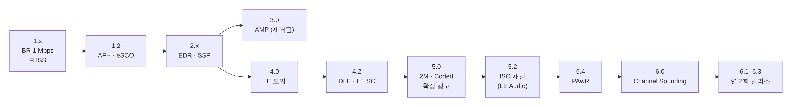

[[TIP("📘 규격 · 버전")]]
Bluetooth Core Specification v1.0(1999) ~ v6.3(2026) · 버전 번호 값: Assigned Numbers 문서의 Core Specification Version 표 · 변경 이력: Core Spec Vol 1 Part C (Core Specification Change History)
6.1(2025)부터 Core 규격이 연 2회 정기 릴리스 체제로 바뀌었습니다.
[[/TIP]]

[TOC]

[[TIP("🟢 한눈에 보기")]]
Bluetooth는 "세대"라기보다 **하나의 규격(Core Specification)이 버전을 올리며 기능을 덧붙여 온 역사**입니다.

1. **1.x–3.x**: 전화기·헤드셋용 Classic(BR/EDR). 속도(EDR)와 페어링 편의성(SSP)을 키운 시기
2. **4.x**: 완전히 새로운 저전력 무선 **Bluetooth Low Energy(LE)** 추가. 센서·웨어러블 시대의 시작
3. **5.x**: LE의 거리(Coded PHY)·속도(2M)·광고 용량(확장 광고), 그리고 LE Audio의 바탕이 된 등시성 채널
4. **6.x**: 정밀 거리 측정(Channel Sounding), 더 짧은 연결 간격 등. 2025년부터 반년마다 작은 버전이 나옵니다

버전은 "이 규격이 정의한 기능 목록"이지 "이 기기가 가진 기능"이 아닙니다. 대부분의 기능이 **선택 사항**이기 때문입니다.
[[/TIP]]

## Core 버전 연대표 (🔵 중급)

| Core | 연도 | 대표 기능 | 비고 |
|---|---|---|---|
| 1.0 / 1.0b | 1999 | 최초 공개 규격. GFSK 1 Mbps, 79채널 주파수 도약 | 상호 운용성 문제가 많았음 |
| 1.1 | 2001 | 1.0의 상호 운용성 문제 수정 | IEEE 802.15.1-2002의 기반 |
| 1.2 | 2003 | **AFH**(적응형 주파수 도약), **eSCO**, 빠른 연결 | 802.15.1-2005의 기반 |
| 2.0 + EDR | 2004 | **EDR** 2/3 Mbps (π/4-DQPSK, 8DPSK) | "+EDR"은 선택 기능 표기 |
| 2.1 + EDR | 2007 | **SSP**(Secure Simple Pairing), **EIR**, Sniff Subrating | PIN 입력 페어링 대체 |
| 3.0 + HS | 2009 | **AMP**: 802.11 무선을 빌려 쓰는 고속 전송 | 거의 쓰이지 않고 5.3에서 규격에서 제거 |
| 4.0 | 2010 | **Bluetooth Low Energy** 도입 (LE PHY, LL, ATT/GATT, SMP) | Classic과 별개의 새 무선 |
| 4.1 | 2013 | LE 역할 동시 수행, LE L2CAP CoC, MWS 공존 신호 | |
| 4.2 | 2014 | LE **Data Length Extension**, **LE Secure Connections**, LE Privacy 1.2 | |
| 5.0 | 2016 | **LE 2M·Coded PHY**, **확장 광고**, 주기적 광고, **CSA #2** | 마케팅 이름도 "Bluetooth 5"로 바뀜 |
| 5.1 | 2019 | 방향 탐지(AoA/AoD, CTE), GATT Caching, 광고 채널 인덱스 무작위화 | |
| 5.2 | 2019 | **LE 등시성 채널**(CIS/BIS), EATT, LE 전력 제어 | LE Audio의 기반 |
| 5.3 | 2021 | 연결 서브레이팅, 주기적 광고 강화(ADI), 채널 분류 강화, 암호 키 길이 제어 | 용어 Central/Peripheral로 정리 |
| 5.4 | 2023 | **PAwR**, 암호화된 광고 데이터, LE GATT Security Levels 특성, 광고 코딩 선택 | 전자 가격표(ESL)용 |
| 6.0 | 2024 | **Channel Sounding**, 결정 기반 광고 필터링, Monitoring Advertisers, ISOAL 강화, LL 확장 기능 집합, 프레임 간격 갱신 | |
| 6.1 | 2025.5 | RPA 갱신 시점 무작위화(Controller가 수행) | 연 2회 릴리스 첫 버전 |
| 6.2 | 2025.11 | **더 짧은 연결 간격**(최소 375 µs), CS 진폭 기반 공격 탐지, HCI USB LE 등시성 지원, LE 시험 모드 강화(UTP) | |
| 6.3 | 2026.5 | CS 인라인 PCT 전달, PHY별 RTT 정확도 보고, HCI 지원 명령·이벤트 마스크 확장, BR/EDR·LE RF 요구 사항 정렬 | |

각 기능의 자세한 내용은 해당 페이지와 **Core 버전별 기능 인덱스**, **Core 6.0–6.3**를 보세요.

## 큰 흐름 세 갈래 (🔵 중급)

| 갈래 | 시기 | 핵심 질문 | 결과 |
|---|---|---|---|
| Classic 고도화 | 1.0–3.0 | 헤드셋·파일 전송을 더 빠르고 쉽게 | EDR 3 Mbps, SSP. 이후 큰 변화는 거의 없음 |
| LE 확장 | 4.0–5.1 | 코인 전지로 몇 년 버티는 센서를 어떻게 | 광고/연결 구조, GATT, 2M·Coded PHY |
| LE 플랫폼화 | 5.2– | 오디오·위치·대규모 기기까지 LE로 | ISO 채널(LE Audio), PAwR(ESL), Channel Sounding |

Classic은 지금도 A2DP 음악 스트리밍과 HFP 통화의 주력이지만, 새 기능은 거의 모두 LE 쪽에 추가되고 있습니다. LE Audio는 Classic 오디오를 LE로 옮기려는 시도입니다(**LE Audio 개요**).

## "Bluetooth 5"가 의미하는 것 (🔵 중급)

제품 상자에 적힌 "Bluetooth 5.3"은 **그 제품이 Core 5.3 규격에 맞춰 인증(Qualification)을 받았다**는 뜻일 뿐, 5.3까지의 모든 기능을 지원한다는 뜻이 아닙니다.

| 오해 | 실제 |
|---|---|
| "Bluetooth 5이면 거리 4배" | Coded PHY는 **선택 기능**. 상대도 지원해야 하고, 실제 거리 이득은 링크 버짓으로 계산해야 합니다 (**무선 전파와 링크 버짓**) |
| "Bluetooth 5이면 속도 2배" | LE 2M PHY도 선택 기능. 처리량은 DLE·연결 간격·호스트 구현에 더 좌우됩니다 |
| "5.2 이상이면 LE Audio 된다" | ISO 채널은 선택 기능이고, LE Audio는 BAP·PACS·LC3 등 별도 프로파일 구현까지 필요합니다 |
| "6.0이면 Channel Sounding 된다" | CS 역시 선택 기능이며 전용 하드웨어(위상 측정)가 필요합니다 |

실제 지원 여부는 Controller가 보고하는 **지원 기능 비트맵**(`HCI_LE_Read_Local_Supported_Features`, 연결 후에는 `LL_FEATURE_REQ`/`LL_FEATURE_RSP` 교환)과 인증 목록의 ICS(구현 적합성 선언)로 확인해야 합니다. SIG도 제품 마케팅에 Core 버전 번호 대신 지원하는 개별 기능을 표기하라고 회원사에 권고합니다.

## 버전 번호 ↔ LMP/LL 버전 값 (🔵 중급)

Controller는 자기가 따르는 Core 버전을 숫자 하나로 보고합니다. 같은 값이 Classic의 **LMP 버전**, LE의 **LL 버전**(`LL_VERSION_IND`), HCI의 **HCI 버전**(`HCI_Read_Local_Version_Information`)에 쓰입니다.

| 값 | Core 버전 | 상태(Assigned Numbers 기준) |
|---|---|---|
| 0x00 | 1.0b | 폐기(Withdrawn) |
| 0x01 | 1.1 | 폐기 |
| 0x02 | 1.2 | 폐기 |
| 0x03 | 2.0 + EDR | 폐기 |
| 0x04 | 2.1 + EDR | 폐기 |
| 0x05 | 3.0 + HS | 폐기 |
| 0x06 | 4.0 | 폐기 |
| 0x07 | 4.1 | 사용 중단 예정(Deprecated) |
| 0x08 | 4.2 | |
| 0x09 | 5.0 | |
| 0x0A | 5.1 | |
| 0x0B | 5.2 | |
| 0x0C | 5.3 | |
| 0x0D | 5.4 | |
| 0x0E | 6.0 | |
| 그 이후 | 6.1, 6.2, 6.3 | 값은 Assigned Numbers 최신판에서 확인 |

[[TIP("🔴 전문가 노트 — 버전 값의 함정, 폐기 정책")]]
**LMP 버전 ≠ 기능.** 버전 값은 "어느 규격 문서로 인증했는가"를 나타낼 뿐입니다. 호스트가 버전 값만 보고 기능을 켜면 안 되고, 반드시 기능 비트(`LE Features`, Classic의 `LMP_features_req`/`LMP_features_req_ext` 페이지)를 확인해야 합니다. 반대로 펌웨어 업데이트로 버전 값이 올라가도 하드웨어 제약 때문에 새 기능 비트가 켜지지 않는 경우가 흔합니다.

**HCI 버전과 LMP 버전이 다를 수 있음.** 2칩 구성에서 호스트 쪽 HCI 계층과 Controller의 LMP/LL 버전이 서로 다른 값을 보고하기도 합니다. `HCI_Read_Local_Version_Information`은 HCI_Version, HCI_Subversion, LMP/PAL_Version, Company_Identifier, LMP/PAL_Subversion을 함께 돌려주므로 로그 분석 때는 다섯 값을 모두 보세요.

**폐기(Withdrawn)와 사용 중단(Deprecated).** SIG는 오래된 Core 버전을 단계적으로 사용 중단 → 폐기합니다. 폐기된 버전으로는 새 제품 인증을 받을 수 없습니다. 이미 시장에 나온 제품이 동작을 멈추는 것은 아니며, 상호 운용성은 하위 호환 규칙으로 유지됩니다.

**6.x 정기 릴리스.** 6.1부터 기능이 완성되는 대로 반년마다 묶어서 내는 방식이 되었습니다. 그래서 6.x의 소수점 버전은 예전 4.1→4.2, 5.0→5.1처럼 "큰 묶음"이 아니라 기능 몇 개 단위입니다.
[[/TIP]]

## 관련 페이지

- **Bluetooth SIG와 규격 체계** — 규격을 만들고 인증하는 조직
- **규격 문서 읽는 법** — Core Spec의 Vol/Part 구조
- **Core 버전별 기능 인덱스** — 기능별 도입 버전 일람
- **Core 6.0–6.3** — 최신 버전 상세
- **Classic vs LE 비교** — 두 무선의 차이
