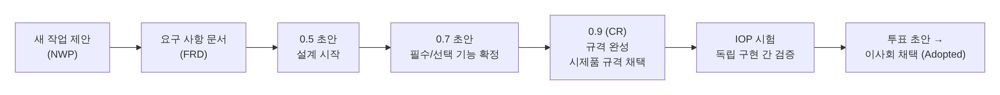

[[TIP("📘 규격 · 버전")]]
Bluetooth SIG 규격 개발 절차(Specification Development Process) · 인증 정책: Qualification Program Reference Document(QPRD) · Core Specification, 프로파일·서비스 규격, Assigned Numbers, Core Specification Supplement(CSS) · IEEE 802.15.1-2002/-2005
1998 SIG 설립 → 2002·2005 IEEE 802.15.1 표준화 → 이후 SIG가 단독 관리 → 2024.7 인증 체계 개편(Design Number) → 2025 Core 연 2회 릴리스
[[/TIP]]

[TOC]

[[TIP("🟢 한눈에 보기")]]
Wi-Fi가 **IEEE(표준)**와 **Wi-Fi Alliance(인증)**로 나뉘어 있다면, Bluetooth는 **Bluetooth SIG 한 곳**이 규격 작성, 번호 배정, 시험 규격, 인증, 상표를 모두 맡습니다.

1. **Core Specification**: 무선부터 L2CAP·ATT·GATT·SMP·GAP까지, 모든 기기가 공유하는 뼈대
2. **프로파일·서비스 규격**: "심박계는 이렇게", "보청기는 이렇게" 같은 응용별 약속
3. **Assigned Numbers**: UUID, 회사 ID, AD Type 같은 번호표
4. **테스트 규격 + 인증**: 규격대로 만들었는지 확인하고 상표(로고) 사용을 허락하는 절차

"Bluetooth" 이름과 로고를 쓰려면 SIG 회원이 되어 제품을 인증해야 합니다.
[[/TIP]]

## Bluetooth SIG (🔵 중급)

**Bluetooth SIG(Special Interest Group)**는 1998년 에릭슨·IBM·인텔·노키아·도시바가 설립한 비영리 단체입니다. 본부는 미국 워싱턴주 커클랜드에 있고, 회원사는 수만 곳에 이릅니다.

| 회원 등급 | 비용 | 할 수 있는 일 |
|---|---|---|
| Adopter | 무료 | 채택된(Adopted) 규격 열람, 제품 인증, 상표 사용 |
| Associate | 연회비 (기업 규모별) | Adopter 권한 + 작업 그룹(WG) 참여, 개발 중인 초안 열람, 인증 비용 할인 |
| Promoter | 초대제 | 이사회(Board of Directors) 의석, 규격 채택 의결 |

Promoter에는 설립사 일부와 Microsoft, Apple, Lenovo 같은 대형 기업이 들어 있습니다(명단은 SIG 웹사이트 기준으로 바뀔 수 있음).

## 규격 문서의 종류 (🔵 중급)

| 문서 | 다루는 것 | 예 |
|---|---|---|
| **Core Specification** | 무선(PHY), Controller(LMP, LL), HCI, Host 기본 프로토콜(L2CAP, SDP, ATT, GATT, SMP, GAP) | Core v6.0 |
| **Core Specification Supplement (CSS)** | 광고 데이터(AD Type) 형식처럼 Core가 참조하는 데이터 정의 | CSS v11, v12 … |
| **프로파일 규격** | 특정 용도에서 역할과 절차, 필요한 서비스 조합 | HFP, A2DP, BAP, HAP, Heart Rate Profile |
| **서비스 규격** | GATT 서비스 하나의 특성(characteristic)과 동작 | Heart Rate Service, Battery Service, PACS |
| **Mesh 규격** | Mesh Protocol, Mesh Model | Mesh Protocol 1.1 |
| **Assigned Numbers** | 16비트 UUID, 회사 식별자(Company ID), AD Type, 외형(Appearance), Core 버전 값 등 | Assigned Numbers 문서 + YAML 저장소 |
| **테스트 규격 (TS)** | 각 규격의 적합성 시험 항목과 절차 | Link Layer TS, GATT TS |
| **ICS / IXIT** | 구현이 지원하는 기능 선언 / 시험에 필요한 구현 정보 | 인증 때 작성 |
| **TCRL** | 어느 시험 케이스가 현재 유효한지 정리한 목록 | 정기 갱신 |

Core는 거의 모든 제품이 따르고, 프로파일·서비스는 제품이 하는 일에 따라 골라 구현합니다. 프로파일과 서비스는 Core와 별도로 각자 버전 번호(예: BAP v1.0.1)를 가집니다.

## 규격이 만들어지는 과정 (🔵 중급)

SIG의 규격 개발 절차는 대략 다음 단계를 거칩니다. 각 단계는 아키텍처 검토 위원회(**BARB**, Bluetooth Architecture Review Board)와 시험·상호 운용 위원회(BTI), 이사회(BoD)의 승인을 받습니다.

| 단계 | 핵심 |
|---|---|
| NWP → FRD | 무엇을 왜 만드는지 합의하고 작업 그룹에 맡김 |
| 0.5 / 0.7 / 0.9 | 설계 → 기능 확정 → 완성. 0.9에서 시제품(Prototyping) 규격으로 채택되고 IP 검토 기간 시작 |
| IOP(상호 운용성) 시험 | 서로 다른 회사의 독립 구현끼리 시험 케이스마다 여러 번 통과해야 함 |
| 최종 채택 | 테스트 규격·TCRL 승인 후 이사회가 채택. **채택 이후에야 제품 인증 가능** |

## 인증(Qualification)과 상표 (🔵 중급)

Bluetooth 이름·로고를 쓰는 모든 제품은 SIG의 **인증(Qualification)** 절차를 거칩니다. 2024년 7월 1일부터 온라인 도구 **Qualification Workspace**와 새 프로그램 문서(QPRD v3)가 적용되었습니다.

| 개념 | 설명 |
|---|---|
| 설계(Design) | 인증 대상이 되는 하드웨어·소프트웨어 조합. 처음 인증되면 **Design Number(DN)**가 발급됨 |
| QDID | 2024.7.1 이전 인증된 설계의 기존 식별자. 지금도 참조용으로 쓰임 |
| 재사용 | 이미 인증된 모듈·스택(설계)을 수정 없이 쓰면 시험 없이 서류만으로 인증 가능 |
| 시험 증빙 | Core 계층을 새로 만들거나 수정했을 때 등에 필요. SIG 시험 도구 **PTS**, 인정 시험소, 자체 시험 결과를 제출 |
| 인증 비용 | 제품(설계)별 행정 수수료. 회원 등급에 따라 다름 |

[[TIP("⚠️ 칩이 인증되었다고 제품이 인증된 것은 아니다")]]
칩 업체의 인증된 Controller와 스택을 써도, 그것을 넣은 **최종 제품**은 별도로 인증(리스팅)해야 Bluetooth 상표를 쓸 수 있습니다. 실무 절차는 **인증 (Qualification)**에서 다룹니다.
[[/TIP]]

## IEEE 802.15.1과의 관계 (🔵 중급)

IEEE 802.15 WPAN 작업 그룹은 Bluetooth를 **802.15.1**로 표준화했습니다. 802.15.1-2002는 Core 1.1을, 802.15.1-2005는 Core 1.2를 바탕으로 했습니다. 그 뒤로 IEEE는 개정을 이어 가지 않았고, EDR·LE를 비롯한 이후 모든 기능은 SIG 규격에만 있습니다.

| 표준 | 관계 |
|---|---|
| IEEE 802.15.1 | Bluetooth 1.1/1.2의 PHY·MAC을 IEEE 문서로 옮긴 것. 현재는 유지되지 않음 |
| IEEE 802.15.2 | WPAN과 WLAN의 공존 권고(Recommended Practice). PTA 같은 공존 기법의 출처 (**Wi-Fi와의 공존**) |
| IEEE 802.15.4 | Zigbee·Thread의 PHY/MAC. Bluetooth와는 별개 기술 |

[[TIP("🔴 전문가 노트 — 정오표·부록, 규격 상태, 번호 신청")]]
**ESR과 CSA.** 예전 Core 버전에는 오류 정정을 모은 **ESR**(Errata Service Release)과 기능을 덧붙인 **CSA**(Core Specification Addendum)가 따로 나왔습니다. 예를 들어 MWS(이동통신) 공존 신호는 CSA로 먼저 나온 뒤 Core 4.1에 흡수되었습니다. 지금은 정정 사항이 새 Core 버전에 합쳐져 나오는 경우가 대부분입니다. 개별 정정(Errata Correction) 중 일부는 "해당 버전 적합성을 주장하려면 필수"로 지정되기도 합니다.

**규격 상태.** 채택된 규격은 Active → Deprecated(사용 중단 예정) → Withdrawn(폐기) 순으로 수명을 다합니다. 폐기된 규격으로는 새 인증을 받을 수 없습니다. 인증 계획을 세울 때 대상 버전이 언제 Deprecated가 되는지 SIG 공지를 확인하세요.

**번호 신청.** 16비트 UUID(회원사용), 회사 식별자(Company Identifier) 같은 값은 SIG에 신청해 배정받습니다. 시험용으로 아무 값이나 쓰면 실제 다른 회사 제품과 충돌할 수 있습니다. 개인 실험에는 128비트 무작위 UUID를 쓰는 것이 원칙입니다.

**마케팅 표기.** SIG는 회원사에 제품 홍보에서 "Core 6.1" 같은 버전 대신 실제 지원 기능을 밝히라고 권고합니다. 버전과 기능의 관계는 **Bluetooth 세대와 Core 버전**을 보세요.
[[/TIP]]

## 관련 페이지

- **Bluetooth 세대와 Core 버전** — 버전별 기능과 버전 값
- **규격 문서 읽는 법** — Core Spec 구조와 원문 구하는 법
- **인증 (Qualification)** — 제품 인증 실무
- **규격 인덱스** — 이 책이 인용하는 규격 목록
- **대표 GATT 서비스** — 서비스 규격의 실제 예
