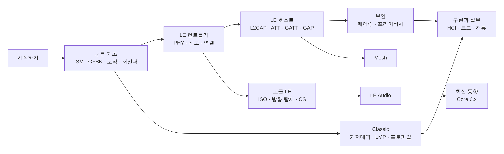

[[TIP("🟢 한눈에 보기")]]
수준과 목적에 따라 읽는 순서를 추천합니다. 각 페이지 안에서도 기초 → 중급 → 전문가 순서로 깊어지므로,
처음에는 🟢 기초 부분(한눈에 보기)만 읽고 넘어가도 됩니다.
[[/TIP]]

## 경로 1 — 처음 공부하는 사람 (🟢 기초)

목표: 스마트폰과 이어폰·센서가 어떻게 서로를 찾고 연결해 데이터를 주고받는지 큰 그림 잡기

1. **Bluetooth 세대와 Core 버전**
2. **2.4 GHz ISM 대역과 규제** → **주파수 도약과 AFH** → **저전력 설계 원리**
3. **Host·Controller·HCI** → **프로토콜 스택 개요**
4. **LE 컨트롤러 개요** → **레거시 광고** → **연결 수립**
5. **GATT** → **LE 페어링과 본딩**
6. **Classic vs LE 비교**

## 경로 2 — 임베디드·앱 개발자 (🔵 중급)

목표: 광고·연결 파라미터를 설계하고, 처리량·전류·연결 문제를 로그로 해석하기

1. 공통 기초 전체 (특히 **무선 전파와 링크 버짓**, **디바이스 주소**)
2. LE 링크 계층: **확장 광고** → **스캔과 필터** → **연결 이벤트와 파라미터** → **데이터 길이 확장**
3. LE 호스트 전체: **ATT** → **GATT** → **GAP** → **광고 데이터 형식** → **처리량 최적화**
4. 보안: **LE 페어링과 본딩** → **프라이버시와 RPA**
5. 실무: **HCI 명령과 이벤트** → **로그 분석** → **저전력 설계와 전류 프로파일**
6. 오디오 제품이라면 **LE Audio 개요**와 **오디오 프로파일 (A2DP·AVRCP·HFP)**

## 경로 3 — 프로토콜·RF 전문가 (🔴 전문가)

목표: 규격 디테일, 버전별 변화, 경계 조건, RF 성능 확인

- 각 페이지의 **전문가 노트**와 **규격 박스**를 레퍼런스로 활용하고, **규격 문서 읽는 법**으로 원문 위치를 찾기
- RF: **디지털 변조** → **LE PHY** → **패킷 구조** → **RF 시험과 안테나**
- 링크 계층: **채널 선택 알고리즘** → **LL 제어 절차** → **등시성 채널**
- 위치: **방향 탐지** → **Channel Sounding** → **Channel Sounding 활용**
- 공존·보안: **Wi-Fi와의 공존**, **알려진 공격과 대응**
- 최신 규격: **Core 6.0–6.3**, **HDT와 상위 대역 확장**, **Core 버전별 기능 인덱스**
