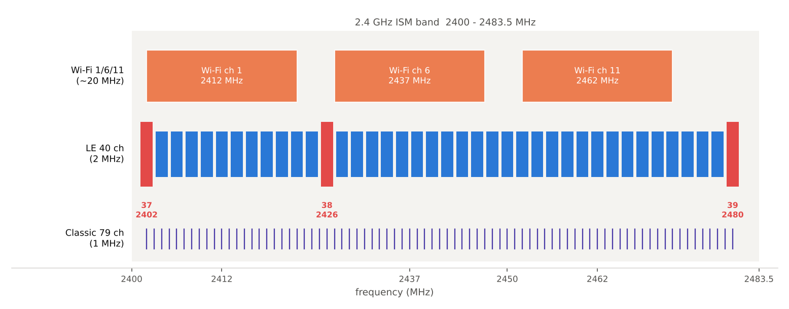

[[TIP("📘 규격 · 버전")]]
Core v6.0 Vol 2 Part A (BR/EDR Radio: 주파수 대역, 출력 클래스) · Vol 6 Part A (LE Radio: 주파수 대역, 출력 클래스) · 국가 규제: 미국 FCC 47 CFR Part 15 §15.247, 유럽 ETSI EN 300 328 (Harmonised Standard), 국가별 전파 규정
Core 1.x: 79채널 FHSS → 4.0 LE 40채널, LE 최대 출력 +10 dBm → 5.0 LE 최대 출력 +20 dBm(Class 1)
[[/TIP]]

[TOC]

[[TIP("🟢 한눈에 보기")]]
Bluetooth는 **2400–2483.5 MHz**의 **ISM(Industrial, Scientific and Medical) 대역**을 씁니다. 이 대역은 전 세계 거의 모든 나라에서 **면허 없이** 쓸 수 있는 몇 안 되는 대역이라, 한 가지 칩으로 어디서나 팔 수 있습니다.

대신 대가가 있습니다.

1. **이웃이 많다**: Wi-Fi, Zigbee/Thread, 무선 마우스, 전자레인지가 모두 같은 대역에 있습니다.
2. **규칙을 지켜야 한다**: 면허는 없지만 나라마다 최대 출력, 대역폭, "남과 나눠 쓰는 방법"에 대한 규정이 있습니다.
3. **보호받지 못한다**: 간섭을 받아도 하소연할 곳이 없으므로, 간섭을 피하는 기술(주파수 도약, AFH)을 스스로 갖춰야 합니다.
[[/TIP]]

## 대역과 채널 배치 (🔵 중급)

*그림. 2.4 GHz ISM 대역 위의 Classic 79채널(1 MHz 간격), LE 40채널(2 MHz 간격, 빨간색이 광고 채널 37/38/39), 그리고 흔히 쓰는 Wi-Fi 1/6/11 채널. LE 광고 채널은 Wi-Fi 1/6/11 사이 틈과 대역 양 끝에 놓여 있습니다.*

| 항목 | Classic (BR/EDR) | LE |
|---|---|---|
| 사용 대역 | 2402–2480 MHz | 2402–2480 MHz |
| 채널 수·간격 | 79개, 1 MHz | 40개, 2 MHz |
| 채널 주파수 | $f = 2402 + k$ MHz, $k = 0..78$ | $f = 2402 + 2k$ MHz (RF 채널 $k = 0..39$) |
| 대역 가장자리 보호 | 아래 2 MHz, 위 3.5 MHz | 동일한 대역 끝 사용 |
| 특별 채널 | 조회·페이징용 32채널 도약 집합 | 광고 채널 37/38/39 = 2402/2426/2480 MHz |

LE의 **채널 인덱스**(링크 계층 번호)는 RF 주파수 순서와 다릅니다. 데이터 채널 0–36은 2404 MHz부터 차례로 붙이되 2426 MHz(광고 채널 38)를 건너뛰고, 광고 채널 37·38·39를 대역 양 끝과 가운데에 따로 둡니다. 자세한 표는 **채널과 송신 전력**에 있습니다.

## 국가별 규제의 틀 (🔵 중급)

규제 문서는 나라마다 다르지만 묻는 것은 비슷합니다. "얼마나 세게(출력)", "얼마나 넓게(대역폭·전력 밀도)", "어떻게 나눠 쓰는가(도약·적응성)"입니다.

| 규제 | 분류 | 핵심 요구 (개념) | Bluetooth와의 관계 |
|---|---|---|---|
| FCC §15.247 (미국) | 주파수 도약(FHSS) | 2.4 GHz에서 도약 채널 15개 이상, 채널당 점유 시간 제한. 도약 채널이 75개 이상이면 최대 전도 출력 1 W, 그보다 적으면 125 mW | Classic이 이 틀로 인증 (AFH로 채널 수가 줄어도 15개 이상 유지) |
| FCC §15.247 (미국) | 디지털 변조(DTS) | 6 dB 대역폭 500 kHz 이상, 최대 전도 출력 1 W, 전력 스펙트럼 밀도 상한 | LE는 보통 이 틀로 인증 |
| ETSI EN 300 328 (유럽) | FHSS / 기타 광대역 변조 | 최대 EIRP 100 mW(20 dBm), 일정 출력 이상은 **적응성**(간섭을 감지해 피하기) 요구, 비적응형은 매체 점유율 제한, 수신기 차단 성능 | Classic의 AFH, LE의 채널 맵이 적응성 요구를 충족하는 수단 |
| 기타 국가 | 각국 전파법 | 대체로 FCC 또는 ETSI 틀을 참조 | 출시 국가마다 인증 필요 |

[[TIP("📝 규제 수치는 원문으로 확인")]]
위 표는 개념을 보이기 위한 요약입니다. 규정은 개정되고 국가마다 세부(EIRP 대 전도 출력, 측정 방법)가 다르므로, 제품 설계 시에는 해당 규정의 최신판과 시험소 의견을 확인하세요.
[[/TIP]]

## 출력 클래스 (🔵 중급)

규격은 최대 송신 출력에 따라 **출력 클래스(Power Class)**를 정의합니다. 값은 안테나 입력 기준 최대 출력입니다.

| 클래스 | Classic 최대 출력 | LE 최대 출력 | 대략적 용도 |
|---|---|---|---|
| Class 1 | 100 mW (+20 dBm) | 100 mW (+20 dBm) | 산업용, 장거리 동글 |
| Class 1.5 | — | 10 mW (+10 dBm) | LE 장거리 센서 (LE 전용 클래스) |
| Class 2 | 2.5 mW (+4 dBm) | 2.5 mW (+4 dBm) | 스마트폰, 이어폰 |
| Class 3 | 1 mW (0 dBm) | 1 mW (0 dBm) | 초소형 기기 |

LE의 최대 출력은 4.x까지 +10 dBm이었고 5.0에서 +20 dBm으로 늘었습니다. 출력을 높이면 도달 거리가 늘지만 전류도 늘고, 규제 한도(특히 EIRP 기준인 유럽)에 걸릴 수 있습니다. Classic Class 1은 전력 제어(power control)를 지원해 필요 이상으로 세게 보내지 않아야 합니다.

## 이웃 기술 (🔵 중급)

| 이웃 | 대역 점유 | Bluetooth에 미치는 영향 |
|---|---|---|
| Wi-Fi (802.11b/g/n/ax) | 채널당 약 20 MHz(40 MHz도 가능), 5 MHz 간격 채널 번호. 흔히 1/6/11 사용 | 가장 큰 간섭원. Bluetooth 채널 20개 이상을 한꺼번에 덮음 (**Wi-Fi와의 공존**) |
| IEEE 802.15.4 (Zigbee, Thread) | 채널 11–26, 5 MHz 간격, 약 2 MHz 폭, 250 kbps | 폭이 Bluetooth와 비슷해 서로 일부 채널만 겹침. 같은 콤보 칩에 들어가는 경우가 많음 (**Matter·Thread와 Bluetooth**) |
| 전자레인지 | 약 2.45 GHz 부근, 넓고 불규칙한 스펙트럼 | 마그네트론이 전원 주기(50/60 Hz)에 맞춰 켜졌다 꺼져, 수 ms 단위로 주기적 버스트 간섭 |
| 독자 규격 2.4 GHz 기기 | 무선 마우스·키보드, 게임 패드, 영상 송신기 등 | 고정 채널을 쓰는 기기는 특정 채널을 계속 막음 |

[[TIP("🔴 전문가 노트 — 대역 가장자리, 규제와 PHY 선택")]]
**대역 끝 채널.** 광고 채널 39(2480 MHz)와 Classic 채널 78(2480 MHz)은 대역 끝(2483.5 MHz)에 가까워 대역 밖 불요 방사(band-edge emission) 규제를 맞추기 가장 어렵습니다. 미국에서는 2483.5 MHz 위에 보호가 필요한 대역(제한 대역)이 있어, 고출력 제품은 높은 채널에서만 출력을 낮추는 **채널별 출력 백오프**를 쓰기도 합니다.

**LE 2M·Coded와 규제.** 2M PHY는 스펙트럼이 넓어 대역 끝 마진이 줄고, Coded PHY는 같은 패킷이 더 오래 공중에 머물러 매체 점유율(유럽 비적응형 장비 제한)이나 채널 점유 시간 계산에 영향을 줍니다. PHY를 추가할 때는 인증 시험을 다시 해야 할 수 있습니다.

**"적응성" 요구와 Bluetooth.** 유럽 규정은 일정 출력 이상 장비에 간섭 회피를 요구합니다. Classic은 AFH(최소 20채널 사용)를, LE는 Central이 관리하는 채널 맵(최소 2채널)을 근거로 적응형 장비로 분류할 수 있지만, 실제 판정은 규정의 시험 절차로 결정됩니다.
[[/TIP]]

## Classic ↔ LE 비교

| 항목 | Classic (BR/EDR) | LE |
|---|---|---|
| 채널 | 79 × 1 MHz | 40 × 2 MHz |
| 대표 규제 틀 (미국) | FHSS | DTS (디지털 변조) |
| 최대 출력 클래스 | +20 dBm (Class 1) | +20 dBm (Class 1, 5.0부터) |
| 간섭 회피 | AFH (1.2부터) | 채널 맵 + 채널 선택 알고리즘 |

## 관련 페이지

- **주파수 도약과 AFH** — 대역을 나눠 쓰는 방법
- **Wi-Fi와의 공존** — 가장 큰 이웃과 지내는 법
- **채널과 송신 전력** — LE 채널 인덱스 표와 출력 설정
- **RF 시험과 안테나** — 규제·규격 RF 시험
- **Bluetooth vs Wi-Fi vs 5G** — 세 기술 비교
