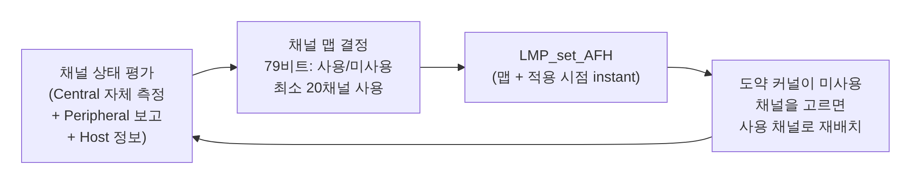

[[TIP("📘 규격 · 버전")]]
Core v6.0 Vol 2 Part B (Baseband: 도약 선택, AFH 채널 재배치) · Vol 2 Part C (LMP: `LMP_set_AFH`, 채널 분류 보고) · Vol 6 Part B (Link Layer: 채널 선택 알고리즘 #1·#2, `LL_CHANNEL_MAP_IND`) · Vol 4 Part E (`HCI_Set_AFH_Host_Channel_Classification`, `HCI_LE_Set_Host_Channel_Classification`)
1.0 FHSS 79채널 → 1.2 AFH → 4.0 LE CSA #1 → 5.0 CSA #2 → 5.3 LE 채널 분류 보고
[[/TIP]]

[TOC]

[[TIP("🟢 한눈에 보기")]]
Bluetooth는 한 채널에 머물지 않고 **약속된 순서로 채널을 계속 바꿉니다**. 이를 **주파수 도약(FHSS, Frequency Hopping Spread Spectrum)**이라고 합니다.

- 어떤 채널에 간섭이 있어도 **잠깐만** 당하고 다음 채널로 넘어갑니다.
- 도약 순서는 두 기기만 아는 값(주소, 클럭, 액세스 주소)으로 정해지므로, 같은 공간의 여러 연결이 서로 다른 순서로 뛰어 충돌이 드뭅니다.

문제는 Wi-Fi처럼 **채널 20개 이상을 계속 차지하는 이웃**입니다. 그래서 1.2에서 **AFH(Adaptive Frequency Hopping)**를 도입해 "나쁜 채널은 아예 도약 목록에서 빼고" 좋은 채널만 쓰게 했습니다. LE는 처음부터 채널 맵으로 같은 일을 합니다.
[[/TIP]]

## Classic의 도약 (🔵 중급)

| 항목 | 값 |
|---|---|
| 채널 | 79개 (2402–2480 MHz, 1 MHz) |
| 슬롯 | 625 µs. Central은 짝수 슬롯, Peripheral은 홀수 슬롯에서 송신 시작 |
| 도약 속도 | 연결 상태에서 슬롯마다 → **초당 1600 홉** (1슬롯 패킷 기준) |
| 다중 슬롯 패킷 | 3·5슬롯 패킷은 끝날 때까지 같은 주파수 유지 → 실제 도약 속도는 그만큼 낮아짐 |
| 도약 순서 결정 | Central의 주소(UAP·LAP)와 Central 클럭(CLK)을 입력으로 하는 도약 선택 커널 |
| 조회·페이징 | 32채널짜리 별도 도약 집합을 더 빠르게 훑음 (**조회와 페이징**) |

피코넷의 모든 기기가 Central의 클럭과 주소를 알기 때문에, 각자 독립적으로 계산해도 같은 순간에 같은 채널에 있게 됩니다. 다른 Central이 만든 피코넷은 다른 순서로 도약하므로 가끔만 같은 채널에서 겹칩니다.

## AFH (1.2) (🔵 중급)

| 구성 요소 | 역할 |
|---|---|
| 채널 평가 | Central이 패킷 오류율·RSSI 등으로 판단(방법은 구현 자유). Peripheral은 `LMP_channel_classification`으로 자기 판단을 보고 |
| Host 정보 | 같은 기기의 Wi-Fi가 쓰는 채널을 Host가 `HCI_Set_AFH_Host_Channel_Classification`으로 알려 줌 |
| 채널 맵 전달 | `LMP_set_AFH`로 79비트 맵과 적용 시점(instant)을 알림. 그 시점부터 양쪽이 동시에 새 맵 사용 |
| 재배치 | 원래 도약 순서가 미사용 채널을 가리키면 사용 채널 목록 중 하나로 바꿈 → 도약 순서의 무작위성은 유지 |
| 최소 채널 수 $N\_{min}$ | 20. 이보다 적게 줄일 수 없음 (규제의 도약 채널 수 요구와도 관계) |

Wi-Fi 채널 하나(약 20 MHz)는 Classic 채널 약 20개를 덮습니다. Wi-Fi가 1/6/11을 모두 쓰면 79채널 중 상당 부분이 나빠지므로, AFH가 남은 틈의 채널로 몰아서 씁니다.

## LE의 채널 선택 (🔵 중급)

LE는 패킷마다가 아니라 **연결 이벤트마다** 채널을 바꿉니다. 한 연결 이벤트 안의 패킷들은 같은 채널을 씁니다.

| 항목 | 채널 선택 알고리즘 #1 (4.0) | 채널 선택 알고리즘 #2 (5.0) |
|---|---|---|
| 방식 | 이전 채널 + hopIncrement(5–16) mod 37 | 연결 이벤트 카운터와 액세스 주소로 만든 의사 난수 |
| 패턴 | 일정한 간격으로 도는 단순 순서 | 불규칙한 순서 |
| 미사용 채널 처리 | 사용 채널 목록으로 재배치 | 사용 채널 목록으로 재배치 |
| 용도 | 레거시 연결 | 연결(둘 다 지원 시), 주기적 광고, ISO 채널 |

| 항목 | 값·이름 |
|---|---|
| 채널 맵 | 데이터 채널 37개에 대한 37비트 맵, 최소 **2채널** 사용 |
| 맵 갱신 | Central이 `LL_CHANNEL_MAP_IND`(맵 + instant) 전송 |
| Host 정보 | `HCI_LE_Set_Host_Channel_Classification` |
| Peripheral 보고 (5.3) | `LL_CHANNEL_REPORTING_IND`로 보고 설정, `LL_CHANNEL_STATUS_IND`로 채널 상태 보고 |
| 광고 | 도약 없이 37/38/39를 차례로 사용. 5.1부터 순서 무작위화 가능 |

자세한 계산식은 **채널 선택 알고리즘**에서 다룹니다.

[[TIP("🔴 전문가 노트 — 같은 채널 응답, 맵 갱신 시점, 맵이 좁을 때")]]
**AFH의 같은 채널 응답.** AFH가 켜진 연결에서 Peripheral은 바로 앞 Central 패킷과 **같은 주파수**로 응답합니다. 재배치 후 응답 채널이 다시 미사용 채널로 떨어지는 문제를 피하기 위한 규칙입니다.

**instant 처리.** 맵 갱신은 미래의 특정 시점(Classic은 클럭 값, LE는 연결 이벤트 카운터)에 양쪽이 동시에 적용합니다. Peripheral이 그 시점 전까지 갱신 PDU를 못 받으면 서로 다른 맵으로 도약하다 링크가 끊어지므로, LE에서는 instant가 이미 지난 갱신을 받으면 연결을 끊도록 되어 있습니다. instant를 너무 가깝게 잡는 구현은 잡음이 많은 환경에서 연결 끊김을 늘립니다.

**맵이 좁을 때의 역효과.** 채널을 너무 많이 빼면 남은 채널에 트래픽이 몰리고, 같은 공간의 다른 Bluetooth 링크와 충돌이 늘며, 새로 나타난 간섭에 대한 여유도 사라집니다. 실무 구현은 나쁜 채널을 빼더라도 주기적으로 다시 시험해 복귀시키는 히스테리시스를 둡니다.

**광고 채널은 AFH 대상이 아님.** LE 광고 채널 37/38/39는 고정이라 채널 맵으로 뺄 수 없습니다. 이 세 채널이 Wi-Fi 1/6/11 틈과 대역 끝에 놓인 이유입니다. 확장 광고는 보조 광고 채널(데이터 채널 0–36)로 대부분의 데이터를 옮겨 이 문제를 줄였습니다.
[[/TIP]]

## Classic ↔ LE 비교

| 항목 | Classic (BR/EDR) | LE |
|---|---|---|
| 도약 단위 | 슬롯(625 µs)마다 | 연결 이벤트마다 |
| 도약 순서 입력 | Central 주소 + 클럭 | hopIncrement(CSA #1) 또는 액세스 주소 + 이벤트 카운터(CSA #2) |
| 적응형 도약 | AFH (1.2부터) | 처음부터 채널 맵 |
| 최소 사용 채널 | 20 | 2 |
| 맵 갱신 메시지 | `LMP_set_AFH` | `LL_CHANNEL_MAP_IND` |

## 관련 페이지

- **채널 선택 알고리즘** — CSA #1·#2 계산 과정
- **피코넷과 기저대역** — 슬롯과 클럭
- **Wi-Fi와의 공존** — 채널 분류와 콤보 칩 협조
- **LL 제어 절차** — 채널 맵 갱신 절차
- **2.4 GHz ISM 대역과 규제** — 도약 채널 수 규제
