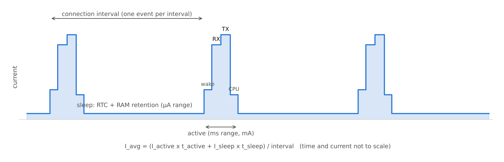

[[TIP("📘 규격 · 버전")]]
Core v6.0 Vol 6 Part B (Link Layer: 연결 이벤트, Peripheral latency, 수면 클럭 정확도, 윈도 확장) · Vol 2 Part B (Baseband: Sniff, Sniff Subrating) · Vol 4 Part E (`HCI_LE_Connection_Update`, `HCI_Sniff_Mode`)
2.1 Sniff Subrating → 4.0 LE 연결 이벤트 기반 동작 → 5.3 연결 서브레이팅 → 6.2 더 짧은 연결 간격(저지연 쪽 확장)
[[/TIP]]

[TOC]

[[TIP("🟢 한눈에 보기")]]
저전력의 비결은 "적게 쓰는 회로"보다 **"거의 항상 자고 있는 것"**입니다.

1. 무선부가 켜져 있으면 수 mA, 자고 있으면 수 µA — **1000배** 차이입니다.
2. 그래서 LE 기기는 정해진 시각에만 잠깐(수 ms) 깨어 통신하고, 나머지 99 % 이상의 시간은 잠듭니다. 이 비율이 **듀티 사이클**입니다.
3. 다음에 언제 깨어날지는 두 기기가 미리 약속합니다(연결 간격). 그래서 상대를 기다리며 수신기를 켜 둘 필요가 없습니다.
4. 약속 시각을 지키는 데 쓰는 **저속 수면 클럭**이 부정확할수록, 조금 일찍 깨어 기다려야 합니다(윈도 확장).
[[/TIP]]

## 듀티 사이클과 이벤트 기반 동작 (🔵 중급)

*그림. LE 연결의 전류 프로파일(개념도). 연결 간격마다 깨어나 수신·송신하고 바로 수면으로 돌아갑니다. 평균 전류는 짧은 활성 구간의 전하량과 긴 수면 구간의 누설 전류를 합해 간격으로 나눈 값입니다.*

| 동작 | 깨어나는 시점 | 저전력 조절 손잡이 |
|---|---|---|
| LE 광고 | 광고 간격마다 (+ 0–10 ms 무작위 지연 advDelay) | 광고 간격 20 ms–10.24 s, 광고 데이터 길이, 채널 수 |
| LE 스캔 | 스캔 간격마다 스캔 윈도 동안 수신 | 윈도/간격 비율(수신 듀티) |
| LE 연결 | 연결 간격마다 연결 이벤트 | 연결 간격, Peripheral latency, 서브레이팅 |
| Classic Sniff | Sniff 간격마다 정해진 슬롯 | Sniff 간격, Sniff 시도 수, Sniff Subrating |

**Peripheral latency**는 Peripheral이 보낼 데이터가 없을 때 연결 이벤트를 최대 N번 건너뛰게 해 줍니다. Central은 매 이벤트마다 깨어 있지만, 배터리가 작은 Peripheral만 덜 깨어납니다. 데이터가 생기면 바로 다음 이벤트에 보낼 수 있어 응답성도 유지됩니다.

## 수면 클럭 정확도(SCA)와 윈도 확장 (🔵 중급)

자는 동안에는 전력을 거의 쓰지 않는 32.768 kHz 저속 클럭으로 시간을 잽니다. 이 클럭에는 오차가 있으므로, 수신 측은 예상 시각보다 **조금 일찍 깨어 조금 더 오래** 듣습니다. 이 여유가 **윈도 확장(window widening)**입니다.

$$
\text{windowWidening} = \frac{SCA\_{Central} + SCA\_{Peripheral}}{10^6} \times \text{timeSinceLastAnchor}
$$

| 항목 | 값 |
|---|---|
| LE 수면 클럭 정확도 요구 | ±500 ppm 이내 |
| LE 활성 클럭 정확도 요구 | ±50 ppm 이내 |
| SCA 표현 | 3비트 값 0–7 (0 = 251–500 ppm … 7 = 0–20 ppm), 연결 요청 PDU 등에 실림 |

예: 양쪽 SCA 합이 100 ppm이고 마지막 앵커 이후 1 s가 지났다면 윈도 확장은 $100\times10^{-6}\times 1\,\text{s} = 100\,\mu\text{s}$입니다. Peripheral latency로 4번 건너뛰어 5 s가 지났다면 500 µs가 되어, 그만큼 수신기를 더 켜 둬야 합니다. 정확한 수정 발진기(±20 ppm)를 쓰면 이 낭비가 줄어듭니다. 앵커 포인트와 타이밍 상세는 **연결 이벤트와 파라미터**에서 다룹니다.

## 평균 전류 계산 예 (🔵 중급)

$$
I\_{avg} = \frac{I\_{active}\,t\_{active} + I\_{sleep}\,t\_{sleep}}{T\_{interval}}
$$

가정: 연결 이벤트당 활성 시간 3 ms(깨어남·수신·송신·처리 포함) 동안 평균 5 mA, 수면 전류 2 µA, 배터리 CR2032 공칭 220 mAh(자기 방전·전압 강하 무시).

| 연결 간격 | 계산 | 평균 전류 | 배터리 수명(단순 계산) |
|---|---|---|---|
| 1 s | (3 ms × 5 mA + 997 ms × 0.002 mA) / 1000 ms | 약 17.0 µA | 약 12,900 h ≈ 1.5년 |
| 100 ms | (3 ms × 5 mA + 97 ms × 0.002 mA) / 100 ms | 약 152 µA | 약 1,450 h ≈ 60일 |

연결 간격 하나로 수명이 9배 가까이 바뀝니다. 실제 설계에서는 활성 구간의 전하량(µC)을 전류 측정으로 구해 쓰는데, 깨어나는 과정의 고속 발진기 안정화 시간이나 CPU 처리 시간이 무선 송수신보다 클 때도 많습니다(**저전력 설계와 전류 프로파일**).

[[TIP("🔴 전문가 노트 — 저전력을 해치는 흔한 원인")]]
**보낼 것이 없어도 빈 패킷.** LE 연결 이벤트에서 Central은 데이터가 없어도 빈 PDU를 보내고 Peripheral은 응답해야 합니다(latency로 건너뛰지 않는 한). 연결을 유지하는 최소 비용입니다.

**MD 비트와 이벤트 연장.** More Data(MD) 비트가 설정되면 연결 이벤트가 길어집니다. 대용량 전송 중에는 처리량에 유리하지만, 펌웨어가 불필요하게 MD를 세우면 매 이벤트가 길어져 전류가 늘어납니다.

**SCA를 과대 보고.** 정확도를 보수적으로(큰 ppm) 보고하면 상대가 윈도를 넓혀 전류가 늘고, 반대로 실제보다 작게 보고하면 패킷을 놓쳐 연결이 끊깁니다. 실제 발진기의 온도 특성까지 포함해 보고해야 합니다.

**연결 파라미터 협상.** 스마트폰 OS는 Peripheral이 요청한 연결 간격을 그대로 받아 주지 않을 수 있습니다. `L2CAP_CONNECTION_PARAMETER_UPDATE_REQ`나 `LL_CONNECTION_PARAM_REQ`로 요청하더라도 결과는 Central이 정합니다. 5.3의 **연결 서브레이팅**은 연결 간격 재설정 없이 "평소엔 드물게, 필요할 때만 자주" 깨어나는 전환을 빠르게 해 줍니다.

**Classic의 수면.** Classic은 Sniff 모드가 주력 저전력 수단이고, 2.1의 Sniff Subrating이 HID처럼 간헐적 트래픽에서 Sniff 간격을 늘려 줍니다. 그래도 Classic은 페이지 스캔·조회 스캔을 유지해야 하는 경우가 많아 LE보다 대기 전류가 큽니다.
[[/TIP]]

## Classic ↔ LE 비교

| 항목 | Classic (BR/EDR) | LE |
|---|---|---|
| 기본 상태 | 연결 중엔 기본적으로 활성, Sniff로 절전 | 처음부터 이벤트 기반 (연결 간격) |
| 절전 손잡이 | Sniff 간격, Sniff Subrating | 연결 간격, Peripheral latency, 서브레이팅 |
| 연결 없이 발견되기 | 조회 스캔·페이지 스캔 수신 | 광고 송신 (짧은 송신만) |
| 대표 대기 전류 | 수백 µA 수준까지 | 수 µA–수십 µA 수준 |

대표 전류는 칩과 설정에 따라 크게 다르므로 감을 잡는 용도로만 보세요.

## 관련 페이지

- **연결 이벤트와 파라미터** — 앵커 포인트, 연결 간격, latency, 감독 타임아웃
- **저전력 설계와 전류 프로파일** — 측정과 최적화 실무
- **레거시 광고** — 광고 간격과 advDelay
- **스캔과 필터** — 스캔 듀티와 필터
- **피코넷과 기저대역** — Classic Sniff
