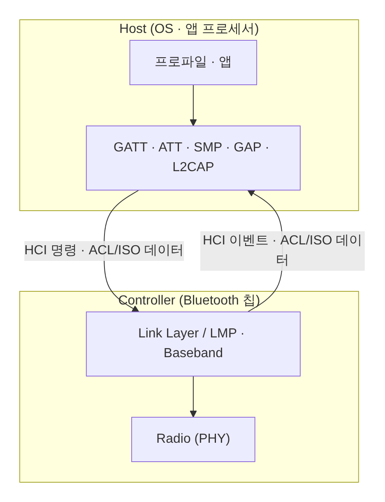

[[TIP("📘 규격 · 버전")]]
Core v6.0 Vol 1 Part A (Architecture: Host/Controller 구성, Core Configurations) · Vol 4 Part A–D (HCI 전송 계층: UART, USB, SD, Three-wire UART) · Vol 4 Part E (HCI 기능 규격: 명령·이벤트·데이터 패킷)
1.0 HCI 정의 → 4.0 LE 명령(OGF 0x08) 추가 → 5.2 ISO 데이터 패킷 → 6.2 HCI USB LE 등시성 지원(Bulk Serialization Mode)
[[/TIP]]

[TOC]

[[TIP("🟢 한눈에 보기")]]
Bluetooth 스택은 두 덩어리로 나뉩니다.

- **Controller**: 시간에 민감한 일. 무선 송수신, 주파수 도약, µs 단위 타이밍, 재전송. 보통 Bluetooth 칩 안의 펌웨어
- **Host**: 시간에 덜 민감하고 복잡한 일. 연결 관리, 보안 키, GATT 데이터베이스, 프로파일. 보통 운영체제(Android, Linux, iOS) 안의 소프트웨어

둘 사이의 약속이 **HCI(Host Controller Interface)**입니다. Host는 HCI **명령**으로 일을 시키고, Controller는 HCI **이벤트**로 결과를 알리며, 데이터는 HCI **데이터 패킷**으로 오갑니다. 덕분에 Qualcomm 칩에 Linux BlueZ를, Broadcom 칩에 Android 스택을 얹는 식의 조합이 가능합니다.
[[/TIP]]

## 왜 둘로 나누나 (🔵 중급)

| 관점 | Host | Controller |
|---|---|---|
| 시간 요구 | ms 단위, 운영체제 스케줄링 허용 | µs 단위, 실시간 |
| 상태 | 본딩 키, GATT DB, 사용자 설정 (영구 저장) | 현재 연결의 타이밍·채널·암호화 상태 |
| 갱신 | OS 업데이트로 자주 | 칩 펌웨어로 드물게 |
| 인증 단위 | Host 서브시스템으로 따로 인증 가능 | Controller 서브시스템으로 따로 인증 가능 |

## HCI 패킷 (🔵 중급)

| 패킷 | 방향 | 내용 | UART(H4) 표시 바이트 |
|---|---|---|---|
| Command | Host → Controller | OpCode(OGF + OCF) + 파라미터 | 0x01 |
| ACL Data | 양방향 | 연결 핸들 + L2CAP 데이터 | 0x02 |
| Synchronous Data | 양방향 | SCO/eSCO 음성 | 0x03 |
| Event | Controller → Host | 이벤트 코드 + 파라미터 (LE 이벤트는 0x3E 아래 하위 코드) | 0x04 |
| ISO Data (5.2) | 양방향 | CIS/BIS 등시성 데이터 | 0x05 |

명령에 대한 응답은 `HCI_Command_Complete`(바로 끝나는 명령)이나 `HCI_Command_Status`(접수만 알리고 결과는 나중 이벤트로) 중 하나로 옵니다. Host는 Controller가 알려 준 **버퍼 수만큼만** 데이터를 보내고, `HCI_Number_Of_Completed_Packets` 이벤트로 버퍼가 비었다는 알림을 받으며 흐름을 제어합니다.

## 단일 칩, 2칩, 듀얼 모드 (🔵 중급)

| 구성 | 예 | HCI는 어디에 |
|---|---|---|
| **2칩** (Host 칩 + Controller 칩) | 스마트폰·PC: 앱 프로세서 + Wi-Fi/Bluetooth 콤보 칩, USB 동글 | 물리 버스(UART, USB, SDIO, PCIe 기반 독자 전송 등) |
| **단일 칩 SoC** | 센서·웨어러블용 Bluetooth LE MCU | 칩 안의 함수 호출·공유 메모리. 표준 HCI 형식을 안 쓰는 경우도 많음 |
| **Controller 전용 + 외부 Host** | 단일 칩 SoC를 HCI 펌웨어로 돌려 외부 MCU/PC가 Host 역할 | UART H4/H5 |

**듀얼 모드**는 한 Controller가 BR/EDR과 LE를 모두 지원하는 구성입니다(스마트폰, PC, 차량). 하나의 무선부를 시간으로 나눠 Classic 링크와 LE 링크를 함께 돌리고, Host는 공통 L2CAP·보안 계층 위에서 둘을 모두 다룹니다. 반대로 **LE 전용** 기기(센서, 태그)는 Classic 부분이 아예 없어 칩이 작고 쌉니다.

## HCI 전송 계층 (🔵 중급)

| 전송 | 규격 위치 | 특징 |
|---|---|---|
| UART (**H4**) | Vol 4 (UART Transport) | 패킷 앞에 1바이트 표시만 붙이는 가장 단순한 방식. 하드웨어 흐름 제어(RTS/CTS) 필요. 오류 복구 없음 |
| Three-wire UART (**H5**) | Vol 4 (Three-wire UART Transport) | SLIP 방식 프레이밍, 순서 번호·확인 응답으로 오류 복구, 흐름 제어선 없이 TX/RX/GND 3선, 저전력 절차 포함 |
| **USB** | Vol 4 (USB Transport) | 명령은 컨트롤 엔드포인트, 이벤트는 인터럽트, ACL은 벌크, SCO는 등시성 엔드포인트. 6.2에서 모든 패킷을 벌크로 직렬화하는 모드 추가 |
| **SD** (SDIO) | Vol 4 (SD Transport) | SD 카드 인터페이스. 휴대 기기 콤보 칩에서 사용 |

[[TIP("🔴 전문가 노트 — HCI 실무 함정")]]
**H4의 동기 상실.** H4에는 프레임 경계 복구 수단이 없어, 바이트 하나만 잃어도 이후 모든 패킷 해석이 어긋납니다. 흐름 제어선을 생략하거나 baud rate 오차가 크면 간헐적 "알 수 없는 이벤트" 오류가 납니다. 신뢰성이 중요하면 H5를 고려하세요.

**벤더 명령.** OGF 0x3F는 벤더 전용 명령입니다. 펌웨어 패치 다운로드, BD_ADDR 설정, 출력 조정, Wi-Fi 공존 설정 같은 실무 필수 기능이 대부분 여기에 있어, 같은 HCI라도 칩마다 초기화 절차가 다릅니다.

**USB의 순서 문제.** USB 전송에서 이벤트(인터럽트 엔드포인트)와 ACL 데이터(벌크 엔드포인트)는 서로 다른 파이프라 도착 순서가 뒤바뀔 수 있습니다. 예를 들어 연결 완료 이벤트보다 그 연결의 첫 ACL 데이터가 먼저 도착하는 경쟁 상태가 생깁니다. 6.2의 Bulk Serialization Mode는 모든 패킷을 하나의 벌크 파이프로 보내 이런 경쟁을 없애고 ISO 데이터도 실을 수 있게 했습니다.

**로그는 HCI에서 뜬다.** btsnoop/btmon 로그는 HCI 경계를 기록한 것입니다. 무선 구간에서 실제로 무슨 일이 있었는지(재전송, 채널, 타이밍)는 보이지 않으므로, 그 아래는 **무선 스니퍼**가 필요합니다.
[[/TIP]]

## Classic ↔ LE 비교

| 항목 | Classic (BR/EDR) | LE |
|---|---|---|
| Controller 내부 | Radio · Baseband · LMP | PHY · Link Layer (LMP 없음) |
| HCI 명령 그룹 | Link Control / Link Policy / Controller & Baseband 등 | LE Controller 명령 (OGF 0x08) |
| HCI 이벤트 | 개별 이벤트 코드 | 대부분 LE Meta Event(0x3E)의 하위 이벤트 |
| 데이터 패킷 | ACL, SCO/eSCO | ACL, ISO |

## 관련 페이지

- **프로토콜 스택 개요** — Host와 Controller 안의 계층
- **HCI 명령과 이벤트** — 자주 쓰는 명령·이벤트 일람
- **로그 분석 (btmon·btsnoop·Wireshark)** — HCI 로그 읽기
- **호스트 스택 비교** — BlueZ, Android, Zephyr 등
- **규격 문서 읽는 법** — Vol 4 구조
