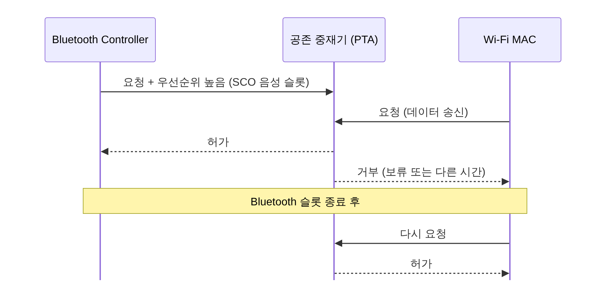

[[TIP("📘 규격 · 버전")]]
Core v6.0 Vol 2 Part B (AFH) · Vol 6 Part B (LE 채널 맵, 채널 분류 보고) · Vol 7 Part A–C (MWS 공존 논리 신호, WCI-1·WCI-2 전송) · Vol 4 Part E (`HCI_Set_AFH_Host_Channel_Classification`, `HCI_LE_Set_Host_Channel_Classification`, MWS 관련 HCI 명령) · IEEE 802.15.2-2003 (WPAN·WLAN 공존 권고, PTA)
1.2 AFH → 4.1 MWS(셀룰러) 공존 신호 → 5.3 LE 채널 분류 보고 강화
[[/TIP]]

[TOC]

[[TIP("🟢 한눈에 보기")]]
Bluetooth와 2.4 GHz Wi-Fi는 같은 대역을 씁니다. 공존 문제는 두 가지 상황으로 나뉩니다.

1. **다른 기기의 Wi-Fi** (옆집 공유기): 전파로만 만납니다. Bluetooth가 **AFH·채널 맵**으로 그 채널을 피합니다.
2. **같은 기기 안의 Wi-Fi** (스마트폰의 콤보 칩): 안테나가 몇 cm 거리라 한쪽이 송신하면 다른 쪽 수신기가 귀가 멉니다. 채널을 피하는 것만으로 부족해 **누가 언제 쓸지 시간으로 나눠야** 합니다.

두 번째가 훨씬 어렵고, "Wi-Fi를 켜면 이어폰 소리가 끊긴다"는 증상의 대부분이 여기서 나옵니다.
[[/TIP]]

## 주파수로 피하기: AFH와 채널 분류 (🔵 중급)

*그림. Wi-Fi 20 MHz 채널 하나는 Classic 채널 약 20개, LE 데이터 채널 약 10개를 덮습니다. LE 광고 채널 37/38/39는 Wi-Fi 1/6/11의 틈과 대역 끝에 놓여 있습니다.*

| 정보원 | 방법 | 장단점 |
|---|---|---|
| Controller 자체 측정 | 채널별 패킷 오류율, 수신 에너지(RSSI) 관측 | 실제 링크 품질 반영. 측정에 시간이 걸림 |
| 상대 기기 보고 | Classic `LMP_channel_classification`, LE(5.3) `LL_CHANNEL_STATUS_IND` | 상대 위치의 간섭까지 반영 |
| Host 정보 | 같은 기기의 Wi-Fi 채널을 `HCI_Set_AFH_Host_Channel_Classification` / `HCI_LE_Set_Host_Channel_Classification`으로 전달 | 즉시 반영. 콤보 칩에서는 칩 내부에서 직접 공유하기도 함 |

Wi-Fi가 채널 6(2427–2447 MHz 근처)에 있다면 Classic 채널 약 25–45번, LE 데이터 채널 약 11–19번 근처를 빼는 식입니다. 최소 채널 수(Classic 20, LE 2)는 지켜야 합니다. 상세 동작은 **주파수 도약과 AFH**에 있습니다.

## 시간으로 나누기: PTA와 콤보 칩 (🔵 중급)

같은 기기 안에서는 주파수가 달라도 문제가 생깁니다. Wi-Fi가 +20 dBm으로 송신하는 순간 몇 cm 옆의 Bluetooth 수신기는 −90 dBm 신호를 들어야 하는데, 안테나 간 격리가 수십 dB뿐이면 수신기가 포화(blocking)됩니다. 그래서 두 무선이 **동시에 하지 않도록** 시간 중재를 합니다.

**PTA(Packet Traffic Arbitration)**는 IEEE 802.15.2가 제안한 방식으로, 두 무선의 MAC이 "지금 보내도 되나"를 매번 묻고 중재기가 우선순위로 허락합니다.

| 공존 수단 | 위치 | 내용 |
|---|---|---|
| 2선/3선/4선 공존 인터페이스 | 별도 칩 간 GPIO | BT_ACTIVE, BT_PRIORITY, WLAN_ACTIVE 같은 신호로 요청·허가 (신호 이름·의미는 칩 업체마다 다름) |
| 콤보 칩 내부 중재 | 하나의 칩 안 | 공유 안테나·스위치를 시간 단위로 배분. 업체 고유 알고리즘 |
| MWS 공존 (4.1, Vol 7) | Bluetooth ↔ 셀룰러 모뎀 | LTE 등 인접 대역 셀룰러의 프레임 타이밍을 Bluetooth Controller에 알려 충돌 시각을 피함. WCI-2(UART 기반) 등 전송 정의 |
| 안테나 격리 | 하드웨어 | 안테나 거리·방향, 필터. 격리가 클수록 동시 동작 가능 시간 증가 |

## 실무 증상과 원인 (🔵 중급)

| 증상 | 흔한 원인 | 확인·대응 |
|---|---|---|
| Wi-Fi 대용량 전송 중 A2DP 끊김 | 콤보 칩 시분할에서 Bluetooth 시간 부족, 3-DH5 재전송 증가 | 공존 우선순위 설정(벤더 HCI), 코덱 비트레이트 낮추기, 5/6 GHz Wi-Fi 사용 |
| 통화(HFP) 음성 지지직 | SCO/eSCO 슬롯이 Wi-Fi에 밀림 | eSCO 재전송 창 사용, 음성 링크 우선순위 상향 |
| LE 센서 연결 끊김 | 채널 맵 갱신이 느려 나쁜 채널에서 연속 실패, 감독 타임아웃 | 감독 타임아웃 여유, Host 채널 분류 전달, 5.3 채널 상태 보고 |
| 광고 발견이 느림 | 스캔 윈도가 Wi-Fi 송신 시간과 겹쳐 수신 기회 상실 | 스캔 듀티 증가, 확장 광고로 보조 채널 활용 |
| 2.4 GHz 공유기 근처에서만 문제 | 외부 간섭 (AFH 대상) | 스니퍼로 채널별 오류 분포 확인 (**무선 스니퍼**) |

[[TIP("🔴 전문가 노트 — 우선순위 설계, 5 GHz의 함정, 로그로 보이지 않는 것")]]
**우선순위 표.** 콤보 칩 공존 펌웨어는 트래픽 종류별 우선순위 표를 갖습니다. 보통 Bluetooth 음성(SCO/eSCO)·LE Audio ISO·페이지 응답 같은 시간 제약 트래픽을 높게, Wi-Fi 비콘·ACK도 높게, 대용량 데이터는 낮게 둡니다. 우선순위가 고정이면 한쪽이 굶을 수 있어, 실제 구현은 굶은 쪽의 우선순위를 일시적으로 올리는 방식을 씁니다.

**5 GHz로 옮겨도 남는 문제.** Wi-Fi를 5/6 GHz로 옮기면 주파수 간섭은 사라지지만, 칩에 따라 공유 안테나나 공유 RF 경로 때문에 시분할이 여전히 남을 수 있습니다. 또 2.4 GHz Wi-Fi의 고조파·혼변조, 셀룰러 인접 대역(2.3 GHz, 2.5–2.6 GHz 대역)의 송신이 Bluetooth 수신기를 막을 수 있어 MWS 공존이 필요합니다.

**HCI 로그로는 안 보인다.** 공존 중재로 Bluetooth 패킷이 송신 기회를 잃어도 HCI에는 흔적이 거의 없습니다. 재전송·지연은 무선 스니퍼나 칩 업체의 진단 로그(벤더 HCI 이벤트)로 봐야 합니다. LE Audio에서 ISO 패킷 손실 통계(`HCI_LE_Read_ISO_Link_Quality`)가 간접 지표가 됩니다.

**LE 광고 채널은 피할 수 없음.** 광고 채널 37/38/39는 채널 맵 대상이 아니므로, 강한 Wi-Fi가 있는 환경에서는 광고 발견·연결 수립이 연결 상태보다 먼저 나빠집니다.
[[/TIP]]

## Classic ↔ LE 비교

| 항목 | Classic (BR/EDR) | LE |
|---|---|---|
| 주파수 회피 | AFH (최소 20채널) | 채널 맵 (최소 2채널) |
| 채널 상태 보고 | `LMP_channel_classification` | `LL_CHANNEL_STATUS_IND` (5.3) |
| 간섭에 약한 지점 | SCO 음성(재전송 없음), 다중 슬롯 EDR 패킷 | 고정 광고 채널, 긴 Coded 패킷 |
| 시분할에서의 성질 | 슬롯 단위로 예측 가능 | 연결 이벤트가 짧아 중재 틈에 끼우기 쉬움 |

## 관련 페이지

- **주파수 도약과 AFH** — 채널 맵과 재배치
- **2.4 GHz ISM 대역과 규제** — 이웃 기술과 규제
- **ACL과 SCO/eSCO** — 음성 링크 재전송
- **무선 스니퍼** — 공존 문제 진단
- **Bluetooth vs Wi-Fi vs 5G** — 세 기술 비교
