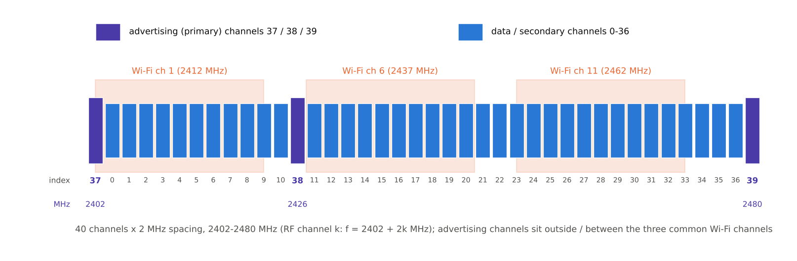

[[TIP("📘 규격 · 버전")]]
Core v6.0 Vol 6 Part A (Physical Layer: 주파수 대역과 채널 배치, 송신기 출력 클래스) · Vol 6 Part B (채널 인덱스와 RF 채널의 대응)
Core 4.0 40채널·최대 +10 dBm → 5.0 최대 +20 dBm(전력 클래스 1) → 5.1 광고 채널 순서 무작위화 → 5.2 LE 전력 제어
[[/TIP]]

[TOC]

[[TIP("🟢 한눈에 보기")]]
LE는 2400–2483.5 MHz ISM 대역을 **2 MHz 간격 40개 채널**로 나눕니다.

1. **광고 채널 3개(37·38·39)** — 기기를 찾고 연결을 시작하는 "로비". 서로 멀리 떨어진 2402·2426·2480 MHz에 둡니다.
2. **데이터 채널 37개(0–36)** — 연결과 확장 광고의 보조 패킷이 주파수 도약하며 쓰는 "방".
3. **송신 출력** — −20 dBm(0.01 mW)부터 +20 dBm(100 mW)까지. 대부분의 웨어러블은 0 dBm 안팎을 씁니다.
[[/TIP]]

*그림. LE 40개 채널. 보라색이 광고 채널 37/38/39, 파란색이 데이터 채널 0–36입니다. 주황 영역은 가장 흔한 Wi-Fi 채널 1/6/11(20 MHz)로, 광고 채널은 그 바깥이나 사이 틈에 놓여 있습니다.*

## 광고 채널은 왜 37·38·39인가 (🔵 중급)

광고 채널은 기기 발견과 연결 수립이 걸린 곳이라 간섭에 특히 약하면 안 됩니다. 4.0 설계 때 가장 흔한 Wi-Fi 배치인 채널 1/6/11(중심 2412·2437·2462 MHz)을 피해 다음 위치를 골랐습니다.

| 광고 채널 | 주파수 | 주변 Wi-Fi 채널과의 관계 |
|---|---|---|
| 37 | 2402 MHz | Wi-Fi 1(2402–2422 MHz 점유)의 아래쪽 가장자리 |
| 38 | 2426 MHz | Wi-Fi 1과 6(2427–2447 MHz) 사이의 틈 |
| 39 | 2480 MHz | Wi-Fi 11(2452–2472 MHz) 위, 대역 끝 |

세 채널을 대역 양 끝과 가운데로 흩어 둔 덕분에 Wi-Fi 하나가 세 광고 채널을 한꺼번에 덮는 일이 드뭅니다. 또 광고 채널 번호(37–39)가 데이터 채널 번호(0–36) 뒤에 붙어 있어, **채널 인덱스 순서와 주파수 순서가 다르다**는 점에 주의해야 합니다. 2402 MHz가 0번이 아니라 37번입니다.

## 채널 인덱스 ↔ RF 채널 ↔ 주파수 (🔵 중급)

RF 채널 $k$(0–39)는 주파수 순서 번호로 $f = 2402 + 2k$ MHz입니다. 링크 계층의 **채널 인덱스**는 광고 채널을 뒤로 뺀 번호입니다. 값은 `tools/bt_numbers.py` 출력과 같습니다.

| RF 채널 | 채널 인덱스 | 주파수 (MHz) | RF 채널 | 채널 인덱스 | 주파수 (MHz) |
|---|---|---|---|---|---|
| 0 | **37** | **2402** | 1 | 0 | 2404 |
| 2 | 1 | 2406 | 3 | 2 | 2408 |
| 4 | 3 | 2410 | 5 | 4 | 2412 |
| 6 | 5 | 2414 | 7 | 6 | 2416 |
| 8 | 7 | 2418 | 9 | 8 | 2420 |
| 10 | 9 | 2422 | 11 | 10 | 2424 |
| 12 | **38** | **2426** | 13 | 11 | 2428 |
| 14 | 12 | 2430 | 15 | 13 | 2432 |
| 16 | 14 | 2434 | 17 | 15 | 2436 |
| 18 | 16 | 2438 | 19 | 17 | 2440 |
| 20 | 18 | 2442 | 21 | 19 | 2444 |
| 22 | 20 | 2446 | 23 | 21 | 2448 |
| 24 | 22 | 2450 | 25 | 23 | 2452 |
| 26 | 24 | 2454 | 27 | 25 | 2456 |
| 28 | 26 | 2458 | 29 | 27 | 2460 |
| 30 | 28 | 2462 | 31 | 29 | 2464 |
| 32 | 30 | 2466 | 33 | 31 | 2468 |
| 34 | 32 | 2470 | 35 | 33 | 2472 |
| 36 | 34 | 2474 | 37 | 35 | 2476 |
| 38 | 36 | 2478 | 39 | **39** | **2480** |

정리하면 인덱스 0–10은 $2404 + 2i$ MHz, 인덱스 11–36은 $2428 + 2(i - 11)$ MHz입니다. 화이트닝 초기값(**패킷 구조**)과 채널 맵 비트는 RF 채널이 아니라 **채널 인덱스**를 씁니다.

## 송신 출력과 전력 클래스 (🔵 중급)

LE 송신기의 출력은 안테나 단자 기준으로 −20 dBm 이상, +20 dBm 이하입니다(4.x까지 상한은 +10 dBm). 이 범위 안에서 최대 출력에 따라 전력 클래스를 나눕니다.

| 전력 클래스 | 최대 출력 | 최소 출력 | 대표 기기 |
|---|---|---|---|
| 1 | 100 mW (+20 dBm) | 10 mW (+10 dBm) | 장거리 게이트웨이, 산업용 모듈 |
| 1.5 | 10 mW (+10 dBm) | 0.01 mW (−20 dBm) | 스마트폰·PC 일부 |
| 2 | 2.5 mW (+4 dBm) | 0.01 mW (−20 dBm) | 일반 모듈 |
| 3 | 1 mW (0 dBm) | 0.01 mW (−20 dBm) | 웨어러블, 비컨, 센서 |

여기서 "최소 출력"은 그 클래스의 최대 출력 설정에서 내야 하는 하한이며, 실제 동작 출력은 이보다 낮게 줄일 수 있습니다. 출력을 바꾸는 방법은 두 가지입니다.

| 방법 | 쓰는 곳 | 관련 기능 |
|---|---|---|
| 호스트가 고정값 지정 | 광고 | `HCI_LE_Set_Extended_Advertising_Parameters`의 `Advertising_TX_Power` (선호값, 컨트롤러가 실제값을 돌려줌) |
| 상대 요청에 따른 조정 | 연결 | 5.2 LE 전력 제어 (`LL_POWER_CONTROL_REQ` 등) → **LE 전력 제어** |
| 경로 손실 감시 | 연결 | 5.2 Path Loss Monitoring, RSSI와 상대 송신 출력으로 경로 손실 계산 |

[[TIP("🔴 전문가 노트 — 규제 한도, 채널 맵, 광고 채널 순서")]]
**규격 상한 ≠ 규제 상한.** Core는 +20 dBm까지 허용하지만 실제 한도는 각국 규제가 정합니다. 유럽 EN 300 328은 주파수 도약이 아닌 광대역 변조에 EIRP 20 dBm과 전력 스펙트럼 밀도 한도를 함께 두므로, 안테나 이득이 있는 +20 dBm 모듈은 출력을 낮춰야 할 수 있습니다. → **2.4 GHz ISM 대역과 규제**

**데이터 채널 맵.** 연결의 채널 맵은 37비트(인덱스 0–36)이고, 최소 2개 채널은 사용 상태로 남겨야 합니다. 센트럴이 `LL_CHANNEL_MAP_IND`로 맵을 바꾸며, 5.3의 채널 분류 강화로 페리페럴도 자신이 관측한 채널 품질을 보고할 수 있습니다. → **채널 선택 알고리즘**

**광고 채널 순서 무작위화.** 4.x에서는 광고 이벤트마다 37 → 38 → 39 순서가 일반적이었는데, 순서가 고정되면 비슷한 간격의 광고자끼리, 또는 주기적인 간섭원과 같은 채널에서 반복해서 부딪히기 쉽습니다. 5.1부터 광고자는 이벤트마다 채널 순서를 무작위로 바꿀 수 있습니다.
[[/TIP]]

## Classic ↔ LE 비교

| 항목 | Classic (BR/EDR) | LE |
|---|---|---|
| 채널 수·간격 | 79개, 1 MHz | 40개, 2 MHz |
| 주파수 | 2402–2480 MHz | 2402–2480 MHz |
| 발견 전용 채널 | 없음(조회 홉 집합 32채널 사용) | 광고 채널 3개 |
| 도약 | 초당 1600홉, 슬롯마다 | 연결 이벤트마다 1회 |
| 최대 출력 | +20 dBm (클래스 1) | +20 dBm (클래스 1) |

## 관련 페이지
- **2.4 GHz ISM 대역과 규제** — 대역 경계와 지역별 출력 규제
- **Wi-Fi와의 공존** — Wi-Fi와 채널이 겹칠 때의 대응
- **채널 선택 알고리즘** — 데이터 채널 0–36 위의 도약
- **LE 전력 제어** — 연결 중 출력 조정
- **LE PHY (1M·2M·Coded)** — PHY별 수신 감도
