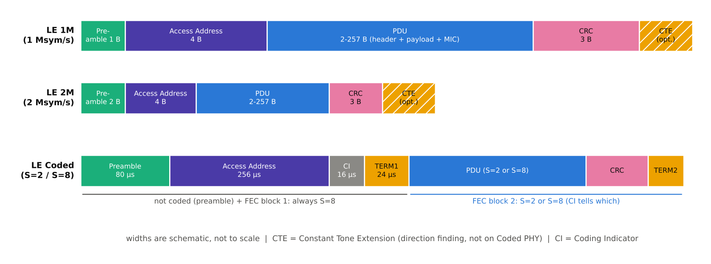

[[TIP("📘 규격 · 버전")]]
Core v6.0 Vol 6 Part B §2.1 (패킷 형식), §2.3 (광고 채널 PDU), §2.4 (데이터 채널 PDU), §3.1 (CRC), §3.2 (화이트닝)
Core 4.0 기본 형식(데이터 페이로드 27 B) → 4.2 Length 필드 8비트로 확장(251 B) → 5.0 2M·Coded 형식, 확장 광고 PDU(최대 255 B) → 5.1 CTE 필드·CP 비트
[[/TIP]]

[TOC]

[[TIP("🟢 한눈에 보기")]]
LE 패킷은 PHY와 무관하게 거의 같은 네 부분으로 되어 있습니다.

1. **프리앰블** — "지금 패킷이 온다"는 신호. 수신기가 이득과 주파수를 맞춥니다.
2. **Access Address** — 이 패킷이 누구 링크 것인지 알려 주는 32비트 이름표. 광고는 모두 같은 값, 연결은 연결마다 다른 값입니다.
3. **PDU** — 헤더(종류·길이·확인 비트)와 실제 데이터.
4. **CRC** — 24비트 오류 검사값.

여기에 5.1부터 방향 탐지용 **CTE**(일정한 톤)를 끝에 붙일 수 있습니다.
[[/TIP]]

*그림. PHY별 패킷 형식. 1M과 2M은 프리앰블 길이(1 B/2 B)만 다르고, Coded는 Access Address·CI·TERM1을 항상 S=8로, PDU·CRC·TERM2를 S=2 또는 S=8로 부호화합니다. 폭은 개념도이며 실제 비율이 아닙니다.*

## 프리앰블과 Access Address (🔵 중급)

| 필드 | 1M | 2M | Coded |
|---|---|---|---|
| 프리앰블 | 8비트 `0101…` 교대 | 16비트 교대 | `00111100` × 10 (80 µs) |
| Access Address | 32비트 | 32비트 | 32비트, S=8 부호화 |
| 비트 순서 | LSB 먼저 (CRC만 MSB 먼저) | 같음 | 같음 |

1M·2M 프리앰블은 마지막 비트가 Access Address 첫 비트와 달라지도록 `01010101`(또는 2M에서 그 두 배 길이)과 그 반전 중 하나를 고릅니다.

**Access Address**는 광고 채널에서 고정값 `0x8E89BED6`을 씁니다. 연결·주기적 광고·BIG는 링크 계층이 무작위로 만든 값을 쓰는데, 수신기의 상관기가 오검출하지 않도록 다음 규칙을 지켜야 합니다.

- 같은 비트가 7개 이상 연속하지 않을 것 (0이든 1이든 최대 6개)
- 광고 Access Address와 같거나 1비트만 다르지 않을 것
- 네 옥텟이 모두 같지 않을 것
- 전체 비트 전환(0↔1)이 24회를 넘지 않을 것
- 상위 6비트 안에 전환이 2회 이상 있을 것
- Coded PHY에서 쓸 값은 추가로, 하위 8비트에 1이 3개 이상이고 하위 16비트의 전환이 11회 이하일 것

## PDU 헤더 (🔵 중급)

광고 채널 PDU와 데이터 채널 PDU는 헤더 모양이 다릅니다. 둘 다 16비트이며, 데이터 PDU는 CP = 1일 때 8비트 `CTEInfo`가 더 붙습니다.

| 광고 PDU 헤더 | 비트 | 의미 |
|---|---|---|
| PDU Type | 4 | `ADV_IND`, `ADV_EXT_IND` 등 종류 → **레거시 광고** |
| RFU | 1 | 예약 |
| ChSel | 1 | 이 광고자가 채널 선택 알고리즘 #2를 지원함 (5.0) |
| TxAdd | 1 | 송신자 주소가 랜덤(1)인지 공개(0)인지 |
| RxAdd | 1 | 대상 주소의 종류 |
| Length | 8 | 페이로드 길이 (레거시 6–37 B, 확장 최대 255 B) |

| 데이터 PDU 헤더 | 비트 | 의미 |
|---|---|---|
| **LLID** | 2 | `01` 데이터 이어짐 또는 빈 PDU, `10` L2CAP 시작(또는 완결), `11` LL 제어 PDU |
| **NESN** | 1 | 다음에 기대하는 순서 번호 — 상대 패킷에 대한 ACK/NAK |
| **SN** | 1 | 이 패킷의 순서 번호 |
| **MD** | 1 | 보낼 데이터가 더 있음 — 연결 이벤트를 이어갈지 결정 |
| **CP** | 1 | `CTEInfo` 필드가 있음 (5.1) |
| RFU | 2 | 예약 |
| Length | 8 | 페이로드 + MIC 길이 (0–255, 페이로드 최대 251 B) |

SN과 NESN은 1비트 정지-대기(stop-and-wait) 방식입니다. 받은 패킷의 SN이 내가 기대한 값이면 새 패킷으로 받아들이고 NESN을 뒤집어 보내며, 내 이전 패킷의 확인이 오지 않으면(상대 NESN이 그대로면) 같은 패킷을 재전송합니다. 별도의 ACK 패킷이 없고 응답 패킷의 헤더가 곧 ACK입니다.

## CRC와 화이트닝 (🔵 중급)

| 항목 | 값 |
|---|---|
| CRC 길이 | 24비트, PDU 전체에 대해 계산 |
| 다항식 | $x^{24} + x^{10} + x^{9} + x^{6} + x^{4} + x^{3} + x + 1$ |
| 초기값 (광고 채널) | `0x555555` |
| 초기값 (연결) | `CONNECT_IND`의 `CRCInit` (연결마다 무작위) |
| 초기값 (주기적 광고·BIG) | `SyncInfo`·`BIGInfo` 안의 값 |
| 화이트닝 다항식 | $x^{7} + x^{4} + 1$ |
| 화이트닝 초기값 | 위치 0 = 1, 위치 1–6 = 채널 인덱스 |
| 화이트닝 범위 | PDU와 CRC (CTE 제외) |

**화이트닝**(whitening)은 0이나 1이 길게 이어지는 데이터를 의사 난수열과 XOR해 스펙트럼을 고르게 만드는 처리입니다. 송신 순서는 CRC 계산 → 화이트닝 → (Coded이면) FEC 부호화입니다.

## CTE와 airtime 공식 (🔵 중급)

**CTE**(Constant Tone Extension)는 CRC 뒤에 붙는 16–160 µs(8 µs 단위)의 변조 없는 톤입니다. 수신기가 안테나를 바꿔 가며 위상을 재는 구간이라 화이트닝·CRC 대상이 아니고, 1M·2M에서만 쓸 수 있습니다. 길이와 종류(AoA, 1 µs/2 µs 슬롯 AoD)는 `CTEInfo`에 들어 있습니다. → **방향 탐지 (AoA·AoD)**

페이로드 $L$ 바이트(MIC 포함) 패킷의 airtime은 다음과 같습니다(CTE 제외).

$$
\begin{aligned}
T\_{1M} &= 8 \times (1 + 4 + 2 + L + 3)\ \mu s \\\\
T\_{2M} &= 4 \times (2 + 4 + 2 + L + 3)\ \mu s \\\\
T\_{Coded} &= 80 + 256 + 16 + 24 + S \times \bigl(8 \times (2 + L + 3) + 3\bigr)\ \mu s
\end{aligned}
$$

| 예 (`tools/bt_numbers.py`) | 1M | 2M | S=2 | S=8 |
|---|---|---|---|---|
| 빈 PDU ($L = 0$) | 80 µs | 44 µs | 462 µs | 720 µs |
| 27 B + MIC ($L = 31$) | 328 µs | 168 µs | 958 µs | 2704 µs |
| 251 B + MIC ($L = 255$) | 2120 µs | 1064 µs | 4542 µs | 17040 µs |

[[TIP("🔴 전문가 노트 — 길이 한계의 역사, MIC, SN/NESN 디버깅")]]
**Length 필드의 확장.** 4.0/4.1의 데이터 PDU Length는 5비트(최대 31 = 27 B + MIC 4 B)였고, 4.2 DLE에서 8비트가 되었습니다. 레거시 광고 PDU는 6비트 길이(최대 37 B = AdvA 6 B + AdvData 31 B)였고, 5.0에서 광고 헤더도 8비트 Length를 쓰게 되어 확장 광고 PDU가 255 B까지 늘었습니다. → **데이터 길이 확장 (DLE)**

**MIC는 Length에 포함됩니다.** 암호화된 연결에서 빈 PDU에는 MIC를 붙이지 않습니다. 그래서 암호화 연결의 빈 패킷도 80 µs(1M)이고, 데이터가 있는 패킷만 4 B가 늘어납니다.

**SN/NESN 디버깅.** 스니퍼 로그에서 같은 SN이 연속으로 보이면 재전송입니다. MD = 0인 패킷을 양쪽이 주고받으면 연결 이벤트가 닫히므로, 처리량이 낮을 때는 MD 비트와 이벤트당 패킷 수를 먼저 확인합니다. → **로그 분석**
[[/TIP]]

## 관련 페이지
- **LE PHY (1M·2M·Coded)** — 심볼율과 Coded 부호화
- **레거시 광고** — 광고 PDU Type별 페이로드
- **확장 광고** — 확장 헤더(Common Extended Advertising Payload)
- **데이터 길이 확장 (DLE)** — 27 B → 251 B
- **방향 탐지 (AoA·AoD)** — CTE 활용
