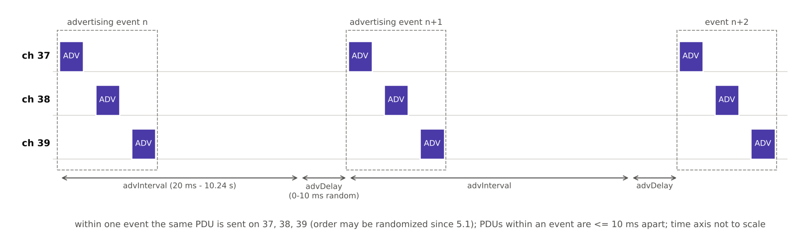

[[TIP("📘 규격 · 버전")]]
Core v6.0 Vol 6 Part B §2.3 (광고 채널 PDU), Part B (광고 상태와 광고 이벤트) · Vol 4 Part E (HCI: `HCI_LE_Set_Advertising_Parameters` 등) · Vol 3 Part C (GAP: 발견·연결 모드)
Core 4.0 도입 → 4.2 LE Privacy 1.2(RPA 대상 directed 광고) → 5.0 비연결·스캔 가능 광고의 최소 간격 100 ms → 20 ms, 확장 광고 등장 → 5.1 광고 채널 순서 무작위화
[[/TIP]]

[TOC]

[[TIP("🟢 한눈에 보기")]]
레거시 광고는 4.0부터 있던 "세 채널에서 짧게 외치기" 방식입니다.

1. 광고자는 **광고 이벤트**마다 같은 PDU를 채널 37, 38, 39에 차례로 보냅니다.
2. 이벤트 사이 간격은 **advInterval**(20 ms–10.24 s)에 0–10 ms의 무작위 지연 **advDelay**를 더한 값입니다.
3. 스캐너는 더 알고 싶으면 `SCAN_REQ`로 물어보고(`SCAN_RSP`로 답함), 연결하고 싶으면 `CONNECT_IND`를 보냅니다.
4. 실을 수 있는 데이터는 PDU당 **31바이트**뿐입니다. 이 한계가 5.0 확장 광고를 낳았습니다.
[[/TIP]]

*그림. 레거시 광고 이벤트. 한 이벤트 안에서 같은 PDU를 37 → 38 → 39에 보내고(5.1부터 순서 무작위화 가능), 다음 이벤트는 advInterval + advDelay 뒤에 시작합니다. advDelay가 여러 광고자의 이벤트가 계속 겹치는 것을 막습니다.*

## 광고 PDU 일곱 가지 (🔵 중급)

| PDU | 보내는 쪽 | 페이로드 | 연결 가능 | 스캔 가능 | 대상 지정 |
|---|---|---|---|---|---|
| `ADV_IND` | 광고자 | AdvA(6) + AdvData(0–31) | 예 | 예 | 아니오 |
| `ADV_DIRECT_IND` | 광고자 | AdvA(6) + TargetA(6) | 예 | 아니오 | 예 |
| `ADV_NONCONN_IND` | 광고자 | AdvA(6) + AdvData(0–31) | 아니오 | 아니오 | 아니오 |
| `ADV_SCAN_IND` | 광고자 | AdvA(6) + AdvData(0–31) | 아니오 | 예 | 아니오 |
| `SCAN_REQ` | 스캐너 | ScanA(6) + AdvA(6) | — | — | — |
| `SCAN_RSP` | 광고자 | AdvA(6) + ScanRspData(0–31) | — | — | — |
| `CONNECT_IND` | 개시자 | InitA(6) + AdvA(6) + LLData(22) | — | — | — |

`CONNECT_IND`(4.x 문서의 `CONNECT_REQ`)의 LLData 22바이트에는 Access Address, `CRCInit`, 전송 창(WinSize·WinOffset), 연결 간격, Peripheral latency, 감시 타임아웃, 채널 맵, 홉 값, 클럭 정확도(SCA)가 들어 있어 이 한 패킷으로 연결 파라미터가 모두 정해집니다. → **연결 수립**

| 용도 | 고를 PDU | GAP 관점 |
|---|---|---|
| 비컨 (iBeacon, Eddystone 등) | `ADV_NONCONN_IND` | 브로드캐스터 |
| 연결을 기다리는 주변기기 | `ADV_IND` | 일반/제한 발견 가능 + 연결 가능 |
| 정보만 더 주는 기기 | `ADV_SCAN_IND` | 연결 불가, 스캔 응답 제공 |
| 아는 상대와 빠른 재연결 | `ADV_DIRECT_IND` | 대상 지정 연결 가능 |

## 광고 이벤트와 응답 타이밍 (🔵 중급)

| 항목 | 값 |
|---|---|
| advInterval | 20 ms – 10.24 s (0.625 ms 단위), 5.0 이전에는 `ADV_SCAN_IND`·`ADV_NONCONN_IND`의 최소가 100 ms |
| advDelay | 이벤트마다 0–10 ms 의사 난수 |
| 이벤트 안 PDU 간격 | 같은 이벤트의 연속 PDU 시작 사이 10 ms 이하 |
| 응답 간격 | 광고 PDU 끝 → T_IFS(150 µs) → `SCAN_REQ`/`CONNECT_IND` → T_IFS → `SCAN_RSP` |
| 채널 | `Advertising_Channel_Map`으로 37/38/39 중 일부만 쓸 수도 있음 |

광고자는 각 채널에서 PDU를 보낸 직후 T_IFS 동안 수신기를 켜고 요청을 기다립니다. 그래서 연결 가능·스캔 가능 광고는 비연결 광고보다 이벤트가 길고 전류도 더 듭니다. `CONNECT_IND`를 받으면 이벤트는 그 자리에서 끝나고 링크 계층은 Connection 상태로 갑니다.

## 31바이트 한계 (🔵 중급)

AdvData 31바이트는 4.0의 광고 PDU 길이 필드(6비트, 최대 37 B)에서 AdvA 6바이트를 뺀 값입니다. AdvData는 `Length | AD Type | Data` 구조의 AD 구조체를 이어 붙이므로, Flags(3 B)와 128비트 서비스 UUID(18 B)만 넣어도 남는 공간이 10 B입니다.

| 내용 | 바이트 |
|---|---|
| Flags | 3 |
| 128비트 서비스 UUID 1개 | 18 |
| 남는 공간 → 짧은 기기 이름 등 | 10 |
| 합계 | 31 |

흔한 대처는 (1) 이름 같은 부가 정보를 `SCAN_RSP` 31바이트로 옮기기, (2) 16비트 SIG UUID 쓰기, (3) 5.0 **확장 광고**로 옮기기입니다. AD Type 목록은 **광고 데이터 형식 (AD Type)**에 있습니다.

## 고속 directed 광고 (🔵 중급)

`ADV_DIRECT_IND`에는 두 모드가 있습니다.

| 모드 | 간격 | 지속 시간 | 쓰임 |
|---|---|---|---|
| 고듀티(high duty cycle) | 같은 채널의 연속 PDU 시작 사이 3.75 ms 이하 | 최대 1.28 s | 끊긴 연결을 즉시 복구 (예: HID 키보드) |
| 저듀티(low duty cycle) | 일반 advInterval | 제한 없음 | 전력을 아끼며 특정 상대만 기다림 |

고듀티 모드는 광고 이벤트 개념보다 "3.75 ms마다 연속 송신"에 가까워 채널을 크게 점유하므로 1.28 s로 제한됩니다. 그 안에 연결되지 않으면 컨트롤러가 `HCI_LE_Connection_Complete` 이벤트를 Advertising Timeout 상태로 보내고 광고를 멈춥니다.

[[TIP("🔴 전문가 노트 — HCI, 레거시와 확장 명령의 혼용, 프라이버시")]]
**HCI 순서.** `HCI_LE_Set_Advertising_Parameters`(간격, `Advertising_Type` 0x00–0x04, 주소 종류, 채널 맵, 필터 정책) → `HCI_LE_Set_Advertising_Data` → `HCI_LE_Set_Scan_Response_Data` → `HCI_LE_Set_Advertising_Enable`. `Advertising_Type`은 0x00 `ADV_IND`, 0x01 고듀티 `ADV_DIRECT_IND`, 0x02 `ADV_SCAN_IND`, 0x03 `ADV_NONCONN_IND`, 0x04 저듀티 `ADV_DIRECT_IND`입니다.

**레거시 명령과 확장 명령은 섞지 않습니다.** 확장 광고 명령(`HCI_LE_Set_Extended_Advertising_Parameters` 등)을 한 번 쓰면, 이후 레거시 광고 명령은 `Command Disallowed`로 거부됩니다(반대도 같음). 확장 광고 명령으로도 이벤트 속성의 "legacy PDU" 비트를 켜면 위의 레거시 PDU를 그대로 보낼 수 있어, 최근 스택은 확장 명령만 쓰는 경우가 많습니다.

**TargetA와 프라이버시.** 4.2 LE Privacy 1.2에서는 `ADV_DIRECT_IND`의 TargetA에 상대의 RPA를 넣을 수 있고, 컨트롤러가 IRK로 주소를 직접 해석(Resolving List)해 필터링합니다. → **프라이버시와 RPA**

**광고 필터 정책.** `Advertising_Filter_Policy`로 `SCAN_REQ`·`CONNECT_IND`를 Filter Accept List에 있는 기기의 것만 받도록 할 수 있습니다. 본딩된 기기만 재연결을 허용할 때 씁니다. → **스캔과 필터**
[[/TIP]]

## Classic ↔ LE 비교

| 항목 | Classic (BR/EDR) | LE 레거시 광고 |
|---|---|---|
| 발견 방법 | 조회 측이 Inquiry, 피조회 측이 Inquiry Scan | 피발견 측이 광고, 찾는 측이 스캔 |
| 발견 시 얻는 데이터 | FHS + EIR 최대 240 B | AdvData 31 B + ScanRspData 31 B |
| 사용 채널 | 조회 홉 32채널 | 광고 채널 3개 |
| 연결 없이 데이터 방송 | 제한적 | 광고 자체가 방송 (비컨) |

## 관련 페이지
- **확장 광고** — 31바이트 한계를 넘는 5.0 방식
- **스캔과 필터** — 광고를 받는 쪽
- **연결 수립** — `CONNECT_IND` 이후
- **광고 데이터 형식 (AD Type)** — AdvData 구조
- **GAP** — 발견 모드와 연결 모드
