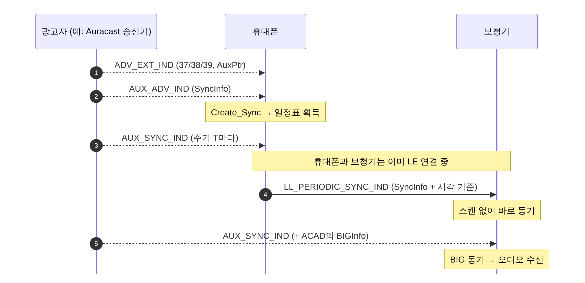
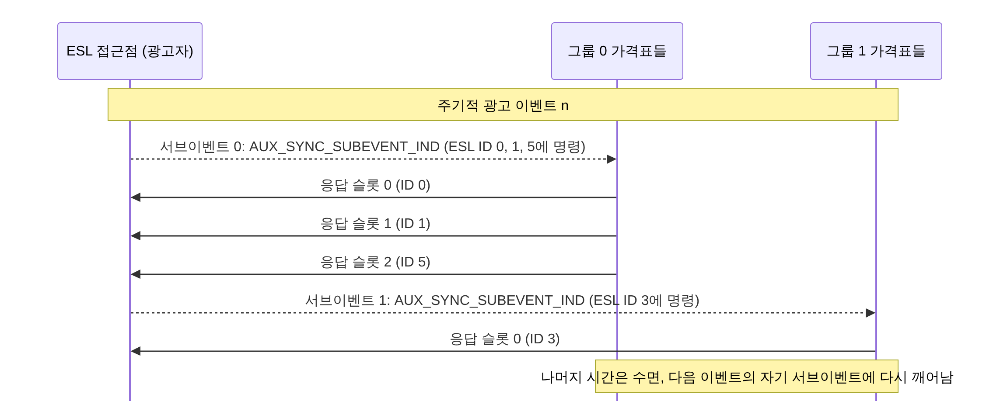

[[TIP("📘 규격 · 버전")]]
Core v6.0 Vol 6 Part B (주기적 광고, Synchronization 상태, PAwR) · Vol 4 Part E (HCI: `HCI_LE_Set_Periodic_Advertising_*`, `HCI_LE_Periodic_Advertising_Create_Sync`) · ESL Profile 1.0 (PAwR 응용)
Core 5.0 주기적 광고 → 5.1 Periodic Advertising Sync Transfer(PAST), 연결 없는 CTE → 5.2 BIGInfo(Auracast 기반) → 5.3 주기적 광고 ADI → 5.4 PAwR(응답 있는 주기적 광고)
[[/TIP]]

[TOC]

[[TIP("🟢 한눈에 보기")]]
일반 광고는 언제 올지 모르는 패킷을 스캐너가 계속 들어야 합니다. **주기적 광고**는 "정확히 몇 ms마다, 어느 채널에서" 보낼지 미리 알려 주어, 수신기가 그 순간에만 깨어나게 합니다.

1. 광고자가 확장 광고의 `AUX_ADV_IND`에 **SyncInfo**(일정표)를 넣어 둡니다.
2. 수신기는 한 번 스캔해 SyncInfo를 얻으면 이후로는 스캔 없이 `AUX_SYNC_IND`만 받습니다(**동기화**).
3. 휴대폰처럼 이미 동기한 기기가 연결을 통해 일정표를 넘겨줄 수도 있습니다(**PAST**).
4. 5.4 **PAwR**은 여기에 "응답 칸"을 더해, 수천 개 전자 가격표가 연결 없이 명령을 받고 답하게 합니다.
[[/TIP]]

## 주기적 광고의 구조 (🔵 중급)

| 항목 | 값 |
|---|---|
| PDU | `AUX_SYNC_IND` (+ 필요하면 `AUX_CHAIN_IND`) |
| 채널 | 데이터 채널 0–36, 채널 선택 알고리즘 #2로 이벤트마다 도약 |
| 주기 | 7.5 ms – 81.91875 s (1.25 ms 단위) |
| 응답 | 없음 (5.4 PAwR 제외) — 스캔 요청·연결 불가 |
| 일정표 | `AUX_ADV_IND`의 SyncInfo 18 B: 오프셋, 주기, 채널 맵, Access Address, `CRCInit`, 이벤트 카운터 |
| 부가 정보 | ACAD로 채널 맵 갱신, BIGInfo(BIS 동기용) 전달 |

주기적 광고는 연결처럼 고유 Access Address와 채널 도약을 쓰지만 ACK가 없는 일방향 방송입니다. 광고자는 확장 광고를 계속 돌려 새 수신기가 SyncInfo를 찾을 수 있게 합니다.

| 단계 | 광고자 HCI | 수신자 HCI |
|---|---|---|
| 설정 | `HCI_LE_Set_Periodic_Advertising_Parameters`, `HCI_LE_Set_Periodic_Advertising_Data` | |
| 시작 | `HCI_LE_Set_Periodic_Advertising_Enable` + 확장 광고 켜기 | `HCI_LE_Periodic_Advertising_Create_Sync` + 확장 스캔 켜기 |
| 동기 성립 | | `HCI_LE_Periodic_Advertising_Sync_Established` 이벤트 |
| 데이터 | | `HCI_LE_Periodic_Advertising_Report` 이벤트 |
| 종료 | 광고 끄기 | `HCI_LE_Periodic_Advertising_Terminate_Sync` 또는 `Sync_Timeout` 만료 시 `HCI_LE_Periodic_Advertising_Sync_Lost` |

수신자는 `Skip` 파라미터로 이벤트를 건너뛰어 전력을 더 줄일 수 있고, Periodic Advertiser List에 원하는 광고자(주소 + SID)를 미리 올려 둘 수 있습니다.

## 동기화와 PAST (🔵 중급)

**PAST**(Periodic Advertising Sync Transfer, 5.1)는 동기 정보를 LE 연결로 넘겨주는 절차입니다. 보청기·이어버드처럼 배터리가 작은 기기는 오래 스캔하지 않고, 화면과 큰 배터리가 있는 휴대폰이 대신 찾아 줍니다. 휴대폰은 `HCI_LE_Periodic_Advertising_Sync_Transfer`(자기가 동기한 것을 전달) 또는 `HCI_LE_Periodic_Advertising_Set_Info_Transfer`(자기가 광고하는 것을 전달)를, 받는 쪽은 `HCI_LE_Set_Periodic_Advertising_Sync_Transfer_Parameters`로 수락 방식을 정합니다. LE Audio의 Broadcast Assistant 역할이 바로 이 기능을 씁니다. → **Auracast 브로드캐스트**

## PAwR — 응답 있는 주기적 광고 (🔵 중급)

5.4의 **PAwR**(Periodic Advertising with Responses)은 주기적 광고 이벤트 하나를 여러 **서브이벤트**로 쪼개고, 각 서브이벤트 뒤에 **응답 슬롯**을 둡니다.

| 파라미터 | 범위 |
|---|---|
| 이벤트당 서브이벤트 수 | 최대 128 |
| 서브이벤트 간격 | 7.5 – 318.75 ms (1.25 ms 단위) |
| 응답 슬롯 지연 | 1.25 – 317.5 ms (1.25 ms 단위) |
| 응답 슬롯 간격 | 0.25 – 31.875 ms (0.125 ms 단위) |
| 응답 패킷 Access Address | 별도 RspAA |

| PDU | 방향 | 내용 |
|---|---|---|
| `AUX_SYNC_SUBEVENT_IND` | 광고자 → 수신자들 | 서브이벤트의 명령 데이터 |
| `AUX_SYNC_SUBEVENT_RSP` | 수신자 → 광고자 | 지정된 응답 슬롯에서의 응답 |
| `AUX_CONNECT_REQ` / `AUX_CONNECT_RSP` | 양방향 | 서브이벤트 안에서 특정 수신자와 연결 수립 |

수신자는 자기 그룹의 서브이벤트에만 깨어나고(`HCI_LE_Set_Periodic_Sync_Subevent`), 명령을 받으면 정해진 슬롯에서 답합니다(`HCI_LE_Set_Periodic_Advertising_Response_Data`). 광고자 쪽 컨트롤러는 `HCI_LE_Periodic_Advertising_Subevent_Data_Request` 이벤트로 호스트에게 다음 서브이벤트 데이터를 요청하고, 응답은 `HCI_LE_Periodic_Advertising_Response_Report`로 올려 줍니다.

**전자 가격표(ESL)** 프로파일이 PAwR의 대표 사례입니다. 가격표는 7비트 그룹 ID와 8비트 ESL ID로 주소가 정해지며, 그룹 ID가 곧 들을 서브이벤트입니다. 한 접근점이 최대 128 그룹 × 그룹당 최대 255개 = 32,640개 가격표를 다룰 수 있습니다. 명령 배열에서 몇 번째 명령인지가 응답 슬롯 번호를 정합니다. 설정과 이미지 전송처럼 큰 작업은 GATT 연결로 합니다.

[[TIP("🔴 전문가 노트 — 동기 손실, ADI, PAwR 설계 감각")]]
**동기 손실과 클럭 오차.** 수신자는 이벤트마다 상대 클럭 오차만큼 수신 창을 넓힙니다. 주기가 길거나 `Skip`이 크면 창이 넓어져 전력 이득이 줄고, 연속으로 놓치면 `Sync_Timeout`(100 ms – 163.84 s)이 지나 동기를 잃습니다.

**5.3 ADI.** 5.3부터 `AUX_SYNC_IND`에도 ADI를 넣을 수 있어, 수신자 컨트롤러가 같은 데이터의 반복 보고를 걸러낼 수 있습니다(`HCI_LE_Periodic_Advertising_Create_Sync`의 옵션). 데이터가 자주 바뀌지 않는 Auracast BASE 정보 수신 시 호스트로 올라가는 중복 보고가 줄어듭니다.

**PAwR은 연결이 아닙니다.** 응답 슬롯은 ACK나 재전송을 보장하지 않습니다. 광고자 호스트가 응답이 없는 기기에 다음 이벤트에서 다시 명령을 보내는 식으로 상위 계층에서 재시도합니다. 서브이벤트 수 × 서브이벤트 간격이 주기적 광고 주기 안에 들어가야 하므로, 반응 시간(주기)과 수용 기기 수(서브이벤트·슬롯 수)가 맞교환 관계입니다.

**PAwR 동기 정보 전달.** PAwR 타이밍 정보는 `AUX_ADV_IND`의 ACAD에 실리고, 연결로 넘길 때는 `LL_PERIODIC_SYNC_WR_IND`를 씁니다. 관련 HCI 이벤트(`..._Sync_Established`, `..._Report`)에는 서브이벤트 정보를 담은 V2 버전이 생겼습니다.
[[/TIP]]

## 관련 페이지
- **확장 광고** — SyncInfo를 싣는 AUX_ADV_IND
- **링크 계층 상태 기계** — Synchronization 상태
- **채널 선택 알고리즘** — CSA #2
- **등시성 채널 (CIS·BIS)** — BIGInfo와 BIS 동기
- **Auracast 브로드캐스트** — PAST와 Broadcast Assistant
