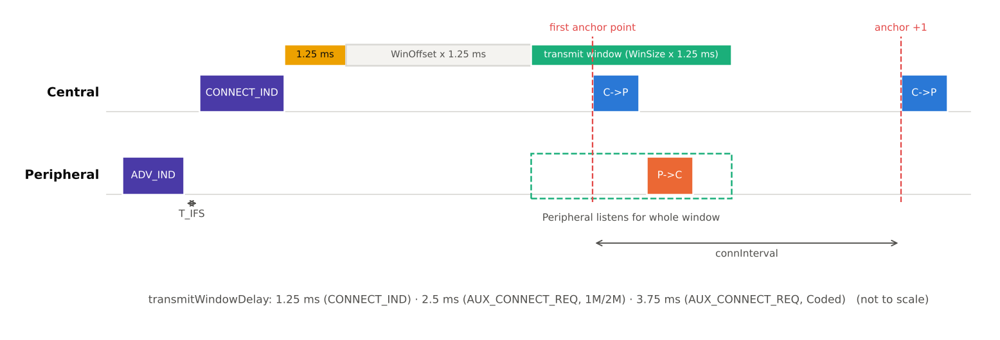
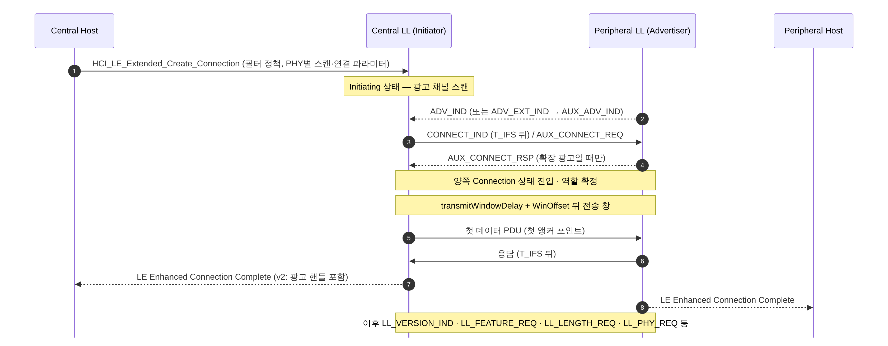

[[TIP("📘 규격 · 버전")]]
Core v6.0 Vol 6 Part B (Link Layer) — 연결 요청 PDU(`CONNECT_IND`, `AUX_CONNECT_REQ`/`AUX_CONNECT_RSP`), 연결 상태 진입 · Vol 4 Part E (HCI) `HCI_LE_Create_Connection`, `HCI_LE_Extended_Create_Connection`
Core 4.0 도입(`CONNECT_REQ`) → 5.0 확장 광고 위 연결(`AUX_CONNECT_REQ`/`RSP`), PDU 이름 `CONNECT_IND`로 변경 → 5.3 용어 Master/Slave를 Central/Peripheral로 정리 → 6.2 짧은 연결 간격 값 집합 추가
[[/TIP]]

[TOC]

[[TIP("🟢 한눈에 보기")]]
LE 연결은 **광고하던 기기에 "이 약속대로 만나자"는 쪽지 한 장을 건네는 것**으로 시작합니다. 별도의 핸드셰이크가 없습니다.

1. Peripheral이 연결 가능한 광고를 보냄
2. 연결하려는 기기(Initiator)가 그 광고 직후 150 µs 뒤에 `CONNECT_IND` 한 패킷을 보냄
3. 쪽지에는 **접속 주소(AA)**, 만날 주기(Interval), 쉬어도 되는 횟수(Latency), 끊김 판정 시간(Timeout), 쓸 채널 목록과 도약 규칙이 모두 들어 있음
4. 이 순간 Initiator는 **Central**, 광고하던 기기는 **Peripheral**이 되고, 정해진 **전송 창(transmit window)** 안에서 첫 패킷을 주고받으면 연결이 성립
[[/TIP]]

*그림. CONNECT_IND 끝에서 transmitWindowDelay(1.25 ms)와 WinOffset만큼 지난 시점부터 WinSize 길이의 전송 창이 열립니다. Central이 창 안 아무 곳에서나 보낸 첫 패킷의 시작이 첫 앵커 포인트가 되고, 이후 앵커는 connInterval마다 반복됩니다 (축척 아님).*

## 연결 요청 PDU의 필드 (🔵 중급)

`CONNECT_IND`의 페이로드는 InitA(6 B) + AdvA(6 B) + **LLData(22 B)** = 34 바이트입니다. `AUX_CONNECT_REQ`도 같은 LLData를 담습니다.

| 필드 | 크기 | 의미 | 범위·주의 |
|---|---|---|---|
| `AA` | 4 B | 이 연결의 **접속 주소**. 모든 데이터 패킷의 AA 자리에 들어감 | 광고 AA(`0x8E89BED6`)와 달라야 하고, 같은 비트가 길게 이어지지 않는 등 무작위성 규칙을 만족 |
| `CRCInit` | 3 B | 데이터 채널 CRC 초기값 | 연결마다 무작위 |
| `WinSize` | 1 B | 전송 창 길이 × 1.25 ms | 1.25 ms – min(10 ms, connInterval − 1.25 ms) |
| `WinOffset` | 2 B | 전송 창 시작 지연 × 1.25 ms | 0 – connInterval |
| `Interval` | 2 B | **connInterval** × 1.25 ms | 7.5 ms – 4 s (6.2의 짧은 간격은 별도 절차) |
| `Latency` | 2 B | **connPeripheralLatency**: Peripheral이 건너뛸 수 있는 이벤트 수 | 0 – 499 |
| `Timeout` | 2 B | **connSupervisionTimeout** × 10 ms | 100 ms – 32 s |
| `ChM` | 5 B | 37개 데이터 채널 사용 여부 비트맵 | 사용 채널 2개 이상 |
| `Hop` | 5 bit | CSA #1의 hopIncrement | 5 – 16 |
| `SCA` | 3 bit | Central의 **수면 클록 정확도** 등급 | 0(251–500 ppm) … 7(0–20 ppm) |

광고 PDU 헤더의 `ChSel` 비트가 양쪽 모두 1이면 이 연결은 CSA #2를 씁니다 (**채널 선택 알고리즘**). 파라미터 사이의 관계식은 **연결 이벤트와 파라미터**에서 다룹니다.

## 연결 절차 (🔵 중급)

| 경로 | 요청 PDU | 응답 | 전송 채널 | transmitWindowDelay |
|---|---|---|---|---|
| 레거시 광고 | `CONNECT_IND` | 없음 | 광고 채널 37/38/39 | 1.25 ms |
| 확장 광고 (1M·2M) | `AUX_CONNECT_REQ` | `AUX_CONNECT_RSP` | 보조 광고 채널(데이터 채널 0–36) | 2.5 ms |
| 확장 광고 (Coded) | `AUX_CONNECT_REQ` | `AUX_CONNECT_RSP` | 보조 광고 채널 | 3.75 ms |

확장 광고 경로에서는 `AUX_CONNECT_RSP`를 받아야 Initiator가 연결 상태로 넘어갑니다. 연결 PHY는 보조 광고가 실린 PHY를 그대로 따릅니다.

## 첫 앵커와 연결 성립 (🔵 중급)

| 단계 | 조건 | 실패 시 |
|---|---|---|
| 전송 창 | Central은 창 안 아무 시점에서나 첫 패킷 시작 가능, Peripheral은 창 전체를 수신 대기 | 첫 이벤트에서 놓치면 다음 이벤트에서 재시도 |
| 연결 성립(established) | 양쪽이 서로의 패킷을 하나라도 정상 수신 | — |
| 성립 전 감시 | 처음 **6 connInterval** 동안 수신이 없으면 | 연결 실패, 오류 코드 `0x3E` (Connection Failed to be Established) |
| 성립 후 감시 | connSupervisionTimeout 동안 유효 패킷 없음 | 연결 끊김, `0x08` (Connection Timeout) |

[[TIP("🔴 전문가 노트 — WinOffset 활용, AA 생성, 용어 변화")]]
**WinOffset으로 일정 맞추기.** 이미 여러 연결을 가진 Central은 새 연결의 앵커를 기존 연결 이벤트와 겹치지 않는 곳에 두려고 WinOffset을 고릅니다. Peripheral은 창 전체를 들어야 하므로 WinSize가 클수록 첫 이벤트의 수신 전류가 늘어납니다. 구현은 대개 WinSize를 1–2(1.25–2.5 ms)로 작게 둡니다.

**AA 생성 규칙.** 무작위 32비트 값이되, 광고 AA와 같거나 1비트만 다르면 안 되고, 6개 넘게 같은 비트가 연속되면 안 되며, 4바이트가 모두 같으면 안 되는 등의 조건이 있습니다(규격 원문 Vol 6 Part B 참조). 이 조건은 프리앰블 오검출과 상관 피크 혼동을 줄이려는 것입니다. CSA #2는 AA에서 채널 식별자를 만들기 때문에 AA의 무작위성이 도약 패턴에도 영향을 줍니다.

**필터 정책과 RPA.** `HCI_LE_Extended_Create_Connection`의 Initiator_Filter_Policy가 1이면 Filter Accept List에 있는 기기의 광고에만 연결합니다. 프라이버시를 쓰는 기기는 리졸빙 리스트로 RPA를 해석해 InitA에도 자신의 RPA를 넣습니다 → **프라이버시와 RPA**.

**용어.** Core 5.3부터 규격 본문이 Master/Slave를 Central/Peripheral로 바꿨고, PDU·HCI 이름도 따라 바뀌었습니다(`LL_SLAVE_FEATURE_REQ` → `LL_PERIPHERAL_FEATURE_REQ`, Slave Latency → Peripheral Latency). 오래된 스택 소스·로그에는 옛 이름이 남아 있습니다. GAP 역할(Central/Peripheral)과 LL 역할은 연결 수립 시점에 일치하지만, 하나의 기기가 여러 연결에서 서로 다른 역할을 동시에 가질 수 있습니다(4.1 이후).
[[/TIP]]

## Classic ↔ LE 비교

| 항목 | Classic (BR/EDR) | LE |
|---|---|---|
| 연결 시작 | 페이징: ID 패킷 반복 → FHS → 응답 (여러 단계) | 광고 직후 `CONNECT_IND` 한 패킷 |
| 소요 시간 | 페이지 스캔 간격(R1 기본 1.28 s)에 좌우 | 광고 간격 + 수 ms |
| 역할 | Master/Slave → Central/Peripheral, 역할 전환 가능 | Central/Peripheral, 연결 중 역할 전환 없음 |
| 링크 파라미터 협상 | 연결 후 LMP로 | 요청 PDU에 대부분 포함 |

## 관련 페이지
- **링크 계층 상태 기계** — Initiating·Connection 상태 전이
- **레거시 광고** — 연결 가능한 광고 PDU 종류
- **확장 광고** — `AUX_CONNECT_REQ`가 오가는 보조 채널
- **연결 이벤트와 파라미터** — Interval·Latency·Timeout 관계
- **LL 제어 절차** — 연결 직후 오가는 제어 PDU
- **조회와 페이징** — Classic의 연결 수립
