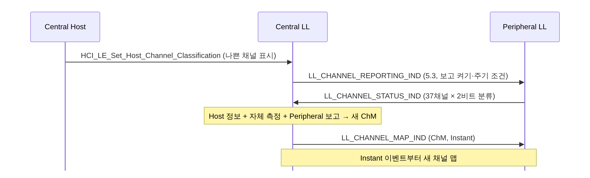

[[TIP("📘 규격 · 버전")]]
Core v6.0 Vol 6 Part B (Link Layer) — Channel Selection Algorithm #1, #2, 채널 맵 갱신·최소 사용 채널 수·채널 분류 보고 절차 · Vol 4 Part E (HCI) `HCI_LE_Set_Host_Channel_Classification`
Core 4.0 CSA #1 → 5.0 CSA #2, 최소 사용 채널 수 절차 → 5.2 CSA #2를 등시성 채널 서브이벤트에도 사용 → 5.3 채널 분류 강화(Peripheral 보고)
[[/TIP]]

[TOC]

[[TIP("🟢 한눈에 보기")]]
LE 연결은 **연결 이벤트마다 데이터 채널(0–36)을 바꿔 가며** 통신합니다. 한 채널이 Wi-Fi 등으로 막혀도 다음 이벤트는 다른 채널로 가니 연결이 버팁니다.

- **CSA #1 (4.0)**: "매번 hop 칸씩 건너뛰기" — 단순하지만 패턴이 규칙적
- **CSA #2 (5.0)**: 이벤트 번호와 접속 주소로 **의사난수**를 만들어 채널을 고름 — 더 고르게 퍼짐
- 두 방식 모두 **채널 맵**에서 "안 쓰는 채널"이 나오면 쓰는 채널 중 하나로 **다시 매핑**
- 채널 맵은 Central이 관리하고, 나쁜 채널을 빼려면 `LL_CHANNEL_MAP_IND`로 바꿈
[[/TIP]]

## CSA #1 (🔵 중급)

$$
\text{unmappedChannel} = (\text{lastUnmappedChannel} + \text{hopIncrement}) \bmod 37
$$

- `hopIncrement`는 `CONNECT_IND`의 `Hop` 필드(5–16에서 무작위). 37이 소수라서 어떤 값이든 37 이벤트 동안 모든 채널을 한 번씩 거칩니다.
- unmappedChannel이 채널 맵에서 **사용(used)**이면 그대로, **미사용(unused)**이면
$$
\text{remappingIndex} = \text{unmappedChannel} \bmod N\_{\text{used}}
$$
  을 구해, 사용 채널을 오름차순으로 늘어놓은 표의 remappingIndex번째 채널을 씁니다.

예: hopIncrement = 7, 채널 10–19가 미사용(사용 채널 27개), 직전 unmapped = 0.

| 이벤트 | unmapped | 상태 | 실제 채널 |
|---|---|---|---|
| 1 | 7 | 사용 | 7 |
| 2 | 14 | 미사용 → 14 mod 27 = 14 | 24 (표: 0–9, 20, 21, 22, 23, **24** …) |
| 3 | 21 | 사용 | 21 |
| 4 | 28 | 사용 | 28 |
| 5 | 35 | 사용 | 35 |
| 6 | 5 (= 42 mod 37) | 사용 | 5 |
| 7 | 12 | 미사용 → 12 mod 27 = 12 | 22 |

규칙성 때문에 미사용 채널이 많으면 같은 채널이 특정 간격으로 몰리고, 스니퍼가 hopIncrement를 쉽게 추정할 수 있다는 약점이 있습니다.

## CSA #2 (🔵 중급)

5.0에서 추가되었고, 광고 PDU 헤더의 `ChSel` 비트로 양쪽이 지원을 알리면 연결에 사용됩니다. 주기적 광고, 등시성 채널(CIS/BIS)에도 쓰입니다.

| 단계 | 계산 |
|---|---|
| 채널 식별자 | `channelIdentifier` = AA[31:16] XOR AA[15:0] |
| 의사난수 | 16비트 이벤트 카운터 XOR 식별자 → (바이트별 비트 뒤집기 PERM → 곱셈·덧셈 MAM) × 3회 → 다시 식별자와 XOR = `prn_e` |
| unmapped 채널 | `prn_e` mod 37 |
| 재매핑 | 미사용이면 remappingIndex = ⌊N_used × prn_e / 2¹⁶⌋ → 사용 채널 표에서 선택 |
| 서브이벤트(ISO) | 같은 함수를 이어 돌려 서브이벤트마다 다른 채널(5.2) |

CSA #2의 재매핑은 나머지 연산이 아니라 **비례 스케일링**이라서, 미사용 채널이 많아도 사용 채널들에 고르게 퍼집니다. 이벤트 카운터만 알면 계산할 수 있으므로 상태(lastUnmapped)를 들고 다닐 필요가 없고, 이벤트를 건너뛴 Peripheral도 바로 맞는 채널을 구합니다.

| 항목 | CSA #1 | CSA #2 |
|---|---|---|
| 입력 | 직전 unmapped 채널, hopIncrement | 이벤트 카운터, AA |
| 패턴 | 고정 간격 | 의사난수 |
| 재매핑 | mod N_used | N_used로 비례 스케일 |
| 사용처 | 연결(레거시) | 연결, 주기적 광고, CIS/BIS 서브이벤트 |
| 선택 | 양쪽 `ChSel` = 1이 아니면 | 양쪽 지원 시 |

## 채널 맵 관리 (🔵 중급)

| 절차 | PDU | 도입 | 요점 |
|---|---|---|---|
| 채널 맵 갱신 | `LL_CHANNEL_MAP_IND` | 4.0 (당시 `LL_CHANNEL_MAP_REQ`) | Central만 시작. instant 이후 새 맵 |
| 최소 사용 채널 수 | `LL_MIN_USED_CHANNELS_IND` | 5.0 | Peripheral이 특정 PHY에서 최소 몇 채널을 써 달라고 요구(규제·전력 제한 대응) |
| 채널 분류 보고 | `LL_CHANNEL_REPORTING_IND` / `LL_CHANNEL_STATUS_IND` | 5.3 | Peripheral의 관측을 Central이 반영 |

채널 맵에는 **사용 채널이 2개 이상** 있어야 합니다. 실제 구현은 공존 성능 때문에 훨씬 많이(보통 20개 이상) 남깁니다.

[[TIP("🔴 전문가 노트 — 분류 보고, 맵 변경 타이밍, 디버깅")]]
**5.3 채널 분류 강화.** 4.x–5.2에서는 Peripheral이 자기 쪽에서 본 간섭을 Central에 알릴 표준 수단이 없었습니다. 5.3의 `LL_CHANNEL_STATUS_IND`는 37개 채널 각각에 2비트 분류(좋음/나쁨/알 수 없음 등)를 담고, Central이 `LL_CHANNEL_REPORTING_IND`로 정한 최소·최대 보고 간격을 지켜 분류가 바뀔 때만 보냅니다. 이 값을 맵에 어떻게 반영할지는 Central 구현 몫입니다.

**맵 변경과 instant.** 채널 맵 갱신과 연결 파라미터 갱신은 둘 다 instant를 쓰므로 동시에 진행할 수 없습니다 → **LL 제어 절차**. 간섭이 갑자기 생겼을 때 맵 반영까지 최소 수 이벤트가 걸리는 이유입니다.

**스니핑.** CSA #1 연결은 몇 이벤트만 관찰해도 hopIncrement와 맵을 역산해 따라갈 수 있습니다. CSA #2도 AA와 이벤트 카운터를 알면 계산 가능하므로 보안 기능이 아닙니다. 기밀성은 링크 암호화로 지켜야 합니다.

**광고 채널은 별개.** 광고 채널 37/38/39는 채널 맵·CSA와 무관합니다. 확장 광고의 보조 채널(`AUX_*`)은 데이터 채널 0–36 중에서 광고자가 고릅니다 → **확장 광고**.
[[/TIP]]

## Classic ↔ LE 비교

| 항목 | Classic (BR/EDR) | LE |
|---|---|---|
| 채널 수 | 79 (1 MHz) | 데이터 37 + 광고 3 (2 MHz) |
| 도약 속도 | 초당 1600 홉(슬롯마다) | 연결 이벤트마다 1번 |
| 도약 계산 입력 | Master 클록 + BD_ADDR | CSA #1: hop / CSA #2: 이벤트 카운터 + AA |
| 적응형 도약 | AFH (최소 20채널) | 채널 맵 (최소 2채널) |

## 관련 페이지
- **채널과 송신 전력** — 채널 번호와 주파수
- **주파수 도약과 AFH** — 도약의 원리와 Classic AFH
- **Wi-Fi와의 공존** — 어떤 채널을 빼야 하는가
- **연결 이벤트와 파라미터** — 채널이 바뀌는 단위
- **등시성 채널 (CIS·BIS)** — 서브이벤트 채널 선택
