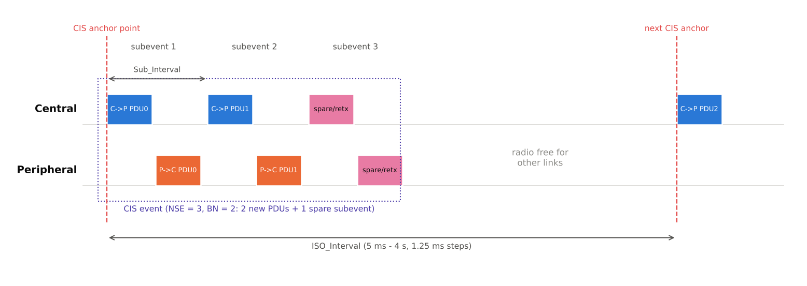
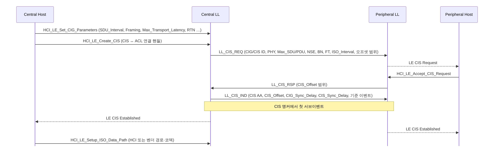

[[TIP("📘 규격 · 버전")]]
Core v6.0 Vol 6 Part B (Link Layer) — Connected Isochronous Group/Stream, Broadcast Isochronous Group/Stream, BIGInfo · Vol 6 Part G (ISOAL) · Vol 4 Part E (HCI) ISO 명령·데이터 경로 · 상위: BAP·CAP (LE Audio)
Core 5.2 도입(CIS·BIS·ISOAL) → 5.3 이후 세부 개선 → 6.0 ISOAL 강화(Unsegmented Framed 모드)
[[/TIP]]

[TOC]

[[TIP("🟢 한눈에 보기")]]
음성처럼 **"늦게 오면 쓸모없는" 데이터**를 위해 만든 전송 방식입니다. 일반 연결(ACL)은 받을 때까지 재전송하지만, 등시성 채널은 **정해진 시간 안에서만 재전송하고, 시간이 지나면 버립니다(flush)**.

- **CIS**(Connected Isochronous Stream): 연결된 두 기기 사이의 양방향 스트림. 여러 CIS를 묶은 것이 **CIG**. 예: 휴대폰 ↔ 왼쪽·오른쪽 이어버드
- **BIS**(Broadcast Isochronous Stream): 연결 없이 한 방향으로 뿌리는 스트림. 묶음은 **BIG**. 예: Auracast 방송
- 모든 수신기가 **같은 시각에 재생**하도록 동기 기준점을 정해 둠 → 좌우 이어버드가 어긋나지 않음
- 응용 데이터(SDU)를 무선 패킷(PDU)으로 나누고 붙이는 일은 **ISOAL**이 담당
[[/TIP]]

*그림. CIS 이벤트는 ISO_Interval마다 시작하고, 그 안에 NSE개의 서브이벤트가 Sub_Interval 간격으로 놓입니다. 예에서 BN = 2(이벤트마다 새 PDU 2개), NSE = 3이므로 남는 서브이벤트 하나를 재전송에 씁니다. 응답을 받으면 남은 서브이벤트는 쉬고, 이벤트 사이 시간은 다른 링크가 씁니다.*

## CIS와 CIG (🔵 중급)

| 파라미터 | 의미 | 범위(HCI·LL 기준) |
|---|---|---|
| ISO_Interval | CIS 이벤트 주기 | 5 ms – 4 s, 1.25 ms 단위 |
| NSE | 이벤트당 서브이벤트 수 | 1 – 31 |
| BN (C→P, P→C) | 이벤트당 새 페이로드 수, 방향별 | 0 – 15 (0이면 그 방향 데이터 없음) |
| FT (Flush Timeout) | 한 페이로드를 시도할 수 있는 CIS 이벤트 수 | 1 – 255 |
| Max_PDU | PDU 최대 크기 | 0 – 251 B |
| Sub_Interval | 서브이벤트 시작 간격 | NSE > 1일 때 |
| Packing | 여러 CIS의 서브이벤트 배치 | Sequential / Interleaved |
| CIG 크기 | 한 CIG 안 CIS 수 | 최대 31 |

Host는 SDU 간격·최대 전송 지연·재전송 횟수(RTN) 같은 "원하는 품질"만 주고, BN·FT·NSE 같은 무선 파라미터는 Controller가 고르는 것이 일반적입니다. 직접 정하려면 `HCI_LE_Set_CIG_Parameters_Test`를 씁니다.

## BIS와 BIG (🔵 중급)

| 파라미터 | 의미 |
|---|---|
| NSE, BN | 서브이벤트 수, 이벤트당 새 페이로드 수 |
| **IRC** (Immediate Repetition Count) | 같은 이벤트 안에서 각 페이로드를 반복하는 횟수 |
| **PTO** (Pre-Transmission Offset) | 미래 이벤트의 페이로드를 미리 보내는 오프셋 — 남는 서브이벤트를 사전 전송에 사용 |
| BIS_Spacing, Sub_Interval | BIS 사이·서브이벤트 사이 간격 (Sequential / Interleaved 배치) |
| 제어 서브이벤트 | `BIG_CHANNEL_MAP_IND`, `BIG_TERMINATE_IND` 전달 |

BIS에는 ACK가 없으므로 신뢰도를 **반복(IRC)과 사전 전송(PTO)**으로 확보합니다. 수신기는 주기적 광고(`AUX_SYNC_IND`)의 ACAD에 실린 **BIGInfo**로 BIG의 타이밍·파라미터를 알아내 `HCI_LE_BIG_Create_Sync`로 동기화합니다. 암호화된 BIG은 Broadcast_Code에서 유도한 키를 씁니다 → **주기적 광고와 PAwR**, **Auracast 브로드캐스트**.

| 항목 | CIS | BIS |
|---|---|---|
| 연결 | ACL 위에 생성 | 연결 없음 (주기적 광고로 안내) |
| 방향 | 양방향 (방향별 BN) | 단방향 |
| 신뢰도 | ACK + 재전송(FT 이내) | 반복(IRC) + 사전 전송(PTO) |
| 수신기 수 | 1 | 제한 없음 |
| 채널 선택 | CSA #2 (서브이벤트마다) | CSA #2 (서브이벤트마다) |

## 동기 기준점과 ISOAL (🔵 중급)

**동기 기준점.** CIG에서는 마지막 CIS 이벤트가 끝날 수 있는 시점을 **CIG 동기 지연(CIG_Sync_Delay)**으로 정해, 모든 수신기가 "CIG 기준 앵커 + CIG_Sync_Delay"를 공통 기준점으로 씁니다. 각 CIS는 자기 앵커에서 기준점까지의 **CIS_Sync_Delay**를 받으므로, 첫 번째 CIS를 받은 이어버드와 마지막 CIS를 받은 이어버드가 같은 시각에 SDU를 재생할 수 있습니다. BIG도 BIG_Sync_Delay로 같은 원리를 씁니다. 송신 쪽 Host는 `HCI_LE_Read_ISO_TX_Sync`로 SDU가 실제 나간 시각을 얻어 오디오 클록을 맞춥니다.

**ISOAL**(Isochronous Adaptation Layer)은 SDU 간격과 ISO 간격이 다를 때 둘을 이어 줍니다.

| 모드 | 방식 | 언제 |
|---|---|---|
| Unframed | SDU를 PDU에 그대로 나눠 담음 (LLID로 시작/계속/끝 표시). 시간 정보 없음 | SDU 간격과 ISO 간격이 정수배로 맞을 때 (예: 10 ms LC3 프레임, 10 ms ISO 간격) |
| Framed | 세그먼트 헤더(완료 여부, 길이, **Time_Offset**)를 붙여 여러 SDU를 한 PDU에 담거나 쪼갬 | 간격이 맞지 않을 때 (예: 7.5 ms 프레임을 10 ms 간격에) |
| Unsegmented Framed (6.0) | Framed의 시간 정보는 유지하되 **SDU 하나 = PDU 하나**, 분할하지 않음 | 지연·신뢰도가 중요한 오디오. `Framing` 파라미터 0x02로 선택 |

[[TIP("🔴 전문가 노트 — 지연 계산, FT·RTN, 6.0 ISOAL")]]
**전송 지연.** CIS의 최대 전송 지연은 대략 CIG_Sync_Delay + FT × ISO_Interval (+ Framed일 때 SDU 간격 추가 항)로 결정됩니다. FT를 키우면 재전송 기회가 늘어 신뢰도는 오르지만 지연과 버퍼가 커집니다. LE Audio의 BAP는 "낮은 지연"과 "높은 신뢰도" 두 가지 QoS 설정 세트를 정의해 이 균형을 표준화합니다 → **BAP (Unicast·Broadcast)**.

**RTN과 NSE.** Host가 주는 RTN(재전송 횟수)은 요구 사항이고, Controller는 이를 NSE와 FT의 조합으로 바꿉니다. 같은 RTN이라도 "한 이벤트 안에서 몰아서"(NSE↑)인지 "여러 이벤트에 걸쳐"(FT↑)인지에 따라 간섭 내성이 다릅니다. 순간 간섭이 잦은 2.4 GHz에서는 이벤트에 걸쳐 나누는 쪽이 유리할 때가 많습니다.

**6.0 Unsegmented Framed 모드.** 일반 Framed 모드는 SDU가 PDU 경계를 넘어 쪼개질 수 있어, SDU 하나를 복원하려면 여러 PDU를 모두 받아야 하고 그중 하나만 잃어도 SDU 전체를 잃습니다. 새 모드는 SDU와 PDU를 1:1로 대응시켜 수신기가 여러 패킷을 기다리지 않고 바로 디코딩할 수 있고, SDU 손실 확률이 패킷 수에 따라 커지지도 않습니다. `HCI_LE_Set_CIG_Parameters`·`HCI_LE_Create_BIG`의 Framing = 0x02로 선택합니다.

**6.0 프레임 간격.** CIS 서브이벤트의 패킷 간격·서브이벤트 간 최소 간격도 6.0 Frame Space Update로 협상할 수 있게 되었습니다 → **데이터 길이 확장 (DLE)**.
[[/TIP]]

## 관련 페이지
- **LE Audio 개요** — CIS·BIS 위에 쌓인 오디오 아키텍처
- **BAP (Unicast·Broadcast)** — QoS 설정과 스트림 설정 절차
- **LC3 코덱** — 7.5 ms/10 ms 프레임과 ISO 간격
- **주기적 광고와 PAwR** — BIGInfo 전달
- **채널 선택 알고리즘** — 서브이벤트 채널 선택
