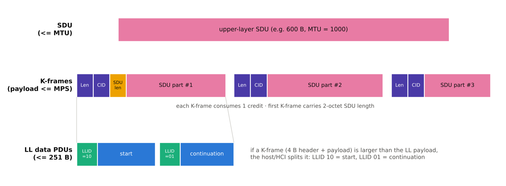
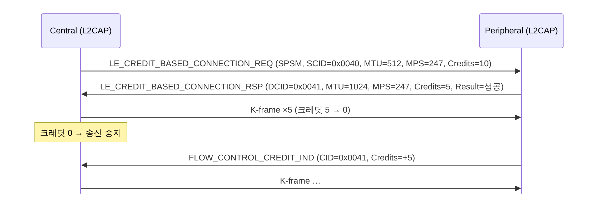

[[TIP("📘 규격 · 버전")]]
Core v6.0 Vol 3 Part A (Logical Link Control and Adaptation Protocol) · HCI ACL 데이터: Vol 4 Part E · LL 데이터 PDU의 LLID: Vol 6 Part B
Core 4.0 LE 고정 채널(ATT·LE 시그널링·SMP) → 4.1 LE Credit Based Flow Control(LE CoC) → 5.2 Enhanced Credit Based Flow Control(LE·BR/EDR 공통, EATT의 기반)
[[/TIP]]

[TOC]

[[TIP("🟢 한눈에 보기")]]
**L2CAP**(Logical Link Control and Adaptation Protocol)은 하나의 LE 연결을 여러 개의 "논리 채널"로 나눠 쓰게 해 주는 우체국 분류기입니다.

1. 모든 L2CAP 패킷 앞에는 **길이(Length)**와 **채널 번호(CID)** 4바이트가 붙습니다.
2. LE에서는 CID 0x0004(ATT), 0x0005(LE 시그널링), 0x0006(SMP)이 연결과 동시에 **항상 열려 있는** 고정 채널입니다. 별도 설정 없이 바로 씁니다.
3. 그 밖의 데이터(파일 전송, IPv6, EATT 등)는 **크레딧 기반 동적 채널(CoC)**을 열어서 보냅니다. 받는 쪽이 "버퍼 n개 비었음"을 크레딧으로 알려 주므로 넘침이 없습니다.
4. LL 패킷(최대 251바이트)보다 큰 L2CAP 패킷은 호스트가 잘라서 보내고, 받는 쪽 호스트가 다시 붙입니다.
[[/TIP]]

## 채널과 기본 헤더 (🔵 중급)

LE의 L2CAP은 Classic보다 훨씬 단순합니다. 기본 모드(Basic L2CAP Mode)에는 재전송·흐름 제어가 없고, 신뢰성은 링크 계층의 ACK/재전송에 맡깁니다.

| 필드 | 크기 | 의미 |
|---|---|---|
| Length | 2 B | 헤더를 뺀 정보 페이로드 길이 (리틀 엔디언) |
| Channel ID (CID) | 2 B | 목적지 논리 채널 |
| Information payload | 0–65535 B | 상위 프로토콜 데이터 (ATT PDU, SMP 명령 등) |

| CID (LE-U) | 용도 | 비고 |
|---|---|---|
| 0x0004 | ATT (Attribute Protocol) | 고정 채널, 비강화(unenhanced) ATT 베어러 |
| 0x0005 | LE L2CAP Signaling | 채널 열기/닫기, 연결 파라미터 갱신 요청 |
| 0x0006 | SMP (Security Manager Protocol) | 페어링·키 분배 |
| 0x0040–0x007F | 동적 할당 | LE CoC, Enhanced Credit Based 채널 |

[[TIP("📝 ATT 기본 MTU와 L2CAP")]]
고정 채널 0x0004의 ATT는 L2CAP 수준의 분할 정보를 쓰지 않고, ATT 자체의 `ATT_MTU`(기본 23바이트)를 따릅니다. 23바이트 ATT PDU + 4바이트 L2CAP 헤더 = 27바이트로, DLE 이전 LL 최대 페이로드(27바이트)에 정확히 들어갑니다. 4.0 설계가 이 숫자에 맞춰져 있다는 점을 기억해 두면 **처리량** 계산이 쉬워집니다.
[[/TIP]]

## 분할과 재조립 (🔵 중급)

*그림. 크레딧 기반 채널에서 상위 SDU는 MPS 이하의 K-frame으로 나뉘고(첫 K-frame에만 2바이트 SDU 길이), 각 K-frame은 다시 LL 데이터 PDU로 쪼개질 수 있습니다. LL 단계 분할은 LLID 10(시작)/01(연속)으로 표시합니다.*

분할은 두 층에서 일어납니다.

1. **L2CAP 분할(Segmentation)** — 크레딧 기반 채널에서만. SDU(최대 MTU)를 MPS 이하의 **K-frame**으로 나눕니다. K-frame 하나가 크레딧 하나를 씁니다.
2. **HCI/LL 단편화(Fragmentation)** — 모든 L2CAP PDU에 적용. 호스트는 컨트롤러 버퍼 크기(`HCI_LE_Read_Buffer_Size`)에 맞춰 ACL 패킷을 자르고, 컨트롤러는 첫 조각을 LLID `0b10`(시작 또는 완결), 이후 조각을 LLID `0b01`(연속)으로 보냅니다. 받는 쪽은 L2CAP 헤더의 Length를 보고 다 모일 때까지 기다립니다.

## 크레딧 기반 흐름 제어 (🔵 중급)

| 항목 | LE Credit Based Flow Control (4.1) | Enhanced Credit Based Flow Control (5.2) |
|---|---|---|
| 적용 링크 | LE만 | LE, BR/EDR |
| 한 번에 여는 채널 | 1개 | 최대 5개 (`L2CAP_CREDIT_BASED_CONNECTION_REQ`) |
| 최소 MTU / MPS | 23 / 23 | 64 / 64 |
| MPS 최대 | 65533 | 65533 |
| 재설정 | 불가 (다시 열어야 함) | `L2CAP_CREDIT_BASED_RECONFIGURE_REQ`로 MTU·MPS 변경 (MTU는 늘리기만 가능) |
| 대표 사용처 | IPSP(6LoWPAN), OTS, 독자 데이터 채널 | EATT (SPSM 0x0027), 새 프로파일 |

채널은 **SPSM**(Simplified Protocol/Service Multiplexer)으로 찾습니다. 0x0001–0x007F는 SIG가 할당한 고정 값, 0x0080–0x00FF는 동적으로 쓰는 값입니다. 연결 요청에는 SPSM, 자기 쪽 CID, MTU, MPS, **초기 크레딧(Initial Credits)**이 들어 있고, 이후 받는 쪽이 버퍼를 비울 때마다 `L2CAP_FLOW_CONTROL_CREDIT_IND`(4.1 당시 이름 LE Flow Control Credit)로 크레딧을 돌려줍니다. 크레딧 합이 65535를 넘으면 프로토콜 오류로 채널을 끊습니다.

## LE 시그널링 명령 (🔵 중급)

| 코드 | 명령 | 방향·용도 |
|---|---|---|
| 0x01 | `L2CAP_COMMAND_REJECT_RSP` | 모르는 명령·잘못된 CID에 대한 거절 |
| 0x06 / 0x07 | `L2CAP_DISCONNECTION_REQ` / `_RSP` | 동적 채널 닫기 |
| 0x12 / 0x13 | `L2CAP_CONNECTION_PARAMETER_UPDATE_REQ` / `_RSP` | Peripheral → Central: 연결 간격·지연·타임아웃 변경 요청 |
| 0x14 / 0x15 | `L2CAP_LE_CREDIT_BASED_CONNECTION_REQ` / `_RSP` | LE CoC 열기 (4.1) |
| 0x16 | `L2CAP_FLOW_CONTROL_CREDIT_IND` | 크레딧 추가 |
| 0x17 / 0x18 | `L2CAP_CREDIT_BASED_CONNECTION_REQ` / `_RSP` | Enhanced 채널 최대 5개 열기 (5.2) |
| 0x19 / 0x1A | `L2CAP_CREDIT_BASED_RECONFIGURE_REQ` / `_RSP` | MTU·MPS 재설정 (5.2) |

[[TIP("🔴 전문가 노트 — 연결 파라미터 갱신, MPS 선택, 흔한 버그")]]
**두 가지 파라미터 갱신 경로.** 4.0에서는 Peripheral이 연결 간격을 바꾸고 싶으면 L2CAP `CONNECTION_PARAMETER_UPDATE_REQ`를 보내고, Central 호스트가 수락하면 컨트롤러가 `LL_CONNECTION_UPDATE_IND`를 보냅니다. 4.1부터는 링크 계층의 Connection Parameters Request 절차(`LL_CONNECTION_PARAM_REQ`)로 컨트롤러끼리 직접 협상할 수 있습니다. 상대가 LL 절차를 지원하지 않으면(`LL_UNKNOWN_RSP`) L2CAP 경로로 되돌아가는 것이 일반적인 구현입니다. → **LL 제어 절차**

**MPS는 LL 페이로드에 맞춘다.** DLE로 LL 페이로드가 251바이트라면, K-frame = 4바이트 기본 헤더 + MPS ≤ 251이 되도록 MPS를 247로 잡으면 K-frame 하나가 LL 패킷 하나에 딱 들어갑니다. MPS를 더 크게 잡으면 HCI 단편화가 생기고, 작게 잡으면 헤더 비율이 커집니다.

**SDU 길이 필드.** 첫 K-frame의 페이로드 앞 2바이트가 SDU 길이이므로 첫 조각의 실제 데이터는 MPS − 2바이트입니다. 구현에서 이 2바이트를 빼먹어 마지막 조각 길이가 어긋나는 버그가 흔합니다.

**고정 채널은 크레딧이 없다.** CID 0x0004의 ATT는 흐름 제어가 없어 Write Without Response나 Notification을 너무 빨리 밀어 넣으면 호스트 버퍼(HCI ACL 버퍼 수)가 바닥나 송신 API가 실패를 돌려줍니다. Android의 `onCharacteristicWrite`, iOS의 `canSendWriteWithoutResponse` 같은 콜백이 이 상태를 알려 줍니다.
[[/TIP]]

## Classic ↔ LE 비교 (🔵 중급)

| 항목 | Classic (BR/EDR) | LE |
|---|---|---|
| 시그널링 채널 | CID 0x0001 | CID 0x0005 |
| 동적 채널 설정 | Connection + Configuration 단계 (MTU, 모드 협상) | 요청/응답 한 번 (크레딧 기반) |
| 모드 | Basic, ERTM, Streaming, (5.2부터) Enhanced Credit Based | Basic, LE Credit Based, Enhanced Credit Based |
| 채널 식별 | PSM (홀수, 2바이트 이상) | SPSM (1바이트 범위) |
| 재전송 | ERTM에서 L2CAP 재전송 가능 | 없음 (LL 재전송에 의존) |

## 관련 페이지
- **ATT** — 고정 채널 0x0004 위의 속성 프로토콜
- **EATT** — Enhanced Credit Based 채널 위에서 ATT를 병렬로 돌리기
- **처리량 최적화** — MTU·MPS·DLE를 함께 맞추는 법
- **데이터 길이 확장 (DLE)** — LL 페이로드 27 → 251바이트
- **L2CAP·SDP·RFCOMM** — Classic 쪽 L2CAP
