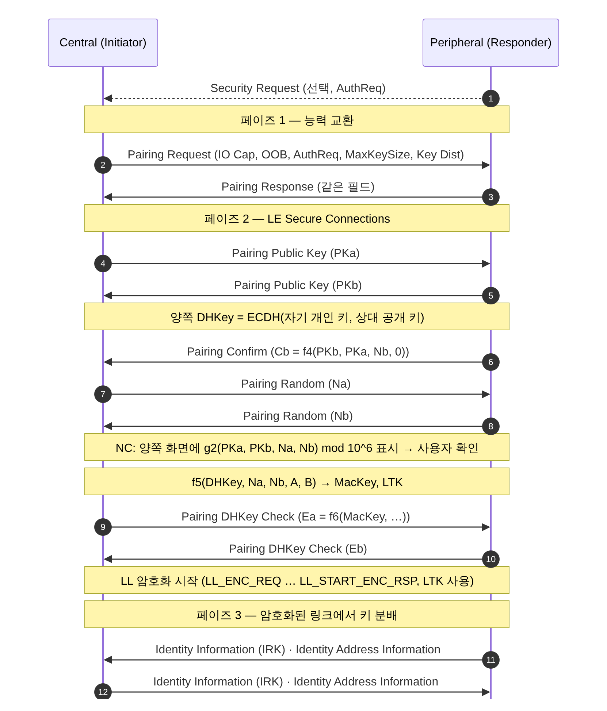

[[TIP("📘 규격 · 버전")]]
Core v6.0 Vol 3 Part H (Security Manager Protocol: 페어링 페이즈, 연결 모델, 암호 함수 f4/f5/f6/g2, 키 분배) · Vol 3 Part C (GAP — 본딩, 보안 모드) · Vol 6 Part B (LL 암호화 시작 절차) · Vol 4 Part E (HCI)
4.0 LE Legacy Pairing(SMP 도입) → 4.2 LE Secure Connections(P-256 ECDH, Numeric Comparison), CTKD → 5.4 LE GATT Security Levels 특성
[[/TIP]]

[TOC]

[[TIP("🟢 한눈에 보기")]]
**페어링(pairing)**은 두 기기가 처음 만나 공유 비밀을 만드는 과정이고, **본딩(bonding)**은 그 결과 키를 저장해 다음에 다시 페어링하지 않게 하는 것입니다.

LE 페어링은 **SMP**(Security Manager Protocol)가 호스트에서 수행하며 세 단계로 나뉩니다.

1. **페이즈 1 — 서로 소개**: "나는 화면이 있다/키보드가 있다", "MITM 보호가 필요하다", "Secure Connections를 지원한다" 같은 조건을 교환
2. **페이즈 2 — 비밀 만들기**: 조건에 맞는 방식(Just Works, Passkey, Numeric Comparison, OOB)으로 키를 만들고 링크를 암호화
3. **페이즈 3 — 키 나눠 주기**: 암호화된 링크 위에서 다음에 쓸 키(LTK, IRK, CSRK)를 전달

본딩한 기기는 다음 연결에서 저장한 LTK로 바로 암호화를 시작합니다.
[[/TIP]]

## SMP 페이즈와 메시지 (🔵 중급)

SMP는 L2CAP 고정 채널 CID `0x0006`(LE)을 쓰며, 모든 단계는 30초 타임아웃 안에 끝나야 합니다. 페리페럴은 `Security Request`로 센트럴에게 페어링 시작을 요청할 수 있습니다.

| 코드 | PDU | 쓰임 |
|---|---|---|
| `0x01` / `0x02` | `Pairing Request` / `Pairing Response` | 페이즈 1 능력 교환 |
| `0x03` / `0x04` | `Pairing Confirm` / `Pairing Random` | 확인 값과 논스 교환 |
| `0x05` | `Pairing Failed` | 이유 코드와 함께 중단 |
| `0x06` / `0x07` | `Encryption Information` / `Central Identification` | LTK, EDIV·Rand (Legacy) |
| `0x08` / `0x09` | `Identity Information` / `Identity Address Information` | IRK, 신원 주소 |
| `0x0A` | `Signing Information` | CSRK |
| `0x0B` | `Security Request` | 페리페럴의 보안 요청 |
| `0x0C` / `0x0D` | `Pairing Public Key` / `Pairing DHKey Check` | LE SC 전용 |
| `0x0E` | `Keypress Notification` | Passkey 입력 진행 알림 |

## Pairing Request/Response 필드 (🔵 중급)

| 필드 | 크기 | 내용 |
|---|---|---|
| IO Capability | 1 B | `0x00` DisplayOnly, `0x01` DisplayYesNo, `0x02` KeyboardOnly, `0x03` NoInputNoOutput, `0x04` KeyboardDisplay |
| OOB Data Flag | 1 B | 상대의 OOB 인증 데이터를 가지고 있는지 |
| AuthReq | 1 B | Bonding Flags(2비트), **MITM**, **SC**(Secure Connections), Keypress, CT2 |
| Maximum Encryption Key Size | 1 B | 7–16 옥텟. 양쪽 값 중 작은 쪽이 최종 키 길이 |
| Initiator / Responder Key Distribution | 1 B씩 | EncKey(LTK), IdKey(IRK), SignKey(CSRK), LinkKey(CTKD) 비트 |

## 연결 모델 결정 (🔵 중급)

먼저 다음 순서로 거릅니다. ① **OOB**: Legacy는 양쪽이, LE SC는 한쪽이라도 OOB 데이터를 가졌으면 OOB. ② 양쪽 모두 **MITM 비트가 0**이면 Just Works. ③ 그 밖에는 IO 능력 표로 결정합니다(행 = 개시자, 열 = 응답자. JW = Just Works, PE = Passkey Entry, NC = Numeric Comparison).

| 개시자 \ 응답자 | DisplayOnly | DisplayYesNo | KeyboardOnly | NoInputNoOutput | KeyboardDisplay |
|---|---|---|---|---|---|
| **DisplayOnly** | JW | JW | PE (개시자 표시) | JW | PE (개시자 표시) |
| **DisplayYesNo** | JW | Legacy: JW / **SC: NC** | PE (개시자 표시) | JW | Legacy: PE / **SC: NC** |
| **KeyboardOnly** | PE (응답자 표시) | PE (응답자 표시) | PE (양쪽 입력) | JW | PE (응답자 표시) |
| **NoInputNoOutput** | JW | JW | JW | JW | JW |
| **KeyboardDisplay** | PE (응답자 표시) | Legacy: PE / **SC: NC** | PE (개시자 표시) | JW | Legacy: PE / **SC: NC** |

| 모델 | 사용자 동작 | MITM 보호 | 결과 키 |
|---|---|---|---|
| Just Works | 없음(또는 "예"만) | 없음 | 인증되지 않은 키 |
| Passkey Entry | 6자리 숫자 표시·입력 | 있음 | 인증된 키 |
| Numeric Comparison (SC 전용) | 양쪽 6자리 비교 후 확인 | 있음 | 인증된 키 |
| OOB | NFC 등 다른 채널로 값 전달 | OOB 채널이 안전하면 있음 | 인증된 키 |

LE SC의 **Passkey Entry**는 6자리(약 20비트)를 한 비트씩 20라운드에 걸쳐 커밋·공개하므로, Legacy와 달리 도청으로 passkey를 맞출 수 없습니다. 다만 같은 passkey를 재사용하면(정적 passkey) 능동 공격자가 한 번 관찰한 뒤 다음 페어링에서 MITM이 가능해지므로 매번 새로 만들어야 합니다.

[[TIP("🔴 전문가 노트 — 암호 함수, Legacy와의 차이, HCI 흐름")]]
**LE SC 함수(모두 AES-CMAC 기반).** `f4`(Confirm 값), `f5`(DHKey에서 MacKey와 LTK 유도, 솔트와 "btle" 키 ID 사용), `f6`(DHKey Check — IO 능력과 주소까지 묶어 다운그레이드를 탐지), `g2`(Numeric Comparison 6자리 값). 공개 키는 P-256이며 수신한 공개 키가 곡선 위의 점인지 반드시 검증해야 합니다(2018년 무효 곡선 공격이 이 검증 누락을 노렸습니다).

**Legacy 페이즈 2.** TK로 `c1`(Confirm), `s1`로 **STK** = s1(TK, Srand, Mrand)을 만들어 링크를 암호화하고, 페이즈 3에서 실제 LTK와 **EDIV·Rand**를 배포합니다. LE SC에서는 LTK가 f5에서 바로 나오므로 배포하지 않고 EDIV·Rand는 0입니다.

**키 길이.** 최종 키는 협상된 길이(7–16옥텟)만큼 남기고 상위 바이트를 0으로 마스킹합니다. 짧은 키를 받아들일지는 호스트 정책입니다.

**HCI 흐름.** SMP 자체는 ACL 데이터로 오갑니다. 암호화는 센트럴 호스트가 `HCI_LE_Enable_Encryption`(LTK, EDIV, Rand)으로 시작하고, 페리페럴 컨트롤러는 `HCI_LE_Long_Term_Key_Request` 이벤트로 호스트에 키를 묻습니다(`HCI_LE_Long_Term_Key_Request_Reply`). 결과는 `HCI_Encryption_Change` 이벤트로 옵니다. P-256 계산은 `HCI_LE_Read_Local_P-256_Public_Key`·`HCI_LE_Generate_DHKey`로 컨트롤러에 맡길 수도 있습니다.
[[/TIP]]

## 본딩과 키 저장 (🔵 중급)

Bonding Flags가 양쪽 모두 "Bonding"이면 페이즈 3에서 받은 키를 비휘발성 메모리에 저장합니다. 저장 단위는 상대의 **신원 주소(Identity Address)** 입니다.

| 저장 항목 | 용도 |
|---|---|
| 상대 신원 주소 + 주소 종류 | 본딩 레코드의 키 |
| LTK (+ Legacy면 EDIV·Rand, 키 길이, 인증 여부) | 재연결 시 암호화 |
| 상대 IRK | RPA 해석 — **프라이버시와 RPA** |
| 상대 CSRK + SignCounter | 서명된 쓰기 검증 |
| GATT 상태 | CCCD 구독, Service Changed, 데이터베이스 해시 |

한쪽만 본딩 정보를 지우면 다음 재연결에서 암호화가 실패합니다(`PIN or Key Missing`). 이때 자동으로 재페어링을 허용하면 사칭 공격의 통로가 되므로, 사용자 확인을 거치도록 하는 구현이 많습니다.

## 관련 페이지
- **키 계층과 CTKD** — 분배되는 키의 의미와 CTKD
- **보안 모델의 진화** — Legacy Pairing의 약점
- **LL 제어 절차** — 링크 계층 암호화 시작 절차
- **HCI 명령과 이벤트** — 페어링 관련 HCI 명령
