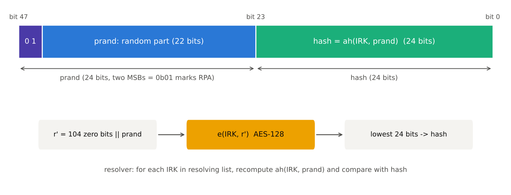

[[TIP("📘 규격 · 버전")]]
Core v6.0 Vol 6 Part B (디바이스 주소, 링크 계층 프라이버시, Resolving List) · Vol 3 Part H (보안 함수 ah) · Vol 3 Part C (GAP — 프라이버시 기능, Central Address Resolution 특성) · Vol 4 Part E (HCI)
4.0 호스트 기반 프라이버시(RPA) → 4.2 컨트롤러 기반 프라이버시(LL Privacy, Resolving List) → 5.0 프라이버시 모드(Network/Device) → 5.4 암호화된 광고 데이터 → 6.1 RPA 갱신 시점 무작위화
[[/TIP]]

[TOC]

[[TIP("🟢 한눈에 보기")]]
LE 기기는 광고할 때 자기 주소를 공중에 뿌립니다. 주소가 고정이면 누구든 수신기만 있으면 "이 이어폰이 어제도 이 매장에 왔다"를 알 수 있습니다.

**RPA**(Resolvable Private Address)는 이렇게 막습니다.

1. 기기는 몇 분마다 **겉보기에 무작위인 새 주소**로 바꿉니다.
2. 그 주소 안에는 기기의 비밀 키 **IRK**로 만든 짧은 서명(hash)이 숨어 있습니다.
3. 본딩 때 IRK를 받은 상대만 이 서명을 확인해 "아, 내 이어폰이구나"를 알아봅니다. 모르는 사람에게는 매번 다른 낯선 주소일 뿐입니다.

주소만 바꿔서는 충분하지 않습니다. 광고 데이터 안에 고정된 이름이나 일련번호가 있으면 그것으로 추적됩니다.
[[/TIP]]

## RPA 생성과 해석 (🔵 중급)

*그림. RPA는 상위 24비트 prand(최상위 2비트가 01이어서 RPA임을 표시)와 하위 24비트 hash로 이루어집니다. hash는 IRK로 prand를 AES-128 암호화한 결과의 하위 24비트이며, 해석하는 쪽은 가진 IRK마다 같은 계산을 해 비교합니다.*

| 주소 종류 | 최상위 2비트 | 바뀌는 시점 | 추적 가능성 |
|---|---|---|---|
| 공개 주소 (Public) | — (IEEE 할당) | 바뀌지 않음 | 높음 |
| 랜덤 정적 (Static) | `11` | 전원 재투입 때 정도 | 높음 |
| **RPA** | `01` | 주기적(기본 15분) | 낮음, IRK 보유자만 식별 |
| NRPA (Non-resolvable) | `00` | 주기적 | 낮음, 아무도 식별 못 함 |

생성 식은 $hash = ah(IRK, prand) = e(IRK,\ r') \bmod 2^{24}$, $r' = 0^{104} \,\\vert\, prand$입니다. prand는 나머지 22비트가 모두 0이거나 모두 1이면 안 됩니다. 해석하는 쪽은 **Resolving List**의 IRK마다 ah를 계산해 hash와 비교하고, 맞으면 그 항목의 **신원 주소(Identity Address)**로 바꿔 생각합니다. hash가 24비트이므로 엉뚱한 IRK가 우연히 맞을 확률은 IRK 하나당 $2^{-24}$입니다.

## 컨트롤러 기반 프라이버시 (4.2) (🔵 중급)

4.0에서는 호스트가 RPA를 만들고 해석했습니다. 문제는 화이트리스트(현재 이름 Filter Accept List)가 **컨트롤러**에 있다는 점입니다. 상대 주소가 계속 바뀌니 컨트롤러가 필터링을 못 하고, 결국 모든 광고를 호스트로 올려 깨워야 했습니다. 4.2는 IRK 목록을 컨트롤러로 내려 이 문제를 풀었습니다.

| HCI 명령 | 역할 |
|---|---|
| `HCI_LE_Add_Device_To_Resolving_List` | (상대 신원 주소, 상대 IRK, 내 IRK) 항목 추가 |
| `HCI_LE_Set_Address_Resolution_Enable` | 컨트롤러 주소 해석 켜기 |
| `HCI_LE_Set_Resolvable_Private_Address_Timeout` | RPA 갱신 주기 (기본 900초 = 15분) |
| `HCI_LE_Set_Privacy_Mode` (5.0) | 항목별 **Network Privacy Mode**(기본, 상대가 신원 주소를 쓰면 거부) / **Device Privacy Mode**(신원 주소도 수락) |
| `HCI_LE_Read_Local_Resolvable_Address` / `…_Peer_…` | 현재 쓰는 RPA 확인 |

컨트롤러는 광고 PDU의 RPA를 직접 해석해 Filter Accept List와 대조하고, 연결되면 `HCI_LE_Enhanced_Connection_Complete` 이벤트로 신원 주소와 실제 RPA를 함께 알립니다. 자신의 RPA도 컨트롤러가 주기마다 만들어 바꿉니다(Own_Address_Type `0x02`/`0x03`).

[[TIP("🔴 전문가 노트 — 6.1 RPA 갱신 무작위화, 해석 특성, 경계 조건")]]
**6.1 Randomized RPA Updates.** 고정 주기로 RPA를 바꾸면 "정확히 15분마다 주소가 바뀌는 기기"라는 패턴 자체가 주소 변경을 이어 붙이는 단서가 됩니다. Core 6.1은 갱신 시점을 **최소–최대 범위 안에서 무작위**로 고르게 했습니다. `HCI_LE_Set_Resolvable_Private_Address_Timeout` [v2]가 최소·최대 타임아웃(각 1–3600초)을 받으며, 기본값은 480–900초입니다. 지원하는 컨트롤러는 명령을 받지 않아도 기본으로 무작위화합니다. 호스트가 타이머를 직접 돌릴 필요가 없어 깨어나는 횟수도 줄어듭니다.

**Central Address Resolution 특성.** 상대가 RPA를 대상 주소로 쓴 directed 광고를 해석할 수 있는지 알리는 GAP 특성입니다. 지원하지 않는 상대에게는 RPA를 대상 주소로 쓰는 directed 광고를 보내면 안 됩니다. 이후 추가된 **Resolvable Private Address Only** 특성은 "본딩 뒤에는 RPA만 쓰겠다"는 약속을 알립니다.

**경계 조건.** Resolving List가 켜진 동안에는 목록을 수정할 수 없는 상태(광고·스캔·연결 시도 중)가 있어, 수정 전에 해석을 잠시 끄는 구현이 흔합니다. Resolving List 크기는 컨트롤러마다 다르며(`HCI_LE_Read_Resolving_List_Size`), 넘치면 호스트 해석으로 돌아가야 합니다.
[[/TIP]]

## 추적 위험과 광고 데이터 주의점 (🔵 중급)

| 새는 곳 | 예 | 대응 |
|---|---|---|
| 고정 식별자 | Complete Local Name에 일련번호, 제조사 데이터의 기기 ID | 이름 축약, 연결 후 GATT로만 제공, **암호화된 광고 데이터** |
| 주소와 데이터의 비동기 변경 | RPA는 바뀌었는데 광고 데이터의 카운터·난수는 그대로 | RPA를 바꿀 때 광고 데이터의 가변 필드도 함께 갱신 |
| 확장·주기적 광고 | 보조 채널의 ADI, 주기적 광고의 고정 패턴 | 주소 변경과 맞춰 SID·데이터 갱신 |
| 갱신 주기 패턴 | 정확히 같은 간격의 주소 변경 | 6.1 무작위화 |
| 공개 주소 노출 | Classic BD_ADDR이 그대로인 듀얼 모드 기기 | Classic 조회 가능 상태를 필요할 때만 켜기 |
| 신호 특성 | 송신 전력, 광고 간격, RF 지문 | 규격으로 완전히 막기 어려움 |

## Classic ↔ LE 비교

| 항목 | Classic (BR/EDR) | LE |
|---|---|---|
| 주소 | BD_ADDR 고정 | 공개·정적·RPA·NRPA |
| 주소 프라이버시 | 없음 (조회·연결 가능 상태를 끄는 것뿐) | RPA, 컨트롤러 해석 |
| 식별 키 | 없음 | IRK |

## 관련 페이지
- **디바이스 주소** — 주소 종류와 형식
- **키 계층과 CTKD** — IRK의 배포
- **스캔과 필터** — Filter Accept List와 스캔 동작
- **암호화된 광고 데이터** — 광고 내용 자체를 숨기기
