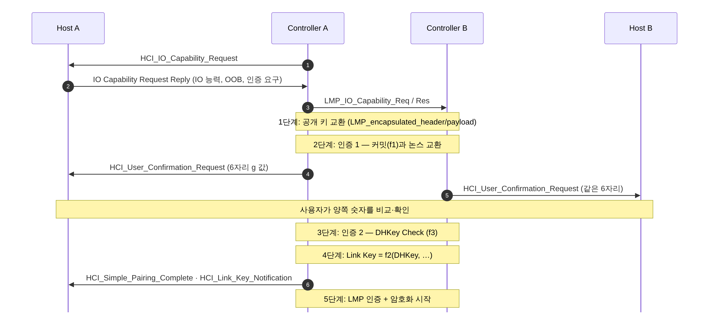

[[TIP("📘 규격 · 버전")]]
Core v6.0 Vol 2 Part H (BR/EDR Security Specification: 키 관리, 인증, 암호화) · Vol 2 Part C (LMP — 페어링·인증·암호화 PDU) · Vol 3 Part C (GAP — 보안 모드 4, Secure Connections Only 모드) · Vol 4 Part E (HCI)
1.x 레거시 PIN 페어링·E0 → 2.1 SSP(P-192, 보안 모드 4) → 4.1 Secure Connections(P-256, h4/h5 상호 인증, AES-CCM, LMP Ping) → 5.3 암호 키 길이 제어
[[/TIP]]

[TOC]

[[TIP("🟢 한눈에 보기")]]
Classic Bluetooth의 페어링은 **LMP**로 컨트롤러끼리 수행하고, 호스트는 HCI 이벤트로 "사용자에게 숫자를 보여 달라", "키가 만들어졌으니 저장하라" 같은 요청만 받습니다.

**SSP**(Secure Simple Pairing, 2.1)는 PIN 입력을 없앴습니다.

1. 서로 **IO 능력**을 알려 주고
2. **공개 키를 교환**해 공유 비밀(DHKey)을 만든 뒤
3. 상황에 맞는 방식(Numeric Comparison, Passkey Entry, Just Works, OOB)으로 "중간에 누가 끼지 않았는지" 확인하고
4. 그 결과로 **Link Key**를 만들어 저장합니다.

4.1의 **Secure Connections**는 같은 틀을 유지하면서 곡선을 P-256으로, 암호화를 E0에서 **AES-CCM**으로 바꾸고 인증을 양방향으로 강화했습니다.
[[/TIP]]

## SSP 단계 (🔵 중급)

| 단계 | 하는 일 | 함수 (2.1 / SC) |
|---|---|---|
| 1. 공개 키 교환 | ECDH 공개 키 교환 → DHKey | P-192 / **P-256** |
| 2. 인증 1 | 연결 모델별로 MITM 여부 확인 (커밋 → 논스 → 사용자 값) | f1, g |
| 3. 인증 2 | 교환 내용 전체를 확인 값으로 검증 | f3 |
| 4. Link Key 계산 | DHKey와 논스·주소로 Link Key 유도 | f2 |
| 5. 인증·암호화 | 이 키로 LMP 인증 후 암호화 시작 | E1 + E0 / **h4·h5 + AES-CCM** |

## 연결 모델과 Link Key 종류 (🔵 중급)

연결 모델 선택 원리는 LE와 같습니다. 양쪽 다 화면과 예/아니오 입력이 있으면 Numeric Comparison, 한쪽이 키보드만 있으면 Passkey Entry, 한쪽이 입출력이 없으면 Just Works, OOB 데이터가 있으면 OOB입니다. 다만 BR/EDR의 Just Works는 내부적으로 "자동 확인되는 Numeric Comparison"으로 처리됩니다. 호스트가 `HCI_IO_Capability_Request_Reply`에 담는 **Authentication Requirements**(MITM 필요 여부 × 본딩 종류)가 결과 키 종류를 좌우합니다.

| Link Key Type | 값 | 만드는 방법 | 보안 모드 4 레벨 |
|---|---|---|---|
| Combination Key | `0x00` | 레거시 PIN 페어링 | (레거시) |
| Debug Combination Key | `0x03` | SSP 디버그 모드(알려진 개인 키) | 사용 금지 수준 |
| Unauthenticated Combination Key (P-192) | `0x04` | SSP Just Works | 2 |
| Authenticated Combination Key (P-192) | `0x05` | SSP NC/PE/OOB | 3 |
| Changed Combination Key | `0x06` | 링크 키 변경 절차 | 원래 키 따름 |
| Unauthenticated Combination Key (P-256) | `0x07` | SC Just Works | 2 |
| Authenticated Combination Key (P-256) | `0x08` | SC NC/PE/OOB | **4** |

호스트는 `HCI_Link_Key_Notification`의 키 종류를 키와 함께 저장했다가, 서비스가 요구하는 레벨과 비교합니다. 레벨 3 서비스에 `0x04` 키로 접속하면 재페어링(MITM 포함)을 요구해야 합니다.

## 보안 모드 4와 Secure Connections Only (🔵 중급)

| 레벨 | 요구 | 대표 쓰임 |
|---|---|---|
| 0 | 보안 없음 | SDP 등 예외 서비스만 |
| 1 | 최소 보안(사용자 상호작용 최소, 암호화 선택) | 거의 쓰지 않음 |
| 2 | 인증 없는 키 + 암호화 | 일반 오디오 등 |
| 3 | 인증된 키 + 암호화 | 키보드, 파일 전송 |
| 4 | 인증된 **P-256** 키 + **AES-CCM** (128비트) | 고보안 서비스 |

**Secure Connections Only 모드**는 모든 서비스(SDP 제외)에 레벨 4를 요구합니다. 상대가 Secure Connections를 지원하지 않으면 연결을 거부하므로 구형 기기와는 붙지 않지만, P-192·E0·짧은 키로의 다운그레이드를 원천 차단합니다. BIAS·BLUFFS 공개 때 SIG가 권고한 대응 중 하나이기도 합니다.

[[TIP("🔴 전문가 노트 — 레거시 PIN, E0 vs AES-CCM, 상호 인증")]]
**레거시 PIN 페어링.** PIN(최대 16바이트)과 난수로 E22가 초기 키를 만들고, E21로 조합 키를 만듭니다. 교환되는 값을 엿들으면 짧은 PIN을 오프라인으로 대입해 Link Key를 복구할 수 있습니다. 2.1 이상 기기끼리는 SSP가 필수이며, 레거시는 상대가 2.0 이하일 때만 씁니다.

**E0 vs AES-CCM.** E0은 클록·주소로 초기화하는 LFSR 기반 스트림 암호로 무결성 보호(MIC)가 없습니다. Secure Connections의 AES-CCM은 패킷마다 MIC를 붙여 변조를 탐지하고, 패킷 카운터를 논스에 넣어 재전송을 막습니다. 4.1은 또 **Authenticated Payload Timeout**과 `LMP_ping_req`를 도입해, 일정 시간 안에 MIC가 붙은 패킷이 오지 않으면 링크 이상으로 판단하게 했습니다.

**상호 인증.** 레거시 인증(E1)은 한쪽이 질문하고 다른 쪽이 답하는 단방향이라, 공격자가 역할 전환으로 질문하는 쪽이 되면 키 없이 통과할 수 있었습니다(BIAS). Secure Connections 인증(h4/h5)은 양방향이고, SIG는 정오표로 레거시에서도 상호 인증이 호스트 책임임을 명확히 했습니다.

**HCI 스위치.** SSP는 `HCI_Write_Simple_Pairing_Mode`, SC는 `HCI_Write_Secure_Connections_Host_Support`로 호스트가 켭니다. 암호 키 길이는 `HCI_Read_Encryption_Key_Size`로 확인하고, 5.3 이후 `HCI_Set_Min_Encryption_Key_Size`로 하한을 둡니다.
[[/TIP]]

## Classic ↔ LE 비교

| 항목 | Classic (BR/EDR) | LE |
|---|---|---|
| 페어링 수행 | 컨트롤러(LMP) | 호스트(SMP) |
| 호스트 개입 | HCI 이벤트로 사용자 상호작용만 | 페어링 전체 |
| 결과 키 | Link Key (+ 종류) | LTK, IRK, CSRK |
| 인증 절차 | 연결마다 LMP 인증(E1 또는 h4/h5) | 별도 인증 없이 LTK로 암호화 성공 = 인증 |
| 암호화 | E0 또는 AES-CCM | AES-CCM |
| 최고 레벨 | Mode 4 Level 4 | Mode 1 Level 4 |

## 관련 페이지
- **보안 모델의 진화** — PIN에서 SC까지의 흐름
- **키 계층과 CTKD** — Link Key와 LTK 사이의 변환
- **링크 관리자 (LMP)** — LMP 절차 전반
- **알려진 공격과 대응** — KNOB, BIAS, BLUFFS
