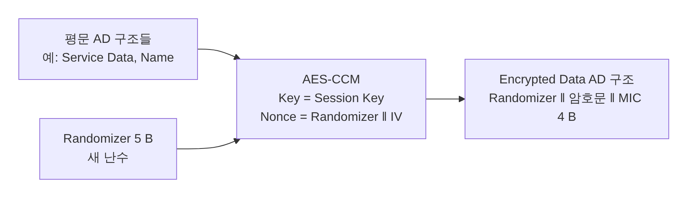

[[TIP("📘 규격 · 버전")]]
Core v5.4 이후 Vol 3 Part C (GAP — Encrypted Data Key Material 특성) · Core Specification Supplement (CSS) v11 이후 Part A (Encrypted Data AD 타입, 암호화 절차) · Vol 3 Part H (AES-CCM 보안 함수)
Core 5.4(2023) 도입 — 호스트 기능이라 컨트롤러 기능 비트가 필요 없음
[[/TIP]]

[TOC]

[[TIP("🟢 한눈에 보기")]]
광고는 누구나 받을 수 있는 방송입니다. 하지만 "온도계 값은 우리 집 앱만 보면 좋겠다", "출입 태그의 ID는 등록된 리더만 알아야 한다" 같은 요구가 있습니다. 예전에는 제조사마다 자체 암호화를 만들어 Manufacturer Specific Data에 넣었습니다.

**암호화된 광고 데이터**(EAD, Encrypted Advertising Data)는 이를 표준화했습니다.

1. 광고하는 기기는 **세션 키**와 **IV**를 정해 둡니다.
2. 이 키 자료를 미리 받은 기기(보통 한 번 연결해 GATT로 읽어 감)만 광고 내용을 풀 수 있습니다.
3. 광고 패킷에는 `Encrypted Data` AD 구조가 들어가고, 그 안에 평범한 AD 구조들이 AES-CCM으로 암호화되어 들어 있습니다.

연결 없이 **"아는 사람에게만 보이는 방송"**을 만드는 기능입니다.
[[/TIP]]

## 키 자료와 공유 방식 (🔵 중급)

| 항목 | 크기 | 설명 |
|---|---|---|
| Session Key | 16 B (128비트) | AES-CCM 키. 최소 128비트 엔트로피 |
| IV | 8 B (64비트) | 논스의 고정 부분. 세션 키를 바꿀 때 함께 바꿈 |
| Key Material 전체 | 24 B | Session Key ‖ IV |
| 공유 수단 | — | GAP 서비스의 **Encrypted Data Key Material** 특성(UUID `0x2B88`), 또는 OOB·사전 공유 |

광고하는 기기(보통 페리페럴)는 GAP 서비스에 Encrypted Data Key Material 특성을 둡니다. 키 자료를 받을 기기는 한 번 연결해 페어링·암호화한 뒤 이 특성을 읽고, 본딩 정보와 함께 저장합니다. 이 특성은 보안 요구가 걸린 특성이므로 암호화된(일반적으로 본딩된) 링크에서만 읽을 수 있게 구성합니다. 세부 접근 권한 요구는 규격 원문 확인이 필요합니다.

키 자료는 "한 번 받으면 계속" 쓰이므로, 키를 바꿨다면 이미 받아 간 기기들이 새 키를 다시 얻을 방법(재연결 후 읽기 또는 지시)이 필요합니다. 그래서 키 교체 주기는 서비스 설계 문제입니다.

## 암호화 절차와 패킷 구조 (🔵 중급)

| 필드 | 크기 | 설명 |
|---|---|---|
| Length · AD Type | 1 B + 1 B | AD 타입 `0x31` (Encrypted Data) |
| Randomizer | 5 B (40비트) | 매번 새로 고르는 난수. 마지막 바이트의 최상위 비트는 **방향 비트** |
| Encrypted Payload | 평문과 같은 길이 | 하나 이상의 AD 구조를 이어 붙인 것을 암호화 |
| MIC | 4 B | AES-CCM 무결성 값 |

- **논스** 13 B = Randomizer(5 B) ‖ IV(8 B). Randomizer가 바뀌므로 같은 키로도 논스가 반복되지 않습니다.
- **오버헤드**: Length·Type 2 B + Randomizer 5 B + MIC 4 B = **11 B**. 레거시 광고의 31 B 안에서는 실제 평문이 20 B까지로 줄어드므로, 큰 데이터는 **확장 광고**와 함께 쓰는 것이 자연스럽습니다.
- 암호화와 복호는 **호스트**가 합니다. 컨트롤러는 그냥 바이트열을 광고합니다.
- AES-CCM의 추가 인증 데이터(AAD)로 1바이트 고정값을 쓰며, 값은 CSS에 정의되어 있습니다.

[[TIP("🔴 전문가 노트 — Randomizer 갱신, 프라이버시와의 관계, 한계")]]
**Randomizer 갱신 시점.** 같은 평문을 같은 Randomizer로 계속 보내면 암호문이 고정되어 그 자체가 추적 식별자가 됩니다. 구현들은 **RPA가 바뀔 때마다** Randomizer를 새로 고르도록 권합니다(예: Zephyr 샘플). 광고 데이터 내용이 바뀔 때도 새로 골라야 논스 재사용이 생기지 않습니다.

**무엇을 막고 무엇을 못 막나.** EAD는 광고 **내용**의 기밀성과 무결성(MIC)을 줍니다. 그러나 ① 주소 추적은 RPA가 담당하고, ② 키 자료를 가진 모든 수신자는 서로 구별되지 않으므로(그룹 키) 수신자 중 하나가 유출되면 전체가 노출되며, ③ 재전송 공격은 막지 않습니다. 같은 암호화 광고를 녹화해 다시 내보내면 MIC는 여전히 유효합니다. 신선도가 필요하면 평문 안에 카운터·시간을 넣고 수신 측에서 검사해야 합니다.

**방향 비트.** Randomizer 마지막 바이트의 최상위 비트는 방향 비트로 예약되어 있어 Randomizer의 실제 난수 부분은 그보다 짧습니다. 이 비트의 정확한 용도와 설정 값은 CSS 원문 확인이 필요하며, 스택 API가 대신 채워 주는 경우가 많습니다.

**스택 지원.** Zephyr(`CONFIG_BT_EAD`, `bt_ead_encrypt()`/`bt_ead_decrypt()`), ESP-IDF, Silicon Labs SDK 등이 EAD API를 제공합니다. 호스트 기능이므로 5.4 이전 컨트롤러에서도 쓸 수 있습니다.
[[/TIP]]

## 쓰임새 (🔵 중급)

| 쓰임 | 암호화하는 내용 | 이점 |
|---|---|---|
| 센서 방송 | 온도·체중·혈압 같은 측정값 | 연결 없이 저전력 전송, 소유자만 읽음 |
| 출입·자산 태그 | 기기 ID, 상태 | 등록된 리더만 식별, 추적 위험 감소 |
| 개인 기기 표시 | 이름, 배터리 | 주변 사람에게 이름 노출 방지 |
| 주기적 광고 데이터 | 동기화된 수신자에게 보낼 내용 | 같은 키 자료로 그룹 배포 |

## Classic ↔ LE 비교

| 항목 | Classic (BR/EDR) | LE |
|---|---|---|
| 방송 데이터 | EIR (조회 응답) | 광고 데이터 |
| 표준 암호화 | 없음 | EAD (5.4) |
| 키 배포 | — | GAP 특성 또는 OOB |

## 관련 페이지
- **프라이버시와 RPA** — 주소 추적 방지와 Randomizer 갱신
- **광고 데이터 형식 (AD Type)** — AD 구조와 타입
- **확장 광고** — 큰 광고 데이터 운반
- **GAP** — GAP 서비스와 특성
