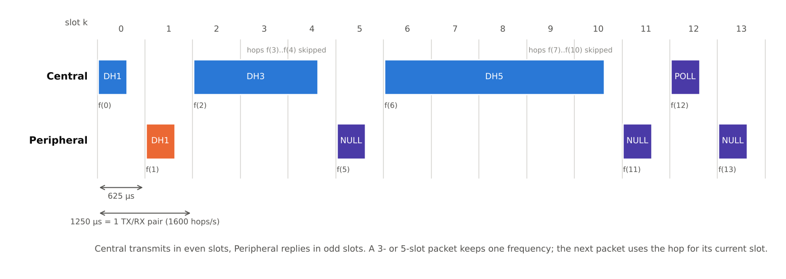
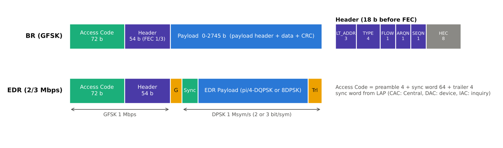

[[TIP("📘 규격 · 버전")]]
Core v6.0 Vol 2 Part B (Baseband Specification) — 피코넷, 클럭, 슬롯, 패킷 형식, 링크 제어기 상태 · 무선 규격: Vol 2 Part A (Radio)
Core 1.1 기본 구조 → 1.2 AFH·eSCO → 2.0 + EDR(2/3 Mbps 패킷) → 2.1 Sniff Subrating → 5.0 Park 상태 제거
[[/TIP]]

[TOC]

[[TIP("🟢 한눈에 보기")]]
Classic은 **한 명의 지휘자와 최대 7명의 연주자**로 이루어진 작은 악단입니다. 이 악단을 **피코넷**(piconet)이라고 부릅니다.

1. 지휘자(**Central**)의 시계가 기준입니다. 모두가 이 시계에 맞춰 625 µs마다 박자를 셉니다.
2. 박자(**슬롯**)마다 79개 채널 중 하나로 함께 건너뜁니다 — 초당 1600번.
3. 짝수 박자에는 Central이 말하고, 바로 다음 홀수 박자에는 Central이 지목한 Peripheral 하나만 대답합니다(**TDD**). 지목받지 않은 Peripheral은 말할 수 없습니다.
4. 긴 이야기를 할 때는 3박자 또는 5박자를 이어서 쓸 수 있습니다(다중 슬롯 패킷).

LE가 "이벤트마다 만나서 짧게 주고받는" 구조라면, Classic은 연결 동안 **끊이지 않는 슬롯 시간축**이 계속 돌아가는 구조입니다.
[[/TIP]]

## 피코넷과 스캐터넷 (🔵 중급)

| 항목 | 내용 |
|---|---|
| Central (옛 용어 master) | 피코넷 하나에 1개. 자신의 BD_ADDR와 클럭으로 도약 순서를 결정 |
| Peripheral (옛 용어 slave) | **활성 상태 최대 7개** — 패킷 헤더의 `LT_ADDR`가 3비트이고 0은 브로드캐스트용 |
| Park 상태 | 활성 7개 밖에서 동기만 유지하던 상태. **Core 5.0에서 규격에서 제거** |
| 스캐터넷 | 한 기기가 여러 피코넷에 참여(예: 폰이 이어폰의 Central이면서 차량의 Peripheral). 한 기기는 동시에 두 피코넷의 Central이 될 수 없음 |
| 역할 전환 | 연결 후 `HCI_Switch_Role`로 Central/Peripheral을 바꿀 수 있음 → **링크 관리자 (LMP)** |

스캐터넷에서 기기는 피코넷마다 다른 클럭·도약 순서를 따라야 하므로, 한쪽 피코넷에 있는 동안 다른 쪽에서는 Sniff 등으로 자리를 비웁니다. 실제 오디오 제품에서는 폰(Central) ↔ 이어폰처럼 **단순한 1:1 피코넷**이 대부분입니다.

## 클럭과 슬롯 (🔵 중급)

모든 기기는 자유 실행 클럭 **CLKN**(native clock)을 가집니다. 28비트 카운터이고 **312.5 µs(3.2 kHz)**마다 1씩 증가하므로, $2^{28} \times 312.5\ \mu s \approx 23.3$ 시간마다 한 바퀴 돕니다. Peripheral은 Central의 클럭과의 차이(오프셋)를 더해 피코넷 클럭 **CLK**를 만듭니다.

| 클럭 비트 | 주기 | 의미 |
|---|---|---|
| CLK0 | 312.5 µs | 반 슬롯. 조회·페이징에서 슬롯당 두 번 송신할 때 사용 |
| CLK1 | 625 µs | **슬롯** 경계. CLK1 = 0 이면 Central 송신 슬롯(짝수) |
| CLK2 | 1.25 ms | TX/RX 한 쌍 = 1600 홉/s |
| CLK12 | 1.28 s | 조회·페이지 스캔 간격 기준 |

*그림. 625 µs 슬롯 TDD. Central은 짝수 슬롯에서 시작하고, 주소를 받은 Peripheral은 바로 다음 홀수 슬롯에 응답합니다. 3·5 슬롯 패킷 동안에는 주파수가 고정되며, 다음 패킷은 그 슬롯 번호에 해당하는 홉 주파수를 씁니다(그 사이 홉은 건너뜀).*

## 패킷 구조 (🔵 중급)

*그림. BR 패킷은 Access Code · Header · Payload를 모두 GFSK로 보냅니다. EDR 패킷은 Header까지 GFSK로 보낸 뒤 보호 구간(Guard)과 동기 시퀀스(Sync)를 두고 π/4-DQPSK(2 Mbps) 또는 8DPSK(3 Mbps)로 변조를 바꿉니다.*

- **Access Code (72비트)**: 프리앰블 + 64비트 동기 워드 + 트레일러. 동기 워드는 LAP에서 만듭니다 — 피코넷 식별용 **CAC**(Central의 LAP), 페이징용 **DAC**(대상 기기의 LAP), 조회용 **IAC**. 상관기가 이 워드를 찾아 "우리 피코넷 패킷"인지 판단합니다.
- **Header (18비트 × 1/3 FEC = 54비트)**: `LT_ADDR`(3), `TYPE`(4), `FLOW`(1), `ARQN`(1), `SEQN`(1), `HEC`(8). `ARQN`/`SEQN`으로 1비트 ACK/NACK와 중복 검출을 합니다.
- **Payload**: ACL은 페이로드 헤더(LLID, FLOW, 길이) + 데이터 + 16비트 CRC.

| 종류 | 슬롯 | 최대 페이로드 (B) | FEC | 비대칭 최대 처리량 |
|---|---|---|---|---|
| DM1 / DH1 | 1 | 17 / 27 | 2/3 / 없음 | 108.8 / 172.8 kbps |
| DM3 / DH3 | 3 | 121 / 183 | 2/3 / 없음 | 387.2 / 585.6 kbps |
| DM5 / DH5 | 5 | 224 / 339 | 2/3 / 없음 | 477.9 / **723.2 kbps** |
| 2-DH1 / 2-DH3 / 2-DH5 | 1 / 3 / 5 | 54 / 367 / 679 | 없음 | 345.6 / 1174.4 / **1448.5 kbps** |
| 3-DH1 / 3-DH3 / 3-DH5 | 1 / 3 / 5 | 83 / 552 / 1021 | 없음 | 531.2 / 1766.4 / **2178.1 kbps** |
| HV1 / HV2 / HV3 (SCO) | 1 | 10 / 20 / 30 | 1/3 / 2/3 / 없음 | 64 kbps 고정, 재전송 없음 |
| EV3·EV4·EV5, 2-EV3·2-EV5, 3-EV3·3-EV5 (eSCO) | 1 또는 3 | 30·120·180, 60·360, 90·540 | EV4만 2/3 | 재전송 창 사용 → **ACL과 SCO/eSCO** |

처리량은 "한 방향은 최대 길이 패킷, 반대 방향은 1슬롯 응답"을 가정한 값입니다. 예를 들어 DH5는 $339 \times 8\ \text{bit} / (6 \times 625\ \mu s) = 723.2$ kbps입니다. 공통 제어 패킷으로 `ID`(Access Code만), `NULL`(ACK 전달), `POLL`(응답 요구), `FHS`(주소·클럭 전달, 페이징·역할 전환에 사용)가 있습니다.

## 저전력 모드 (🔵 중급)

| 모드 | 동작 | 상태 |
|---|---|---|
| Active | 매 Central 슬롯을 들어야 함 (자기 주소가 올 수 있으므로) | 기본 |
| **Sniff** | $T\_{sniff}$ 간격의 앵커에서 $N\_{attempt}$ 슬롯만 수신 | 가장 널리 사용. 오디오가 없는 이어폰·키보드의 대기 |
| **Sniff Subrating** | Sniff 앵커를 다시 N개 중 1개만 듣도록 낮춤 (데이터가 없으면 자동 진입) | Core 2.1 + EDR |
| Hold | 정해진 시간 동안 ACL 수신을 멈춤 (일회성) | 규격에 정의되어 있으나 칩·스택 지원은 드묾. 폐지 여부는 규격 원문 확인 필요 |
| Park | 활성 주소를 반납하고 비콘만 수신 | Core 5.0에서 제거 |

[[TIP("🔴 전문가 노트 — 도약 커널, AFH, Sniff 파라미터")]]
**도약 선택 커널.** 연결 상태의 도약 주파수는 Central의 LAP + UAP 하위 비트(28비트)와 CLK 27–1비트를 입력으로 하는 선택 커널이 결정합니다. 페이징·조회 때는 같은 커널에 다른 입력(대상의 주소, 추정 클럭 CLKE)을 넣어 32개 주파수의 짧은 순열을 만듭니다. AFH가 켜지면 나쁜 채널로 떨어진 홉을 사용 채널 목록으로 다시 매핑합니다(최소 20채널). → **주파수 도약과 AFH**

**슬롯 경계와 응답 규칙.** Peripheral은 직전 Central 슬롯에서 자기 `LT_ADDR`로 된 패킷을 받았을 때만 송신합니다. 그래서 Peripheral이 보낼 데이터가 쌓여도 Central이 `POLL`이나 데이터를 보내 주지 않으면 지연이 생깁니다. 이 폴링 주기가 HID 지연과 오디오 링크의 공존 성능을 좌우합니다.

**Sniff 파라미터.** `HCI_Sniff_Mode`의 `Sniff_Max_Interval`·`Sniff_Min_Interval`(슬롯 단위, 짝수), `Sniff_Attempt`, `Sniff_Timeout`이 LMP의 $T\_{sniff}$, $N\_{sniff\ attempt}$, $N\_{sniff\ timeout}$로 협상됩니다. Sniff Subrating은 `HCI_Sniff_Subrating`(`Max_Latency`, `Min_Remote_Timeout`, `Min_Local_Timeout`)으로 설정하며, 실제 모드 변경은 `HCI_Mode_Change` 이벤트로 알 수 있습니다. HID 기기는 수십 ms Sniff, 오디오 대기 중인 이어폰은 수백 ms Sniff를 흔히 씁니다.

**링크 감독 시간.** 상대 패킷을 `Link_Supervision_Timeout`(기본 0x7D00 슬롯 = 20 s) 동안 하나도 받지 못하면 링크를 끊습니다. 휴대용 기기는 보통 이보다 짧게 설정합니다.
[[/TIP]]

## Classic ↔ LE 비교

| 항목 | Classic (BR/EDR) | LE |
|---|---|---|
| 시간 구조 | 625 µs 슬롯이 연결 내내 연속 | 연결 이벤트(간격 7.5 ms–4 s) 사이에 휴면 |
| 도약 | 79 채널, 슬롯마다(1600 홉/s) | 40 채널(데이터 37), 연결 이벤트마다 |
| 연결 수 | Central당 활성 Peripheral 7 | 규격상 제한 없음(구현 제한) |
| 변조 | GFSK 1 Mbps, EDR π/4-DQPSK·8DPSK | GFSK 1M·2M, Coded |
| 최대 응용 처리량 | 3-DH5 약 2178 kbps (링크 계층 상한) | 2M 약 1402 kbps |
| 패킷 ACK | 헤더의 ARQN/SEQN | 헤더의 SN/NESN |

## 관련 페이지

- **조회와 페이징** — 피코넷이 처음 만들어지는 과정
- **ACL과 SCO/eSCO** — 슬롯 위의 논리 링크
- **주파수 도약과 AFH** — 도약과 적응형 채널 배제
- **디지털 변조 (GFSK·DPSK)** — BR/EDR 변조
- **LE 패킷 구조** — LE 패킷과 비교
