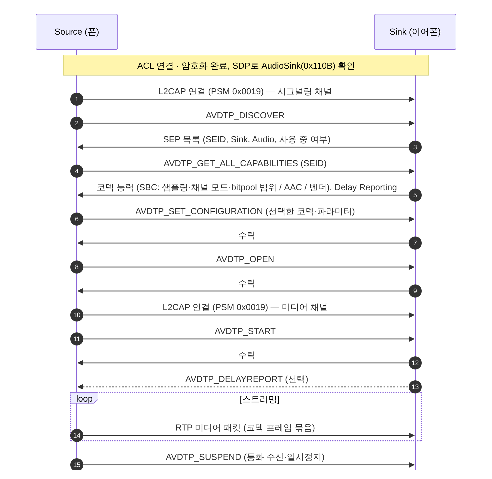

[[TIP("📘 규격 · 버전")]]
Advanced Audio Distribution Profile (A2DP) 1.4.1 · Audio/Video Distribution Transport Protocol (AVDTP) 1.3 · Audio/Video Remote Control Profile (AVRCP) 1.6.x · AVCTP 1.4 · Hands-Free Profile (HFP) 1.9 · Headset Profile (HSP) 1.2
A2DP: SBC 필수 코덱, 1.3에서 지연 보고(Delay Reporting) · AVRCP: 1.3 메타데이터 → 1.4 브라우징·절대 볼륨 → 1.5 정정 → 1.6 추가 정보 · HFP: 1.6 mSBC 광대역 → 1.7 HF 지시자(배터리 등) → 1.9 LC3-SWB
[[/TIP]]

[TOC]

[[TIP("🟢 한눈에 보기")]]
무선 이어폰 하나에는 보통 세 개의 Classic 프로파일이 함께 돌아갑니다.

1. **A2DP** — 음악을 보내는 파이프. 폰(Source)이 압축한 오디오를 이어폰(Sink)으로 ACL 링크에 실어 보냅니다. 필수 코덱은 **SBC**입니다.
2. **AVRCP** — 리모컨. 재생/정지/다음 곡, 곡 정보 표시, 그리고 **절대 볼륨**.
3. **HFP** — 전화. 폰(**AG**, Audio Gateway)과 이어폰·차량(**HF**, Hands-Free)이 **AT 명령**으로 통화 상태를 주고받고, 실제 음성은 eSCO 링크로 갑니다.

음악을 듣다가 전화가 오면 A2DP 스트림이 멈추고(Suspend), HFP가 eSCO를 열어 통화를 넘겨받습니다. 통화가 끝나면 다시 A2DP가 이어집니다.
[[/TIP]]

## A2DP와 AVDTP (🔵 중급)

| 코덱 | 지위 | 비고 |
|---|---|---|
| **SBC** | **필수** (Source·Sink 모두) | 부대역 코덱. 44.1 kHz 스테레오 기준 bitpool 53에서 약 328 kbps(고품질 권장값) |
| MPEG-1/2 Audio (MP3 등) | 선택 (규격 정의 코덱) | 실제 지원은 드묾 |
| **MPEG-2/4 AAC** | 선택 (규격 정의 코덱) | iOS 기기와 많은 이어폰이 사용 |
| ATRAC | 선택 (규격 정의 코덱) | 실제 지원 드묾 |
| aptX 계열, LDAC, LHDC, Samsung Scalable 등 | **벤더 코덱** — A2DP 규격 코덱이 아님 | 코덱 타입 "Vendor Specific"(0xFF) + 벤더 ID·코덱 ID로 식별. 각 회사의 라이선스·규격을 따름 |

**AVDTP**는 A2DP의 전송 계층입니다. 하나의 **시그널링 채널**과 스트림마다 하나의 **미디어 채널**을 각각 별도의 L2CAP 채널(PSM `0x0019`)로 엽니다. 각 기기는 코덱·역할별 **SEP**(Stream End Point)를 노출하고, 미디어 패킷은 RTP 헤더 + 코덱 프레임 묶음으로 전송됩니다.

## AVRCP — 원격 제어 (🔵 중급)

AVRCP는 **CT**(Controller, 명령을 보내는 쪽)와 **TG**(Target, 명령을 받아 실행하는 쪽)로 동작하며, AVCTP(PSM `0x0017`, 브라우징은 `0x001B`) 위로 AV/C 명령을 보냅니다. 이어폰 버튼으로 곡을 넘길 때는 이어폰이 CT, 폰이 TG입니다. 반대로 볼륨은 폰이 CT가 되어 이어폰(TG)의 볼륨을 설정합니다.

| 버전 | 추가된 것 |
|---|---|
| 1.0 | 기본 패스스루 명령 (`PLAY`, `PAUSE`, `STOP`, `FORWARD`, `BACKWARD`) |
| 1.3 | 재생 상태, 곡 메타데이터(제목·아티스트), 알림 등록 |
| 1.4 | 브라우징(여러 플레이어, 재생 목록, 검색), **절대 볼륨** (`SetAbsoluteVolume`, `EVENT_VOLUME_CHANGED`, 0–0x7F) |
| 1.5 | 절대 볼륨·브라우징 등 정정·명확화 |
| 1.6 | 브라우징 데이터·곡 정보 확장 (커버 아트 등) |

**절대 볼륨**이 없던 시절에는 폰이 PCM을 줄여서 보내고 이어폰도 따로 볼륨을 가져 두 볼륨이 곱해졌습니다. 절대 볼륨에서는 폰의 볼륨 막대가 이어폰 증폭기를 직접 조절하므로 양자화 손실이 없고 최대 음량을 낼 수 있습니다.

## HFP와 HSP (🔵 중급)

HFP의 제어는 RFCOMM 위의 **SLC**(Service Level Connection)에서 AT 명령으로 이루어집니다.

| 단계 | HF → AG | AG → HF |
|---|---|---|
| 기능 교환 | `AT+BRSF=<HF 기능>` | `+BRSF:<AG 기능>`, `OK` |
| 코덱 목록 (1.6+) | `AT+BAC=1,2[,3]` (1 CVSD, 2 mSBC, 3 LC3-SWB) | `OK` |
| 지시자 | `AT+CIND=?`, `AT+CIND?`, `AT+CMER=3,0,0,1` | 지시자 목록·현재 값(service, call, callsetup, signal, battchg …) |
| 3자 통화 | `AT+CHLD=?` | 지원 옵션 |
| HF 지시자 (1.7+) | `AT+BIND=…` | 배터리 레벨 등 |
| 통화 중 | `ATA`(받기), `AT+CHUP`(끊기), `ATD<번호>;`, `AT+VGS`/`AT+VGM`(볼륨) | `RING`, `+CLIP`, `+CIEV`(상태 변화) |
| **코덱 협상** | `AT+BCS=<id>`로 확인 | `+BCS:<id>`로 제안 → 이후 eSCO 수립 |

**HSP**는 `AT+CKPD=200`(버튼 한 개) 정도만 있는 최소 프로파일입니다. 오늘날 헤드셋은 HFP를 쓰고 HSP는 호환용으로 남아 있습니다.

[[TIP("🔴 전문가 노트 — 코덱 선택, 지연, 상호 운용")]]
**A2DP 코덱 결정권.** 코덱과 파라미터는 Source가 `AVDTP_SET_CONFIGURATION`으로 정합니다. Sink는 능력만 알릴 수 있으므로, "이어폰은 LDAC를 지원하는데 왜 AAC로 붙나"는 대개 폰(Source)의 정책 문제입니다. 재설정은 `AVDTP_SUSPEND` → `AVDTP_RECONFIGURE` 또는 스트림 종료 후 재수립으로 합니다.

**SBC bitpool과 링크 품질.** SBC는 bitpool로 비트율을 바꿀 수 있어, 구현은 ACL 큐가 밀리면 bitpool을 낮춰 끊김을 막습니다. 2-DH5/3-DH5가 쓰일 수 있는지(EDR 기능 비트, `HCI_Change_Connection_Packet_Type`)가 실효 여유를 좌우합니다.

**지연 보고.** 이어폰은 `AVDTP_DELAYREPORT`로 자신의 버퍼·디코딩 지연을 1/10 ms 단위로 알립니다. 동영상 앱이 이를 반영해 립싱크를 맞추므로, 값이 틀리면 영상과 소리가 어긋납니다.

**HFP 코덱 협상 실패.** AG가 `+BCS:2`를 보냈는데 HF가 응답하지 않거나 mSBC eSCO 설정(T2/T1)이 칩에서 거절되면 AG는 CVSD(S4 등)로 되돌아갑니다. 통화 음질이 갑자기 협대역이 되면 로그에서 `+BCS`와 `Synchronous Connection Complete`의 air mode를 확인합니다.

**동시 연결.** 폰 한 대가 이어폰과 스마트워치 등 여러 기기와 A2DP/HFP를 동시에 맺을 수 있지만, 실제 오디오 스트림은 보통 한 번에 하나입니다. "멀티포인트" 이어폰은 반대로 두 AG(폰·노트북)에 HFP/A2DP를 동시에 연결해 두고 스트림만 전환합니다.
[[/TIP]]

## Classic ↔ LE 비교

| 항목 | Classic 오디오 | LE Audio |
|---|---|---|
| 음악 | A2DP (AVDTP over ACL) | BAP Unicast (CIS) |
| 통화 | HFP (AT 명령 + eSCO) | CAP + CCP/TBS (CIS 양방향) |
| 리모컨·볼륨 | AVRCP (절대 볼륨) | MCP/MCS, VCP/VCS |
| 필수 코덱 | SBC (음악), CVSD (통화) | LC3 |
| 브로드캐스트 | 없음 | Auracast (BIS) |
| 양쪽 귀 | 한쪽이 받아 다른 쪽에 중계(벤더 방식) | 표준으로 두 이어버드에 각각 CIS |

## 관련 페이지

- **ACL과 SCO/eSCO** — 음악·통화가 실리는 링크와 음성 코덱
- **L2CAP·SDP·RFCOMM** — AVDTP·AVCTP·RFCOMM 채널
- **LE Audio 개요** — Classic 오디오의 후속
- **볼륨·통화·미디어 제어** — LE Audio의 AVRCP·HFP 대응
- **로그 분석 (btmon·btsnoop·Wireshark)** — AVDTP·AT 명령 디버깅
