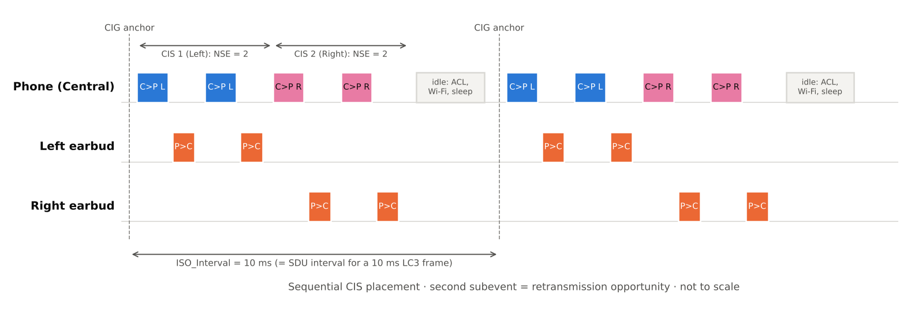

[[TIP("📘 규격 · 버전")]]
Core v5.2 이상 Vol 6 Part B (Link Layer, 등시성 채널 CIS·BIS), Vol 6 Part G (ISOAL) · LC3 v1.0 · BAP v1.0 · PACS v1.0 · ASCS v1.0 · BASS v1.0 · CAP v1.0 · CSIP v1.0 · TMAP v1.0 · HAP v1.0 · PBP v1.0 (각 규격은 이후 v1.0.x 오류 수정판이 나옴)
Core 5.2(2019.12)에 등시성 채널 도입 → 2020년 1월 CES에서 LE Audio 발표, 2020년 LC3 채택 → 2022년 6월 Auracast 이름 발표 → 2022년 7월 12일 SIG가 LE Audio 규격 일체 완성 발표 → 이후 GMAP(게이밍) 등 응용 프로파일 추가
[[/TIP]]

[TOC]

[[TIP("🟢 한눈에 보기")]]
Classic 오디오는 "음악용 길(A2DP)"과 "통화용 길(HFP)"이 따로 있고, 휴대폰과 이어폰이 **1:1**로만 이어지는 구조입니다. LE Audio는 이 바탕을 새로 깔았습니다.

1. **등시성 채널**: 정해진 시각마다 오디오 조각을 보내는 LE의 새 링크(CIS·BIS). 음악과 통화가 같은 길을 씁니다.
2. **멀티 스트림**: 휴대폰이 왼쪽·오른쪽 이어버드에 **각각** 스트림을 보내고, 두 쪽이 같은 시각에 재생합니다.
3. **브로드캐스트**: 연결 없이 한 송신기가 무제한의 청취자에게 방송합니다(**Auracast**).
4. **LC3**: SBC보다 낮은 비트율로 더 좋은 음질을 내는 새 필수 코덱.
5. **보청기 지원**: 보청기용 표준 프로파일(HAP)이 처음으로 Bluetooth 규격에 들어왔습니다.
[[/TIP]]

## Classic 오디오의 한계 (🔵 중급)

| 문제 | Classic에서의 모습 | LE Audio의 해법 |
|---|---|---|
| 음악/통화 분리 | A2DP(ACL 위 AVDTP)와 HFP(SCO/eSCO)가 별개 링크·별개 코덱 → 통화 전환 시 끊김 | 둘 다 CIS 위의 LC3 스트림. 방향·품질만 바꿔 다시 설정 |
| 무선 이어버드(TWS) | 규격은 1:1만 정의 → 한쪽이 받아 다른 쪽에 중계하거나 **스니핑**하는 제조사 고유 방식 | 한 CIG 안에 좌·우용 CIS 두 개를 표준으로 정의 |
| 1:N 방송 | 사실상 없음 (Broadcast Audio 개념 없음) | BIG/BIS 기반 브로드캐스트, Auracast |
| 코덱 | 필수 SBC(음악), CVSD/mSBC(음성) — 저비트율에서 품질 저하 | 필수 LC3 하나로 음성~음악 |
| 보청기 | 표준 없음 (제조사·OS 독자 방식) | HAP/HAS |
| 전력 | BR/EDR 라디오를 계속 유지 | LE 라디오, 필요한 시점에만 깨어남 |

## 무엇이 새로운가: 네 가지 축 (🔵 중급)

**등시성 채널.** Core 5.2가 LE 링크 계층에 **CIS**(Connected Isochronous Stream)와 **BIS**(Broadcast Isochronous Stream)를 추가했습니다. 데이터에 "유효 기한"이 있어서, 정해진 전송 지연 안에 못 보낸 오디오 조각은 버리고 다음 조각으로 넘어갑니다. 파일 전송처럼 끝까지 재전송하는 ACL과 반대 철학입니다. 무선 구간 세부는 **등시성 채널 (CIS·BIS)**에 있습니다.

*그림. 하나의 CIG에 좌(CIS 1)·우(CIS 2) 이어버드용 스트림을 순차 배치한 예. 10 ms마다 같은 앵커에서 시작하고, 각 CIS는 두 번의 서브이벤트(두 번째는 재전송 기회)를 가집니다. 남는 시간은 ACL이나 Wi-Fi 공존, 수면에 씁니다.*

**멀티 스트림과 동기 재생.** 각 이어버드가 휴대폰과 직접 CIS를 맺습니다. 두 스트림은 같은 CIG에 속해 같은 기준 시각을 공유하고, BAP의 **Presentation Delay**(수신 기준점에서 실제 재생까지의 지연)를 양쪽이 똑같이 적용하므로 좌우 음이 어긋나지 않습니다. 중계가 없으니 한쪽 배터리만 빨리 닳는 문제도 줄어듭니다.

**브로드캐스트.** 송신기는 확장 광고 → 주기적 광고 → BIG 순서로 "방송이 있다, 이런 설정이다, 여기서 받아라"를 알립니다. 수신기는 연결 없이 BIS에 동기화합니다. 청취자 수 제한이 없고, 브로드캐스트 코드로 암호화할 수도 있습니다. → **Auracast 브로드캐스트**

**LC3.** 10 ms와 7.5 ms 프레임, 8–48 kHz 샘플링, 프레임당 바이트 수를 세밀하게 조절해 음성부터 음악까지 하나로 처리합니다. → **LC3 코덱**

## 규격 계층과 역할 분담 (🔵 중급)

| 기능 | Classic | LE Audio |
|---|---|---|
| 능력 교환 | AVDTP Get Capabilities, SDP 레코드 | PACS (GATT 특성) |
| 스트림 설정·상태 | AVDTP 시그널링 (Set Configuration, Open, Start…) | ASCS의 ASE Control Point, BAP 절차 |
| 미디어 제어 | AVRCP | MCP / MCS |
| 통화 제어 | HFP AT 명령 (RFCOMM) | CCP / TBS |
| 볼륨 | AVRCP 절대 볼륨, HFP `+VGS` | VCP / VCS (+ VOCS, AICS) |
| 여러 기기 묶기 | 없음 | CSIP / CSIS, CAP |
| 제품 요구 묶음 | A2DP·HFP 프로파일 자체 | TMAP, HAP, PBP, GMAP |

LE Audio에서는 제어가 모두 **GATT**로 통일되었습니다. 그래서 ACL(GATT용)과 CIS(오디오용)가 함께 존재하며, 제어 메시지가 오디오 스트림의 타이밍을 방해하지 않도록 **EATT**를 쓰면 여러 GATT 절차를 병렬로 처리할 수 있습니다.

[[TIP("🔴 전문가 노트 — 지연, 공존, 전환기의 현실")]]
**지연 예산.** 종단 지연은 대략 "송신 측 코덱 프레임 + 인코딩 + 전송 지연(Max_Transport_Latency 안) + Presentation Delay + 디코딩"입니다. BAP의 저지연 설정(예: `48_2_1`)은 최대 전송 지연 20 ms를 요구하고, 고신뢰 설정(`48_2_2`)은 95 ms까지 허용하는 대신 재전송을 13회까지 둡니다. 실제 지연은 제품의 Presentation Delay 선택에 크게 좌우됩니다. → **BAP**

**듀얼 모드 공존.** 대부분의 휴대폰·이어버드는 Classic(A2DP/HFP)과 LE Audio를 둘 다 지원합니다. 어떤 쪽을 쓸지는 OS 정책에 달려 있으며, CTKD로 한 번의 페어링에서 양쪽 키를 만드는 구현이 흔합니다. → **키 계층과 CTKD**

**Classic도 LC3를 씁니다.** HFP 1.9는 eSCO 위에서 LC3를 쓰는 초광대역 음성(LC3-SWB)을 추가했습니다. 즉 LC3는 LE 전용 코덱이 아닙니다.

**HCI 관점.** 스트림 하나는 `HCI_LE_Set_CIG_Parameters` → `HCI_LE_Create_CIS` → `HCI_LE_Setup_ISO_Data_Path` 순서로 컨트롤러에 만들어집니다. 브로드캐스트는 `HCI_LE_Create_BIG`(송신), `HCI_LE_BIG_Create_Sync`(수신)입니다. 오디오 데이터는 ACL이 아닌 **ISO 데이터 패킷**으로 HCI를 건너거나, 코덱이 컨트롤러 쪽에 있으면 HCI를 거치지 않는 vendor 데이터 경로를 씁니다.
[[/TIP]]

## Classic ↔ LE 비교

| 항목 | Classic (A2DP/HFP) | LE Audio |
|---|---|---|
| 전송 | ACL(음악), SCO/eSCO(음성) | CIS(유니캐스트), BIS(브로드캐스트) |
| 필수 코덱 | SBC, CVSD (mSBC는 광대역 음성) | LC3 |
| 토폴로지 | 1:1 | 1:1, 1:2(좌우), 1:N(브로드캐스트) |
| 양방향 오디오 | HFP만 (음성 품질) | CIS 양방향, 음악 품질 양방향도 가능 |
| 제어 | AVRCP, AT 명령 | GATT 서비스(MCS, TBS, VCS…) |
| 보청기 | 표준 없음 | HAP |
| 도입 | A2DP·HFP 2000년대 초 | Core 5.2(2019) + 프로파일 완성 2022 |

## 관련 페이지

- **등시성 채널 (CIS·BIS)** — 링크 계층에서 본 CIS·BIS 타이밍
- **오디오 프로파일 (A2DP·AVRCP·HFP)** — 비교 대상인 Classic 오디오
- **LC3 코덱** — LE Audio의 필수 코덱
- **BAP (Unicast·Broadcast)** — 스트림을 세우는 기본 절차
- **Auracast 브로드캐스트** — 연결 없는 1:N 오디오
