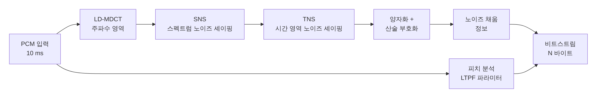

[[TIP("📘 규격 · 버전")]]
Low Complexity Communication Codec (LC3) v1.0 (2020 채택), v1.0.1 · BAP v1.0 §3 (코덱 설정 이름과 필수 설정), §5 (QoS 설정) · Assigned Numbers (Codec_ID 0x06 = LC3, Codec Specific Capabilities/Configuration LTV 유형)
LE Audio의 필수 코덱으로 2020년 채택 → HFP 1.9에서 Classic eSCO 음성(LC3-SWB)에도 사용 · LC3plus는 별도 규격(ETSI TS 103 634)
[[/TIP]]

[TOC]

[[TIP("🟢 한눈에 보기")]]
코덱은 "소리를 얼마나 작게 접어서 보낼지"를 정하는 규칙입니다. **LC3**(Low Complexity Communication Codec)는 LE Audio의 모든 기기가 반드시 지원해야 하는 공통 코덱입니다.

1. 소리를 **10 ms**(또는 **7.5 ms**) 단위로 잘라
2. 주파수 성분으로 바꾸고(**MDCT**),
3. 귀가 잘 못 듣는 부분은 거칠게, 잘 듣는 부분은 정밀하게 양자화해서
4. 정해진 바이트 수(프레임당 20–400 B) 안에 담습니다.

목표는 "같은 음질이면 더 적은 비트, 같은 비트면 더 좋은 음질"입니다. 비트가 줄면 무선 구간 airtime이 줄고, 그만큼 재전송 여유와 배터리가 생깁니다.
[[/TIP]]

## 기본 파라미터 (🔵 중급)

| 항목 | 값 |
|---|---|
| 샘플링 주파수 | 8, 16, 24, 32, 44.1, 48 kHz |
| 프레임 길이 | 10 ms, 7.5 ms (44.1 kHz에서는 샘플 수를 48 kHz와 같게 두어 실제 10.884 ms / 8.163 ms) |
| 비트율 | 채널당 약 16–320 kbps (프레임당 20–400 B) |
| 채널 | 코덱 인스턴스는 모노. 스테레오는 채널 수만큼 프레임을 이어 붙여 한 SDU에 싣거나 스트림을 나눔 |
| 변환 | 저지연 MDCT (Low-Delay MDCT) |
| 알고리즘 지연 | 10 ms 프레임: 10 + 2.5 ms 미리보기 = 12.5 ms, 7.5 ms 프레임: 7.5 + 4 ms = 11.5 ms |
| 손실 대응 | 패킷 손실 은닉(PLC)이 디코더에 포함 — 놓친 프레임을 이전 스펙트럼으로 추정 |
| 개발 | Fraunhofer IIS와 Ericsson이 SIG에 기여 |

비트율은 프레임당 바이트 수와 프레임 길이로 바로 정해집니다.

$$
R = \frac{8 \cdot N\_{octets}}{T\_{frame}}, \qquad \text{예: } \frac{8 \times 120\ \text{B}}{10\ \text{ms}} = 96\ \text{kbps}
$$

## 인코더 구조 (🔵 중급)

| 블록 | 하는 일 |
|---|---|
| **LD-MDCT** | 겹치는 창으로 프레임을 주파수 계수로 변환. 미리보기 구간이 짧아 지연이 작음 |
| **SNS** (Spectral Noise Shaping) | 스펙트럼 포락선을 소수의 계수로 보내 양자화 잡음을 귀에 덜 들리는 모양으로 분배 |
| **TNS** (Temporal Noise Shaping) | 박수·타악기 같은 순간음에서 잡음이 프레임 전체로 번지는 프리에코를 줄임 |
| **LTPF** (Long-Term Postfilter) | 음성처럼 주기성이 강한 신호에서 디코더 후처리로 하모닉 사이 잡음을 줄임 |
| 산술 부호화 | 양자화된 계수를 정해진 바이트 예산에 맞춰 압축 |
| 노이즈 채움 | 0으로 양자화된 고역 대역에 잡음을 채워 "먹먹함"을 줄임 |

SBC는 4/8개 서브밴드 필터 뱅크와 단순한 비트 할당이라 저비트율에서 품질이 급격히 떨어집니다. LC3는 위의 지각 도구 덕분에 저비트율에서 강합니다. SIG는 청취 시험에서 LC3가 SBC보다 **약 절반의 비트율로도 더 나은 음질**을 냈다고 발표했습니다.

## BAP 코덱 설정 이름 (🔵 중급)

BAP는 자주 쓰는 LC3 설정에 `<샘플링 kHz>_<번호>` 이름을 붙였습니다. 번호가 홀수면 7.5 ms, 짝수면 10 ms 프레임입니다. QoS까지 붙인 이름(`48_4_1`, `48_4_2`)은 **BAP**에서 다룹니다.

| 이름 | 샘플링 | 프레임 | 바이트/프레임 | 비트율 (kbps) | 흔한 용도 |
|---|---|---|---|---|---|
| `8_1` / `8_2` | 8 kHz | 7.5 / 10 ms | 26 / 30 | 27.734 / 24 | 협대역 음성 |
| `16_1` / `16_2` | 16 kHz | 7.5 / 10 ms | 30 / 40 | 32 / 32 | 광대역 음성, 보청기 |
| `24_1` / `24_2` | 24 kHz | 7.5 / 10 ms | 45 / 60 | 48 / 48 | 초광대역 음성, 공공 방송(SQ) |
| `32_1` / `32_2` | 32 kHz | 7.5 / 10 ms | 60 / 80 | 64 / 64 | 고품질 통화 |
| `441_1` / `441_2` | 44.1 kHz | 8.163 / 10.884 ms | 97 / 130 | 95.06 / 95.55 | 44.1 kHz 원본 재생 |
| `48_1` / `48_2` | 48 kHz | 7.5 / 10 ms | 75 / 100 | 80 / 80 | 음악 |
| `48_3` / `48_4` | 48 kHz | 7.5 / 10 ms | 90 / 120 | 96 / 96 | 음악 (흔한 기본값) |
| `48_5` / `48_6` | 48 kHz | 7.5 / 10 ms | 117 / 155 | 124.8 / 124 | 고음질 음악 |

비트율은 위 식으로 계산한 값입니다(예: `8_1` = 8 × 26 / 7.5 ms = 27.734 kbps). BAP는 기본 상호 운용을 위해 `16_2`를 모든 역할에 필수로 두고, 오디오를 받는 쪽(Sink)에는 `24_2`도 요구합니다. 응용 프로파일이 더 높은 설정을 추가로 요구합니다(예: TMAP 미디어 수신기는 48 kHz 설정, PBP의 High Quality는 `48_1`–`48_6` 중 하나).

[[TIP("🔴 전문가 노트 — LTV 설정, 7.5 ms, LC3plus와의 구분")]]
**설정은 LTV로 전달됩니다.** PACS의 PAC 레코드에는 Codec Specific Capabilities(`Supported_Sampling_Frequencies`, `Supported_Frame_Durations`, `Supported_Audio_Channel_Counts`, `Supported_Octets_Per_Codec_Frame`, `Supported_Max_Codec_Frames_Per_SDU`)가, ASE의 Config Codec에는 Codec Specific Configuration(`Sampling_Frequency`, `Frame_Duration`, `Audio_Channel_Allocation`, `Octets_Per_Codec_Frame`, `Codec_Frame_Blocks_Per_SDU`)이 Length-Type-Value로 들어갑니다. 바이트 수를 범위(최소–최대)로 광고하므로 이름 붙은 설정 밖의 값도 쓸 수 있습니다.

**7.5 ms 프레임은 왜 있나.** 광대역 음성용 eSCO(mSBC)가 흔히 7.5 ms 주기로 동작하므로, 듀얼 모드 칩이 두 종류 링크를 같은 주기로 맞추기 쉽게 하려는 선택지로 알려져 있습니다. 지연이 2.5 ms 짧아지는 대신 프레임이 짧아 같은 비트율에서의 부호화 효율은 10 ms보다 다소 떨어집니다. 일반적인 음악 재생은 10 ms 설정이 기본입니다.

**44.1 kHz는 framed로.** 441 설정은 프레임 길이가 ISO 간격의 정수배로 맞지 않아 BAP QoS 설정에서 **framed** ISOAL 모드를 씁니다(SDU 간격 8163 µs / 10884 µs).

**LC3plus는 다른 규격입니다.** LC3plus는 Fraunhofer IIS가 주도해 ETSI(TS 103 634)로 표준화한 확장 코덱으로, 2.5·5 ms 프레임과 96 kHz 고해상도 모드를 지원합니다. DECT NR+ 등에서 쓰이며, Bluetooth에서는 벤더 고유 코덱 ID로 실릴 수 있을 뿐 LE Audio 필수 코덱이 아닙니다. "LC3 지원"과 "LC3plus 지원"은 상호 운용이 되지 않습니다.

**오픈 구현.** Google의 liblc3(Android·Zephyr 등에서 사용)가 널리 쓰입니다. LC3 구현의 정합성은 SIG의 LC3 테스트 스위트(참조 벡터 비교)로 확인합니다.
[[/TIP]]

## Classic ↔ LE 비교

| 항목 | SBC (A2DP 필수) | mSBC (HFP 광대역) | LC3 |
|---|---|---|---|
| 변환 | 4/8 서브밴드 필터 뱅크 | SBC 고정 설정 | LD-MDCT |
| 샘플링 | 16–48 kHz | 16 kHz | 8–48 kHz |
| 블록/프레임 | 설정 따라 수 ms | 7.5 ms (120 샘플) | 7.5 / 10 ms |
| 음성·음악 | 음악 중심 | 음성 전용 | 둘 다 |
| PLC | 규격 밖(구현 몫) | 구현 몫 | 디코더 일부로 규정 |
| 쓰는 곳 | A2DP | HFP 1.6+ | LE Audio 전체, HFP 1.9 LC3-SWB |

## 관련 페이지

- **LE Audio 개요** — LC3가 들어간 전체 그림
- **BAP (Unicast·Broadcast)** — 코덱 설정 + QoS 설정 조합
- **PACS와 ASCS** — PAC 레코드와 Config Codec
- **오디오 프로파일 (A2DP·AVRCP·HFP)** — SBC·mSBC
