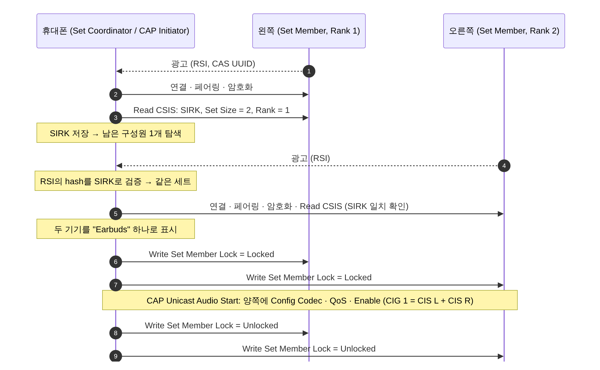

[[TIP("📘 규격 · 버전")]]
Common Audio Profile (CAP) v1.0 · Common Audio Service (CAS) v1.0 · Coordinated Set Identification Profile (CSIP) v1.0 · Coordinated Set Identification Service (CSIS) v1.0 · Assigned Numbers (AD Type "Resolvable Set Identifier") · 하위: BAP, VCP, MICP, BASS
CSIP는 LE Audio 규격군 가운데 일찍 채택되었고, CAP은 2022년 LE Audio 완성 시점에 함께 정리됨. 이후 v1.0.x 오류 수정판
[[/TIP]]

[TOC]

[[TIP("🟢 한눈에 보기")]]
무선 이어버드는 두 개의 독립된 기기입니다. 그런데 사용자는 "이어폰 하나"로 느끼고 싶어 합니다.

- **CSIP/CSIS**는 "우리 둘은 한 세트"라는 **신분증**입니다. 같은 세트의 기기는 같은 비밀 키(**SIRK**)를 공유하고, 광고에 그 키로 만든 표식(**RSI**)을 넣어 휴대폰이 짝꿍을 찾게 합니다.
- **CAP**은 "한 세트는 한 몸처럼 다뤄라"는 **공통 절차**입니다. 볼륨을 올리면 두 쪽 모두, 스트림을 시작하면 두 쪽 모두 같은 설정으로 시작합니다.

결과적으로 휴대폰 설정 화면에는 "Earbuds" 하나가 보이고, 실제로는 연결 두 개와 CIS 두 개가 움직입니다.
[[/TIP]]

## CAP: 역할과 공통 절차 (🔵 중급)

| CAP 역할 | 하는 일 | 대표 기기 | 아래에서 쓰는 역할 |
|---|---|---|---|
| **Initiator** | 유니캐스트·브로드캐스트 스트림을 시작·변경·종료 | 휴대폰, TV, PC | BAP Unicast Client / Broadcast Source |
| **Acceptor** | 스트림을 받거나 보냄. CAS 노출 | 이어버드, 보청기, 스피커 | BAP Unicast Server / Broadcast Sink |
| **Commander** | 다른 기기의 볼륨·마이크·브로드캐스트 수신을 원격 제어 | 휴대폰, 워치, 리모컨 | VCP Controller, MICP Controller, Broadcast Assistant |

| 절차 묶음 | 대표 절차 | 하는 일 |
|---|---|---|
| Unicast | Unicast Audio Start / Update / Stop | 세트의 모든 Acceptor에 BAP 절차(Config Codec → … → Enable)를 일관되게 적용, Metadata(문맥·CCID) 갱신 |
| Broadcast | Broadcast Audio Start / Update / Stop | BASE 구성, BIG 생성·해제, Metadata 갱신 |
| 전환 | Unicast → Broadcast 전환 | 개인 청취에서 공유 청취로 바꿀 때 스트림을 갈아탐 (정의 범위는 CAP 판본별 원문 확인 필요) |
| Commander | Change Volume, Change Volume Mute, Change Microphone Mute/Gain | 세트 전체에 VCP·MICP 절차 적용 |
| Commander | Broadcast Reception Start/Stop, Distribute Broadcast_Code | BASS로 Acceptor에게 방송 수신을 지시 |

CAP의 핵심 규칙은 **"코디네이트 세트의 일부만 바꾸지 않는다"** 입니다. Initiator는 CSIP로 세트 구성원을 모두 찾은 뒤, 같은 Codec·QoS·Metadata를 모든 구성원에 적용하고, 하나의 CIG 안에 구성원별 CIS를 둡니다. 스트림이 어떤 응용에 속하는지는 **CCID**(Content Control ID, 각 MCS/TBS 인스턴스의 ID)를 Metadata의 `CCID_List`로 알려 연결합니다.

## CSIP/CSIS: 코디네이트 세트 (🔵 중급)

| CSIS 특성 | 내용 |
|---|---|
| **Set Identity Resolving Key** (SIRK) | 세트 공통 128비트 키. 타입이 "암호화됨"이면 링크 LTK로 암호화해서 전달, "평문"이면 그대로 |
| **Coordinated Set Size** | 세트 구성원 수 (이어버드 한 쌍이면 2) |
| **Set Member Lock** | 잠금 상태 (Unlocked / Locked) — 한 코디네이터만 세트를 조작하도록 |
| **Set Member Rank** | 구성원의 순번. 잠금은 순번 오름차순으로 |

| CSIP 역할 | 하는 일 |
|---|---|
| **Set Coordinator** | 세트 구성원 발견, 잠금/해제, 순서대로 절차 수행 (휴대폰) |
| **Set Member** | CSIS 노출, 광고에 RSI 포함 (이어버드) |

**RSI**(Resolvable Set Identifier)는 6바이트 값으로, 무작위 `prand` 3바이트와 SIRK로 계산한 `hash` 3바이트로 이루어집니다. RPA(Resolvable Private Address)를 해석하는 방식과 같아서, SIRK를 모르는 제3자는 두 광고가 같은 세트인지 알 수 없습니다. → **프라이버시와 RPA**

## 좌우 이어버드를 묶는 과정 (🔵 중급)

각 이어버드는 PACS의 Audio Locations로 자신이 Front Left인지 Front Right인지 알리고, 휴대폰은 Config Codec의 `Audio_Channel_Allocation`을 그에 맞게 넣어 왼쪽 CIS에는 왼쪽 채널, 오른쪽 CIS에는 오른쪽 채널을 보냅니다. 한쪽만 귀에 꽂은 경우에는 그 이어버드에만 스트림을 열고, 양 채널을 섞은 모노나 두 채널을 담은 SDU를 보낼 수 있습니다.

[[TIP("🔴 전문가 노트 — 잠금이 필요한 이유, SIRK 보호, 실무 함정")]]
**잠금은 경쟁 방지용입니다.** 휴대폰과 노트북이 동시에 같은 이어버드 세트를 조작하면, 한쪽은 노트북 설정, 다른 쪽은 휴대폰 설정으로 갈라질 수 있습니다. 코디네이터는 Rank 오름차순으로 잠그고, 하나라도 잠금이 거절되면(이미 다른 코디네이터가 잠금) 이미 잠근 것을 풀고 물러납니다. 모든 코디네이터가 같은 순서를 따르므로 교착이 생기지 않습니다. 단, 잠금은 선택 기능이고 CAP 절차가 항상 잠금을 요구하지는 않습니다.

**SIRK 보호.** SIRK가 새면 누구나 RSI로 세트를 추적할 수 있습니다. 그래서 암호화 타입 SIRK는 링크 LTK로 암호화해 전달(규격의 `sef` 함수)하고, 읽기는 암호화된 링크에서만 허용하는 것이 일반적입니다. 제조 시점에 SIRK를 기기별 무작위로 넣어야 하며, 모델 공통 값을 쓰는 것은 추적 위험입니다.

**RSI 광고 주기.** 첫 구성원과 본딩한 뒤 두 번째 구성원을 찾을 때, 두 번째 쪽이 RSI를 담아 충분히 자주 광고하지 않으면 "한쪽만 연결" 상태가 오래 지속됩니다. 이어버드는 케이스에서 꺼낼 때 짧은 간격의 광고를 쓰는 것이 일반적입니다.

**CAS의 포함 서비스.** Acceptor가 세트 구성원이면 CAS는 CSIS를 **포함 서비스(Included Service)** 로 가리킵니다. Initiator는 CAS에서 출발해 CSIS를 찾습니다.
[[/TIP]]

## 관련 페이지

- **BAP (Unicast·Broadcast)** — CAP이 세트 전체에 적용하는 기본 절차
- **볼륨·통화·미디어 제어** — Commander가 쓰는 VCP·MICP·MCP·CCP
- **Auracast 브로드캐스트** — Broadcast Reception Start와 BASS
- **프라이버시와 RPA** — RSI와 같은 해석 원리
- **LE 페어링과 본딩** — 구성원별 페어링
