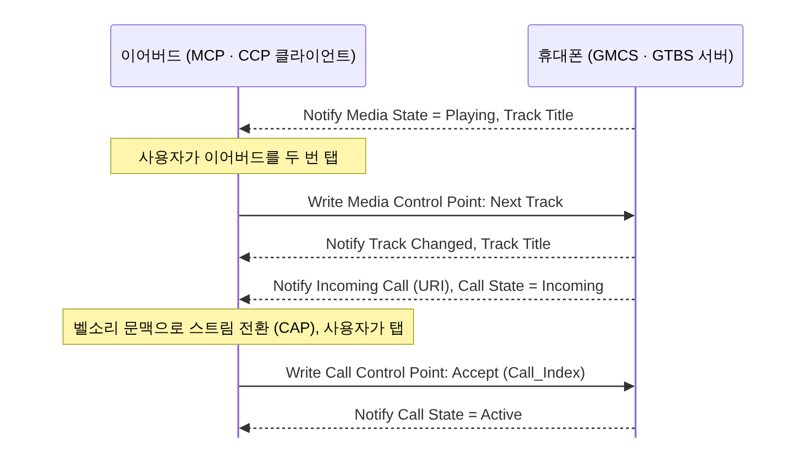

[[TIP("📘 규격 · 버전")]]
Volume Control Profile (VCP) v1.0 · Volume Control Service (VCS) v1.0 · Volume Offset Control Service (VOCS) v1.0 · Audio Input Control Service (AICS) v1.0 · Microphone Control Profile (MICP) v1.0 / Microphone Control Service (MICS) v1.0 · Media Control Profile (MCP) v1.0 / Media Control Service (MCS, GMCS) v1.0 · Call Control Profile (CCP) v1.0 / Telephone Bearer Service (TBS, GTBS) v1.0 · Object Transfer Service/Profile (OTS/OTP, MCS의 객체 전달에 선택적으로 사용)
LE Audio 규격군과 함께 v1.0으로 채택, 이후 일부는 v1.0.x 오류 수정판 · Classic의 AVRCP·HFP AT 명령에 해당하는 기능을 GATT로 옮김
[[/TIP]]

[TOC]

[[TIP("🟢 한눈에 보기")]]
Classic에서는 볼륨은 AVRCP나 HFP의 `+VGS`, 재생/정지는 AVRCP, 전화 받기는 HFP AT 명령으로 했습니다. 프로파일마다 제어 방법이 달랐습니다.

LE Audio는 이를 모두 **GATT 서비스**로 통일했습니다. 원칙은 하나입니다. **상태를 가진 쪽이 서비스(-S)를 노출하고, 조작하는 쪽이 프로파일(-P) 클라이언트가 된다.**

- 볼륨은 소리를 내는 **이어버드**가 가지고 있으므로 이어버드가 VCS를, 휴대폰이 VCP 컨트롤러를 맡습니다.
- 재생 목록과 통화 상태는 **휴대폰**에 있으므로 휴대폰이 MCS·TBS를, 이어버드가 MCP·CCP 클라이언트를 맡습니다. 이어버드의 탭 제스처가 휴대폰의 Media Control Point에 "Play"를 쓰는 식입니다.
[[/TIP]]

## 한 장으로 보는 제어 규격 (🔵 중급)

| 기능 | 프로파일 (클라이언트) | 서비스 (서버) | 서버는 보통 | 핵심 특성 |
|---|---|---|---|---|
| 볼륨 | **VCP** Volume Controller | **VCS** (Volume Renderer) | 이어버드, 스피커 | Volume State, Volume Control Point, Volume Flags |
| 채널별 볼륨 보정 | VCP | **VOCS** (VCS에 포함) | 이어버드, 사운드바 | Volume Offset State, Audio Location, Audio Output Description |
| 입력별 게인 | VCP / MICP | **AICS** (VCS·MICS에 포함) | 보청기(마이크·텔레코일·스트림 입력) | Audio Input State, Gain Setting Properties, Audio Input Type |
| 마이크 음소거 | **MICP** Microphone Controller | **MICS** (Microphone Device) | 헤드셋, 보청기 | Mute |
| 미디어 제어 | **MCP** Media Control Client | **MCS** / **GMCS** (Media Control Server) | 휴대폰, PC, TV | Media State, Media Control Point, Track Title, Track Position |
| 통화 제어 | **CCP** Call Control Client | **TBS** / **GTBS** (Call Control Server) | 휴대폰, PC(VoIP 앱) | Call State, Call Control Point, Incoming Call, Bearer Provider Name |

**포함 서비스(Included Service)** 구조에 주의합니다. VOCS와 AICS는 단독으로 쓰이지 않고 VCS(또는 MICS)가 포함하는 형태입니다. 예를 들어 사운드바는 VCS 하나에 출력 채널마다 VOCS 인스턴스를, 보청기는 입력(내장 마이크, 텔레코일, 블루투스 스트림)마다 AICS 인스턴스를 둡니다.

## VCP: 볼륨 (🔵 중급)

| Volume Control Point opcode | 동작 |
|---|---|
| 0x00 | Relative Volume Down |
| 0x01 | Relative Volume Up |
| 0x02 | Unmute / Relative Volume Down |
| 0x03 | Unmute / Relative Volume Up |
| 0x04 | Set Absolute Volume (0–255) |
| 0x05 | Unmute |
| 0x06 | Mute |

**Volume State**는 `Volume_Setting`(0–255), `Mute`, `Change_Counter`로 이루어집니다. 모든 Control Point 쓰기에는 클라이언트가 알고 있는 `Change_Counter`를 넣어야 하고, 서버의 현재 값과 다르면 거절됩니다(Invalid Change Counter). 휴대폰과 워치가 동시에 볼륨을 바꿔도 "오래된 상태를 기준으로 한 명령"이 적용되지 않게 하는 장치입니다. 상대 볼륨 단계 크기는 서버가 정합니다.

볼륨이 **렌더러(이어버드) 쪽**에 있다는 점이 Classic과 다릅니다. 휴대폰은 항상 일정한 레벨의 오디오를 보내고, 이어버드가 증폭을 조절하므로 양자화 해상도 손실이 없고, 보청기처럼 자체 볼륨 버튼이 있는 기기와 상태가 자연스럽게 동기화됩니다.

## MCP·CCP: 휴대폰 쪽 상태를 원격 조작 (🔵 중급)

| 미디어/통화 요소 | 내용 |
|---|---|
| Media State | Inactive, Playing, Paused, Seeking |
| Media Control Point | Play, Pause, Stop, Fast Forward/Rewind, Move Relative, Previous/Next Track, Goto Track 등 |
| Call State | 통화별 `Call_Index`, 상태(Incoming, Dialing, Alerting, Active, 보류 등), 플래그 |
| Call Control Point | Accept, Terminate, Local Hold, Local Retrieve, Originate, Join |
| Content Control ID (CCID) | 각 MCS/TBS 인스턴스의 ID. BAP Metadata의 `CCID_List`로 "이 스트림은 이 앱/통화"를 연결 |

**Generic 인스턴스.** 휴대폰에는 음악 앱이 여러 개, 통화 앱(이동통신, VoIP)도 여러 개 있을 수 있습니다. 각 앱이 MCS/TBS 인스턴스를 가질 수 있고, **GMCS**(Generic MCS)와 **GTBS**(Generic TBS)는 이들을 대표하는 단일 창구입니다. 이어버드 같은 단순 클라이언트는 GMCS·GTBS만 쓰면 됩니다.

[[TIP("🔴 전문가 노트 — 지속성, 보안, 흔한 상호 운용 문제")]]
**Volume Flags와 지속성.** VCS의 `Volume_Setting_Persisted` 플래그는 "사용자가 이 기기에서 볼륨을 바꾼 적이 있다"를 뜻합니다. 클라이언트는 이 값을 보고 재연결 시 자기 볼륨을 덮어쓸지, 렌더러의 값을 따를지 결정합니다. 재연결할 때마다 볼륨이 튀는 문제는 대개 이 플래그를 무시해서 생깁니다.

**세트 전체 볼륨.** 좌우 이어버드는 각자 VCS를 가집니다. CAP Commander의 Change Volume 절차가 두 쪽에 같은 절대 볼륨을 쓰고, 좌우 균형은 VOCS의 `Volume_Offset`(−255 … 255)으로 조정합니다.

**보안 요구.** 제어 특성은 대부분 암호화된 링크에서만 쓰기를 허용합니다. 특히 TBS의 Originate나 MCS의 객체 접근(OTS)은 개인 정보와 직결되므로, 페어링되지 않은 기기의 접근을 막는 것이 기본입니다.

**AT 명령과의 공존.** 듀얼 모드 이어버드가 HFP와 LE Audio를 모두 지원하면, 통화 제어가 HFP AT 명령과 CCP 중 어느 쪽으로 오는지 OS 정책에 달려 있습니다. 한 기기에서 두 경로를 동시에 쓰면 상태가 엇갈리므로 하나만 활성화하는 것이 원칙입니다.
[[/TIP]]

## Classic ↔ LE 비교

| 기능 | Classic | LE Audio |
|---|---|---|
| 볼륨 | AVRCP Absolute Volume (0–127), HFP `+VGS`/`+VGM` (0–15) | VCS Volume_Setting (0–255), Mute, Change_Counter |
| 미디어 | AVRCP (Play/Pause, 메타데이터, 브라우징) | MCS/GMCS (+ OTS로 목록·아이콘) |
| 통화 | HFP AT 명령 (`ATA`, `AT+CHUP`, `+CLCC` …) over RFCOMM | TBS/GTBS (Call Control Point, Call State) |
| 마이크 | HFP `+VGM` | MICS, AICS |
| 전송 | AVCTP, RFCOMM (L2CAP) | GATT (ATT/EATT) |

## 관련 페이지

- **오디오 프로파일 (A2DP·AVRCP·HFP)** — 비교 대상인 AVRCP·HFP
- **CAP과 CSIP** — Commander 절차로 세트 전체 제어
- **BAP (Unicast·Broadcast)** — Metadata의 CCID_List
- **GATT** — 포함 서비스, 알림
- **보청기 프로파일 (HAP)** — VCS·AICS를 쓰는 대표 기기
