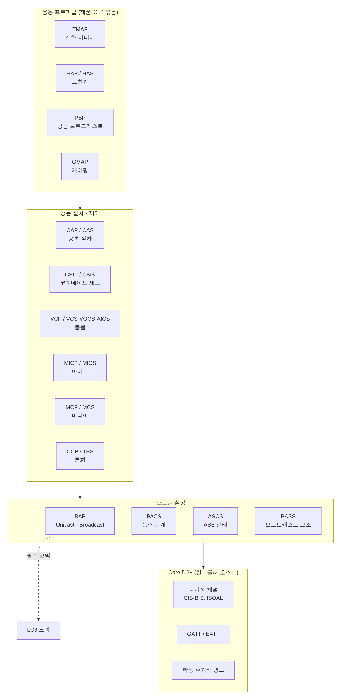

이 섹션은 Bluetooth Low Energy 위에서 동작하는 새 오디오 체계, **LE Audio**를 다룹니다. Classic의 A2DP·HFP가 프로파일 하나에 코덱·연결·제어를 모두 묶었다면, LE Audio는 기능을 잘게 나눈 **여러 개의 규격**을 계층처럼 쌓습니다. 처음에는 약어가 많아 보이지만, 아래 지도에서 "어느 층의 규격인가"만 잡아 두면 각 페이지가 쉽게 읽힙니다.

| 페이지 | 핵심 질문 |
|---|---|
| **LE Audio 개요** | A2DP·HFP와 무엇이 근본적으로 다르고, 왜 새로 만들었나? |
| **LC3 코덱** | 더 낮은 비트율로 SBC보다 좋은 음질을 내는 비결은? `48_4`는 무슨 뜻인가? |
| **BAP (Unicast·Broadcast)** | 스트림 하나를 세우기까지 어떤 순서로 무엇을 협상하나? |
| **PACS와 ASCS** | 이어버드는 자기 능력을 어떻게 알리고, 스트림 상태는 누가 관리하나? |
| **CAP과 CSIP** | 왼쪽·오른쪽 이어버드를 어떻게 "한 세트"로 묶어 동시에 다루나? |
| **Auracast 브로드캐스트** | 연결 없이 수많은 청취자에게 오디오를 뿌리고, 휴대폰이 대신 찾아 주는 원리는? |
| **볼륨·통화·미디어 제어** | AVRCP·AT 명령을 대신하는 GATT 기반 제어는 어떻게 생겼나? |
| **보청기 프로파일 (HAP)** | 보청기·TV·게임 헤드셋은 어떤 "응용 프로파일"로 상호 운용을 보장하나? |

## 규격 지도 (🔵 중급)

| 층 | 규격 | 역할 한 줄 |
|---|---|---|
| Core | 등시성 채널(CIS/BIS), ISOAL, 주기적 광고, EATT | 시간이 정해진 오디오 패킷을 실어 나르는 "도로" |
| 코덱 | LC3 | 모든 LE Audio 기기가 반드시 지원하는 공통 코덱 |
| 스트림 | BAP, PACS, ASCS, BASS | 코덱·QoS를 협상하고 스트림을 세우고 끊는 절차 |
| 공통 절차·제어 | CAP, CSIP, VCP, MICP, MCP, CCP | 여러 기기를 한 번에 다루고, 볼륨·통화·미디어를 제어 |
| 응용 | TMAP, HAP, PBP, GMAP | "이 제품이라면 최소 이것은 지원하라"는 묶음 요구 |

[[TIP("🟢 읽는 순서 추천")]]
1. **개요**에서 등시성 채널과 브로드캐스트라는 두 가지 큰 변화를 먼저 잡습니다.
2. **BAP**와 **PACS와 ASCS**는 한 쌍입니다. BAP가 "절차", ASCS가 그 절차가 바꾸는 "상태"입니다.
3. 이어버드 한 쌍을 다루는 **CAP과 CSIP**, 연결 없는 **Auracast**는 BAP 위에 올라갑니다.
4. 무선 구간(CIS·BIS의 타이밍)은 **등시성 채널 (CIS·BIS)**에서 다룹니다. 이 섹션은 그 위의 호스트 규격에 집중합니다.

약어 이름의 규칙: 끝이 **-P**(Profile)면 클라이언트 쪽 동작, **-S**(Service)면 서버가 노출하는 GATT 서비스입니다. 예를 들어 VCP의 컨트롤러(휴대폰)가 VCS를 가진 렌더러(이어버드)를 조작합니다.
[[/TIP]]

## 이 장의 페이지

[[SubPages]]
