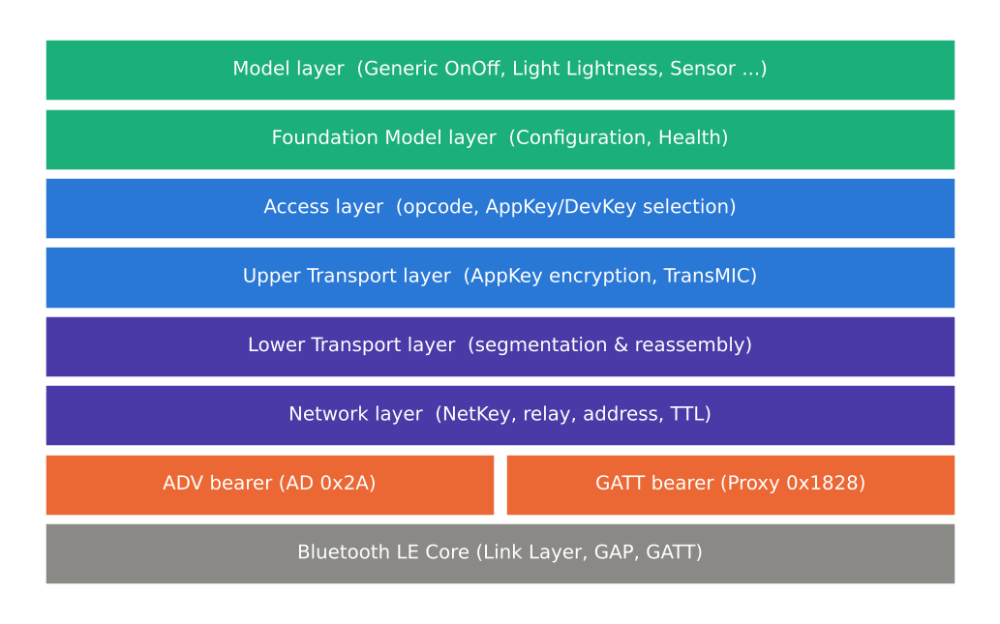
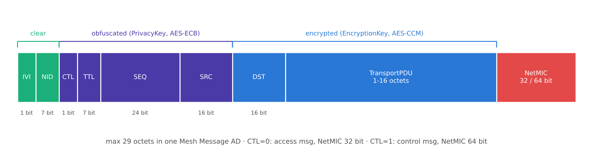

[[TIP("📘 규격 · 버전")]]
Mesh Protocol v1.1 — Bearer, Network, Lower Transport, Upper Transport, Access, Foundation Model 계층 · Mesh Proxy Service(GATT) · Core v6.0 Vol 3 Part C (GAP 광고), Vol 6 Part B (광고 PDU)
Mesh Profile 1.0 (2017) 계층 구조 → Mesh Protocol 1.1 (2023): SAR 동작을 설정 가능한 상태로 바꾸고(SAR Configuration 모델), Model 계층 절 신설
[[/TIP]]

[TOC]

[[TIP("🟢 한눈에 보기")]]
Mesh 메시지 하나는 계층을 내려가며 이렇게 포장됩니다.

1. **Access** — "Generic OnOff Set, 켜기"처럼 opcode + 파라미터를 만듦
2. **Upper Transport** — **AppKey**(또는 DevKey)로 암호화하고 TransMIC를 붙임
3. **Lower Transport** — 한 패킷에 안 들어가면 최대 32조각으로 **분할**
4. **Network** — 주소·TTL·SEQ를 붙이고 **NetKey**로 암호화·난독화
5. **Bearer** — 광고 패킷(ADV) 또는 GATT(Proxy)로 공중에 내보냄

Relay 노드는 **네트워크 계층까지만** 풀어 보고(NetKey만 앎) 다시 보냅니다. 내용(AppKey 영역)은 최종 수신 노드만 읽을 수 있습니다.
[[/TIP]]

## 계층 구조 (🔵 중급)

*그림. Mesh 계층 구조. 아래 두 베어러(ADV, GATT)는 LE Core 기능을 그대로 쓰고, 그 위의 모든 계층은 Mesh 규격이 정의합니다.*

| 계층 | 하는 일 | 주요 PDU·필드 |
|---|---|---|
| **Bearer** | 네트워크 PDU를 LE로 운반 | ADV 베어러: AD Type `Mesh Message`, `Mesh Beacon`, `PB-ADV` · GATT 베어러: Proxy PDU |
| **Network** | 주소 지정, Relay·Proxy 판단, NetKey 암호화와 난독화, 메시지 캐시 | Network PDU (IVI, NID, CTL, TTL, SEQ, SRC, DST, NetMIC) |
| **Lower Transport** | 분할·재조립(SAR), 세그먼트 ACK, Friend 큐 | 비분할/분할 Access·Control 메시지, `Segment Acknowledgment` |
| **Upper Transport** | AppKey/DevKey 암호화(TransMIC), 전송 제어 메시지 | Upper Transport Access PDU, Friend·Heartbeat 제어 메시지 |
| **Access** | opcode 형식, 키 선택, 요소·모델로 전달 | opcode(1·2·3바이트) + 파라미터 |
| **Foundation Model** | 네트워크 설정·진단을 위한 기본 모델 | Configuration Server/Client, Health Server/Client |
| **Model** | 응용 동작과 상태 | Generic, Lighting, Sensor, Scene, Time 모델 → **모델** |

## 네트워크 PDU (🔵 중급)

*그림. 네트워크 PDU. IVI·NID만 평문이고, CTL부터 SRC까지는 PrivacyKey로 난독화, DST와 전송 PDU는 EncryptionKey로 암호화됩니다. 광고 하나에 실리므로 전체가 29바이트를 넘지 않습니다.*

| 필드 | 크기 | 의미 |
|---|---|---|
| `IVI` | 1비트 | IV Index의 최하위 비트. IV 업데이트 중 어떤 IV Index로 복호할지 판별 |
| `NID` | 7비트 | NetKey에서 유도한 식별값. 수신자는 NID가 맞는 NetKey로만 복호 시도 |
| `CTL` | 1비트 | 0 = Access 메시지(NetMIC 32비트), 1 = Control 메시지(NetMIC 64비트) |
| `TTL` | 7비트 | 남은 전달 횟수 → **개요** |
| `SEQ` | 24비트 | 발신 요소별 순번. 같은 IV Index 안에서 재사용 금지 |
| `SRC` | 16비트 | 발신 요소의 유니캐스트 주소 |
| `DST` | 16비트 | 유니캐스트·그룹·가상 주소 |
| `TransportPDU` | 1–16바이트 | 하위 전송 PDU (Control은 최대 12바이트) |
| `NetMIC` | 32/64비트 | 네트워크 계층 무결성 |

헤더 9바이트 + 전송 PDU 16바이트 + NetMIC 4바이트 = 29바이트입니다. 광고 데이터 31바이트에서 AD 구조의 Length·Type 2바이트를 뺀 값과 같습니다.

## 분할과 재조립 (SAR) (🔵 중급)

| 하위 전송 PDU | 헤더 | 페이로드 |
|---|---|---|
| 비분할 Access | `SEG`=0, `AKF`, `AID`(6비트) — 1바이트 | Upper Transport PDU 5–15바이트 (= Access 페이로드 최대 11바이트 + TransMIC 4바이트) |
| 분할 Access | `SEG`=1, `AKF`, `AID`, `SZMIC`, `SeqZero`(13), `SegO`(5), `SegN`(5) — 4바이트 | 세그먼트당 최대 12바이트 |
| 비분할 Control | `SEG`=0, Opcode(7비트) | 최대 11바이트 |
| 분할 Control | `SEG`=1, Opcode, `SeqZero`, `SegO`, `SegN` | 세그먼트당 최대 8바이트 |

- 세그먼트는 최대 32개(`SegN` 5비트) → Upper Transport Access PDU 최대 32 × 12 = 384바이트, Access 페이로드는 TransMIC 4바이트를 빼면 최대 380바이트(8바이트 TransMIC이면 376바이트).
- **유니캐스트** 목적지는 수신자가 `Segment Acknowledgment`(BlockAck 32비트 비트맵)로 받은 조각을 알리고, 송신자는 빠진 조각만 재전송합니다. **그룹·가상** 목적지는 ACK 없이 정해진 횟수만큼 반복합니다.
- 짧은 메시지가 훨씬 유리하므로, 자주 쓰는 모델 메시지는 opcode와 파라미터를 11바이트 안에 맞추도록 설계되어 있습니다.

[[TIP("🔴 전문가 노트 — 난독화, SAR 타이머, Proxy 필터")]]
**난독화(obfuscation).** 헤더의 CTL·TTL·SEQ·SRC는 암호화된 부분 일부(DST·전송 PDU 앞부분)와 IV Index로 만든 값을 PrivacyKey로 AES-ECB 처리한 결과와 XOR합니다. 목적은 기밀성이 아니라 SRC·SEQ로 기기를 추적하기 어렵게 하는 것입니다. 수신자는 NID로 후보 NetKey를 고르고 → 난독화 해제 → NetMIC 검증 순으로 처리합니다.

**SAR 타이머.** 1.0은 TTL에 따라 늘어나는 고정 공식(예: ACK 타이머 150 ms + 50 ms × TTL)과 재조립 미완료 타이머(최소 10초)를 규정했습니다. 1.1은 이를 **SAR Transmitter/Receiver 상태**로 바꿔 `SAR Configuration` 모델로 노드별 조정이 가능해졌습니다. 정확한 기본값은 Mesh Protocol 1.1 원문 확인이 필요합니다.

**SeqAuth.** 분할 메시지의 재전송·중복 판별은 IV Index와 첫 세그먼트의 SEQ(하위 13비트가 `SeqZero`)로 만든 **SeqAuth**로 합니다. 한 SRC에서 동시에 진행할 수 있는 분할 메시지는 목적지당 하나입니다.

**Proxy PDU와 필터.** GATT 베어러는 Mesh Proxy Service(`0x1828`)의 `Mesh Proxy Data In`/`Out` 특성으로 **Proxy PDU**를 주고받습니다. 첫 바이트의 SAR(2비트)로 ATT MTU보다 긴 PDU를 나누고, Message Type(6비트)으로 Network PDU·Mesh Beacon·Proxy Configuration·Provisioning PDU를 구분합니다. 클라이언트는 `Set Filter Type`, `Add Addresses to Filter`로 수락(accept)/거부(reject) 목록을 설정해 필요한 메시지만 GATT로 받습니다.

**Proxy 광고.** Proxy 노드는 Mesh Proxy Service UUID와 서비스 데이터로 **Network ID**(어느 네트워크인지) 또는 **Node Identity**(어느 노드인지, 해시로 보호)를 광고합니다. 1.1은 여기에 Private Network Identity·Private Node Identity를 추가했습니다.
[[/TIP]]

## 관련 페이지

- **Mesh 개요와 관리형 플러딩** — TTL, Relay, 메시지 캐시
- **Mesh 보안** — NetKey에서 NID·EncryptionKey·PrivacyKey 유도
- **모델** — Access 계층 위의 메시지
- **레거시 광고** — ADV 베어러가 쓰는 광고 PDU
- **GATT** — Proxy 베어러의 기반
