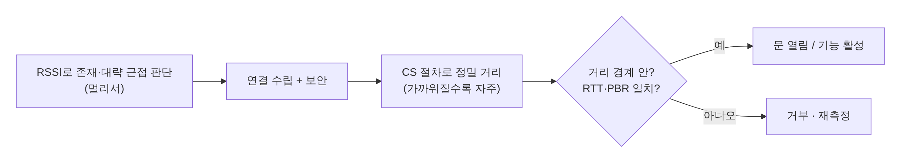

[[TIP("📘 규격 · 버전")]]
Core v6.0 Vol 6 (Link Layer·Physical Layer의 Channel Sounding) · v6.2 진폭 기반 공격 내성 · v6.3 Inline PCT Transfer, PHY별 RTT 정확도 · 관련 외부 규격: CCC Digital Key (Car Connectivity Consortium), IEEE 802.15.4z (UWB)
Core 4.0–5.0: RSSI 기반 근접 → 5.1: AoA/AoD 방향 탐지 → **6.0: Channel Sounding** (PBR + RTT) → 6.2/6.3: 보안·정확도 보강
[[/TIP]]

[TOC]

[[TIP("🟢 한눈에 보기")]]
지금까지 Bluetooth로 거리를 재는 방법은 **RSSI**(신호 세기)뿐이었고, 손이나 벽만 있어도 값이 크게 흔들렸습니다. **Channel Sounding**(CS)은 여러 채널에서 **위상**(PBR)을 재고 **왕복 시간**(RTT)으로 교차 확인해 거리를 계산합니다.

1. **정밀도** — SIG는 센티미터 수준 정확도를 목표로 설계했고, 초기 구현이 약 ±20 cm를 보인다고 소개합니다.
2. **보안** — RTT 거리 경계(distance bounding)로 **중계 공격**(relay attack)을 막도록 설계되었습니다.
3. **이미 있는 무선** — 휴대폰·태그에 이미 있는 Bluetooth LE로 동작하므로, 칩이 지원하면 UWB 같은 별도 무선이 필요 없습니다.

다만 CS 지원은 새 칩이 필요할 수 있고, 아래 응용 대부분은 2025년 이후 초기 단계입니다. 측정 원리는 **LE 컨트롤러 › Channel Sounding**을 보십시오.
[[/TIP]]

## 거리 측정 기술 비교 (🔵 중급)

| 항목 | RSSI | AoA/AoD (5.1) | **Channel Sounding** (6.0) | UWB (IEEE 802.15.4z) |
|---|---|---|---|---|
| 측정량 | 수신 세기 | 도래 각도 | 위상 차(여러 채널) + 왕복 시간 | 짧은 펄스의 비행 시간(ToF) |
| 대역 | 2.4 GHz | 2.4 GHz | 2.4 GHz | 6–9 GHz대 (지역별 채널) |
| 거리 정확도 | 수 m 수준 오차, 환경에 민감 | 각도 중심 (거리는 별도) | 센티미터 수준 목표 (SIG) | 센티미터 수준 (업계 일반 평가) |
| 중계 공격 방어 | 없음 | 없음 | RTT 거리 경계 + 무작위 시퀀스 | STS(Scrambled Timestamp Sequence) 기반 보안 측정 |
| 추가 하드웨어 | 없음 | 안테나 배열 | CS 지원 LE 칩 | UWB 칩·안테나 |
| 휴대폰 보급 | 전부 | 제한적 | 칩 세대 교체에 따라 늘어나는 중 | 고급 기종 중심 |

## 응용 분야 (🔵 중급)

| 분야 | CS가 주는 것 | 현재 상황 (확인 범위) |
|---|---|---|
| **디지털 차량 키** | 휴대폰이 문 손잡이 근처인지, 차 안인지를 판단해 패시브 출입·시동 | CCC Digital Key 인증 프로그램은 2025년 3월 **BLE와 UWB**를 포함하도록 확장(BLE는 근접 통신·원격 제어, UWB는 정밀 위치). CCC가 CS를 규격에 포함했는지는 공개 자료로 확인하지 못함. 칩 벤더가 "CCC Digital Key with Channel Sounding" 응용 노트를 공개했고, 중국 ICCOA는 CS를 자체 Bluetooth 디지털 키 규격에 넣겠다고 SIG 발표에서 언급 |
| **분실물 추적** ("Find My") | "방향·거리 몇 m"를 넘어 근거리 정밀 안내 | SIG 발표에 Samsung이 Find My 응용 성능 향상을 기대한다는 언급. 구체적 제품 지원은 제조사 발표 확인 필요 |
| **출입·보안 거리 경계** | 인가된 기기가 **정해진 거리 안**에 있을 때만 잠금 해제 | SIG가 대표 사례로 제시. 중계 공격 방어가 핵심 가치 |
| **실내 측위** | 고정 앵커와 다수 거리 측정으로 위치 계산 | CS는 연결된 두 기기 간 측정이라 다수 태그·앵커 구성은 스케줄링 부담. AoA와 결합하는 연구·제품 등장 |
| **주변기기 상태 전환** | 마우스·키보드·컨트롤러가 사용자 거리로 활성/절전 전환 | SIG 발표에서 ABI Research가 언급한 사례 |

SIG는 멀리서는 RSSI로 존재·근접을 판단하고, 기기가 가까워질수록 CS로 정확도를 높이는 단계적 사용을 제시합니다. 최대 전력으로 송신하면 150 m까지도 측정이 가능하다고 소개하지만, 실제 성능은 안테나·다중 경로·인체 차폐에 크게 좌우됩니다.

[[TIP("🔴 전문가 노트 — UWB와의 관계, 보안 평가 포인트")]]
**대체인가 보완인가.** 차량 키에서는 BLE가 이미 연결·인증 채널로 쓰이고 UWB가 정밀 측위를 맡는 구조가 자리 잡았습니다. CS는 "UWB 없는 기기에서도 보안 거리 측정"을 제공할 수 있다는 점에서 원가 측면의 대안이 되지만, 다중 경로가 심한 차 안·주차장에서 UWB(넓은 대역폭 → 높은 시간 분해능)와 같은 수준인지는 공개된 독립 평가가 아직 적습니다. 이 책은 단정하지 않습니다.

**공격 모델.** 위상 측정(PBR)은 정밀하지만 주기적 위상·진폭 조작으로 거리를 줄여 보이게 하는 공격 여지가 있습니다. 그래서 RTT를 함께 쓰고, 무작위 시퀀스와 NADM(Normalized Attack Detector Metric)으로 이상을 탐지합니다. 6.2는 진폭 기반 공격 탐지 시험 기준을 추가했습니다. 응용은 "PBR 거리와 RTT 거리의 불일치"를 거부 조건으로 써야 합니다.

**호스트 쪽 계산.** 컨트롤러는 측정값(위상·품질 지표·시간)을 HCI로 넘기고, **거리 계산 알고리즘은 호스트·응용 몫**인 구현이 많습니다. 6.3의 Inline PCT Transfer는 반사기가 위상 보정을 미리 해 HCI 데이터량을 줄이는 방향입니다. 제품 간 정확도 차이는 이 알고리즘 차이에서 크게 나옵니다.

**Ranging Profile.** 반사기(reflector)가 측정한 CS 결과를 개시기(initiator)로 넘기는 GATT 기반 규격으로 **Ranging Profile (RAP) 1.0**과 **Ranging Service (RAS)**가 별도로 채택되어 있습니다. 세부 특성 구성은 해당 규격 원문 확인이 필요합니다.
[[/TIP]]

## 생태계 상태 (🔵 중급)

| 항목 | 상태 |
|---|---|
| 규격 | Core 6.0(2024.9) 채택, 6.2·6.3에서 보안·정확도 개선 |
| 칩 | 다수 SoC 벤더가 CS 지원 제품·SDK·응용 노트를 공개. 기존 제품은 IC 교체가 필요할 수 있음(SIG 안내) |
| 최종 제품 | SIG는 2025년부터 최종 제품 등장을 예상했다고 밝힘. 휴대폰 OS 수준 지원 범위는 제조사·OS 발표 확인 필요 |
| 표준 단체 연계 | CCC(차량), ICCOA(중국 차량) 등에서 활용 논의 — 채택 범위는 각 단체 규격 확인 필요 |

## 관련 페이지

- **Channel Sounding** — PBR·RTT 측정 원리와 절차
- **방향 탐지 (AoA·AoD)** — 각도 기반 위치 기술
- **Core 6.0–6.3** — CS를 포함한 버전별 기능
- **알려진 공격과 대응** — 중계 공격 등
