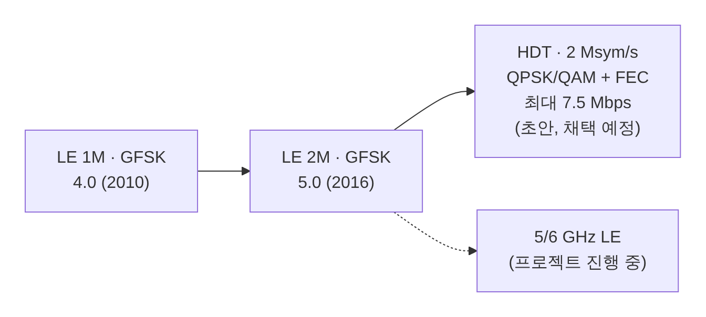

[[TIP("📘 규격 · 버전")]]
**논의 중** — Bluetooth High Data Throughput (Change Request) 초안 공개(2026), SIG는 2026년 하반기 Core 릴리스에서 채택 예정이라고 밝힘 · 5 GHz/6 GHz 대역 LE 동작: SIG "Specifications in development" 프로젝트 (세부 미공개)
LE 1M (4.0, 2010) → LE 2M (5.0, 2016) → HDT 최대 7.5 Mbps (초안) · 2.4 GHz 단일 대역 → 5/6 GHz 추가 (프로젝트 진행 중)
[[/TIP]]

[[TIP("⚠️ 이 페이지의 성격")]]
이 페이지의 내용은 **채택된 규격이 아닙니다.** SIG가 공개한 프로젝트 소개, 블로그, 공개 초안 안내에 나온 내용만 정리했으며, 최종 규격에서 수치·구조가 바뀔 수 있습니다. 확인하지 못한 세부(변조 성상도 배치, 패킷 필드, 6 GHz 채널 계획 등)는 쓰지 않았습니다.
[[/TIP]]

[[TIP("🟢 한눈에 보기")]]
LE는 2016년 LE 2M 이후 PHY 속도가 그대로였습니다. SIG는 두 갈래로 이를 넘어서려 합니다.

1. **HDT (High Data Throughput)** — 같은 2.4 GHz에서 **심볼 속도는 2 Msym/s로 유지**하고 심볼당 더 많은 비트(QPSK·QAM 계열)를 실어 최대 **7.5 Mbps**까지
2. **상위 대역 확장** — 붐비는 2.4 GHz 밖, **5 GHz·6 GHz** 비면허 대역에서 LE를 동작시키는 별도 프로젝트

목적은 큰 파일 전송, 고음질·무손실 오디오, 낮은 지연 등입니다. HDT는 초안이 공개된 단계이고, 상위 대역은 프로젝트가 진행 중이라는 사실 외에 공개된 세부가 거의 없습니다.
[[/TIP]]

## HDT: 공개된 내용 (🔵 중급)

| 항목 | SIG 공개 내용 (2026.7 블로그·초안 안내) |
|---|---|
| 상태 | 초안(Change Request) 공개. 2026년 하반기 Core 릴리스에서 채택 예정 |
| 최대 속도 | 2 Mbps → 최대 **7.5 Mbps** (약 4배). 프로젝트 소개 페이지에는 "최대 8 Mbps 목표"로 표현 |
| 지원 비트율 | 2, 3, 4, 6, 7.5 Mbps — 모두 **2 Msym/s** 신호 속도 |
| 변조·검출 | QPSK·QAM 계열 고차 변조, **코히런트 검출** |
| 오류 정정 | 모든 비트율에서 PHY 계층 **FEC** (컨볼루션 부호 기반) |
| 링크 적응 | 패킷 헤더가 비트율을 표시 → **패킷 단위로 속도 변경**. 선택적으로 수신 측이 RSSI·SNR을 송신 측에 보고 |
| 패킷 구조 | 가장 큰 모드에서 약 8,000바이트 이상 페이로드. 블록마다 체크섬 → **손상된 블록만 재전송**, 부분 전송·블록별 선택 ACK |
| 보안 | ECDH·AES 유지. MIC 64/128비트 선택(기존 LE PHY는 32비트), GFSK ↔ HDT PHY 전환 시 키·MIC 길이를 바꾸는 **Encryption Key Schedule**, 순방향 비밀성 언급 |
| 예시 효과 | 회원사 초기 시연에서 수 MB 파일 전송이 약 16초 → 약 4초 |

**계산으로 보는 의미.** 2 Msym/s에서 7.5 Mbps라면 FEC를 포함한 실효 정보량이 심볼당 $7.5 / 2 = 3.75$비트입니다. 기존 LE 2M은 GFSK 심볼당 1비트(2 Msym/s → 2 Mbps)였으므로, 점유 대역폭은 비슷하게 두고 성상도와 부호로 효율을 올리는 방식임을 알 수 있습니다. 다만 고차 변조는 같은 거리에서 더 높은 SNR을 요구하므로, 실제 처리량은 링크 상태에 따라 2–7.5 Mbps 사이에서 오르내리게 됩니다. 현재 LE 2M의 응용 처리량 상한은 약 1402 kbps입니다(251바이트 PDU 기준) → **처리량 최적화**.

## 5 GHz·6 GHz 확장: 논의 중 (🔵 중급)

| 항목 | 확인된 내용 | 확인되지 않은 내용 |
|---|---|---|
| 프로젝트 | SIG가 "추가 비면허 중대역(5 GHz, 6 GHz)에서의 LE 동작 정의" 프로젝트를 진행 중이라고 공개 | 채널 배치, 대역폭, 송신 전력 클래스 |
| HDT와 관계 | SIG 블로그는 HDT와 별개의 로드맵 항목으로 소개 | 상위 대역에서 HDT PHY를 쓸지 여부 |
| 일정 | 공개된 일정 없음 | 채택 시점 |
| 목적 | 처리량·지연·공존 등 성능 향상을 지속하기 위함(프로젝트 소개 문구) | 구체적 응용 목표 |

배경 지식으로, 5/6 GHz는 Wi-Fi가 주로 쓰는 대역이고 국가별 규제(DFS, 6 GHz 실내 저전력·초저전력 기기 규칙 등)가 2.4 GHz보다 복잡합니다. 따라서 상위 대역 LE는 Wi-Fi 공존과 지역별 규제 대응이 핵심 과제가 될 것으로 보이지만, 이는 이 책의 해석이며 SIG가 구체적 방식을 공개한 것은 아닙니다. → **Wi-Fi와의 공존**

[[TIP("🔴 전문가 노트 — 지켜볼 점")]]
**하위 호환.** 공개 자료는 GFSK PHY와 HDT PHY 사이 전환(키 스케줄)을 언급할 뿐, 광고·연결 수립을 어떤 PHY로 하는지, 기존 기기와 어떻게 협상하는지는 자세히 설명하지 않습니다. 기존 LE PHY 선택 절차(`LL_PHY_REQ`류)와의 관계는 최종 규격을 확인해야 합니다.

**오디오와의 관계.** SIG의 LE Audio 개발 프로젝트 목록에는 "고해상도·무손실 오디오"가 따로 있습니다. HDT가 그 전송 기반이 될 가능성이 거론되지만, 무손실 오디오 지원은 HDT 규격의 확정 기능이 아니라 **잠재적 응용**으로 소개되고 있습니다. 칩 업체들이 HDT 오디오 칩 협력을 발표하는 등 업계 준비는 진행 중입니다.

**블록 단위 재전송의 의미.** 현재 LE는 PDU 하나(최대 251바이트)를 통째로 CRC 검사·재전송합니다. HDT의 블록 체크섬 구조는 큰 페이로드에서 일부 손상 시 재전송량을 줄이려는 설계로, 802.11의 A-MPDU·Block Ack와 비슷한 발상입니다.

**6.3의 준비 작업.** Core 6.3은 HCI 지원 명령 비트맵과 LE 이벤트 마스크를 크게 늘렸습니다([v2] 명령). SIG 발표 기사에서는 이것이 HDT 같은 후속 기능을 위한 여유 공간 확보로 언급되었습니다.
[[/TIP]]

## 관련 페이지

- **LE PHY (1M·2M·Coded)** — 현재 LE PHY와 변조
- **디지털 변조 (GFSK·DPSK)** — GFSK와 고차 변조 비교의 기초
- **처리량 최적화** — 현재 LE 처리량 상한
- **2.4 GHz ISM 대역과 규제** — 현재 대역과 규제
- **Core 6.0–6.3** — 최근 Core 버전
