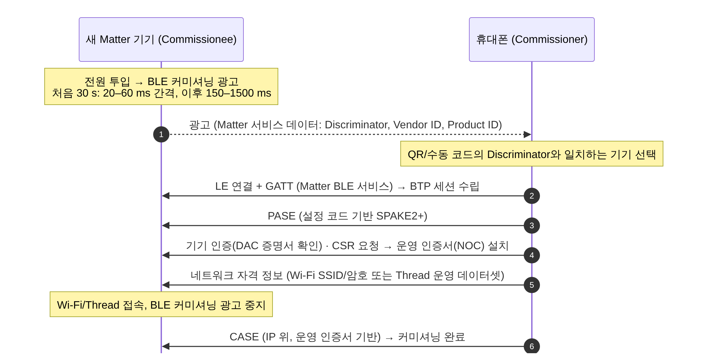

[[TIP("📘 규격 · 버전")]]
Matter (CSA, 1.0 2022.10 이후 개정) — 커미셔닝, BLE 커미셔닝 전송(BTP) · Thread (Thread Group, 1.4 2024.9) · IEEE 802.15.4 (2.4 GHz O-QPSK PHY) · Bluetooth Mesh Protocol v1.1 · Core v6.0 Vol 3 Part C (GAP 광고), Part G (GATT)
Bluetooth Mesh 1.0 (2017) / Thread 1.1 (2017경) → Matter 1.0 (2022, BLE를 커미셔닝 수단으로 채택) → Thread 1.4 (2024, Border Router 상호운용 강화)
[[/TIP]]

[TOC]

[[TIP("🟢 한눈에 보기")]]
스마트홈 표준 **Matter**는 IP 위의 응용 계층 규격이고, 실제 데이터는 **Wi-Fi·Ethernet·Thread**로 오갑니다. 그럼 Bluetooth는 어디에 쓰일까요?

1. **처음 설치할 때(커미셔닝)** — 새 기기는 아직 Wi-Fi 비밀번호도 Thread 네트워크 정보도 모릅니다. 휴대폰이 **BLE로 기기를 찾아 연결**하고, 그 위에서 인증·네트워크 정보 전달을 마칩니다.
2. **설치가 끝나면** — 기기는 Wi-Fi나 Thread로 IP 통신을 하고, 커미셔닝용 BLE 광고를 멈춥니다.
3. **Bluetooth Mesh와는 다른 길** — Matter는 Bluetooth Mesh를 데이터 경로로 쓰지 않습니다. 저전력 메시가 필요하면 Matter는 **Thread**를 씁니다.

즉 Matter에서 BLE는 "현관 인터폰" 역할이고, 집 안 대화는 IP 네트워크로 합니다.
[[/TIP]]

## Matter 커미셔닝에서 BLE의 역할 (🔵 중급)

| 단계 | BLE가 하는 일 | 비고 |
|---|---|---|
| 발견 | 기기가 Matter 서비스 데이터를 담은 연결 가능 광고 | Commissioner는 광고 채널 37/38/39를 수동 스캔하면 됨 |
| 연결 | 일반 LE 연결 + GATT | 서비스 UUID `0xFFF6`(Matter용 16비트 UUID), 쓰기 특성·Indication 특성으로 양방향 |
| 전송 | **BTP**(Bluetooth Transport Protocol): GATT 위에서 Matter 메시지를 분할·순서 보장·흐름 제어 | ATT MTU에 맞춰 조각냄 |
| 보안 | BLE 링크 암호화에 의존하지 않고 Matter **PASE**로 세션 암호화 | LE 페어링 불필요 |
| 종료 | 첫 패브릭에 커미셔닝되면 광고 중지 | 이후 추가 관리자 등록은 IP 위에서 |

## Thread와 IEEE 802.15.4 (🔵 중급)

| 항목 | IEEE 802.15.4 (2.4 GHz) | Bluetooth LE |
|---|---|---|
| 변조·속도 | O-QPSK (DSSS), 250 kbps | GFSK 1/2 Mbps, Coded 125/500 kbps |
| 채널 | 16개 (채널 11–26, 5 MHz 간격, 2405–2480 MHz) | 40개 (2 MHz 간격) |
| 매체 접근 | CSMA-CA | 시간 예약(연결 이벤트), 광고는 경쟁 없음 |
| 최대 프레임 | 127바이트 PHY 페이로드 | 데이터 PDU 최대 251바이트 |
| 위에 올라가는 것 | Thread, Zigbee, (구) 6LoWPAN 각종 | GATT 프로파일, LE Audio, Bluetooth Mesh |

**Thread**는 802.15.4 위에 6LoWPAN으로 IPv6를 얹고, 라우터들이 거리 벡터 방식으로 경로를 유지하는 메시 네트워크입니다. 역할은 Router·REED(라우터가 될 수 있는 단말)·End Device(배터리 기기는 Sleepy End Device)로 나뉘고, **Border Router**가 Thread와 집의 Wi-Fi/Ethernet IP 네트워크를 잇습니다. Thread 1.4(2024.9)는 서로 다른 제조사 Border Router의 상호운용과 자격 정보 공유를 강화했습니다.

## Bluetooth Mesh vs Thread vs Zigbee (🔵 중급)

| 항목 | **Bluetooth Mesh** | **Thread** | **Zigbee** |
|---|---|---|---|
| 표준 단체 | Bluetooth SIG | Thread Group | CSA (구 Zigbee Alliance) |
| 무선 | Bluetooth LE (2.4 GHz, 1M PHY 광고) | IEEE 802.15.4 | IEEE 802.15.4 |
| 네트워크 계층 | 자체 (16비트 Mesh 주소) | **IPv6** (6LoWPAN) | 자체 (Zigbee PRO, 16비트 NWK 주소) |
| 전달 방식 | 관리형 플러딩 (1.1: Directed Forwarding 선택) | 라우팅 (라우터 간 경로) | 라우팅 (경로 탐색 기반) |
| 저전력 단말 | Low Power Node + Friend | Sleepy End Device + 부모 라우터 | Sleepy End Device + 부모 |
| 응용 계층 | Mesh Model (Generic, Lighting, Sensor), NLC 프로파일 | 응용 계층 없음 → **Matter**가 위에 올라감 | Zigbee Cluster Library |
| 인터넷 연결 | 게이트웨이(Proxy·클라우드) 필요 | Border Router로 IP 직접 | 게이트웨이(코디네이터) 필요 |
| 휴대폰 직접 제어 | Proxy 노드 경유 GATT로 가능 | 휴대폰에 802.15.4 무선 없음 → Border Router 경유 | 불가(허브 경유) |
| Matter 관계 | 데이터 경로로 쓰이지 않음 (BLE는 커미셔닝에만) | Matter의 저전력 메시 전송 | 브리지를 통해 Matter에 연결 |
| 강점 분야 | 상업용 조명 제어, 대규모 그룹 제어 | 스마트홈(Matter), IP 기반 기기 | 기존 스마트홈·조명 설치 기반 |

[[TIP("🔴 전문가 노트 — 공존과 설계 선택")]]
**같은 2.4 GHz.** 802.15.4 채널 15·20·25·26은 Wi-Fi 1·6·11 채널 사이 틈과 겹침이 적어 흔히 권장됩니다. Thread와 BLE를 한 칩에서 동시에 돌리는 **멀티프로토콜** SoC는 시간 분할로 무선을 나눠 쓰므로, 커미셔닝 중 BLE 연결과 Thread 접속이 겹치는 구간에서 스케줄링이 중요합니다(동적 멀티프로토콜 구성은 칩 SDK 확인).

**Bluetooth Mesh의 위치.** Matter가 스마트홈의 상호운용 층을 차지하면서, Bluetooth Mesh는 NLC 프로파일과 함께 **상업용 조명·빌딩 제어**에 집중하는 흐름입니다. 두 기술을 함께 쓰려면 게이트웨이가 Mesh 모델 ↔ Matter 클러스터를 변환하는 브리지가 필요합니다.

**BLE 커미셔닝의 실무 문제.** 휴대폰 OS가 광고 스캔 결과를 걸러 내거나 백그라운드 스캔을 제한해 기기 발견이 늦어지는 경우가 많습니다. 기기 쪽에서는 30초 빠른 광고 구간을 놓치면 느린 간격(150–1500 ms)으로 바뀌므로 발견 시간이 길어집니다. 사용자가 전원을 넣은 직후 앱을 열도록 안내하는 이유입니다.

**IP over Bluetooth.** SIG는 LE 위 IPv6 전송 규격(IP Link)을 개발 중이며 2026년 가을 채택을 목표로 한다고 공개했습니다. 확정되면 BLE 기기가 IP 네트워크에 참여하는 방식이 달라질 수 있습니다(논의 중).
[[/TIP]]

## 관련 페이지

- **Mesh 개요와 관리형 플러딩** — Bluetooth Mesh의 전달 방식
- **Mesh 1.1** — Directed Forwarding 등 확장 기능
- **GATT** — Matter BLE 커미셔닝이 쓰는 GATT 구조
- **Wi-Fi와의 공존** — 2.4 GHz 공존
- **Bluetooth vs Wi-Fi vs 5G** — 무선 기술 전반 비교
