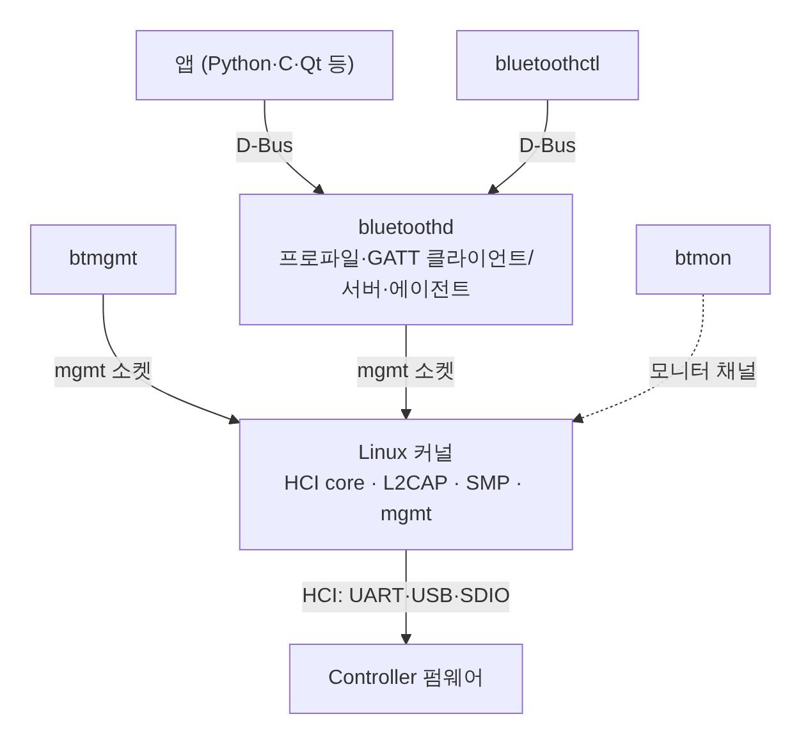

[[TIP("📘 규격 · 버전")]]
Core v6.0 Vol 4 Part E (HCI Functional Specification) · Vol 3 (Host: L2CAP, ATT, GATT, SMP, GAP) · 각 스택의 지원 범위는 해당 프로젝트·SDK 문서와 SIG 인증 목록(DN/QDID)으로 확인
Core 4.0 이후 LE 전용 경량 스택(NimBLE, 칩 벤더 스택)이 늘어남 → 5.2 이후 LE Audio(ISO)·EATT 지원 여부가 스택 선택의 새 기준
[[/TIP]]

[TOC]

[[TIP("🟢 한눈에 보기")]]
**호스트 스택(host stack)**은 HCI 위에서 L2CAP, ATT/GATT, SMP, GAP와 프로파일을 구현한 소프트웨어입니다. 같은 칩이라도 어떤 스택을 올리느냐에 따라 쓸 수 있는 기능, API, 메모리 사용량, 인증 부담이 크게 달라집니다.

1. **운영체제 스택**: Linux의 BlueZ, Android 스택, Apple Core Bluetooth — OS가 제공하고 앱은 API만 씁니다.
2. **RTOS·임베디드 스택**: Zephyr, NimBLE — 소스가 공개되어 펌웨어에 직접 링크합니다.
3. **칩 벤더 SDK**: Nordic, Silicon Labs, Espressif, TI 등 — 컨트롤러와 함께 검증·인증된 묶음으로 제공됩니다.
[[/TIP]]

## 구성 방식: Host와 Controller를 어디에 두나 (🔵 중급)

| 구성 | Host 위치 | Controller 위치 | HCI 전송 | 대표 예 |
|---|---|---|---|---|
| 2칩 (호스트 SoC + BT 칩) | 애플리케이션 프로세서(Linux, Android) | 별도 BT/콤보 칩 | UART(H4·H5), USB, SDIO | 스마트폰, PC, 게이트웨이 |
| 단일 칩 SoC | 같은 MCU 안 | 같은 MCU 안 | 내부 함수 호출 또는 가상 HCI | 센서 태그, 웨어러블 |
| 듀얼 코어 SoC | 앱 코어 | 네트워크(무선) 코어 | 코어 간 IPC 위의 HCI | nRF5340 계열 등 |
| 네트워크 프로세서 | 외부 MCU는 앱만 | BT SoC가 Host+Controller | 벤더 전용 명령(UART/SPI) | 모듈형 제품 |

2칩 구성에서는 Host와 Controller가 표준 HCI로만 대화하므로 **HCI 로그**로 거의 모든 동작을 볼 수 있습니다. 단일 칩에서는 HCI가 내부에 숨어 있어, 스택이 제공하는 HCI 추적 기능(예: Zephyr의 모니터 출력)을 켜야 같은 수준의 로그를 얻습니다.

## 주요 스택 비교 (🔵 중급)

| 스택 | 플랫폼 | 범위 | 라이선스·형태 | 앱에서 보는 API | 특징 |
|---|---|---|---|---|---|
| **BlueZ** | Linux | Classic + LE, Host (커널 HCI·L2CAP·SMP + 사용자 공간 `bluetoothd`) | GPL/LGPL, 오픈소스 | **D-Bus**(`org.bluez.Adapter1`, `Device1`, `GattCharacteristic1` …), mgmt 소켓 | `bluetoothctl`·`btmgmt`·`btmon` 도구 제공. 커널 버전과 BlueZ 버전 조합에 따라 기능 차이 |
| **Zephyr** | Zephyr RTOS | LE Host + 오픈소스 LE Controller, Mesh, LE Audio | Apache 2.0 | C API (`bt_le_adv_start`, `bt_gatt_notify` …) | 다른 벤더 Controller와 HCI로 조합 가능. nRF Connect SDK의 기반 |
| **NimBLE** | Apache Mynewt, ESP-IDF, RIOT 등 | LE 전용 Host + Controller | Apache 2.0 | C API (`ble_gap_*`, `ble_gatts_*`) | 작은 RAM·Flash. ESP-IDF에서 Bluedroid 대신 선택 가능 |
| **Android 스택** | Android, (ChromeOS의 Floss) | Classic + LE, LE Audio | Apache 2.0 (AOSP) | Java/Kotlin `BluetoothAdapter`, `BluetoothGatt`, `BluetoothLeScanner` | BlueDroid → Fluoride → **Gabeldorsche(GD)** 재구성. 업데이트 가능한 Mainline 모듈 |
| **Core Bluetooth** | iOS, iPadOS, macOS, watchOS | LE GATT (앱 관점) | 비공개 | `CBCentralManager`, `CBPeripheralManager`, `CBPeripheral` | HCI·주소·광고 내용 제어가 제한적. Classic은 시스템 기능이나 MFi 경로 |
| **칩 벤더 스택** | 각 SoC | 대개 LE (일부 Classic 포함) | 바이너리 + 소스 일부, 벤더 라이선스 | 벤더 C API 또는 Zephyr API | Controller와 함께 인증된 조합을 그대로 재사용 가능 |

### 칩 벤더 SDK 개요

| 벤더 | SDK | Host | Controller | 메모 |
|---|---|---|---|---|
| Nordic | nRF Connect SDK | Zephyr Host | SoftDevice Controller (또는 Zephyr Controller) | 이전 세대 nRF5 SDK + SoftDevice는 유지보수 단계 |
| Silicon Labs | Simplicity SDK (Bluetooth LE SDK) | 자체 스택 | 자체 | 이벤트 기반 API, NCP 모드 지원 |
| Espressif | ESP-IDF | Bluedroid 또는 NimBLE | 자체 (ESP32는 Classic+LE 듀얼 모드) | Wi-Fi와 무선 공유 → 공존 설정 중요 |
| TI | SimpleLink SDK | BLE5-Stack (자체) | 자체 | CC26xx·CC23xx 계열 |
| Infineon 등 | AIROC 등 | 자체 | 자체 | 오디오·콤보 칩 중심 |

SDK 이름과 지원 칩은 자주 바뀌므로, 구체적인 버전·기능 지원표는 각 벤더 문서에서 확인해야 합니다.

## BlueZ 구조와 도구 (🔵 중급)

| 도구 | 경로 | 주 용도 |
|---|---|---|
| `bluetoothctl` | D-Bus → `bluetoothd` | 스캔, 페어링, 연결, GATT 탐색(`menu gatt`) |
| `btmgmt` | mgmt 소켓 → 커널 | 어댑터 전원·광고·주소·보안 모드 등 저수준 설정 |
| `btmon` | 커널 모니터 채널 | 모든 HCI 트래픽 기록·해석 (**로그 분석**) |
| `hcitool`, `gatttool` | 원시 HCI 소켓 | 구형 도구. 최신 BlueZ에서는 사용 중단(deprecated) |

원시 HCI 소켓으로 명령을 직접 보내면 `bluetoothd`가 가진 상태와 어긋나기 쉽습니다. 실험 외에는 D-Bus나 mgmt 경로를 쓰는 것이 안전합니다.

[[TIP("🔴 전문가 노트 — Android GD·Rust, Apple 제약, 인증 재사용")]]
**Android 스택의 계보.** Android 4.2에서 도입된 BlueDroid(Broadcom 기반)가 이후 **Fluoride**로 불렸고, Google은 이를 계층별로 다시 쓰는 **Gabeldorsche(GD)** 작업을 플래그로 단계적으로 켜 왔습니다. 코드는 Bluetooth가 업데이트 가능한 Mainline 모듈이 되면서 `packages/modules/Bluetooth/system/gd/`로 옮겨졌습니다. 핵심 경로는 C++이고, Rust는 `system/gd/rust/` 아래의 ChromeOS용 **Floss**(Fluoride Linux OS Stack) 데몬·바인딩(`topshim` 등)에 주로 쓰입니다. Android 본체에서 Rust가 맡는 범위는 릴리스마다 바뀌므로 AOSP 소스로 확인해야 합니다.

**Android 컨트롤러 경계.** 벤더 Controller와는 Bluetooth HAL(HIDL → AIDL)을 통해 HCI 패킷을 주고받습니다. 그래서 Android의 HCI snoop log는 HAL 바로 위의 HCI를 기록하며, 벤더 전용(VS) 명령도 함께 보입니다.

**Core Bluetooth의 제약.** 앱은 BD_ADDR 대신 기기별 `NSUUID` 식별자를 받고, 광고 데이터는 로컬 이름과 서비스 UUID 정도만 넣을 수 있으며, 백그라운드에서는 광고·스캔 동작이 제한됩니다. 연결 간격 등은 Apple 액세서리 설계 가이드라인(Accessory Design Guidelines for Apple Devices)에 맞춰 주변기기 쪽에서 요청해야 합니다.

**인증 재사용.** SIG 인증에서 Controller와 Host는 각각 별도의 설계(Design)로 등록될 수 있습니다. 벤더가 인증받은 Controller + Host 조합을 수정 없이 쓰면 제품 인증 시 새 시험이 거의 필요 없지만, 오픈소스 Host를 직접 수정해 쓰면 그 부분은 직접 시험·선언해야 합니다. → **인증 (Qualification)**
[[/TIP]]

## 스택 선택 기준 (🔵 중급)

| 기준 | 질문 | 영향 |
|---|---|---|
| 기능 범위 | Classic 필요? LE Audio(ISO), EATT, PAwR, Channel Sounding? | Classic이 필요하면 BlueZ·Android·듀얼 모드 SoC로 좁혀짐 |
| 메모리 | RAM/Flash 예산은? 동시 연결 수는? | NimBLE·벤더 스택이 작고, 기능을 켤수록 커짐 |
| 인증 | 이미 인증된 Host+Controller 조합이 있나? | 비용·일정에 직접 영향 |
| 라이선스 | GPL 허용? 바이너리 배포 조건은? | BlueZ(GPL) vs Apache 2.0 vs 벤더 라이선스 |
| 디버깅 | HCI 로그를 쉽게 뽑을 수 있나? | 2칩·Zephyr·BlueZ는 유리, 일부 벤더 스택은 전용 도구 필요 |
| 유지보수 | 보안 패치(예: 알려진 공격 대응) 주기는? | 활성 커뮤니티·벤더 지원 여부 |
| 이식성 | 칩을 바꿀 가능성? | 표준 HCI 위 Host(Zephyr, NimBLE, BTstack 등)는 Controller 교체가 쉬움 |

## 관련 페이지

- **Host·Controller·HCI** — 스택을 나누는 경계
- **HCI 명령과 이벤트** — 스택이 Controller와 주고받는 패킷
- **로그 분석 (btmon·btsnoop·Wireshark)** — 스택별 로그 수집법
- **인증 (Qualification)** — 인증된 스택 재사용
- **GATT** — 모든 스택 API의 중심
