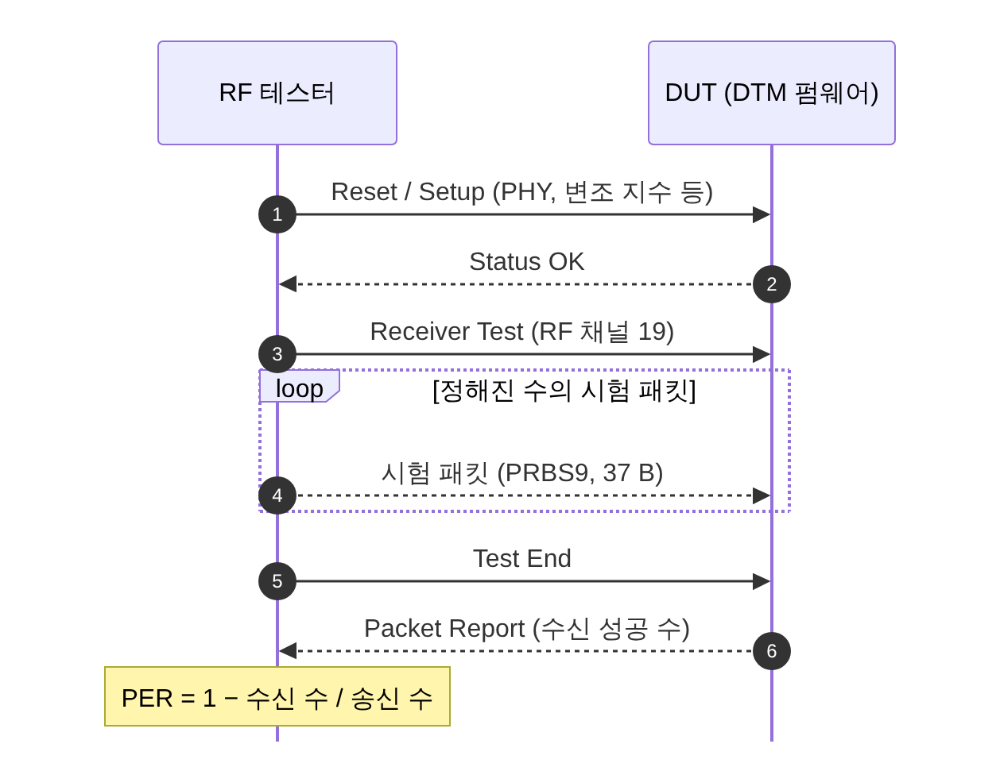

[[TIP("📘 규격 · 버전")]]
Core v6.0 Vol 6 Part A (LE Physical Layer: 송신·수신 요구 사항) · Vol 6 Part F (Direct Test Mode) · Vol 4 Part E (`HCI_LE_Receiver_Test`, `HCI_LE_Transmitter_Test`, `HCI_LE_Test_End`) · SIG 시험 규격 RF-PHY.TS (LE), RF.TS (BR/EDR)
Core 4.0 DTM 도입 → 5.0 2M·Coded PHY 시험 추가(명령 v2) → 5.1 CTE 시험(v3) → 6.2 Unified Test Protocol(UTP)로 OTA 시험 경로 추가
[[/TIP]]

[TOC]

[[TIP("🟢 한눈에 보기")]]
무선 제품은 "규격대로 신호를 내고 받는지"를 장비로 확인해야 합니다. LE에서는 이를 위해 칩을 시험 전용 상태로 만드는 **DTM**(Direct Test Mode)이 규격에 들어 있습니다.

1. 시험 장비(테스터)가 **UART 두 선이나 HCI**로 DUT에 "채널 19에서 PRBS9 패킷을 송신해" 같은 명령을 보냅니다.
2. 테스터가 송신 전력·변조·주파수 오차를 재거나, 반대로 테스터가 패킷을 보내고 DUT가 몇 개를 받았는지 보고합니다.
3. 칩이 아무리 좋아도 **안테나와 매칭**이 틀어지면 몇 dB가 사라집니다. 케이스, 배터리, 손이 모두 안테나 특성을 바꿉니다.
[[/TIP]]

## Direct Test Mode (🔵 중급)

| 인터페이스 | 명령 | 결과 보고 | 쓰는 곳 |
|---|---|---|---|
| **HCI** | `HCI_LE_Transmitter_Test` [v1–v4], `HCI_LE_Receiver_Test` [v1–v3], `HCI_LE_Test_End` | `HCI_LE_Test_End`의 Command Complete에 수신 패킷 수 | 2칩 구성, Linux·Android 기기 |
| **2-wire UART** | 16비트 명령: 종류(리셋·수신·송신·종료) + 채널 + 길이 + 패킷 종류 | 16비트 이벤트: 상태 또는 패킷 수 | 단일 칩 모듈, 양산 라인 |
| **UTP** (6.2) | 규격 원문 확인 필요 | | 무선(OTA)으로 시험 제어 |

| 시험 패킷 페이로드 | 용도 |
|---|---|
| PRBS9 | 실제 데이터와 비슷한 스펙트럼, 감도·출력 측정 |
| `11110000` 반복 | 변조 특성 Δf1 (낮은 주파수 성분) |
| `10101010` 반복 | 변조 특성 Δf2 (높은 주파수 성분) |
| 모두 1 / 모두 0, PRBS15 등 | 규제 시험·추가 측정 (지원 여부는 명령 버전에 따름) |

## RF-PHY 시험 항목 (🔵 중급)

| 구분 | 항목 | 확인하는 것 | 대표 요구 (LE 1M) |
|---|---|---|---|
| 송신 | 출력 전력 | 피크·평균 전력이 신고 범위 안 | LE 전체 범위 −20 dBm ~ +20 dBm |
| 송신 | 대역 내 방출 | 인접 채널로 새는 전력 | 오프셋별 마스크 |
| 송신 | 변조 특성 | 주파수 편이 Δf1avg, Δf2max, Δf2avg/Δf1avg | Δf1avg 225–275 kHz (변조 지수 0.5 근처) |
| 송신 | 반송파 주파수 오프셋·드리프트 | 크리스털 오차, 패킷 중 주파수 흔들림 | 오프셋 ±150 kHz 이내, 드리프트 한도는 RF-PHY.TS 확인 |
| 수신 | 수신 감도 | 기준 PER에서 최소 입력 전력 | −70 dBm 이하 (2M −70, Coded S2 −75, S8 −82 dBm) |
| 수신 | C/I·수신 선택도 | 같은·인접 채널 간섭 속 수신 | 동일 채널 C/I 21 dB 등 오프셋별 표 |
| 수신 | 블로킹 | 대역 밖 강한 신호(셀룰러 등) 속 수신 | 주파수 구간별 블로커 레벨 |
| 수신 | 상호변조 | 두 간섭 신호의 3차 IM | 규정 조합 |
| 수신 | 최대 입력 레벨 | 아주 가까운 송신기 | 포화 없이 수신 |
| 수신 | PER 보고 무결성 | DUT가 보고하는 패킷 수가 정확한지 | — |

2M PHY는 편이가 두 배(Δf1avg 450–550 kHz)이고, Coded PHY는 감도 요구가 더 엄격합니다. 시험은 낮은·중간·높은 채널(예: RF 채널 0, 19, 39)에서 반복하며, 이 페이지의 수치는 대표값이므로 인증 시험에서는 현행 RF-PHY.TS를 기준으로 합니다.

## 안테나와 매칭 (🔵 중급)

| 종류 | 형태 | 장점 | 단점 |
|---|---|---|---|
| PCB 패턴 (역 F, 미앤더 등) | 기판 동박 | 부품비 0, 효율 좋음 | 면적 필요, 기판·케이스에 민감 |
| 칩 안테나 (세라믹 칩) | 표면 실장 부품 | 작음 | 효율 낮은 편, 그라운드 크기·배치 조건 엄격 |
| 세라믹 패치·외장 (다이폴, 휩) | 커넥터 또는 부착 | 높은 이득·거리 | 크기, 비용 |
| 안테나 내장 모듈 | 인증 모듈 | 설계 부담 최소 | 모듈 배치 규칙(금속 금지 구역) 준수 필요 |

**매칭**은 칩 RF 출력(대개 50 Ω 기준)과 안테나 임피던스를 맞추는 일입니다. 보통 π형 LC 회로 자리(0 Ω·미실장 포함)를 미리 두고, 최종 케이스에 넣은 상태에서 VNA로 S11(반사 손실)을 2402–2480 MHz에서 −10 dB 이하로 맞추는 것을 목표로 조정합니다.

**디튜닝(detuning)**은 주변 물체 때문에 안테나 공진 주파수가 이동하는 현상입니다. 플라스틱 케이스(유전체)는 공진을 낮추고, 금속·배터리·디스플레이·사람 몸은 공진 이동과 흡수를 일으킵니다. 개발 보드에서 잘 되던 제품이 케이스에 넣으면 거리가 절반이 되는 흔한 원인입니다.

[[TIP("🔴 전문가 노트 — DTM 채널 번호, OTA 측정, 규제 시험과의 관계")]]
**DTM 채널 번호는 RF 채널.** DTM의 채널 파라미터는 링크 계층 채널 인덱스(광고 37/38/39)가 아니라 RF 채널 $k$이며 주파수는 $2402 + 2k$ MHz입니다. 따라서 DTM 채널 0은 2402 MHz(광고 채널 37), 채널 39는 2480 MHz입니다. 이 혼동으로 "엉뚱한 주파수에서 송신" 문제가 자주 생깁니다.

**전도 시험 vs OTA.** RF-PHY 시험은 대개 RF 커넥터로 연결한 **전도(conducted)** 시험입니다. 제품 전체 성능은 무반향실에서 **TRP**(총 방사 전력)와 **TIS**(총 등방 감도)로 따로 봅니다. 칩 감도가 −97 dBm이어도 안테나 효율이 −6 dB이면 제품 TIS는 그만큼 나빠집니다. 6.2의 UTP는 무선으로 시험 모드를 제어하는 경로를 규격에 추가해, 커넥터가 없는 완제품 시험을 쉽게 하려는 것입니다.

**규제 시험과의 관계.** SIG 인증의 RF 시험은 Bluetooth 규격 적합성이고, 판매 국가의 **전파 인증**(미국 FCC Part 15, 유럽 ETSI EN 300 328, 한국 KC 적합성평가, 일본 전파법 인증 등)은 별개입니다. 둘 다 DTM이나 벤더 시험 명령으로 고정 채널 연속 송신 상태를 만들어 측정합니다. 인증 모듈을 쓰면 모듈의 전파 인증을 활용할 수 있지만, 안테나를 바꾸거나 배치 규칙을 어기면 다시 받아야 할 수 있습니다.

**양산 시험.** 양산 라인에서는 모든 항목 대신 출력 전력, 주파수 오프셋(크리스털 트리밍), 간단한 PER만 DTM으로 빠르게 확인하는 경우가 많습니다. 크리스털 부하 커패시턴스 보정값을 이때 저장합니다.
[[/TIP]]

## Classic ↔ LE 비교

| 항목 | Classic (BR/EDR) | LE |
|---|---|---|
| 시험 모드 | Test Mode (LMP로 진입, 테스터가 Central) | Direct Test Mode (HCI 또는 2-wire UART) |
| 시험 규격 | RF.TS | RF-PHY.TS |
| 변조 시험 | GFSK + EDR(π/4-DQPSK, 8DPSK) 위상 오차 | GFSK (1M·2M), Coded |
| 감도 기준 | BER 0.1 % (BR) | PER 기반 (BER 0.1 % 상당) |

## 관련 페이지

- **LE PHY (1M·2M·Coded)** — 변조와 감도 요구
- **채널과 송신 전력** — RF 채널 번호와 전력 등급
- **무선 전파와 링크 버짓** — 안테나 이득과 거리
- **2.4 GHz ISM 대역과 규제** — 국가별 규제
- **인증 (Qualification)** — RF 시험이 들어가는 절차
