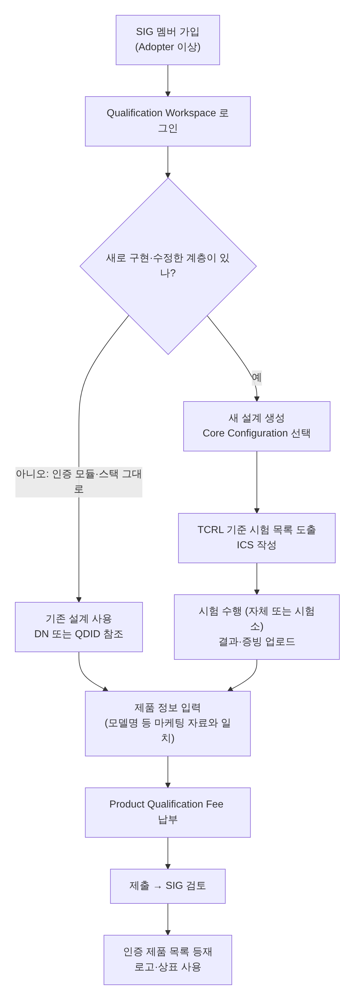

[[TIP("📘 규격 · 버전")]]
Bluetooth SIG Qualification Program Reference Document (**QPRD v3**, 2024년 6월 발행, 2024년 7월 1일 시행) · Bluetooth Patent/Copyright License Agreement(PCLA), Trademark License Agreement · 시험 규격(TS)·ICS·IXIT, Test Case Reference List(TCRL)
QPRD v2.x(2014년부터 적용, QDID·Declaration ID·Product Type 체계) → QPRD v3(Design Number·Core Configuration 체계, Product Type 폐지)
[[/TIP]]

[TOC]

[[TIP("🟢 한눈에 보기")]]
Bluetooth 이름과 로고를 쓰는 제품을 팔려면 **SIG 멤버**가 되어 제품을 **인증(Qualification)**하고 SIG 목록에 올려야 합니다. 주파수 인증(FCC, KC 등)과는 별개의 절차입니다.

1. **멤버 가입** — 무료 Adopter 등급으로도 가능
2. **설계(Design) 정하기** — 이미 인증된 칩·모듈·스택의 번호(DN 또는 기존 QDID)를 그대로 쓸지, 새 설계를 만들지
3. **필요한 시험** — 수정하지 않은 인증 설계만 쓰면 새 시험이 거의 없고, 새로 구현한 계층은 시험·증빙이 필요
4. **수수료 납부와 제출** — 검토 후 Bluetooth 인증 제품 목록에 등재
[[/TIP]]

## 절차 (🔵 중급)

| 단계 | 하는 일 | 메모 |
|---|---|---|
| 멤버십 | Adopter(무료) 또는 유료 등급 가입 | 등급에 따라 수수료·참여 권한이 다름 |
| 설계 선택 | "단일 기존 설계 사용" 또는 "새 설계 생성" 등 | QPRD v3 §3.2 |
| 시험 범위 결정 | 새로 구현한 계층의 시험 케이스만 | TCRL 버전 확인 |
| 시험 | 자체 시험(인정 범위) 또는 BQTF·시험소 | 일부 시험은 인정 시험소 필수 |
| 제출·검토 | 제품 정보, 참조 설계, 증빙 | 검토는 보통 1영업일 정도로 안내 |
| 기록 보관 | 판매 종료 후 일정 기간 증빙 보관 | 감사(audit) 대비 |

## 용어: 옛 체계와 새 체계 (🔵 중급)

| 개념 | QPRD v2.x (2024년 6월까지) | QPRD v3 (2024년 7월~) |
|---|---|---|
| 인증된 설계의 번호 | **QDID** (Qualified Design ID) | **DN** (Design Number). 기존 QDID도 수정하지 않았다면 계속 참조 가능 |
| 제품 선언 | **Declaration ID**(DID) 구매 후 리스팅에 연결 | 제품 인증 제출 시 Product Qualification Fee 납부 (Declaration Fee에서 이름 변경) |
| 설계 분류 | Product Type (End Product, Component, Subsystem 등) | **Core Configuration** (Core Complete, Core Host, Core Controller 등) |
| 결과 | 리스팅(Listing) | 인증 제품(Qualified Product) 목록 등재 |

v3 이전에 인증된 제품은 영향을 받지 않습니다. 칩·모듈 공급사는 고객에게 DN(또는 QDID)을 제공해야 하므로, 모듈을 고를 때 데이터시트나 공급사 문서에서 이 번호를 먼저 확인합니다.

[[TIP("🔴 전문가 노트 — 시험 범위, 수정의 의미, 비용")]]
**무엇이 "수정"인가.** 인증된 Host 스택의 소스를 고쳐 프로토콜 동작이 바뀌었다면 그 계층은 새 설계가 됩니다. 반면 앱 코드에서 공개 API만 쓰고 GATT 데이터베이스를 정의하는 것은 대개 스택 수정이 아닙니다. 다만 표준 프로파일·서비스(예: HID over GATT, Heart Rate)를 지원한다고 표시하면 해당 프로파일 시험 대상이 됩니다. 판단이 애매하면 SIG 지원팀이나 인증 컨설턴트(과거 BQE 제도의 전문가 등)에게 확인합니다.

**시험 도구.** SIG는 프로파일·프로토콜 시험용 **PTS**(Profile Tuning Suite)를 멤버에게 제공합니다. RF 계층 시험은 전용 테스터가 필요하며, 대개 칩·모듈 공급사가 이미 수행한 결과를 DN으로 재사용합니다. → **RF 시험과 안테나**

**TCRL과 버전.** 어느 시험 케이스가 필수인지는 제출 시점에 유효한 TCRL이 정합니다. 구 규격 버전(예: 폐지·중단 예정 규격)을 새로 인증할 수 없는 경우가 있으므로, 오래된 칩을 새 제품에 쓸 때는 그 설계가 아직 참조 가능한지 확인합니다.

**비용.** 제품 인증 수수료는 멤버 등급에 따라 다르며 수천~1만 달러대 규모입니다(예: Adopter 등급 약 1만 1천 달러 수준이라는 2024년 공급사 안내가 있음). 유료 멤버 등급은 연회비를 내는 대신 수수료가 낮습니다. **정확한 금액은 반드시 bluetooth.com의 현행 수수료 안내에서 확인**해야 합니다.
[[/TIP]]

## 인증과 함께 챙길 것 (🔵 중급)

| 항목 | 내용 | 관련 기관 |
|---|---|---|
| 전파 인증 | 판매 국가별 무선 인증 (FCC, CE/RED, KC, 일본 전파법 등) | 각국 규제 기관 |
| 상표 사용 | 로고·워드마크 사용 규칙 준수 | Bluetooth SIG 상표 가이드 |
| 회사 식별자 | 제조사 데이터 AD 타입 등에 쓰는 Company Identifier | SIG Assigned Numbers |
| 플랫폼 인증 | Apple MFi, Google Fast Pair 등 (선택) | 각 플랫폼 |
| 상호운용 시험 | 주요 스마트폰·OS 버전과의 실제 동작 | 자체 (UPF 행사 등 활용 가능) |

## 관련 페이지

- **Bluetooth SIG와 규격 체계** — SIG 조직과 규격 종류
- **호스트 스택 비교** — 인증된 스택 재사용
- **RF 시험과 안테나** — RF-PHY 시험
- **참고 자료** — SIG 사이트 링크
