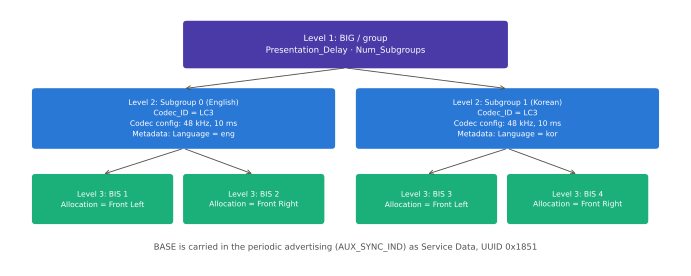
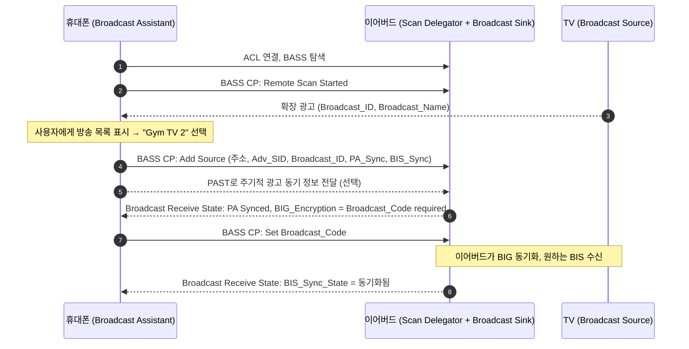

# Auracast 브로드캐스트

!!! spec "규격 · 버전"
    Core v5.2+ Vol 6 Part B (BIG/BIS, BIGInfo, BIG 암호화), Vol 6 Part G (ISOAL) · BAP v1.0 (Broadcast Source/Sink/Assistant, BASE) · Broadcast Audio Scan Service (BASS) v1.0 · Public Broadcast Profile (PBP) v1.0 · CAP v1.0 (Broadcast 절차) · Core 5.1 PAST(주기적 광고 동기 전달)
    BIS는 Core 5.2(2019)에 도입 → 2022년 6월 SIG가 브로드캐스트 오디오 브랜드 **Auracast** 발표 → 2022년 7월 LE Audio 규격 완성과 함께 PBP 등 정리

!!! basic "한눈에 보기"
    **Auracast**는 LE Audio 브로드캐스트에 SIG가 붙인 브랜드 이름입니다. 송신기 하나가 연결 없이 **청취자 수 제한 없이** 오디오를 내보냅니다.

    1. **송신기**는 "방송 중"이라는 광고(이름, Broadcast_ID)를 내고,
    2. 주기적 광고에 **방송 편성표(BASE)**: 코덱 설정, 언어, 좌/우 채널 배치를 싣고,
    3. 실제 오디오는 **BIG** 안의 여러 **BIS**로 흘려보냅니다.
    4. **수신기**(이어버드)는 원하는 BIS만 골라 받습니다. 비밀번호(**Broadcast_Code**)가 걸린 방송은 코드가 있어야 들립니다.

    이어버드에는 화면이 없으므로, 휴대폰이 대신 방송 목록을 보여 주고 고른 방송을 이어버드에 알려 줍니다(**Broadcast Assistant**). 공항 탑승구 안내, 체육관 TV, 친구와 음악 나눠 듣기가 대표 예입니다.

## 광고 계층과 BASE { .l2 }

| 단계 | 운반 PDU | 실리는 정보 |
|---|---|---|
| 1. 발견 | `ADV_EXT_IND` → `AUX_ADV_IND` (확장 광고) | Broadcast Audio Announcement (서비스 UUID 0x1852) + **Broadcast_ID**(3 B), Broadcast_Name, PBP라면 Public Broadcast Announcement (0x1856) |
| 2. 설정 | `AUX_SYNC_IND` (주기적 광고) | Basic Audio Announcement (0x1851) 서비스 데이터 = **BASE** |
| 3. 타이밍 | `AUX_SYNC_IND`의 ACAD | **BIGInfo**: BIG 앵커, ISO 간격, BIS 수, NSE·BN 등, 암호화 여부 |
| 4. 오디오 | BIG의 BIS들 | LC3 프레임 (BIS별 채널·언어) |

**Broadcast_ID**는 송신기가 방송마다 정하는 무작위 3바이트 식별자입니다. 광고 주소(RPA 등)가 바뀌어도 "같은 방송"임을 알아보는 데 쓰입니다.

**BASE**(Broadcast Audio Source Endpoint)는 세 단계 구조입니다.

<figure markdown>

<figcaption>BASE의 계층. Level 1은 BIG 전체(Presentation Delay, 서브그룹 수), Level 2는 같은 코덱·Metadata를 공유하는 서브그룹(여기서는 언어별), Level 3은 개별 BIS와 그 채널 배치입니다. 수신기는 원하는 서브그룹의 BIS만 골라 동기화합니다.</figcaption>
</figure>

| 레벨 | 필드 | 예 |
|---|---|---|
| 1 (그룹) | `Presentation_Delay`, `Num_Subgroups` | 40 ms, 2 |
| 2 (서브그룹) | `Num_BIS`, `Codec_ID`, Codec Specific Configuration, Metadata | LC3 `48_2`, Language = kor, Program_Info |
| 3 (BIS) | `BIS_index`, BIS별 Codec Specific Configuration | Audio_Channel_Allocation = Front Left |

## 암호화와 Broadcast_Code { .l2 }

BIG는 **Broadcast_Code**(16바이트, 사람이 입력하는 문자열을 UTF-8로 채운 값)로 암호화할 수 있습니다. 송신 컨트롤러는 `HCI_LE_Create_BIG`의 `Encryption`·`Broadcast_Code` 파라미터로 BIG 전체 키를 만들고, 수신 컨트롤러는 `HCI_LE_BIG_Create_Sync`에 같은 코드를 넣어야 BIS 페이로드를 해독합니다. BIGInfo의 암호화 비트로 수신기는 "코드가 필요한 방송"임을 미리 압니다.

- 공개 방송(공항 안내): 암호화 없음
- 개인·소규모 방송(내 휴대폰 음악 공유, 회의실): 코드 필요 — 코드는 QR, 화면 표시, Assistant 전달 등으로 배포
- 코드는 접근 통제일 뿐, 광고(BASE·이름)는 평문이므로 방송의 존재와 메타데이터는 숨겨지지 않습니다.

## BASS와 Broadcast Assistant { .l2 }

| BASS 요소 | 내용 |
|---|---|
| Broadcast Audio Scan Control Point | Remote Scan Stopped/Started, Add Source, Modify Source, Set Broadcast_Code, Remove Source |
| Broadcast Receive State (여러 개) | Source_ID, 송신기 주소·Adv_SID, Broadcast_ID, PA_Sync_State, BIG_Encryption(없음/코드 필요/해독 중/잘못된 코드), 서브그룹별 BIS_Sync_State와 Metadata |

이어버드가 직접 스캔하면 작은 배터리를 오래 소모합니다. Assistant가 대신 스캔하고, **PAST**(Periodic Advertising Sync Transfer)로 동기 정보를 넘겨 주면 이어버드는 스캔 없이 바로 주기적 광고에 붙을 수 있습니다.

## PBP와 사용 사례 { .l2 }

**PBP**(Public Broadcast Profile)는 "누구나 받을 수 있는 공공 방송"의 최소 요건을 정합니다. 송신기는 Public Broadcast Announcement(UUID 0x1856)에 암호화 여부와 품질 등급을 표시하고 Broadcast_Name을 넣습니다.

| 등급 | 요구 설정 | 용도 |
|---|---|---|
| Standard Quality (SQ) | `16_2` 또는 `24_2` (16/24 kHz, 10 ms) | 음성 안내, 보청기 친화 |
| High Quality (HQ) | `48_1`–`48_6` 중 하나 | 음악, TV |

| 사용 사례 | 구성 |
|---|---|
| 공항·역 안내 | 탑승구별 공개 방송, 언어별 서브그룹, SQ로 보청기까지 수신 |
| 체육관·바의 무음 TV | TV마다 방송 하나, 화면에 이름 표시, 원하는 TV 선택 |
| 강의실·공연장 보조 청취 | 기존 텔레코일 히어링 루프를 대체·보완 |
| 오디오 공유 | 휴대폰이 암호화된 방송을 열고 친구 이어버드에 코드 전달 |
| 집 TV | 가족 각자 이어버드·보청기로 각자 볼륨 청취 |

??? expert "전문가 노트 — BIG 파라미터, 수신기 동작, 실무 이슈"
    **BIG 크기.** BIG 하나에 BIS를 최대 31개까지 둘 수 있습니다. 스테레오를 BIS 두 개(좌·우)로 보내면 한쪽 이어버드는 하나만 받으면 되므로 수신 전력이 줄고, 스테레오를 한 BIS에 담으면 스피커처럼 양 채널이 필요한 기기에 유리합니다. 송신기는 둘을 모두 담을 수도 있습니다.

    **재전송은 "반복 송신"입니다.** 브로드캐스트에는 ACK가 없으므로 BIS의 신뢰성은 같은 페이로드를 여러 서브이벤트에 미리 반복(IRC)하거나 앞당겨 보내는(PTO) 방식으로 얻습니다. BAP 브로드캐스트 QoS의 RTN 4가 이 반복 횟수의 희망값입니다. → [등시성 채널 (CIS·BIS)](../le/iso.md)

    **수신기 순서.** `HCI_LE_Periodic_Advertising_Create_Sync`(또는 PAST 수신) → BIGInfo 수신(`HCI_LE_BIGInfo_Advertising_Report`) → `HCI_LE_BIG_Create_Sync`(BIS 인덱스 목록, Broadcast_Code) → `HCI_LE_Setup_ISO_Data_Path`. 동기 후에는 주기적 광고 동기를 끊어 전력을 아낄 수 있지만, BASE 변경(Metadata 갱신)을 놓칠 수 있습니다.

    **잘못된 코드.** 컨트롤러는 MIC 실패로 코드가 틀렸음을 알게 되고, 수신기는 BASS의 BIG_Encryption 값을 Bad_Code로 바꿔 Assistant가 사용자에게 다시 묻게 합니다.

    **Auracast는 브랜드입니다.** 규격 이름은 BAP 브로드캐스트·BASS·PBP이며, "Auracast" 로고 사용은 SIG의 브랜드 지침과 인증 요건을 따릅니다.

## 관련 페이지

- [BAP (Unicast·Broadcast)](bap.md) — 브로드캐스트 역할과 QoS
- [주기적 광고와 PAwR](../le/periodic-advertising.md) — BASE를 실어 나르는 주기적 광고와 PAST
- [확장 광고](../le/extended-advertising.md) — `ADV_EXT_IND`/`AUX_ADV_IND`
- [등시성 채널 (CIS·BIS)](../le/iso.md) — BIG 타이밍과 반복 송신
- [보청기 프로파일 (HAP)](hap.md) — 보청기의 브로드캐스트 수신
