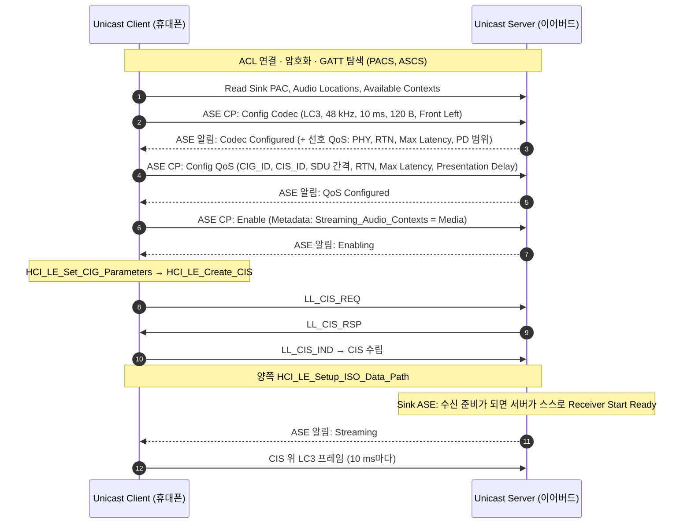
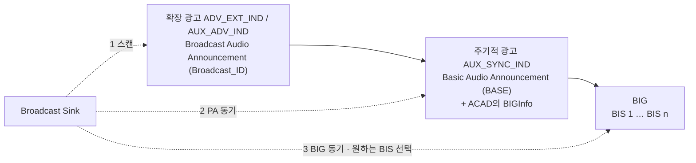

# BAP (Unicast·Broadcast)

!!! spec "규격 · 버전"
    Basic Audio Profile (BAP) v1.0, v1.0.1 (2022.6), v1.0.2 · 함께 쓰는 서비스: PACS v1.0, ASCS v1.0, BASS v1.0 · 전송: Core v5.2+ Vol 6 Part B (CIS·BIS), Vol 6 Part G (ISOAL), Vol 4 Part E (HCI LE ISO 명령)
    LE Audio의 기초 프로파일. 그 위에 CAP·TMAP·HAP·PBP·GMAP이 요구 사항을 덧붙임

!!! basic "한눈에 보기"
    **BAP**(Basic Audio Profile)는 "오디오 스트림 하나를 어떻게 세우고, 바꾸고, 끊는가"를 정한 규칙입니다. 두 가지 모드가 있습니다.

    - **Unicast**: 휴대폰(**Unicast Client**)이 이어버드(**Unicast Server**)와 연결(ACL)을 맺고, GATT로 하나하나 협상한 뒤 CIS로 오디오를 보냅니다. 식당에서 주문하는 것처럼 "메뉴 확인(PACS) → 주문(코덱) → 서빙 방식(QoS) → 시작"을 거칩니다.
    - **Broadcast**: 송신기(**Broadcast Source**)가 "이런 방송을 한다"는 정보를 광고에 실어 내보내고, 수신기(**Broadcast Sink**)는 연결 없이 골라 듣습니다. 라디오와 같습니다. 이어버드 대신 휴대폰이 방송을 찾아 주는 **Broadcast Assistant** 역할도 있습니다.

## 역할 { .l2 }

| 모드 | 역할 | 대표 기기 | 노출/사용하는 서비스 |
|---|---|---|---|
| Unicast | **Unicast Client** | 휴대폰, PC, TV | PACS·ASCS의 GATT 클라이언트, CIG를 만드는 쪽(Central) |
| Unicast | **Unicast Server** | 이어버드, 헤드셋, 보청기 | PACS와 ASCS 서버, ASE 보유 |
| Broadcast | **Broadcast Source** | TV, 공항 방송 송신기, 휴대폰 | 확장·주기적 광고 + BIG 송신 |
| Broadcast | **Broadcast Sink** | 이어버드, 보청기, 스피커 | PACS 서버, BIG 동기화 |
| Broadcast | **Broadcast Assistant** | 휴대폰, 워치 | BASS 클라이언트 — 대신 스캔하고 Sink에 정보 전달 |
| Broadcast | **Scan Delegator** | 이어버드 (보통 Broadcast Sink와 함께) | BASS 서버 — 스캔을 위임받음 |

## Unicast 스트림 수립 { .l2 }

오디오의 끝점은 **ASE**(Audio Stream Endpoint)입니다. 서버는 Sink ASE(오디오를 받음)와 Source ASE(오디오를 보냄, 예: 마이크)를 가지고, 클라이언트는 **ASE Control Point**에 명령을 써서 ASE 상태를 바꿉니다. 상태 기계는 [PACS와 ASCS](pacs-ascs.md)에서 자세히 봅니다.

Source ASE(서버가 보내는 쪽, 예: 이어버드 마이크)에서는 반대로 **클라이언트**가 수신 준비를 마친 뒤 ASE Control Point에 `Receiver Start Ready`를 씁니다. 규칙은 단순합니다. **오디오를 받는 쪽이 "준비됐다"를 선언해야 Streaming이 됩니다.**

## QoS 설정 { .l2 }

BAP는 코덱 설정 이름 뒤에 QoS 번호를 붙입니다. `_1`은 **저지연**, `_2`는 **고신뢰** 설정입니다(괄호는 브로드캐스트 값).

| 설정 | SDU 간격 | 최대 SDU | 재전송 수 (RTN) | 최대 전송 지연 | Presentation Delay |
|---|---|---|---|---|---|
| `8_1_1` | 7500 µs | 26 B | 2 (2) | 8 ms (8) | 40 ms |
| `16_2_1` | 10000 µs | 40 B | 2 (2) | 10 ms (10) | 40 ms |
| `24_2_1` | 10000 µs | 60 B | 2 (2) | 10 ms (10) | 40 ms |
| `48_2_1` | 10000 µs | 100 B | 5 (4) | 20 ms (20) | 40 ms |
| `48_4_1` | 10000 µs | 120 B | 5 (4) | 20 ms (20) | 40 ms |
| `16_2_2` | 10000 µs | 40 B | 13 (4) | 95 ms (60) | 40 ms |
| `48_2_2` | 10000 µs | 100 B | 13 (4) | 95 ms (65) | 40 ms |
| `48_4_2` | 10000 µs | 120 B | 13 (4) | 100 ms (65) | 40 ms |
| `441_2_1` | 10884 µs (framed) | 130 B | 5 | 31 ms | 40 ms |

| 파라미터 | 뜻 |
|---|---|
| **SDU 간격** | 코덱이 SDU(보통 LC3 프레임 1개)를 내놓는 주기. 10 ms 프레임이면 10000 µs |
| **RTN** (Retransmission Number) | 원하는 재전송 횟수. 컨트롤러가 NSE·BN·FT 등 링크 계층 파라미터로 바꿀 때 참고하는 "희망값" |
| **Max_Transport_Latency** | SDU가 송신 호스트에서 수신 컨트롤러까지 가는 최대 시간. 넘으면 버림 |
| **Presentation Delay** | 수신 측 기준점(SDU 동기 기준)에서 실제 재생까지의 시간. 좌우 이어버드가 같은 값을 써서 동시에 재생 |
| Framing | unframed(SDU 하나가 PDU 하나에 딱 맞음) / framed(44.1 kHz처럼 맞지 않을 때 분할·재조립) |

서버는 Codec Configured 알림에 선호값(`Preferred_PHY`, `Preferred_Retransmission_Number`, `Max_Transport_Latency`, `Presentation_Delay_Min/Max`, `Preferred_Presentation_Delay_Min/Max`)을 담아 보내고, 클라이언트는 그 범위 안에서 Config QoS 값을 고릅니다. 하나의 CIG에 여러 서버가 있으면 클라이언트는 **모두의 범위에 들어가는 하나의 Presentation Delay**를 골라야 합니다.

## Broadcast 흐름 { .l2 }

Broadcast Source는 **Idle → Configured → Streaming** 상태를 가집니다. Configured에서 BASE를 담은 주기적 광고를 시작하고, BIG를 만들면 Streaming입니다. Sink는 BASE에서 코덱 설정과 BIS별 위치(좌/우)를 읽고 `HCI_LE_BIG_Create_Sync`로 필요한 BIS만 골라 받습니다. 세부는 [Auracast 브로드캐스트](auracast.md)에 있습니다.

??? expert "전문가 노트 — RTN과 링크 계층, 문맥 메타데이터, 흔한 실수"
    **RTN은 희망값입니다.** `HCI_LE_Set_CIG_Parameters`에는 `RTN`, `Max_Transport_Latency`, `SDU_Interval`, `Max_SDU`, `Packing`(Sequential/Interleaved) 등이 들어가고, 컨트롤러가 이것으로 NSE(서브이벤트 수), BN(버스트 수), FT(Flush Timeout), ISO_Interval을 결정합니다. 세밀하게 제어하고 싶으면 `HCI_LE_Set_CIG_Parameters_Test`로 링크 계층 값을 직접 지정합니다. 실제 결과는 `HCI_LE_CIS_Established` 이벤트의 Transport_Latency, NSE, BN, FT로 확인합니다.

    **Metadata와 문맥.** Enable과 `Update Metadata`에 `Streaming_Audio_Contexts`(Media, Conversational, Game…)와 `CCID_List`(어느 MCS/TBS 인스턴스와 연결된 스트림인지)를 넣습니다. 서버는 Available Audio Contexts에 없는 문맥이면 Enable을 거절할 수 있습니다. 통화가 오면 클라이언트가 Media 스트림을 Disable/Release하고 Conversational로 다시 설정하는 흐름이 흔합니다.

    **Config Codec은 Idle이 아니어도 됩니다.** Codec Configured나 QoS Configured 상태에서 다시 Config Codec을 보내 재설정할 수 있습니다. 반면 Streaming 중에는 Disable → (QoS Configured) → 재설정이 필요합니다.

    **Released 뒤 캐싱.** Release 후 서버는 Idle로 가거나 Codec Configured로 돌아가 설정을 캐시할 수 있습니다. 다음 스트림 시작이 빨라지지만, 클라이언트는 알림으로 받은 상태를 따라야 합니다.

## 관련 페이지

- [PACS와 ASCS](pacs-ascs.md) — ASE 상태 기계와 Control Point
- [LC3 코덱](lc3.md) — 코덱 설정 이름(`48_4` 등)의 뜻
- [CAP과 CSIP](cap-csip.md) — 여러 서버에 같은 절차를 한 번에
- [Auracast 브로드캐스트](auracast.md) — BASE, BIG, BASS
- [등시성 채널 (CIS·BIS)](../le/iso.md) — NSE·BN·FT와 CIG 타이밍
