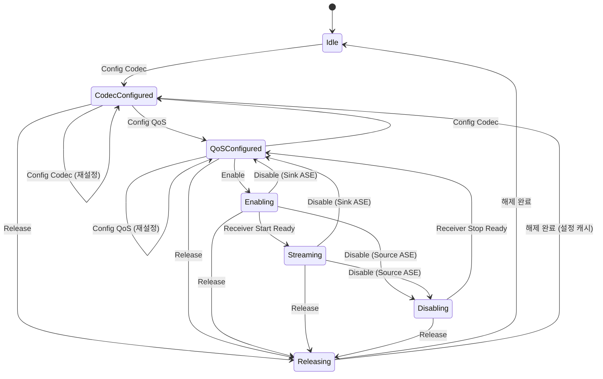

# PACS와 ASCS

!!! spec "규격 · 버전"
    Published Audio Capabilities Service (PACS) v1.0 · Audio Stream Control Service (ASCS) v1.0 · 이를 사용하는 절차: BAP v1.0 · Assigned Numbers (Audio Location 비트, Context Type 비트, LTV 유형) · GATT: Core Vol 3 Part G
    LE Audio 1세대 규격으로 함께 채택, 이후 v1.0.x 오류 수정판

!!! basic "한눈에 보기"
    이어버드(Unicast Server)는 두 개의 GATT 서비스를 가집니다.

    - **PACS**는 **메뉴판**입니다. "나는 LC3를 이런 설정까지 받을 수 있고, 왼쪽 귀용이며, 지금은 음악과 통화를 받을 수 있다"를 공개합니다.
    - **ASCS**는 **주문서 상태판**입니다. 스트림 끝점(ASE)마다 "지금 어떤 설정으로, 어느 단계에 있는가"를 보여 주고, 휴대폰은 **ASE Control Point**에 명령을 써서 단계를 넘깁니다.

    휴대폰(Unicast Client)은 PACS를 읽고 → ASCS에 주문하는 순서로 스트림을 만듭니다([BAP](bap.md)의 절차).

## PACS: 능력 공개 { .l2 }

| 특성 | 내용 | 비고 |
|---|---|---|
| **Sink PAC** / **Source PAC** | PAC 레코드 목록: Codec_ID + Codec Specific Capabilities(LTV) + Metadata | 받을 수 있는/보낼 수 있는 코덱 능력. 여러 레코드 가능 |
| **Sink Audio Locations** / **Source Audio Locations** | 32비트 위치 비트맵 (Front Left = 0x00000001, Front Right = 0x00000002 …) | 왼쪽 이어버드는 Front Left, 헤드폰은 둘 다 |
| **Available Audio Contexts** | 지금 받아들일 수 있는 문맥 (Sink 16비트 + Source 16비트) | 상황에 따라 바뀜 → 알림 |
| **Supported Audio Contexts** | 원리적으로 지원하는 문맥 | 거의 고정 |

**PAC 레코드** 하나는 "이 코덱을 이 범위로 처리할 수 있다"는 선언입니다. LC3라면 지원 샘플링 주파수 비트맵, 지원 프레임 길이(7.5/10 ms), 채널 수, 프레임당 바이트 범위(예: 26–155), SDU당 최대 프레임 수를 LTV로 넣습니다. Metadata에는 `Preferred_Audio_Contexts` 같은 선호 정보가 들어갈 수 있습니다.

**문맥 유형(Context Type)** 은 16비트 비트맵입니다.

| 비트 | 문맥 | 비트 | 문맥 |
|---|---|---|---|
| 0x0001 | Unspecified | 0x0040 | Live |
| 0x0002 | Conversational (통화) | 0x0080 | Sound effects |
| 0x0004 | Media | 0x0100 | Notifications |
| 0x0008 | Game | 0x0200 | Ringtone |
| 0x0010 | Instructional (내비게이션 등) | 0x0400 | Alerts |
| 0x0020 | Voice assistants | 0x0800 | Emergency alarm |

Available Contexts는 일종의 "지금 받을 수 있음" 신호입니다. 예를 들어 이어버드가 노트북과 통화 중이면 휴대폰에 대해 Media를 일시적으로 빼 둘 수 있습니다.

## ASCS: ASE 특성과 Control Point { .l2 }

서버는 **Sink ASE**와 **Source ASE** 특성을 원하는 개수만큼 노출합니다(예: 이어버드 하나에 Sink ASE 1개 + Source ASE 1개). 각 ASE 특성 값은 `ASE_ID`, `ASE_State`, 그리고 상태별 추가 파라미터(코덱 설정, QoS, Metadata)로 이루어집니다. 클라이언트는 알림(Notify)을 구독해 상태 변화를 따라갑니다.

| Opcode | 명령 | 허용되는 ASE 상태 | 결과 상태 |
|---|---|---|---|
| 0x01 | **Config Codec** | Idle, Codec Configured, QoS Configured | Codec Configured |
| 0x02 | **Config QoS** | Codec Configured, QoS Configured | QoS Configured |
| 0x03 | **Enable** (+ Metadata) | QoS Configured | Enabling |
| 0x04 | **Receiver Start Ready** | Enabling | Streaming |
| 0x05 | **Disable** | Enabling, Streaming | Sink ASE: QoS Configured / Source ASE: Disabling |
| 0x06 | **Receiver Stop Ready** | Disabling (Source ASE) | QoS Configured |
| 0x07 | **Update Metadata** | Enabling, Streaming | (상태 유지) |
| 0x08 | **Release** | Idle 외 모든 상태 | Releasing |

한 번의 Control Point 쓰기에 여러 ASE를 넣을 수 있고(`Number_of_ASEs`), 서버는 Control Point 알림으로 ASE별 응답 코드(성공, Invalid ASE State Machine Transition, Unsupported Configuration Parameter Value, Insufficient Resources 등)를 돌려줍니다.

## ASE 상태 기계 { .l2 }

| 상태 (값) | 의미 |
|---|---|
| Idle (0x00) | 설정 없음 |
| Codec Configured (0x01) | 코덱 확정. 서버가 선호 QoS 범위를 알려 줌 |
| QoS Configured (0x02) | CIG/CIS ID, SDU 간격, 지연 등 확정. 아직 CIS 없음 |
| Enabling (0x03) | 문맥 Metadata 확정. CIS 수립과 데이터 경로 설정 진행 |
| Streaming (0x04) | 오디오 흐름 중 |
| Disabling (0x05) | Source ASE만: 수신 측(클라이언트)의 정지 확인 대기 |
| Releasing (0x06) | CIS·데이터 경로 해제 중 |

서버도 스스로 상태를 바꿀 수 있습니다(예: 자원이 부족하면 Release, Idle에서 자율적으로 Codec Configured로 가서 선호 설정 제시). 따라서 클라이언트는 "내가 보낸 명령의 결과"만이 아니라 **모든 ASE 알림**을 따라가야 합니다.

??? expert "전문가 노트 — Sink/Source 비대칭, 상태와 링크의 관계, 디버깅"
    **왜 Disabling은 Source ASE에만 있나.** 오디오를 멈출 때도 "받는 쪽"이 마지막 데이터를 처리했음을 확인해야 합니다. Sink ASE는 받는 쪽이 서버 자신이므로 Disable 즉시 QoS Configured로 갑니다. Source ASE는 받는 쪽이 클라이언트이므로, 클라이언트가 `Receiver Stop Ready`를 쓸 때까지 Disabling에 머뭅니다. 시작할 때의 `Receiver Start Ready`도 같은 원리입니다.

    **CIS와 ASE는 1:1이 아닙니다.** 양방향 CIS 하나에 Sink ASE(음악/음성 수신)와 Source ASE(마이크)를 함께 묶을 수 있습니다. 두 ASE의 Config QoS에 같은 `CIG_ID`/`CIS_ID`를 넣으면 됩니다. 그래서 한쪽 ASE만 Release해도 다른 ASE가 쓰는 CIS는 유지될 수 있습니다.

    **CIS 끊김.** Streaming 중 CIS가 끊기면(`HCI_Disconnection_Complete` on CIS handle) 서버는 그 CIS를 쓰던 ASE를 스스로 QoS Configured로 되돌리고 알립니다. 클라이언트는 CIS를 다시 만들고 Enable부터 반복하면 됩니다(세부 조건은 ASCS 원문 확인). ACL이 끊기면 ASE는 모두 Idle(또는 캐시된 Codec Configured)로 갑니다.

    **로그에서 보기.** Wireshark는 ASE Control Point 쓰기와 ASE 알림을 해석해 줍니다. 상태 기계 오류(응답 코드 Invalid ASE State Machine Transition)는 대개 클라이언트가 알림을 기다리지 않고 다음 명령을 보낸 경우입니다. → [로그 분석](../practice/logs.md)

## Classic ↔ LE 비교

| 항목 | Classic (A2DP/AVDTP) | LE Audio (PACS/ASCS) |
|---|---|---|
| 능력 조회 | AVDTP `Discover`, `Get_Capabilities` (SEP 단위) | PACS 특성 읽기 (PAC 레코드) |
| 스트림 끝점 | SEP (Stream End Point) | ASE |
| 설정 | `Set_Configuration` | Config Codec + Config QoS |
| 시작/정지 | `Open` → `Start` / `Suspend` / `Close` | Enable → Receiver Start Ready / Disable / Release |
| 문맥 개념 | 없음 (A2DP는 미디어 전용) | Audio Context, Available Contexts |
| 전송 계층 | L2CAP 시그널링 채널 | GATT (ATT/EATT) |

## 관련 페이지

- [BAP (Unicast·Broadcast)](bap.md) — 이 상태 기계를 움직이는 절차
- [LC3 코덱](lc3.md) — PAC 레코드의 LTV 값
- [GATT](../host/gatt.md) — 특성, 알림, 쓰기 절차
- [EATT](../host/eatt.md) — 여러 GATT 절차 병렬 처리
- [CAP과 CSIP](cap-csip.md) — 여러 서버의 ASE를 한꺼번에 다루는 절차
