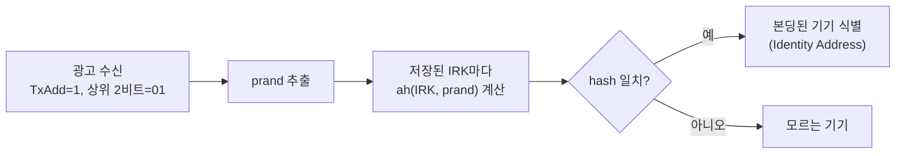

# 디바이스 주소

!!! spec "규격 · 버전"
    Core v6.0 Vol 2 Part B (BR/EDR: BD_ADDR 구조 LAP·UAP·NAP) · Vol 6 Part B (LE 디바이스 주소: 공개·무작위 주소 형식) · Vol 3 Part C (GAP: 프라이버시, 주소 사용 규칙) · Vol 3 Part H (SMP: IRK, 주소 해석 함수 `ah`) · IEEE 등록 기관(OUI/MA-L)
    1.0 BD_ADDR → 4.0 LE 무작위 주소(정적·RPA·NRPA) → 4.2 LE Privacy 1.2(Controller 주소 해석) → 6.1 RPA 갱신 시점 무작위화

!!! basic "한눈에 보기"
    모든 Bluetooth 기기에는 이더넷 MAC 주소처럼 **48비트 주소**가 있습니다. Classic에서는 이것을 **BD_ADDR**이라 부르고, 기기마다 고정입니다.

    LE는 여기에 **무작위 주소**를 추가했습니다. 광고를 늘 방송하는 LE 기기가 고정 주소를 쓰면 누구나 그 기기(=그 사람)를 추적할 수 있기 때문입니다.

    1. **공개 주소**: 제조사가 IEEE에서 받은 번호로 만든 고정 주소
    2. **무작위 정적 주소**: 전원을 켤 때 등 가끔 바꾸는 무작위 주소
    3. **해석 가능한 비공개 주소(RPA)**: 수 분마다 바뀌지만, 열쇠(IRK)를 가진 친구만 "아, 그 기기구나" 알아봄
    4. **해석 불가능한 비공개 주소(NRPA)**: 그냥 일회용

## Classic BD_ADDR와 공개 주소 { .l2 }

| 필드 | 비트 | 의미 |
|---|---|---|
| NAP (Non-significant Address Part) | 16 (상위) | OUI의 일부. 도약·액세스 코드 계산에 쓰이지 않음 |
| UAP (Upper Address Part) | 8 | OUI의 나머지. 도약 계산, HEC·CRC 초기값에 사용 |
| LAP (Lower Address Part) | 24 (하위) | 제조사가 배정. 액세스 코드(동기 워드) 생성에 사용 |

상위 24비트(NAP + UAP)는 IEEE가 회사에 배정하는 **OUI(Organizationally Unique Identifier)**이고, 하위 24비트는 회사가 기기마다 붙입니다. LE의 **공개 주소(Public Device Address)**도 같은 규칙을 따르므로, 듀얼 모드 기기는 보통 BD_ADDR와 LE 공개 주소가 같습니다.

로그에서는 `AA:BB:CC:DD:EE:FF`처럼 상위 바이트부터 쓰지만, 무선과 HCI에서는 **하위 바이트(LSB)부터** 전송됩니다. HCI 덤프의 16진수를 주소로 읽을 때 순서를 뒤집어야 합니다.

## LE 주소의 종류 { .l2 }

| 종류 | 상위 2비트 | 바뀌는 때 | 상대가 알아보는 법 | 주 용도 |
|---|---|---|---|---|
| 공개 (Public) | — (OUI) | 바뀌지 않음 | 주소 그대로 | 동글, 일부 듀얼 모드 기기 |
| 무작위 정적 (Random Static) | **11** | 전원 사이클 등에서만 (바꾸면 본딩 정보가 무효) | 주소 그대로 | OUI가 없는 저가 기기, 센서 |
| 해석 가능한 비공개 (RPA) | **01** | 주기적으로 (흔히 15분 안팎, 구현·설정에 따라 다름) | IRK로 해석 | 스마트폰, 웨어러블 (프라이버시) |
| 해석 불가능한 비공개 (NRPA) | **00** | 자주 | 알아볼 수 없음 | 연결 없는 비콘, 일회성 광고 |
| (예약) | 10 | — | — | 사용하지 않음 |

LE 패킷에는 주소 옆에 **TxAdd/RxAdd** 같은 1비트 플래그가 있어 공개(0)인지 무작위(1)인지를 알립니다. 무작위 주소라면 상위 2비트로 세 종류를 구분합니다. 공개 주소는 상위 비트가 OUI라 아무 값이나 될 수 있으므로, **플래그 없이 상위 2비트만 보고 종류를 판단하면 안 됩니다.**

## RPA와 IRK { .l2 }

RPA는 두 부분으로 됩니다.

| 부분 | 비트 | 내용 |
|---|---|---|
| prand (상위) | 24 | 상위 2비트 `01` + 무작위 22비트 |
| hash (하위) | 24 | \( \text{hash} = ah(\text{IRK}, \text{prand}) \) — AES-128 기반 함수의 결과 하위 24비트 |

**IRK(Identity Resolving Key)**는 기기의 128비트 비밀 키로, 본딩할 때 SMP로 상대에게 넘겨 줍니다. 받은 쪽은 새 RPA를 볼 때마다 저장해 둔 IRK들로 hash를 다시 계산해 일치하는 기기를 찾습니다. 4.2(LE Privacy 1.2)부터는 이 해석을 Controller가 **해석 목록(Resolving List)**으로 직접 해서, Host를 깨우지 않고도 화이트리스트 필터링과 자동 재연결이 됩니다. 자세한 보안 분석은 [프라이버시와 RPA](../security/privacy.md)에 있습니다.

??? expert "전문가 노트 — Identity Address, 무작위 값 제약, 실무 함정"
    **Identity Address.** 본딩 시 IRK와 함께 기기의 **신원 주소(Identity Address)** — 공개 주소 또는 무작위 정적 주소 — 를 넘깁니다. Host는 RPA가 아니라 이 신원 주소로 본딩 정보를 저장하고 찾습니다. HCI에서 주소 유형 값 0x02/0x03은 "해석된 신원 주소(공개/무작위)"를 뜻합니다.

    **무작위 부분의 제약.** 무작위 정적 주소와 NRPA, RPA의 prand는 상위 2비트를 뺀 나머지 비트가 **모두 0이거나 모두 1이면 안 됩니다**. NRPA는 또한 공개 주소와 같아서는 안 됩니다.

    **RPA 갱신 시점.** RPA가 정확히 같은 주기로 바뀌면 바뀌는 순간을 맞춰 기기를 이어 추적할 수 있습니다. 6.1은 Controller가 RPA 갱신 시점을 무작위로 정하도록 해 이 추적을 어렵게 하고, Host가 깨어나 주소를 바꿀 필요도 줄였습니다.

    **주소만 바꿔서는 부족.** 광고 데이터에 고정 값(기기 이름, 일련번호, 제조사 데이터의 고유 ID)이 들어 있으면 RPA를 써도 추적됩니다. 연결 없는 광고 간격·데이터 길이 같은 "지문"도 추적 단서가 됩니다.

    **OUI로 제조사 추정.** 공개 주소의 상위 24비트로 제조사를 짐작할 수 있지만, 칩 업체 OUI를 그대로 쓰는 제품도 많고, 무작위 주소에는 OUI가 없습니다. 로그 도구가 보여 주는 "제조사 이름"을 맹신하지 마세요.

## Classic ↔ LE 비교

| 항목 | Classic (BR/EDR) | LE |
|---|---|---|
| 주소 종류 | BD_ADDR (공개) 하나 | 공개, 무작위 정적, RPA, NRPA |
| 주소의 다른 쓰임 | LAP→액세스 코드, UAP·LAP→도약 순서 | 주소와 무관한 액세스 주소(연결마다 무작위) |
| 프라이버시 | 조회 응답에 주소 노출 | RPA + IRK, Controller 해석 목록 |

## 관련 페이지

- [프라이버시와 RPA](../security/privacy.md) — RPA 생성·해석과 프라이버시 모드
- [키 계층과 CTKD](../security/keys.md) — IRK 분배
- [GAP](../host/gap.md) — 주소 사용 규칙과 모드
- [패킷 구조](../le/packet.md) — TxAdd/RxAdd와 액세스 주소
- [피코넷과 기저대역](../classic/baseband.md) — BD_ADDR로 만드는 액세스 코드
