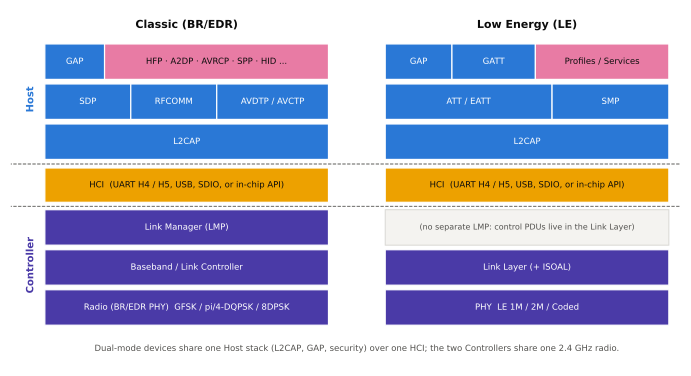

# 프로토콜 스택 개요

!!! spec "규격 · 버전"
    Core v6.0 Vol 2 (BR/EDR Controller: Radio, Baseband, LMP) · Vol 6 (LE Controller: PHY, Link Layer) · Vol 3 (Host: L2CAP, SDP, GAP, ATT, GATT, SMP) · 상위 프로토콜·프로파일은 개별 SIG 규격 (RFCOMM, AVDTP, A2DP, HFP, BAP 등)
    1.0 Classic 스택 → 4.0 LE 스택(ATT/GATT/SMP) → 5.2 EATT·ISO 채널 → 5.3 AMP 관련 계층 제거

!!! basic "한눈에 보기"
    Bluetooth 스택은 Wi-Fi·셀룰러처럼 층층이 쌓인 구조이고, **Classic과 LE가 아래쪽은 다르고 위쪽은 일부 공유**합니다.

    - **아래(Controller)**: Classic은 Radio–Baseband–LMP, LE는 PHY–Link Layer. 서로 완전히 다른 무선입니다.
    - **가운데(L2CAP)**: 둘 다 L2CAP으로 여러 상위 프로토콜의 데이터를 나눠 싣습니다.
    - **위(Host)**: Classic은 SDP·RFCOMM·AVDTP 위에 오디오·직렬 포트 프로파일이, LE는 **ATT/GATT** 위에 "서비스·특성" 모델이 올라갑니다.
    - **옆(GAP, SMP)**: 기기 찾기·연결·보안 규칙은 모든 계층을 가로질러 적용됩니다.

<figure markdown>

<figcaption>Classic(BR/EDR) 스택과 LE 스택. 점선 사이가 HCI 경계이고, 아래 보라색이 Controller, 위 파란색이 Host 프로토콜, 분홍색이 프로파일입니다. LE에는 별도의 링크 관리자(LMP)가 없고 제어 PDU가 링크 계층 안에 있습니다.</figcaption>
</figure>

## Controller 계층 { .l2 }

| 계층 | Classic / LE | 한 줄 역할 | 이 책의 페이지 |
|---|---|---|---|
| Radio | Classic | 79채널 GFSK/DPSK 송수신, 출력·감도 | [디지털 변조](modulation.md) |
| Baseband (Link Controller) | Classic | 슬롯·도약·패킷 형식·ARQ, 피코넷 | [피코넷과 기저대역](../classic/baseband.md) |
| LMP (Link Manager Protocol) | Classic | 링크 설정·인증·암호화·전력 제어를 두 Controller가 협상 | [링크 관리자 (LMP)](../classic/lmp.md) |
| PHY | LE | 1M·2M·Coded 송수신, 40채널 | [LE PHY](../le/phy.md) |
| Link Layer | LE | 광고·스캔·연결 상태 기계, 연결 이벤트, 채널 선택, 제어 절차(LL Control) | [링크 계층 상태 기계](../le/link-layer-states.md) |
| ISOAL | LE (5.2) | 상위 SDU를 등시성 채널 PDU로 나누고 합치기 | [등시성 채널 (CIS·BIS)](../le/iso.md) |

## Host 계층 { .l2 }

| 계층 | Classic / LE | 한 줄 역할 | 이 책의 페이지 |
|---|---|---|---|
| L2CAP | 공통 | 채널 다중화, 분할·재조립, 흐름 제어(LE Credit Based) | [L2CAP](../host/l2cap.md), [L2CAP·SDP·RFCOMM](../classic/l2cap-sdp-rfcomm.md) |
| SDP | Classic | "이 기기가 어떤 서비스를 제공하나" 검색 | [L2CAP·SDP·RFCOMM](../classic/l2cap-sdp-rfcomm.md) |
| RFCOMM | Classic | 직렬 포트 에뮬레이션 (SPP, HFP 제어 채널) | [L2CAP·SDP·RFCOMM](../classic/l2cap-sdp-rfcomm.md) |
| AVDTP / AVCTP | Classic | 오디오 스트림 설정·전송 / 리모컨 명령 | [오디오 프로파일](../classic/audio-profiles.md) |
| ATT / EATT | LE (Classic 위에서도 가능) | 핸들로 구분한 속성 읽기·쓰기·알림 | [ATT](../host/att.md), [EATT](../host/eatt.md) |
| GATT | LE (Classic 위에서도 가능) | 속성을 서비스·특성·설명자로 묶는 데이터 모델과 절차 | [GATT](../host/gatt.md) |
| SMP | LE | 페어링, 키 생성·분배 | [LE 페어링과 본딩](../security/le-pairing.md) |
| GAP | 공통 | 역할(광고·스캔·Central·Peripheral), 발견·연결 모드, 보안 모드, 주소 | [GAP](../host/gap.md) |

## 프로파일 계층 { .l2 }

| 영역 | Classic 프로파일 | LE 프로파일·서비스 | 페이지 |
|---|---|---|---|
| 오디오 | A2DP, AVRCP, HFP | LE Audio: BAP, CAP, VCP, MCP, CCP, HAP | [LE Audio 개요](../audio/overview.md) |
| 데이터 | SPP, PAN | 커스텀 GATT 서비스, L2CAP CoC | [데이터 프로파일](../classic/data-profiles.md) |
| 입력 장치 | HID | HID over GATT (HOGP) | [대표 GATT 서비스](../host/gatt-services.md) |
| 센서·헬스 | (HDP, 현재는 거의 안 씀) | Heart Rate, Battery, Device Information 등 | [대표 GATT 서비스](../host/gatt-services.md) |
| 네트워크 | — | Mesh (광고 베어러 + GATT 베어러) | [Mesh 개요](../mesh/overview.md) |

??? expert "전문가 노트 — 계층 경계의 예외들"
    **GATT over BR/EDR.** ATT/GATT는 LE 전용이 아닙니다. 듀얼 모드 기기는 BR/EDR 링크 위의 L2CAP 채널로도 GATT를 쓸 수 있고, 일부 기기는 Classic 연결 중 GATT 서비스 탐색을 이 경로로 합니다.

    **SMP와 CTKD.** SMP는 LE 페어링 프로토콜이지만, Secure Connections에서는 LE에서 만든 키로 BR/EDR 키를 유도하거나 그 반대도 가능합니다(Cross-Transport Key Derivation). 듀얼 모드 기기가 한 번만 페어링하면 되는 이유입니다([키 계층과 CTKD](../security/keys.md)).

    **LE에 LMP가 없는 이유.** Classic의 LMP는 별도 프로토콜 계층이지만, LE에서는 같은 역할(기능 교환, 암호화 시작, 연결 갱신, 채널 맵 갱신)을 링크 계층 제어 PDU(`LL_FEATURE_REQ`, `LL_ENC_REQ`, `LL_CONNECTION_UPDATE_IND`, `LL_CHANNEL_MAP_IND` 등)가 맡습니다. 계층 수를 줄여 Controller 코드와 지연을 줄인 설계입니다.

    **ISO 데이터 경로.** LE Audio의 오디오 데이터는 L2CAP을 거치지 않고 HCI ISO 데이터 패킷으로, 또는 HCI를 거치지 않고 칩 내부의 코덱 경로로 Controller에 바로 갑니다. 오디오 지연과 Host 부하를 줄이기 위한 구조입니다.

## Classic ↔ LE 비교

| 항목 | Classic (BR/EDR) | LE |
|---|---|---|
| Controller 계층 | Radio · Baseband · LMP | PHY · Link Layer (+ ISOAL) |
| 서비스 발견 | SDP | GATT 서비스 탐색 (+ 광고 데이터) |
| 데이터 모델 | 프로파일마다 다름 (RFCOMM 스트림, AVDTP 미디어) | ATT 속성 기반 공통 모델 |
| 페어링 | SSP (LMP 안에서) | SMP (L2CAP 고정 채널) |
| 오디오 경로 | SCO/eSCO, A2DP(ACL) | ISO 채널 (CIS/BIS) |

## 관련 페이지

- [Host·Controller·HCI](architecture.md) — 스택이 둘로 나뉘는 경계
- [LE 호스트](../host/index.md) — L2CAP·ATT·GATT·GAP 상세
- [Classic (BR/EDR)](../classic/index.md) — Classic 스택 상세
- [LE 컨트롤러](../le/index.md) — PHY·링크 계층 상세
- [Classic vs LE 비교](../reference/classic-vs-le.md) — 전체 비교표
