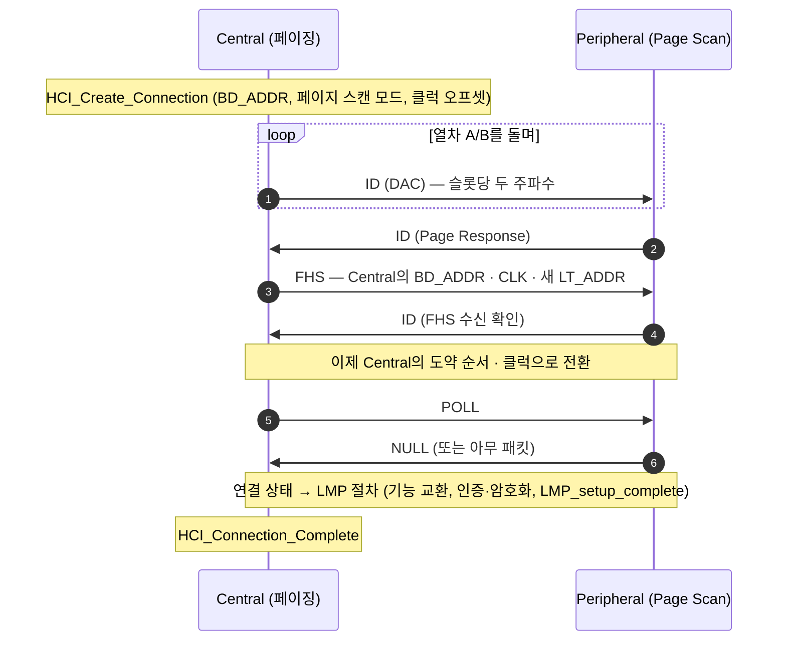

# 조회와 페이징

!!! spec "규격 · 버전"
    Core v6.0 Vol 2 Part B (Baseband) — 조회·페이징 절차, 도약 순서 · Vol 4 Part E (HCI) — `HCI_Inquiry`, `HCI_Create_Connection`, 스캔 파라미터 · 조회 응답 데이터 형식: Vol 3 Part C (GAP)
    Core 1.1 기본 절차 → 1.2 인터레이스 스캔, RSSI 포함 조회 결과, 빠른 연결 → 2.1 + EDR 확장 조회 응답(EIR)

!!! basic "한눈에 보기"
    Classic에는 LE의 광고 채널 같은 "고정된 만남의 장소"가 없습니다. 대신 두 단계를 거칩니다.

    1. **조회(Inquiry)** — "근처에 누구 있어요?" 찾는 쪽이 32개 정해진 주파수를 빠르게 돌며 짧은 `ID` 패킷을 뿌립니다. 발견 가능한 기기는 1.28 s마다 잠깐 귀를 열고 있다가(**Inquiry Scan**) 자기 주소와 클럭을 담은 `FHS`로 대답합니다.
    2. **페이징(Paging)** — "당신, 연결합시다." 이제 상대 주소와 대략의 클럭을 알므로, 그 기기 전용 주파수 순열로 호출합니다. 상대가 **Page Scan** 중에 듣고 응답하면 피코넷이 만들어집니다.

    이미 페어링된 기기(차량·이어폰)는 주소를 알고 있으므로 조회 없이 **페이징만** 합니다.

## 조회 (Inquiry) { .l2 }

| 항목 | 값 |
|---|---|
| 조회 접근 코드(IAC) | **GIAC** `0x9E8B33`(일반 발견) · **LIAC** `0x9E8B00`(제한 발견 — 짧은 시간만 발견 가능 모드) |
| 조회 주파수 | GIAC에서 정해지는 32개, **열차 A**·**열차 B** 각 16개 |
| 송신 방식 | 송신 슬롯마다 서로 다른 주파수로 `ID`를 2번(312.5 µs 간격), 다음 슬롯에서 두 주파수를 듣기 |
| 열차 반복 | 한 열차를 최소 256회(2.56 s) 반복한 뒤 다른 열차로 전환 |
| 조회 길이 | `HCI_Inquiry`의 `Inquiry_Length` × 1.28 s (1.28–61.44 s). 일반적으로 10.24 s → 열차 전환 4회 |
| Inquiry Scan (기본값) | 창 11.25 ms(18 슬롯) / 간격 1.28 s(2048 슬롯) |

16개 주파수 열차 하나를 도는 데 10 ms(16 슬롯)이고, 스캔 창 11.25 ms는 이보다 길게 잡혀 있습니다. 그래서 스캐너가 듣는 주파수가 현재 열차에 들어 있으면 한 창 안에 반드시 `ID`를 듣게 됩니다. 들어 있지 않으면 열차가 바뀔 때까지 기다려야 하므로 10.24 s 동안 열차를 여러 번 바꿉니다. Core 1.2의 **인터레이스 스캔**은 스캐너가 창을 두 번 연속 열어 두 번째 창에서 반대 열차 쪽 주파수를 들어, 첫 발견 시간을 줄입니다.

### 응답과 EIR

1. 스캐너가 `ID`를 들으면 **무작위 백오프**(최대 1023 슬롯) 동안 기다립니다 — 여러 기기가 동시에 응답해 충돌하는 것을 막기 위함입니다.
2. 다시 `ID`를 들으면 `FHS`로 응답합니다. `FHS`에는 BD_ADDR, **클럭(CLKN)**, Class of Device, 페이지 스캔 모드가 들어 있습니다.
3. EIR 비트가 켜져 있으면 이어서 **확장 조회 응답**(**EIR**, Extended Inquiry Response) 패킷을 보냅니다. 최대 240바이트의 LE AD와 같은 길이-타입-값 구조로 기기 이름, 서비스 UUID 목록, TX 전력 등을 담습니다.

호스트는 결과를 `HCI_Inquiry_Result`, `HCI_Inquiry_Result_with_RSSI`, `HCI_Extended_Inquiry_Result` 이벤트로 받습니다. EIR 덕분에 2.1 이후로는 기기 이름을 얻으려고 별도 연결(`HCI_Remote_Name_Request`)을 맺지 않아도 됩니다.

## 페이징 (Paging) { .l2 }

| 항목 | 내용 |
|---|---|
| 접근 코드 | 대상의 LAP로 만든 **DAC** |
| 주파수 | 대상 주소로 정해지는 32개 페이지 주파수, 추정 클럭 **CLKE**를 중심으로 열차 A/B |
| Page Scan 반복 모드 | **R0** 연속 스캔 · **R1** 간격 ≤ 1.28 s · **R2** 간격 ≤ 2.56 s |
| Page Scan 기본값 | 창 11.25 ms / 간격 1.28 s (R1) |
| Page Timeout | `HCI_Write_Page_Timeout`, 기본 0x2000 슬롯 = 5.12 s |

`FHS`를 받은 Peripheral은 그 순간부터 Central의 클럭과 주소로 도약합니다. 이후 LMP가 기능 교환, 페어링·인증, 암호화를 마치고 `LMP_setup_complete`를 서로 보내면 호스트가 L2CAP 채널을 열 수 있습니다. → [링크 관리자 (LMP)](lmp.md)

## 연결 소요 시간 { .l2 }

| 상황 | 대략적 시간 | 이유 |
|---|---|---|
| 조회로 주변 기기 목록 얻기 | 수 초 (보통 10.24 s 동안 수집) | 스캐너가 1.28 s마다 한 번 듣고, 백오프·열차 전환이 있음 |
| 클럭 오프셋을 아는 페이징 (R1) | 대개 1.28 s 이내 | 첫 열차에 상대 주파수가 들어 있어 다음 스캔 창에서 응답 |
| 클럭 오프셋을 모르는 페이징 (R1) | 최악 약 2.56 s | 반대 열차로 바뀌어야 맞는 경우 |
| 상대가 꺼져 있거나 범위 밖 | Page Timeout(기본 5.12 s) 후 실패 | `HCI_Connection_Complete`에 Page Timeout 오류 |

??? expert "전문가 노트 — 스캔 설계, 공존, 디버깅"
    **스캔 duty cycle.** 기본값(11.25 ms / 1.28 s)은 약 0.9 % 수신입니다. 빠른 재연결이 중요한 이어폰은 `HCI_Write_Page_Scan_Activity`로 간격을 줄이거나 인터레이스 스캔(`HCI_Write_Page_Scan_Type`)을 켜고, 배터리가 중요한 기기는 R2 쪽으로 늘립니다. 조회 스캔은 사용자가 "페어링 모드"를 켰을 때만 여는 것이 일반적입니다(`HCI_Write_Scan_Enable`).

    **조회 중 다른 링크.** 조회는 슬롯을 연속으로 쓰므로 진행 중인 A2DP·eSCO 링크와 시간을 다툽니다. 폰이 기기 검색 중에 음악이 끊기는 현상의 원인이 이것이며, 구현은 조회 슬롯을 링크 사이에 끼워 넣거나 오디오 중에는 조회를 미룹니다.

    **클럭 오프셋 캐시.** `HCI_Create_Connection`의 `Clock_Offset`(조회 결과 또는 이전 연결에서 얻음)과 `Page_Scan_Repetition_Mode`를 정확히 주면 페이징이 맞는 열차에서 시작합니다. 스택은 연결이 끊길 때 `HCI_Read_Clock_Offset` 값을 저장해 두었다가 재연결에 씁니다.

    **로그에서 보기.** btmon/btsnoop에서 `Create Connection` → `Command Status` → (페이징 시간) → `Connection Complete` 간격이 곧 페이징 시간입니다. Page Timeout(오류 0x04)이 잦으면 상대의 스캔 설정, 공존(Wi-Fi), 주소 오류를 먼저 의심합니다. → [로그 분석](../practice/logs.md)

## Classic ↔ LE 비교

| 항목 | Classic (BR/EDR) | LE |
|---|---|---|
| 발견 | 조회: 찾는 쪽이 32 주파수로 `ID` 송신, 상대는 스캔 | 광고: 발견될 쪽이 37/38/39 채널로 광고 |
| 발견 데이터 | FHS + EIR(최대 240 B) | 광고 데이터 31 B(레거시) / 확장 광고 최대 1650 B |
| 연결 요청 | 페이징: 시작하는 쪽이 대상 전용 주파수로 반복 호출 | 광고를 듣고 `CONNECT_IND` 한 번 |
| 기다리는 쪽의 전력 | 1.28 s마다 짧은 스캔 | 광고 간격마다 짧은 송신 + 수신 |
| 연결 소요 | 수백 ms–수 초 | 광고 간격 수준(수십–수백 ms) |

## 관련 페이지

- [피코넷과 기저대역](baseband.md) — 클럭, 슬롯, `ID`·`FHS` 패킷
- [링크 관리자 (LMP)](lmp.md) — 연결 직후의 협상
- [레거시 광고](../le/legacy-advertising.md) — LE의 발견 방식
- [연결 수립](../le/connection.md) — LE의 연결 방식
- [디바이스 주소](../basics/addresses.md) — BD_ADDR의 LAP·UAP·NAP
