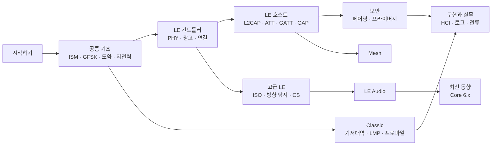

# 학습 로드맵

!!! basic "한눈에 보기"
    수준과 목적에 따라 읽는 순서를 추천합니다. 각 페이지 안에서도 기초 → 중급 → 전문가 순서로 깊어지므로,
    처음에는 기초 부분(한눈에 보기)만 읽고 넘어가도 됩니다.

## 경로 1 — 처음 공부하는 사람 { .l1 }

목표: 스마트폰과 이어폰·센서가 어떻게 서로를 찾고 연결해 데이터를 주고받는지 큰 그림 잡기

1. [Bluetooth 세대와 Core 버전](generations.md)
2. [2.4 GHz ISM 대역과 규제](../basics/ism-band.md) → [주파수 도약과 AFH](../basics/fhss-afh.md) → [저전력 설계 원리](../basics/low-power.md)
3. [Host·Controller·HCI](../basics/architecture.md) → [프로토콜 스택 개요](../basics/stack.md)
4. [LE 컨트롤러 개요](../le/index.md) → [레거시 광고](../le/legacy-advertising.md) → [연결 수립](../le/connection.md)
5. [GATT](../host/gatt.md) → [LE 페어링과 본딩](../security/le-pairing.md)
6. [Classic vs LE 비교](../reference/classic-vs-le.md)

## 경로 2 — 임베디드·앱 개발자 { .l2 }

목표: 광고·연결 파라미터를 설계하고, 처리량·전류·연결 문제를 로그로 해석하기

1. 공통 기초 전체 (특히 [무선 전파와 링크 버짓](../basics/radio-channel.md), [디바이스 주소](../basics/addresses.md))
2. LE 링크 계층: [확장 광고](../le/extended-advertising.md) → [스캔과 필터](../le/scanning.md) → [연결 이벤트와 파라미터](../le/connection-events.md) → [데이터 길이 확장](../le/data-length.md)
3. LE 호스트 전체: [ATT](../host/att.md) → [GATT](../host/gatt.md) → [GAP](../host/gap.md) → [광고 데이터 형식](../host/ad-types.md) → [처리량 최적화](../host/throughput.md)
4. 보안: [LE 페어링과 본딩](../security/le-pairing.md) → [프라이버시와 RPA](../security/privacy.md)
5. 실무: [HCI 명령과 이벤트](../practice/hci.md) → [로그 분석](../practice/logs.md) → [저전력 설계와 전류 프로파일](../practice/power-profile.md)
6. 오디오 제품이라면 [LE Audio 개요](../audio/overview.md)와 [오디오 프로파일 (A2DP·AVRCP·HFP)](../classic/audio-profiles.md)

## 경로 3 — 프로토콜·RF 전문가 { .l3 }

목표: 규격 디테일, 버전별 변화, 경계 조건, RF 성능 확인

- 각 페이지의 **전문가 노트**와 **규격 박스**를 레퍼런스로 활용하고, [규격 문서 읽는 법](reading-specs.md)으로 원문 위치를 찾기
- RF: [디지털 변조](../basics/modulation.md) → [LE PHY](../le/phy.md) → [패킷 구조](../le/packet.md) → [RF 시험과 안테나](../practice/rf-testing.md)
- 링크 계층: [채널 선택 알고리즘](../le/channel-selection.md) → [LL 제어 절차](../le/ll-control.md) → [등시성 채널](../le/iso.md)
- 위치: [방향 탐지](../le/direction-finding.md) → [Channel Sounding](../le/channel-sounding.md) → [Channel Sounding 활용](../next/cs-applications.md)
- 공존·보안: [Wi-Fi와의 공존](../basics/coexistence.md), [알려진 공격과 대응](../security/attacks.md)
- 최신 규격: [Core 6.0–6.3](../next/core-6.md), [HDT와 상위 대역 확장](../next/hdt.md), [Core 버전별 기능 인덱스](../reference/version-index.md)
