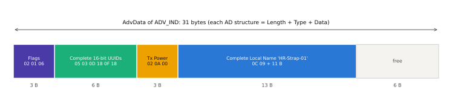

# 광고 데이터 형식 (AD Type)

!!! spec "규격 · 버전"
    Core v6.0 Vol 3 Part C §11 (Advertising and Scan Response Data Format) · AD Type 정의: Core Specification Supplement (CSS) Part A · AD Type 번호·회사 ID: Assigned Numbers
    Core 4.0 도입 (Classic EIR과 같은 형식) → 5.0 확장 광고로 최대 1650바이트 → 5.1 이후 BIGInfo·Broadcast_Code·RSI 등 LE Audio용 AD 추가 → 5.4 Encrypted Advertising Data AD

!!! basic "한눈에 보기"
    광고 패킷의 데이터 부분은 **작은 꾸러미(AD 구조)를 이어 붙인 것**입니다. 각 꾸러미는

    1. **Length** (1바이트) — 뒤따르는 Type + Data의 길이
    2. **AD Type** (1바이트) — 이 꾸러미가 무엇인지 (이름? UUID? 제조사 데이터?)
    3. **Data** — 내용

    으로 이루어집니다. 받는 쪽은 Length만큼씩 건너뛰며 모르는 Type은 무시합니다. 레거시 광고는 이 꾸러미들을 **31바이트** 안에 모두 넣어야 하므로, 무엇을 넣고 무엇을 Scan Response나 GATT로 미룰지가 설계의 핵심입니다.

## AD 구조 { .l2 }

| 바이트 | 필드 | 예: Complete Local Name "Tag" |
|---|---|---|
| 0 | Length = 1 + Data 길이 | `0x04` |
| 1 | AD Type | `0x09` |
| 2… | AD Data (다중 바이트 정수는 리틀 엔디언) | `54 61 67` ("Tag") |

Length가 0이면 그 지점에서 데이터가 끝난 것으로 봅니다(남은 바이트는 0 패딩). 같은 AD Type이 두 번 나오면 안 되는 Type(예: Flags)과 여러 번 나와도 되는 Type(예: Service Data)이 구분됩니다.

## 주요 AD Type { .l2 }

| Type | 이름 | 내용 | 비고 |
|---|---|---|---|
| 0x01 | **Flags** | 1바이트 비트 필드 | 연결 가능 광고면 필수, 비연결 광고에선 생략 가능. Scan Response에는 넣지 않음 |
| 0x02 / 0x03 | Incomplete / Complete List of 16-bit Service UUIDs | UUID × n | |
| 0x04 / 0x05 | Incomplete / Complete List of 32-bit Service UUIDs | UUID × n | |
| 0x06 / 0x07 | Incomplete / Complete List of 128-bit Service UUIDs | UUID × n | 128비트 하나에 18바이트 소모 |
| 0x08 / 0x09 | **Shortened / Complete Local Name** | UTF-8 | |
| 0x0A | **Tx Power Level** | int8 dBm | 수신 RSSI와 비교해 거리 추정 |
| 0x12 | Peripheral Connection Interval Range | 최소·최대 (1.25 ms 단위) | |
| 0x14 / 0x15 | List of 16 / 128-bit Service Solicitation UUIDs | UUID × n | "이 서비스를 가진 Central을 찾음" |
| 0x16 | **Service Data – 16-bit UUID** | UUID(2) + 데이터 | Eddystone, LE Audio 방송 공지 |
| 0x20 / 0x21 | Service Data – 32 / 128-bit UUID | UUID + 데이터 | |
| 0x19 | **Appearance** | 16비트 | [GAP](gap.md) 참고 |
| 0x1A | Advertising Interval | 0.625 ms 단위 | |
| 0x24 | URI | 스킴 코드 + 문자열 | |
| 0x29 / 0x2A / 0x2B | PB-ADV / Mesh Message / Mesh Beacon | Mesh 전용 | → [Mesh](../mesh/overview.md) |
| 0x2C | BIGInfo | 주기적 광고의 ACAD 안에서 사용 | LE Audio 방송 |
| 0x2E | Resolvable Set Identifier | 6바이트 | CSIP 세트 구성원 |
| 0x30 | Broadcast Name | UTF-8 | Auracast |
| 0x31 | Encrypted Advertising Data | 암호문 + MIC | 5.4 |
| 0xFF | **Manufacturer Specific Data** | 회사 ID(2) + 자유 형식 | |

### Flags 비트

| 비트 | 의미 |
|---|---|
| 0 | LE Limited Discoverable Mode |
| 1 | LE General Discoverable Mode |
| 2 | BR/EDR Not Supported |
| 3 | Simultaneous LE and BR/EDR (Controller) — 4.1부터 쓰지 않음, 0으로 둠 |
| 4 | Simultaneous LE and BR/EDR (Host) — 4.1부터 쓰지 않음, 0으로 둠 |
| 5–7 | 예약 |

LE 전용 Peripheral의 전형적인 Flags는 `02 01 06`(General Discoverable + BR/EDR Not Supported)입니다.

## 31바이트 예산 짜기 { .l2 }

<figure markdown>

<figcaption>심박 스트랩의 ADV_IND 예. Flags 3 B + 16비트 UUID 두 개(심박 0x180D, 배터리 0x180F) 6 B + Tx Power 3 B + 이름 13 B = 25 B, 6 B 여유.</figcaption>
</figure>

예산을 짤 때의 순서는 다음과 같습니다.

1. **Flags 3 B**는 연결 가능 광고에서 고정 비용
2. 휴대폰 앱이 **스캔 필터로 쓸 값**(서비스 UUID 또는 제조사 ID)을 반드시 광고 본체에 넣기. iOS 백그라운드 스캔은 서비스 UUID로 걸러야 하는 경우가 많음
3. 남는 공간에 이름. 넘치면 Shortened Local Name(0x08)으로 줄이고 전체 이름은 **Scan Response**(추가 31 B)나 GAP 서비스로
4. 128비트 커스텀 UUID는 18 B를 먹으므로 이름과 동시에 넣기 어려움 → UUID는 광고, 이름은 Scan Response가 흔한 배치
5. 그래도 부족하면 [확장 광고](../le/extended-advertising.md)(최대 1650 B)를 검토. 단 구형 스캐너는 확장 광고를 보지 못함

## 제조사 포맷 예: iBeacon과 Eddystone { .l2 }

아래 둘은 SIG 규격이 아니라 **각 회사가 정의한 포맷**이며, SIG의 AD 구조 안에 들어가는 내용물입니다.

| 항목 | iBeacon (Apple) | Eddystone (Google) |
|---|---|---|
| 담는 AD | Manufacturer Specific Data (0xFF), 회사 ID 0x004C | Complete 16-bit UUIDs `0xFEAA` + Service Data (0x16) `0xFEAA` |
| 내용 | 타입 `02 15` + Proximity UUID 16 B + Major 2 B + Minor 2 B + Measured Power 1 B | 프레임 타입 1 B: 0x00 UID, 0x10 URL, 0x20 TLM, 0x30 EID |
| 전체 길이 | Flags 3 B + 27 B = 30 B | 프레임마다 다름 |
| 바이트 순서 | Major/Minor는 빅 엔디언 (BT 관례와 반대) | 프레임 정의를 따름 |

```text
iBeacon ADV_IND AdvData (30 B)
02 01 06                                  Flags
1A FF 4C 00 02 15                          Len=26, MSD, Apple, type 0x02, len 0x15(21)
  E2 C5 6D B5 DF FB 48 D2 B0 60 D0 F5 A7 10 96 E0   Proximity UUID (예시 값)
  00 01  00 02  C5                         Major=1, Minor=2, Measured Power=−59 dBm
```

??? expert "전문가 노트 — 파싱 견고성, 회사 ID, Service Data 활용"
    **파서는 방어적으로.** Length가 남은 바이트 수를 넘거나, 0x00 이후에 쓰레기가 있거나, 같은 Type이 중복된 광고가 실제로 돌아다닙니다. 모르는 Type은 건너뛰고, 길이 오류에서 멈추는 것이 안전합니다. 또 광고(AdvData)와 Scan Response(ScanRspData)는 별개의 31 B이며 OS가 두 결과를 합쳐 보여 주는지 따로 주는지는 플랫폼마다 다릅니다.

    **회사 ID는 할당받아야 한다.** Manufacturer Specific Data의 앞 2바이트는 SIG가 회원사에 할당한 Company Identifier입니다(Assigned Numbers). 시제품에서 임의 값을 쓰다 다른 회사 제품과 충돌하는 일이 흔합니다. 테스트용 예약값 0xFFFF가 있지만 출시 제품에는 쓰지 않습니다.

    **Service Data가 더 경제적일 때.** 상태 값(배터리, 온도)을 광고로 뿌리려면 Manufacturer Data(회사 ID 2 B 오버헤드) 대신 16비트 UUID Service Data(UUID 2 B)를 쓸 수도 있습니다. 16비트 서비스 UUID는 SIG 회원사가 별도로 할당받는 값입니다. 표준 서비스 UUID(예: 0x180F)를 붙이면 그 서비스 규격의 형식을 따라야 합니다.

    **Eddystone 현황.** Google은 Eddystone 기반 Nearby Notifications를 2018년에 종료했지만 포맷 자체는 공개되어 있어 비콘 제품에서 여전히 쓰입니다.

## 관련 페이지
- [GAP](gap.md) — Flags가 표시하는 발견 가능 모드
- [레거시 광고](../le/legacy-advertising.md) — `ADV_IND`, `SCAN_RSP` 등 PDU 종류
- [확장 광고](../le/extended-advertising.md) — 31 B 한계를 넘는 방법
- [대표 GATT 서비스](gatt-services.md) — UUID 목록에 넣을 서비스 UUID
- [암호화된 광고 데이터](../security/encrypted-ad.md) — 5.4 Encrypted Advertising Data
