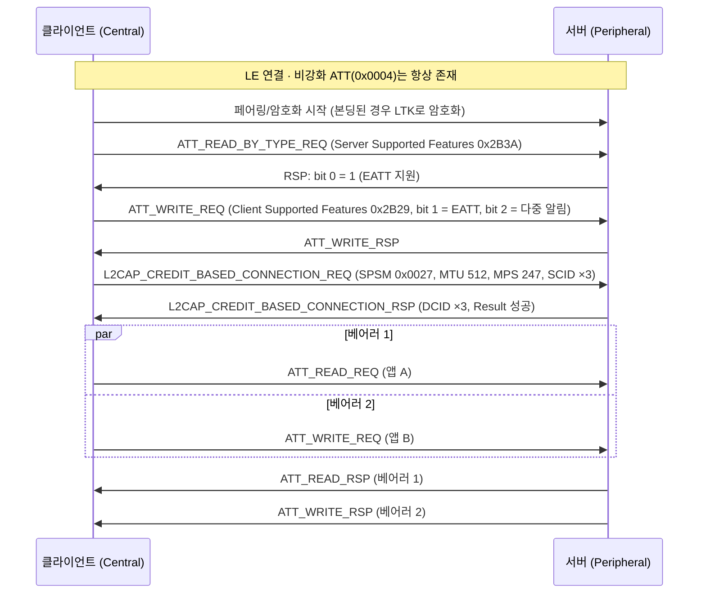

# EATT

!!! spec "규격 · 버전"
    Core v6.0 Vol 3 Part F (ATT: Enhanced ATT bearer) · Vol 3 Part G (GATT: Server/Client Supported Features) · Vol 3 Part A (L2CAP Enhanced Credit Based Flow Control Mode)
    Core 5.2 도입 (LE·BR/EDR 공통). 함께 추가: `ATT_READ_MULTIPLE_VARIABLE_REQ/RSP`, `ATT_MULTIPLE_HANDLE_VALUE_NTF`, `L2CAP_CREDIT_BASED_RECONFIGURE_REQ`

!!! basic "한눈에 보기"
    기존 ATT는 **창구가 하나뿐인 은행**입니다. 앞 손님(요청)의 업무가 끝나야 다음 손님이 설 수 있습니다. 휴대폰 안의 여러 앱이 같은 시계에 동시에 접근하면, 느린 요청 하나가 모두를 붙잡습니다.

    **EATT**(Enhanced ATT)는 창구를 여러 개 엽니다.

    1. ATT를 고정 채널 0x0004 대신 **Enhanced Credit Based 흐름 제어 L2CAP 채널** 위에 올립니다. 이 채널 하나가 **EATT 베어러** 하나입니다.
    2. 베어러마다 "한 번에 하나" 규칙이 따로 적용되므로, 여러 베어러에서 트랜잭션이 **동시에** 진행됩니다.
    3. 각 베어러는 자기 MTU를 가지며, 나중에 **늘릴 수 있습니다**.
    4. 대신 **암호화된 링크에서만** 쓸 수 있습니다.

## 기존 ATT와 비교 { .l2 }

| 항목 | 비강화(unenhanced) ATT 베어러 | EATT 베어러 |
|---|---|---|
| 전송 | LE: 고정 CID 0x0004 / BR/EDR: PSM 0x001F | Enhanced Credit Based 채널 (SPSM/PSM 0x0027) |
| 개수 | 연결당 1개 | 여러 개 (요청 한 번에 최대 5개 개설, 반복 가능) |
| 순차 규칙 | 연결 전체에 하나의 트랜잭션 | 베어러별로 하나씩 → 병렬 |
| ATT_MTU 결정 | `ATT_EXCHANGE_MTU_REQ` (연결당 1회) | L2CAP 채널 MTU에서 결정, Exchange MTU는 쓰지 않음 |
| MTU 변경 | 불가 (한 번 정하면 끝) | `L2CAP_CREDIT_BASED_RECONFIGURE_REQ`로 증가 가능 (감소 불가) |
| 최소 MTU | 23 (LE) | 64 |
| 흐름 제어 | 없음 | 크레딧 기반 |
| 보안 조건 | 없음 | 암호화된 링크 필수 |
| Signed Write | 가능 | 불가 |

## 개설 절차 { .l2 }

양쪽 모두 EATT 채널 개설을 시도할 수 있으므로, 구현은 상대가 동시에 요청했을 때 충돌을 처리해야 합니다(예: 무작위 지연 후 재시도). 개설이 실패하거나 일부만 성공해도 비강화 ATT 베어러로 계속 동작할 수 있어야 합니다.

## 이점과 제약 { .l2 }

| 이점 | 설명 |
|---|---|
| **지연 감소** | 큰 블롭 읽기(예: OTA 정보)가 진행 중이어도 다른 베어러에서 짧은 제어 쓰기가 바로 처리됨 |
| **앱 분리** | OS가 앱(또는 프로파일)별로 베어러를 나눠 줄 수 있어 한 앱의 느린 응답이 다른 앱을 막지 않음 |
| **큰 PDU의 교차 전송** | L2CAP 분할 덕분에 긴 PDU 사이에 다른 베어러의 짧은 PDU가 끼어 나갈 수 있음 |
| **새 PDU** | `ATT_MULTIPLE_HANDLE_VALUE_NTF`로 여러 특성 값을 알림 하나에, `ATT_READ_MULTIPLE_VARIABLE_REQ`로 가변 길이 값 여러 개를 한 번에 |

| 제약 | 설명 |
|---|---|
| 암호화 필수 | 페어링하지 않는 공개 기기(비콘형 센서 등)에는 맞지 않음 |
| 순서 보장 없음 | 서로 다른 베어러의 Notification 사이 순서는 보장되지 않음. 순서가 중요한 값은 같은 베어러로 |
| CCCD·캐시 | 서버의 클라이언트 상태(CCCD, change-aware 여부)는 베어러가 아니라 **클라이언트 단위**로 관리 |
| 지원 편차 | 휴대폰 OS·칩 스택마다 지원 시기와 범위가 달라 실제 상호 운용 시험이 필요 |

??? expert "전문가 노트 — 베어러 선택, Indication, LE Audio"
    **어느 베어러로 응답하나.** 응답·확인은 반드시 요청·Indication이 온 **같은 베어러**로 돌아갑니다. Notification과 Indication은 서버가 아무 베어러나 골라 보낼 수 있지만, 같은 특성의 연속 값을 여러 베어러로 흩으면 클라이언트에서 순서가 뒤집힐 수 있습니다. 실무에서는 "특성 → 베어러" 고정 매핑을 둡니다.

    **Indication의 동시성.** Indication도 베어러마다 하나씩이므로, 베어러가 3개면 확인을 기다리는 Indication이 최대 3개 동시에 있을 수 있습니다. Indication을 많이 쓰는 프로파일(오디오 스트림 상태 변화 등)에서 지연이 줄어드는 이유입니다.

    **MTU 재설정 규칙.** Enhanced Credit Based 채널의 MTU는 늘리기만 할 수 있습니다. ATT 입장에서는 베어러의 ATT_MTU가 연결 중에 커질 수 있다는 뜻이므로, 앱이 "최대 쓰기 길이"를 한 번만 캐시하면 안 됩니다.

    **LE Audio와 EATT.** LE Audio의 제어 평면(PACS·ASCS·BASS·VCP·MCP·CCP 등)은 모두 GATT 기반이고, Indication·Notification·제어점 쓰기가 짧은 시간에 몰립니다. BAP는 Unicast Server/Client의 "ATT and EATT transport requirements" 절에서 EATT 관련 요구 사항을 두고 있으며, LE Audio 제품은 보통 EATT를 지원합니다. 역할별 필수 여부는 BAP 원문 확인 필요. → [BAP](../audio/bap.md)

## 관련 페이지
- [ATT](att.md) — 순차 규칙과 PDU
- [L2CAP](l2cap.md) — Enhanced Credit Based 흐름 제어 모드
- [GATT](gatt.md) — Server/Client Supported Features 특성
- [PACS와 ASCS](../audio/pacs-ascs.md) — EATT를 활용하는 대표 GATT 서비스
