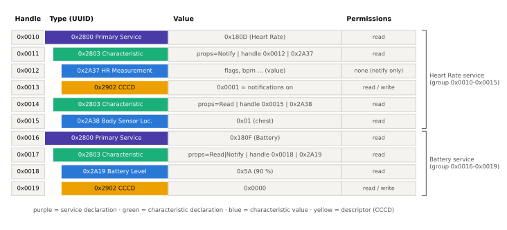
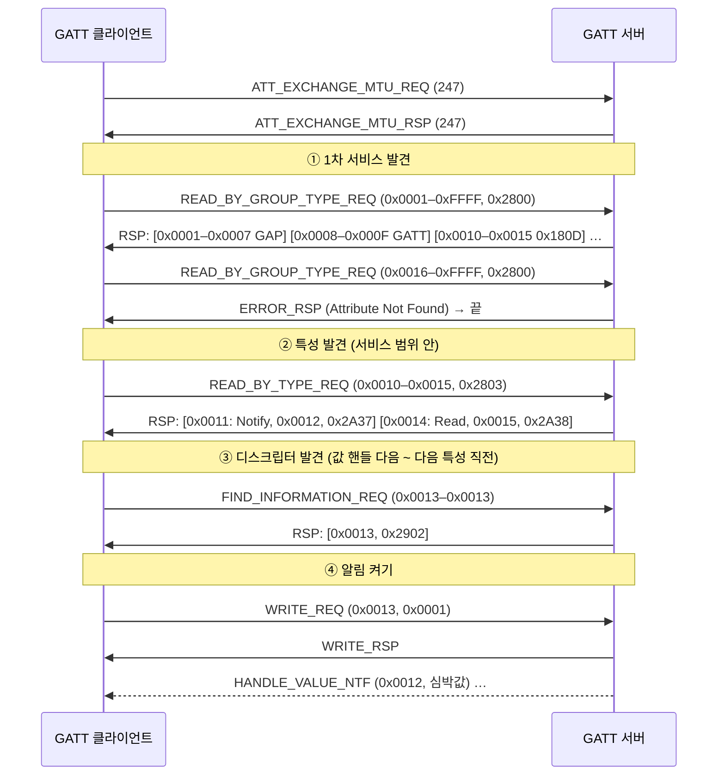

# GATT

!!! spec "규격 · 버전"
    Core v6.0 Vol 3 Part G (Generic Attribute Profile) · 하위: Vol 3 Part F (ATT) · UUID: Assigned Numbers · 특성 값 형식: GATT Specification Supplement
    Core 4.0 도입 → 5.1 GATT Caching(Database Hash, Robust Caching) → 5.2 EATT 지원(Server Supported Features) → 5.4 LE GATT Security Levels 특성

!!! basic "한눈에 보기"
    ATT가 "행 번호 + 타입 + 값" 표라면, **GATT**(Generic Attribute Profile)는 그 표를 **폴더 구조**로 읽는 규칙입니다.

    1. **서비스(Service)** = 폴더. 예: Heart Rate 서비스, Battery 서비스
    2. **특성(Characteristic)** = 파일. 값 하나와 그 값을 다루는 방법(읽기/쓰기/알림)을 가짐. 예: Battery Level
    3. **디스크립터(Descriptor)** = 파일 속성. 예: "알림 켜기" 스위치(CCCD), 단위·설명
    4. 이 계층은 표 안에 **특별한 타입의 행(선언)**을 끼워 넣어 만듭니다. 0x2800 행이 나오면 새 서비스, 0x2803 행이 나오면 새 특성이 시작됩니다.

    값을 가진 쪽이 **서버**, 가져가는 쪽이 **클라이언트**입니다. 이 역할은 GAP의 Central/Peripheral과 무관해서, 휴대폰(Central)이 GATT 서버가 되는 경우도 흔합니다(예: 시계에 알림을 보내는 ANCS).

## 계층 구조 { .l2 }

<figure markdown>

<figcaption>심박계 GATT 서버의 속성 테이블 예. 서비스 선언(0x2800)부터 다음 서비스 선언 직전까지가 한 서비스이고, 특성 선언(0x2803) 뒤에 값 행과 디스크립터 행이 이어집니다.</figcaption>
</figure>

| 선언·디스크립터 | UUID | 값 내용 |
|---|---|---|
| Primary Service | 0x2800 | 서비스 UUID (16 또는 128비트) |
| Secondary Service | 0x2801 | 다른 서비스가 포함(include)해서만 쓰는 서비스 |
| Include | 0x2802 | 포함하는 서비스의 핸들 범위 + UUID |
| Characteristic | 0x2803 | Properties(1 B) + 값 핸들(2 B) + 특성 UUID |
| Characteristic Extended Properties | 0x2900 | Reliable Write, Writable Auxiliaries 비트 |
| Characteristic User Description | 0x2901 | 사람이 읽는 UTF-8 설명 |
| **CCCD** (Client Characteristic Configuration) | 0x2902 | bit 0 = Notification, bit 1 = Indication |
| SCCD (Server Characteristic Configuration) | 0x2903 | bit 0 = Broadcast |
| Characteristic Presentation Format | 0x2904 | 형식·지수·단위 |

## 특성 선언과 CCCD { .l2 }

특성 선언 값의 첫 바이트 **Properties**는 클라이언트에게 "이 값으로 무엇을 할 수 있는지"를 알려 줍니다(실제 허용 여부는 서버의 권한이 결정).

| 비트 | 값 | Property | 쓰이는 ATT PDU |
|---|---|---|---|
| 0 | 0x01 | Broadcast | (SCCD 설정 시 광고의 Service Data) |
| 1 | 0x02 | Read | `ATT_READ_REQ`, `ATT_READ_BLOB_REQ` |
| 2 | 0x04 | Write Without Response | `ATT_WRITE_CMD` |
| 3 | 0x08 | Write | `ATT_WRITE_REQ` |
| 4 | 0x10 | Notify | `ATT_HANDLE_VALUE_NTF` |
| 5 | 0x20 | Indicate | `ATT_HANDLE_VALUE_IND` |
| 6 | 0x40 | Authenticated Signed Writes | `ATT_SIGNED_WRITE_CMD` |
| 7 | 0x80 | Extended Properties | 0x2900 디스크립터 존재 |

Notify/Indicate 특성에는 **CCCD**가 반드시 붙습니다. 클라이언트가 CCCD에 `0x0001`(Notification) 또는 `0x0002`(Indication)를 써야 서버가 값을 밀어 줍니다. CCCD 값은 **클라이언트마다 따로** 저장되고, 본딩된 클라이언트의 값은 재연결 후에도 유지되어야 합니다. 그래서 본딩된 기기는 다시 연결하자마자 알림을 받을 수 있습니다.

## 발견 절차 { .l2 }

특정 서비스만 찾을 때는 ①을 `ATT_FIND_BY_TYPE_VALUE_REQ`(타입 0x2800, 값 = 서비스 UUID)로 바꿔 왕복을 줄입니다. 128비트 UUID 서비스는 응답 한 번에 들어가는 개수가 적어 왕복이 늘어나므로 MTU를 먼저 키우는 것이 유리합니다.

## GATT Caching (5.1) { .l2 }

전체 탐색은 수십 번의 왕복이라 연결 간격 30 ms라면 1초를 넘기기 쉽습니다. 그래서 클라이언트는 탐색 결과를 **캐시**하고, 서버 DB가 바뀌었는지만 확인하고 싶어 합니다.

| 수단 | UUID | 동작 |
|---|---|---|
| **Service Changed** 특성 | 0x2A05 | 서버 DB가 바뀌면 영향받은 핸들 범위(시작·끝 핸들 4 B)를 Indication으로 알림. 4.0부터 존재 |
| **Database Hash** 특성 | 0x2B2A | 서비스·특성 선언과 디스크립터 정보로 계산한 128비트 AES-CMAC 값. 재연결 시 이 값만 읽어 캐시와 비교 (5.1) |
| **Client Supported Features** 특성 | 0x2B29 | bit 0 Robust Caching, bit 1 EATT, bit 2 Multiple Handle Value Notifications 지원을 서버에 알림 |
| **Server Supported Features** 특성 | 0x2B3A | bit 0 EATT 지원 (5.2) |

**Robust Caching**을 켠 클라이언트는 DB가 바뀐 뒤 서버에게 "change-unaware" 상태로 취급됩니다. 이 상태에서 요청을 보내면 서버는 `Database Out Of Sync`(0x12) 오류를 돌려주고, 클라이언트가 Database Hash를 읽거나 Service Changed Indication을 확인하면 "change-aware"로 돌아옵니다. 덕분에 본딩하지 않은 클라이언트도 낡은 캐시로 엉뚱한 핸들에 쓰는 사고를 피합니다.

??? expert "전문가 노트 — 캐시 버그, 역할 혼동, 서버 설계 팁"
    **가장 흔한 현장 버그: 펌웨어 업데이트 후 핸들이 바뀜.** 본딩된 휴대폰은 이전 핸들을 캐시하고 있으므로 서버는 반드시 Service Changed 특성을 두고 업데이트 후 첫 연결에서 Indication을 보내야 합니다(본딩된 클라이언트에는 CCCD가 유지되어 있음). 규격은 기기 수명 동안 DB가 절대 바뀌지 않을 때만 Service Changed를 생략하도록 하므로, OTA 업데이트를 지원하는 제품이라면 사실상 필수입니다. 본딩하지 않은 클라이언트의 캐시는 원칙적으로 그 연결 동안만 유효하고, 연결을 넘어 캐시를 쓰려면 Database Hash로 확인해야 합니다. 개발 중 핸들이 계속 바뀌는데 Service Changed를 빠뜨리면 휴대폰의 Bluetooth 캐시를 직접 지워야 하는 상황이 생깁니다.

    **GAP·GATT 역할은 독립.** Central이 GATT 서버, Peripheral이 GATT 클라이언트가 될 수 있고, 한 기기가 서버와 클라이언트를 동시에 할 수도 있습니다. 예를 들어 스마트워치(Peripheral)는 휴대폰의 Current Time 서비스나 ANCS를 읽는 클라이언트입니다.

    **서버 설계 팁.** (1) GAP 서비스(0x1800)와 GATT 서비스(0x1801)는 모든 LE GATT 서버에 필수입니다. (2) 핸들을 빽빽하게 채울 필요는 없고, 향후 확장을 위해 서비스 사이에 빈 핸들을 남기는 구현도 있습니다. (3) 같은 UUID의 특성이 한 서비스에 여러 개면 클라이언트는 핸들로 구분해야 하므로, 가능한 한 서비스 인스턴스를 나누는 편이 앱 코드가 단순해집니다.

    **5.4 LE GATT Security Levels(0x2BF5).** 서버가 요구하는 가장 높은 보안 모드·레벨을 클라이언트가 미리 읽어, 오류 응답을 받고 나서야 페어링하는 대신 처음부터 필요한 수준으로 페어링하게 해 줍니다.

## Classic ↔ LE 비교 { .l2 }

| 항목 | Classic (BR/EDR) | LE |
|---|---|---|
| 서비스 발견 | SDP (전통적) 또는 GATT over BR/EDR | GATT만 |
| ATT 전송 | 동적 L2CAP 채널 (PSM 0x001F) | 고정 채널 CID 0x0004 |
| ATT_MTU | L2CAP 설정에서 결정 (최소 48) | 기본 23, `ATT_EXCHANGE_MTU_REQ`로 확대 |

## 관련 페이지
- [ATT](att.md) — GATT 절차가 쓰는 PDU와 오류 코드
- [EATT](eatt.md) — 여러 베어러로 GATT 절차 병렬화
- [대표 GATT 서비스](gatt-services.md) — 서비스·특성 UUID 표
- [GAP](gap.md) — GAP 서비스(0x1800)의 Device Name·Appearance
- [LE 페어링과 본딩](../security/le-pairing.md) — CCCD·캐시 유지 조건인 본딩
