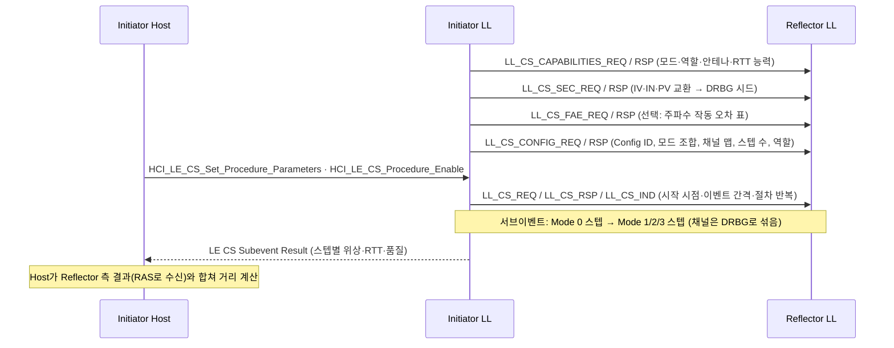

# Channel Sounding

!!! spec "규격 · 버전"
    Core v6.0 Vol 6 Part A (Physical Layer: CS 채널·LE 2M 2BT PHY) · Vol 6 Part B (Link Layer: CS 절차, `LL_CS_*` PDU) · Vol 4 Part E (HCI `HCI_LE_CS_*`) · 상위: Ranging Profile(RAP)·Ranging Service(RAS)
    Core 6.0 도입(2024.9) → 6.2 진폭 기반 공격 대응(CS Amplitude-based Attack Resilience) 추가

!!! basic "한눈에 보기"
    RSSI로 거리를 추정하면 몸·벽·방향 때문에 몇 배씩 틀립니다. **Channel Sounding(CS)**은 두 기기가 **여러 주파수에서 신호를 주고받으며** 거리를 직접 잽니다.

    1. **위상 기반(PBR)**: 주파수를 바꿔 가며 왕복한 톤의 **위상이 얼마나 돌아가는지**를 보면 거리가 나옴 — 정밀
    2. **왕복 시간(RTT)**: 패킷이 갔다 오는 **시간**에서 상대의 처리 시간을 빼서 거리 계산 — 대략적이지만 속이기 어려움
    3. 두 방법을 함께 써서 서로 검증하고, 보내는 순서·내용을 **암호학적 난수(DRBG)**로 섞어 중계 공격을 막음
    4. 한쪽은 **Initiator**, 다른 쪽은 **Reflector**. Central·Peripheral 누구든 어느 역할이든 가능

    목표 응용: 차량 디지털 키(주인이 정말 차 옆에 있는지), 분실물 찾기, 근접 기반 출입·결제.

## 두 가지 측정 원리 { .l2 }

**PBR(Phase-Based Ranging).** Initiator와 Reflector가 같은 주파수 \(f\)에서 톤을 한 번씩 주고받으면, 두 측정 위상을 합친 왕복 위상은 \(\varphi(f) = 4\pi f d / c\)에 비례합니다(각자의 국부 발진기 위상은 상쇄). 주파수를 \(\Delta f\)만큼 바꿔 위상 기울기를 구하면

\[
d = \frac{c}{4\pi}\,\frac{\Delta\varphi}{\Delta f}
\]

위상은 2π마다 되풀이되므로 모호성 없는 최대 거리는 \(c / (2\Delta f)\)입니다. CS 채널 간격 1 MHz이면 \(3\times10^8 / (2 \times 10^6) = 150\) m입니다. 여러 채널(최대 72개)의 위상을 모아 다중 경로 성분을 분리하는 것이 정확도의 핵심입니다.

**RTT(Round-Trip Timing).** Initiator가 CS_SYNC 패킷을 보낸 시각과 Reflector 응답을 받은 시각의 차이에서 Reflector의 회신 시간을 뺀 값이 왕복 비행 시간입니다.

\[
d = \frac{c}{2}\left(T_{\text{round}} - T_{\text{turnaround}}\right)
\]

빛은 1 ns에 약 30 cm 가므로 RTT 정밀도는 타이밍 분해능에 직접 묶입니다. 그래서 RTT는 단독으로 정밀하지 않지만, 위상처럼 2π 모호성이 없고 "실제보다 가깝게" 속이기 어렵다는 장점이 있습니다.

| 항목 | PBR | RTT |
|---|---|---|
| 측정량 | 주파수별 위상 | 패킷 왕복 시간 |
| 신호 | CS Tone (변조 없는 톤) | CS_SYNC 패킷 (AA, 선택적 난수 페이로드·사운딩 시퀀스) |
| 강점 | 정밀, 다중 경로 분석 가능 | 모호성 없음, 거리 단축 공격에 강함 |
| 약점 | 150 m 주기 모호성, 위상 조작 공격 가능성 | 타이밍 분해능 한계 |

## 절차·서브이벤트·스텝 { .l2 }

CS는 기존 **ACL 연결 위에서** 동작합니다. 구조는 절차(procedure) ⊃ CS 이벤트 ⊃ 서브이벤트 ⊃ 스텝이며, 각 스텝은 하나의 CS 채널에서 하나의 모드로 수행됩니다.

| 모드 | 내용 | 비고 |
|---|---|---|
| Mode 0 | 주파수 보정: CS_SYNC로 두 기기의 주파수 오프셋을 맞춤 | 서브이벤트 시작에 배치 |
| Mode 1 | RTT: CS_SYNC 교환 | |
| Mode 2 | PBR: CS Tone 교환 (안테나 경로별) | |
| Mode 3 | RTT + PBR을 한 스텝에서 | 지원 선택 |

| 수치 | 값 |
|---|---|
| 서브이벤트당 스텝 수 | 2 – 160 |
| 절차당 스텝 수 | 최대 256 |
| CS 채널 | 1 MHz 간격, 72개 (광고 채널 부근 제외) |
| 채널 맵 최소 | 15채널 이상 사용 |
| 안테나 경로(antenna path) | 최대 4 (예: 2×2, 1×4 안테나 구성) |
| 연결당 CS 설정(config) | 최대 4개 (ID 0–3) |
| 전용 PHY | LE 2M 2BT (BT = 2.0, CS 전용, 선택) |

## 보안 { .l2 }

| 위협 | 대응 |
|---|---|
| 중계 공격(relay, 진짜 키를 멀리서 중계) | RTT가 늘어남 → 거리 판정에서 걸러짐. PBR·RTT 교차 검증 |
| 거리 단축(위상·심볼 조작으로 더 가깝게 보이게) | **DRBG**로 채널 순서·안테나 경로 순서·RTT 페이로드 비트를 무작위화, 공격자가 미리 예측 불가 |
| 심볼 조작 | SNR 제어(송신 신호에 의도적 잡음), LE 2M 2BT PHY |
| 탐지 | **NADM**(Normalized Attack Detector Metric) 0x00 "공격 가능성 매우 낮음" – 0x06 "매우 높음", 0xFF 알 수 없음 |
| 진폭 기반 공격 (6.2) | RTT 패킷의 진폭 변화를 DFT 기반 지표로 탐지 |

DRBG는 AES-128 기반 결정적 난수 생성기로, `LL_CS_SEC_REQ`/`RSP`(CS Security Start)에서 양쪽이 나눠 낸 IV·IN·PV 값으로 초기화됩니다. 두 기기는 같은 난수열을 만들어 다음 채널·안테나·비트를 알지만, 엿듣는 공격자는 미리 알 수 없습니다.

??? expert "전문가 노트 — 정확도, Host 측 계산, 구현 현황"
    **정확도는 규격 밖.** 규격은 측정 방법과 품질 지표(톤 품질 지표 등)까지만 정하고 거리 정확도 수치는 정하지 않습니다. 정확도는 사용 채널 수, 안테나 경로 수, 다중 경로 분해 알고리즘(IFFT, MUSIC 등), 교정 품질에 좌우됩니다. 칩 벤더·업계 자료는 가시선 조건에서 수십 cm 수준의 결과를 보고하지만 조건에 따라 크게 달라지므로 응용마다 검증이 필요합니다.

    **계산은 Host에서.** Controller는 스텝별 IQ(위상)와 타이밍 값을 LE CS Subevent Result(및 Continue) 이벤트로 올리고, 거리 계산은 Host 또는 응용이 합니다. 양쪽 측정값이 모두 필요하므로 Reflector가 자신의 결과를 GATT의 **Ranging Service(RAS)**로 Initiator에 보내고, 이를 **Ranging Profile(RAP)**이 규정합니다.

    **RTT 변형.** CS_SYNC의 페이로드 없이 AA만 쓰는 방식, 32/64/96/128비트 난수 페이로드를 붙이는 방식, 사운딩 시퀀스를 넣는 방식이 있고 지원 여부는 능력 교환으로 알립니다. 타이밍 정밀도 능력(예: 150 ns, 10 ns급)도 따로 신고합니다.

    **HCI 흐름.** `HCI_LE_CS_Read_Local_Supported_Capabilities` → `HCI_LE_CS_Read_Remote_Supported_Capabilities` → `HCI_LE_CS_Security_Enable` → `HCI_LE_CS_Set_Default_Settings` → (`HCI_LE_CS_Read_Remote_FAE_Table`) → `HCI_LE_CS_Create_Config` → `HCI_LE_CS_Set_Procedure_Parameters` → `HCI_LE_CS_Procedure_Enable`. 채널 분류는 `HCI_LE_CS_Set_Channel_Classification`.

    **방향 탐지와의 관계.** AoA/AoD는 각도, CS는 거리입니다. 안테나 경로 여러 개를 쓰는 CS 결과에서 도래 방향 정보를 일부 얻을 수 있다는 연구가 있지만 규격 기능은 아닙니다.

## 관련 페이지
- [방향 탐지 (AoA·AoD)](direction-finding.md) — 각도 측정
- [LE 전력 제어](power-control.md) — RSSI 기반 경로 손실의 한계
- [Channel Sounding 활용](../next/cs-applications.md) — 디지털 키·분실물 찾기 사례
- [Core 6.0–6.3](../next/core-6.md) — 함께 도입된 기능
- [알려진 공격과 대응](../security/attacks.md) — 중계 공격
- [LE PHY (1M·2M·Coded)](phy.md) — 2M 2BT PHY
