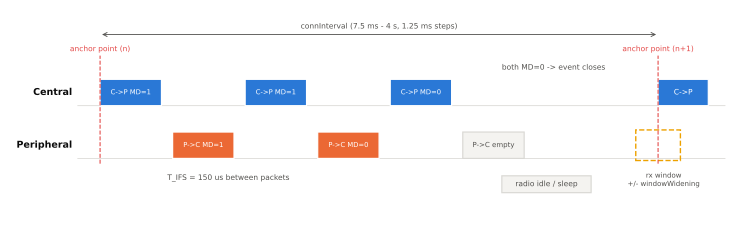
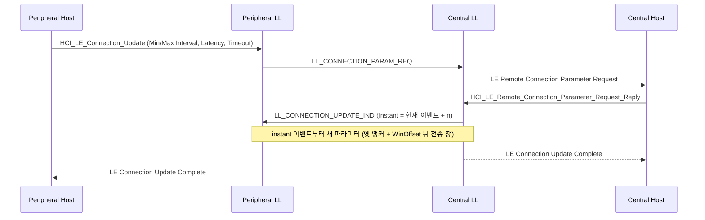

# 연결 이벤트와 파라미터

!!! spec "규격 · 버전"
    Core v6.0 Vol 6 Part B (Link Layer) — 연결 이벤트, 감독 타임아웃, 연결 갱신·파라미터 요청·서브레이팅 절차 · Vol 3 Part A (L2CAP) Connection Parameter Update 시그널링 · Core 6.2 Shorter Connection Intervals
    Core 4.0 연결 이벤트·`LL_CONNECTION_UPDATE_REQ` → 4.1 `LL_CONNECTION_PARAM_REQ` → 5.0 이후 PDU 이름 `LL_CONNECTION_UPDATE_IND` → 5.3 연결 서브레이팅 → 6.0 프레임 간격 갱신 → 6.2 짧은 연결 간격(최소 375 µs)

!!! basic "한눈에 보기"
    연결된 두 LE 기기는 **정해진 시각에만 잠깐 깨어나 만나는** 약속을 반복합니다.

    1. 만나는 시각 = **앵커 포인트**, 만남 한 번 = **연결 이벤트**
    2. 이벤트마다 Central이 먼저 말하고 Peripheral이 150 µs 뒤 대답, 할 말이 남았으면(**MD** 비트) 같은 이벤트에서 계속 주고받음
    3. 만남 주기 = **connInterval**, Peripheral이 "할 말 없으면 건너뛰어도 되는" 횟수 = **Peripheral Latency**
    4. 일정 시간(**Supervision Timeout**) 동안 한 번도 못 만나면 연결이 끊긴 것으로 봄
    5. 상황이 바뀌면 이 약속을 연결을 끊지 않고 바꿀 수 있음(파라미터 갱신, 서브레이팅)

<figure markdown>

<figcaption>앵커 포인트에서 Central이 먼저 보내고, 패킷 사이는 T_IFS 150 µs입니다. 양쪽이 모두 MD = 0을 보내면 이벤트가 닫히고 다음 앵커까지 무선부를 끕니다. Peripheral은 클록 오차를 감안해 다음 앵커 앞뒤로 수신 창을 넓혀 엽니다(윈도 확장).</figcaption>
</figure>

## 연결 이벤트의 규칙 { .l2 }

| 항목 | 규칙 |
|---|---|
| 이벤트 시작 | Central이 앵커 포인트에 첫 패킷 송신. Peripheral은 받은 패킷 시작 시각으로 앵커를 다시 맞춤 |
| 채널 | 이벤트마다 한 채널, 이벤트 안에서는 바뀌지 않음 ([채널 선택 알고리즘](channel-selection.md)) |
| 교대 | C→P, P→C를 T_IFS 간격으로 교대. 보낼 데이터가 없으면 빈 PDU |
| `MD` (More Data) | 보낼 PDU가 더 있으면 1. 양쪽이 모두 0이면 이벤트 종료 |
| `SN`/`NESN` | 1비트 순번과 다음 기대 순번 — 이것이 곧 ACK/NACK. 재전송은 다음 패킷 기회에 |
| CRC 오류 | 같은 이벤트에서 연속 두 번 CRC 오류면 이벤트를 닫음 |
| 이벤트 길이 | 다음 앵커 전에는 반드시 끝나야 함. Central 구현이 여러 링크 일정을 보고 자름 |

## Interval · Latency · Timeout { .l2 }

| 파라미터 | 단위 | 범위 | 효과 |
|---|---|---|---|
| connInterval | 1.25 ms | 7.5 ms – 4 s | 작을수록 지연·처리량 ↑, 전류 ↑ |
| connPeripheralLatency | 이벤트 | 0 – 499 | Peripheral만 이벤트를 건너뜀. 보낼 데이터가 생기면 즉시 다음 이벤트에 응답 가능 |
| connSupervisionTimeout | 10 ms | 100 ms – 32 s | 유효 패킷 없이 이 시간이 지나면 연결 끊김 |

세 값은 다음 관계를 지켜야 합니다. Peripheral이 최대로 건너뛴 뒤 한 번 더 놓쳐도 끊기지 않게 하려는 여유입니다.

\[
\text{connSupervisionTimeout} > (1 + \text{connPeripheralLatency}) \times \text{connInterval} \times 2
\]

예: Interval 30 ms, Latency 4이면 (1 + 4) × 30 ms × 2 = 300 ms이므로 Timeout은 300 ms보다 커야 합니다. 실무에서는 4–6 s처럼 넉넉하게 잡습니다.

**윈도 확장(window widening).** Peripheral은 마지막으로 동기를 맞춘 앵커 이후 흐른 시간에 비례해 수신 창을 앞뒤로 넓힙니다.

\[
\text{windowWidening} = \frac{\text{SCA}_{C} + \text{SCA}_{P}}{10^{6}} \times \text{timeSinceLastAnchor}
\]

예: Central 50 ppm + Peripheral 50 ppm, 마지막 앵커 후 1 s(Latency로 건너뛴 경우)라면 100 × 10⁻⁶ × 1 s = 100 µs를 앞뒤로 더 듣습니다. Latency를 크게 잡으면 이벤트 수는 줄지만 깨어날 때마다 수신 창이 길어집니다.

## 파라미터 바꾸기 { .l2 }

| 방법 | 누가 시작 | 계층 | 도입 | 결과 |
|---|---|---|---|---|
| `LL_CONNECTION_UPDATE_IND` | Central만 | LL | 4.0 | Interval·Latency·Timeout·WinSize·WinOffset을 **instant**에 적용 |
| L2CAP Connection Parameter Update Request/Response | Peripheral Host | L2CAP LE 시그널링 채널(CID 0x0005) | 4.0 | Central Host가 수락하면 `HCI_LE_Connection_Update` → 위 PDU |
| `LL_CONNECTION_PARAM_REQ`/`RSP` | 양쪽 | LL | 4.1 | 범위(Min/Max)·선호 주기·앵커 오프셋 후보 제시 → Central이 `LL_CONNECTION_UPDATE_IND` |
| `LL_SUBRATE_REQ`/`LL_SUBRATE_IND` | 양쪽(IND는 Central) | LL | 5.3 | 기존 Interval은 두고 이벤트를 N개 중 하나만 사용 |
| `LL_CONNECTION_RATE_REQ`/`LL_CONNECTION_RATE_IND` | 양쪽(IND는 Central) | LL | 6.2 | 125 µs 단위의 짧은 간격 적용 |

## 서브레이팅과 짧은 연결 간격 { .l2 }

**연결 서브레이팅(5.3).** 기본 Interval은 짧게 유지하되 평소에는 **subrate factor**(1–500)개 이벤트 중 하나에만 깨어납니다. 데이터가 오가면 **continuation number**만큼 이어지는 이벤트를 연속으로 사용합니다. 파라미터 갱신처럼 새 간격을 협상할 필요가 없어서, LE Audio 기기가 "대기 ↔ 스트리밍" 사이를 빠르게 오가는 데 유리합니다. HCI는 `HCI_LE_Set_Default_Subrate`, `HCI_LE_Subrate_Request`, 이벤트 LE Subrate Change입니다. 감독 타임아웃 관계식의 connInterval 자리에는 subrate factor를 곱한 실효 간격이 들어갑니다.

**짧은 연결 간격(6.2, Shorter Connection Intervals).** 최소 간격을 7.5 ms에서 **375 µs**로 줄이고 해상도를 **125 µs**로 세분했습니다.

| 값 집합 | 범위·단위 | 사용 조건 |
|---|---|---|
| BCV (Baseline) | 7.5 ms 이상, 1.25 ms 단위 | 기존 방식, 기능 미지원 시 |
| RCV (Rounded) | 1.25 ms 이상, 1.25 ms 단위 | 기능 지원 시 필수 |
| ECV (Extended) | 375 µs부터 125 µs 단위 | 선택 |

양쪽이 Controller·Host 지원 기능 비트를 모두 세우면 `LL_CONNECTION_RATE_REQ`(Peripheral 제안)와 `LL_CONNECTION_RATE_IND`(Central 확정, instant 포함)를 씁니다. HCI는 `HCI_LE_Connection_Rate_Request`, `HCI_LE_Set_Default_Rate_Parameters`, `HCI_LE_Read_Minimum_Supported_Connection_Interval`, 이벤트 LE Connection Rate Change입니다. 게임 컨트롤러·HID·실시간 센서처럼 지연이 중요한 용도를 겨냥합니다.

??? expert "전문가 노트 — instant 여유, 앵커 배치, 실무 기본값"
    **instant 여유.** `LL_CONNECTION_UPDATE_IND`의 Instant는 Peripheral이 Latency로 이벤트를 건너뛰는 중에도 PDU를 받고 ACK할 수 있도록 충분히 먼 미래로 잡습니다(구현은 보통 현재 + 6 이상, Latency가 크면 그 이상). Peripheral이 Instant가 지난 뒤에 PDU를 받으면 `0x28` (Instant Passed)로 링크를 끊습니다.

    **갱신 중 Latency 무시.** 갱신 PDU를 받은 Peripheral은 instant까지 Latency를 쓰지 말고 매 이벤트에 귀를 기울여야 안전합니다. 많은 스택이 제어 절차가 진행 중이면 Latency를 자동으로 0으로 취급합니다.

    **PreferredPeriodicity와 Offset.** `LL_CONNECTION_PARAM_REQ`의 PreferredPeriodicity·ReferenceConnEventCount·Offset0–5는 Peripheral이 다른 링크(예: 또 다른 Central, Wi-Fi 공존 일정)와 겹치지 않는 앵커 위치를 제안하는 데 씁니다.

    **실무 값.** 휴대폰 OS는 Peripheral 요청을 그대로 받지 않고 자체 범위로 고칩니다(예: 최소 Interval을 15 ms 근처로 제한하는 경우가 흔함). HID는 보통 7.5–15 ms, 센서는 100 ms–1 s + Latency, 대용량 전송 직전에는 짧은 Interval로 바꾸는 패턴이 일반적입니다. 프레임 간격 자체(T_IFS)를 바꾸는 6.0 기능은 [데이터 길이 확장](data-length.md)에서 다룹니다.

## Classic ↔ LE 비교

| 항목 | Classic (BR/EDR) | LE |
|---|---|---|
| 기본 시간 단위 | 625 µs 슬롯, 초당 1600 홉 | 연결 이벤트(1.25 ms 단위 간격) |
| 절전 | Sniff(Tsniff), Sniff Subrating, Hold | Peripheral Latency, 서브레이팅 |
| 끊김 감지 | Link Supervision Timeout (기본 20 s) | connSupervisionTimeout (100 ms – 32 s) |
| 파라미터 변경 | LMP (Sniff 요청 등) | LL 제어 PDU + instant |

## 관련 페이지
- [연결 수립](connection.md) — 첫 앵커와 초기 파라미터
- [LL 제어 절차](ll-control.md) — instant와 절차 충돌 규칙
- [채널 선택 알고리즘](channel-selection.md) — 이벤트마다 채널이 바뀌는 방식
- [저전력 설계 원리](../basics/low-power.md) — 듀티 사이클과 평균 전류
- [L2CAP](../host/l2cap.md) — LE 시그널링 채널의 파라미터 갱신 요청
- [처리량 최적화](../host/throughput.md) — Interval·DLE·PHY 조합
