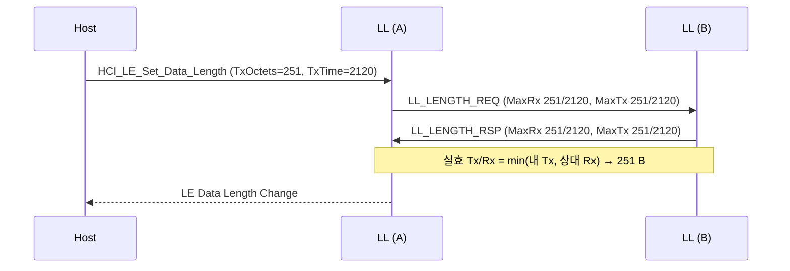

# 데이터 길이 확장 (DLE)

!!! spec "규격 · 버전"
    Core v6.0 Vol 6 Part B (Link Layer) — Data Length Update 절차, connMaxTxOctets/connMaxTxTime 등 데이터 길이 파라미터, Frame Space Update 절차 · Vol 4 Part E (HCI) `HCI_LE_Set_Data_Length`, `HCI_LE_Frame_Space_Update`
    Core 4.0–4.1 데이터 PDU 페이로드 최대 27 B → 4.2 LE Data Packet Length Extension(최대 251 B) → 5.0 Coded PHY와 시간 파라미터 결합 → 6.0 프레임 간격(T_IFS) 협상

!!! basic "한눈에 보기"
    LE 4.0/4.1의 데이터 패킷은 한 번에 **27 바이트**까지만 실을 수 있었습니다. 패킷마다 프리앰블·주소·헤더·CRC·T_IFS 같은 "포장비"가 붙으니, 작은 상자를 여러 번 나르는 셈이었습니다.

    4.2의 **DLE**는 상자를 **251 바이트**까지 키웁니다. 같은 포장비로 9배 넘게 싣게 되어 처리량이 크게 오릅니다. 다만 상자를 키울지는 연결마다 **양쪽이 합의**(`LL_LENGTH_REQ`/`RSP`)해야 하고, 느린 PHY에서는 "시간" 한도 때문에 작게 잘릴 수 있습니다.

## 네 개의 파라미터 { .l2 }

| 파라미터 | 의미 | 범위 | 기본값 |
|---|---|---|---|
| connMaxTxOctets | 내가 보낼 수 있는 최대 페이로드(MIC 제외) | 27 – 251 B | 27 |
| connMaxRxOctets | 내가 받을 수 있는 최대 페이로드 | 27 – 251 B | 27 |
| connMaxTxTime | 내가 보낼 한 패킷의 최대 airtime | 328 – 17040 µs | 328 |
| connMaxRxTime | 내가 받을 한 패킷의 최대 airtime | 328 – 17040 µs | 328 |

양쪽은 `LL_LENGTH_REQ`/`LL_LENGTH_RSP`에 자기 네 값을 담아 교환하고, 각 방향의 **실효값(connEffective…)**은 "내 Tx 한도"와 "상대 Rx 한도" 중 작은 값입니다. 바뀌면 Controller가 LE Data Length Change 이벤트로 Host에 알립니다.

## airtime과 처리량 { .l2 }

시간 한도 328 µs와 17040 µs는 각각 "1M에서 27 B + MIC"와 "Coded S8에서 251 B + MIC"의 airtime입니다(값은 `tools/bt_numbers.py` 출력).

| PHY | 27 B + MIC | 251 B + MIC | 응용 처리량 상한 (27 B PDU) | 응용 처리량 상한 (251 B PDU) |
|---|---|---|---|---|
| 1M | 328 µs | 2120 µs | 236.7 kbps | 790.9 kbps |
| 2M | 168 µs | 1064 µs | 322.6 kbps | 1402.3 kbps |
| Coded S=2 | 958 µs | 4542 µs | 96.6 kbps | 372.5 kbps |
| Coded S=8 | 2704 µs | 17040 µs | 46.1 kbps | 109.6 kbps |

1M에서 DLE만 켜도 상한이 약 3.3배(236.7 → 790.9 kbps), 2M을 더하면 약 5.9배가 됩니다. 실제 값은 연결 간격과 이벤트당 패킷 수, 상대 기기 버퍼에 따라 이보다 낮습니다 → [처리량 최적화](../host/throughput.md).

## PHY와 시간 한도의 관계 { .l2 }

옥텟 한도와 시간 한도는 **둘 다** 지켜야 합니다. 1M 기준으로 TxTime = 2120 µs를 잡아 둔 연결이 Coded S=8로 바뀌면 옥텟 한도(251)보다 시간 한도가 먼저 걸립니다.

S=8 패킷 airtime은 고정부 400 µs(프리앰블 80 + AA 256 + CI 16 + TERM1 24 + TERM2 24) + (헤더 2 + 페이로드 + MIC 4 + CRC 3) × 64 µs입니다(도구 값: 0 B = 720 µs, 27 B + MIC = 2704 µs와 일치).

\[
400 + (2 + n + 4 + 3) \times 64 \le 2120 \;\Rightarrow\; n \le 17
\]

즉 페이로드가 17 B로 줄어 오히려 DLE 이전보다 작아집니다. 이를 막기 위해 규격은 Coded PHY에서 실효 시간 한도가 **2704 µs 아래로 내려가지 않게** 해, 어떤 경우에도 27 B는 보장합니다. 같은 식에 2704를 넣으면 n ≤ 27입니다.

| 상황 | 결과 |
|---|---|
| 1M/2M, Time ≥ 옥텟에 맞는 시간 | 옥텟 한도가 결정 |
| PHY를 Coded로 변경, Time은 그대로 | 시간 한도가 결정 (최소 2704 µs 보장) |
| PHY 변경 후 | Controller가 실효값을 다시 계산해 LE Data Length Change 이벤트를 보낼 수 있음 |

??? expert "전문가 노트 — HCI 버퍼, 6.0 프레임 간격 갱신"
    **세 군데 크기가 맞아야 함.** 무선 PDU 길이(DLE), Controller ACL 버퍼 크기(`HCI_LE_Read_Buffer_Size`), L2CAP·ATT MTU가 따로 놉니다. ATT MTU 247이면 ATT 헤더 3 B + 데이터 244 B + L2CAP 헤더 4 B = 251 B로 한 PDU에 딱 맞습니다. 기본값은 `HCI_LE_Write_Suggested_Default_Data_Length`, 지원 최대값은 `HCI_LE_Read_Maximum_Data_Length`로 확인합니다.

    **6.0 Frame Space Update.** 6.0 이전 T_IFS는 150 µs로 고정이었습니다. 6.0은 ACL 연결용 3종과 CIS용 2종, 모두 5개의 프레임 간격 유형을 정의하고(각 기본값 150 µs) 연결 뒤 Central과 Peripheral이 더 짧거나 긴 값으로 협상할 수 있게 했습니다. 다른 전송 유형의 고정 150 µs는 T_IFS_150이라 부릅니다. Controller 사이에서는 `LL_FRAME_SPACE_REQ`/`LL_FRAME_SPACE_RSP`로 협상하고, Host는 `HCI_LE_Frame_Space_Update`(최소·최대 간격, PHY, 간격 유형 지정, HCI 범위 0–10000 µs)로 요청하고 결과는 LE Frame Space Update Complete 이벤트로 받습니다. 짧은 간격은 펌웨어 갱신·LE Audio처럼 이벤트 안에서 많이 주고받는 경우 처리량을, 긴 간격은 처리 능력이 낮은 저전력 Controller가 긴 패킷을 다룰 여유를 줍니다. 각 간격 유형의 기호 이름과 허용 범위는 규격 원문 확인이 필요합니다.

    **효율 예.** 1M 251 B + MIC 패킷 하나(2120 µs) + T_IFS 150 µs + 빈 응답(MIC 포함 112 µs) + T_IFS 150 µs = 2532 µs마다 251 B가 오가는 셈입니다. T_IFS를 줄이면 이 주기 중 2 × 150 µs가 직접 줄어듭니다.

## Classic ↔ LE 비교

| 항목 | Classic (BR/EDR) | LE |
|---|---|---|
| 패킷 크기 선택 | 패킷 유형(DH1/3/5, 2-DH5 …) | 페이로드 길이(27–251 B) |
| 협상 | LMP로 허용 패킷 유형 지정 | `LL_LENGTH_REQ`/`RSP` |
| 최대 처리량(대표) | DH5 723.2 kbps, 3-DH5 2178.1 kbps | 1M 790.9 kbps, 2M 1402.3 kbps |

## 관련 페이지
- [패킷 구조](packet.md) — 데이터 PDU 헤더와 길이 필드
- [LE PHY (1M·2M·Coded)](phy.md) — 심볼 속도와 코딩
- [LL 제어 절차](ll-control.md) — `LL_LENGTH_REQ`의 절차 규칙
- [처리량 최적화](../host/throughput.md) — DLE·PHY·연결 간격 조합
- [계산기](../reference/calculators.md) — airtime 계산
