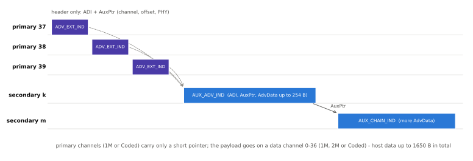

# 확장 광고

!!! spec "규격 · 버전"
    Core v6.0 Vol 6 Part B §2.3 (광고 채널 PDU, 확장 광고 공통 페이로드 형식) · Vol 4 Part E (HCI: `HCI_LE_Set_Extended_Advertising_*`)
    Core 5.0 도입 → 5.1 연결 없는 CTE(주기적 광고에 부착) → 5.3 주기적 광고에도 ADI → 5.4 광고 PHY 코딩 선택(V2 명령), 암호화된 광고 데이터 → 6.0 결정 기반 광고 필터링(`ADV_DECISION_IND`)

!!! basic "한눈에 보기"
    확장 광고는 "로비(광고 채널)에는 짧은 안내문만 붙이고, 본문은 다른 방(데이터 채널)에 두는" 방식입니다.

    1. 주 채널 37/38/39에는 `ADV_EXT_IND`가 나갑니다. 데이터는 없고 "본문은 몇 번 채널에서 몇 µs 뒤에, 어떤 PHY로"라는 **포인터(AuxPtr)**만 있습니다.
    2. 본문 `AUX_ADV_IND`는 데이터 채널 0–36 중 하나에서 한 번만 나갑니다.
    3. 더 길면 `AUX_CHAIN_IND`로 줄줄이 이어 붙여 호스트 데이터를 **최대 1650바이트**까지 보냅니다.
    4. 한 기기가 여러 **광고 세트**(예: 비컨 + 연결 가능 광고)를 서로 다른 간격·PHY로 동시에 돌릴 수 있습니다.

<figure markdown>

<figcaption>확장 광고. 주 채널의 ADV_EXT_IND 세 개가 모두 같은 보조 채널 패킷(AUX_ADV_IND)을 가리키고, 그 패킷의 AuxPtr가 다시 AUX_CHAIN_IND를 가리킵니다. 큰 데이터를 세 번 반복하지 않아 광고 채널 혼잡이 줄어듭니다.</figcaption>
</figure>

## 확장 광고 PDU { .l2 }

5.0은 새 PDU Type 하나(`0111`)를 여러 이름으로 씁니다. 어느 채널·어느 순서에서 받았는지로 이름이 갈립니다.

| PDU | 채널 | 역할 | 주요 헤더 필드 |
|---|---|---|---|
| `ADV_EXT_IND` | 주 (37/38/39) | 보조 패킷 포인터 | ADI, AuxPtr (AdvData 없음) |
| `AUX_ADV_IND` | 보조 (0–36) | 광고 본문 | AdvA, ADI, AuxPtr, SyncInfo, TxPower, ACAD + AdvData |
| `AUX_CHAIN_IND` | 보조 | 이어지는 조각 | ADI, AuxPtr + AdvData |
| `AUX_SCAN_REQ` / `AUX_SCAN_RSP` | 보조 | 스캔 요청·응답 (응답이 길면 체인) | |
| `AUX_CONNECT_REQ` / `AUX_CONNECT_RSP` | 보조 | 연결 요청과 확인 (2단계) | |
| `AUX_SYNC_IND` | 보조 | 주기적 광고 → [주기적 광고와 PAwR](periodic-advertising.md) | |

주 채널 PHY는 1M 또는 Coded, 보조 채널 PHY는 1M·2M·Coded 중에서 고릅니다(2M은 주 채널에 쓸 수 없음). 레거시 광고와 달리 한 세트는 **연결 가능**과 **스캔 가능** 중 하나만(또는 둘 다 아님) 될 수 있습니다.

## 확장 헤더와 AuxPtr { .l2 }

확장 PDU의 페이로드(최대 255 B)는 공통 형식을 따릅니다. 첫 바이트의 6비트 **Extended Header Length**와 2비트 **AdvMode**(비연결·비스캔 / 연결 가능 / 스캔 가능) 뒤에 플래그 바이트와 선택 필드가 옵니다.

| 필드 | 크기 | 내용 |
|---|---|---|
| AdvA | 6 B | 광고자 주소 |
| TargetA | 6 B | 대상 주소 (directed) |
| CTEInfo | 1 B | CTE 길이·종류 |
| **ADI** | 2 B | DID(12비트, 데이터 ID) + SID(4비트, 광고 세트 ID) |
| **AuxPtr** | 3 B | 다음 패킷의 채널 인덱스, 시간 오프셋, PHY |
| SyncInfo | 18 B | 주기적 광고 동기 정보 |
| TxPower | 1 B | 송신 출력 (경로 손실 계산용) |
| ACAD | 가변 | 추가 제어 데이터 (채널 맵 갱신, BIGInfo 등) |

**AuxPtr**는 채널 인덱스(6비트), 클럭 정확도(CA, 1비트), 오프셋 단위(30 µs 또는 300 µs, 1비트), AUX Offset(13비트), PHY(3비트)로 됩니다. 오프셋은 13비트 × 300 µs로 약 2.46 s까지 가리킬 수 있습니다. 같은 광고 체인 안의 연속 보조 패킷 사이에는 최소 간격 **T_MAFS**(300 µs)가 있습니다.

**ADI**는 스캐너의 중복 필터에 중요합니다. 광고자는 AdvData가 바뀔 때마다 DID를 바꾸므로, 스캐너는 SID·DID가 같은 `ADV_EXT_IND`를 받으면 보조 채널을 따라가지 않고 건너뛸 수 있습니다.

## 데이터 크기와 광고 세트 { .l2 }

| 항목 | 레거시 광고 | 확장 광고 |
|---|---|---|
| PDU당 AdvData | 31 B | 최대 254 B (확장 헤더가 없을 때) |
| 세트당 호스트 데이터 | 31 B (+ 스캔 응답 31 B) | 최대 1650 B (체인) |
| 광고 간격 | 20 ms – 10.24 s | 20 ms – 약 10,485 s (24비트, 0.625 ms 단위) |
| 동시 세트 | 1 | 컨트롤러 한도 (`HCI_LE_Read_Number_of_Supported_Advertising_Sets`) |
| 주 채널 점유 | 데이터 포함 PDU × 3 | 짧은 포인터 × 3 |

여러 세트는 `Advertising_Handle`(호스트 쪽 핸들)과 `Advertising_SID`(공중에서 보이는 4비트 ID)로 구분합니다. 예를 들어 Auracast 송신기는 한 세트로 방송 정보를 담은 확장 광고 + 주기적 광고를 돌리고, 다른 세트로 휴대폰 앱의 연결 가능 광고를 돌릴 수 있습니다.

HCI 명령은 세트 단위입니다.

| 명령 / 이벤트 | 하는 일 |
|---|---|
| `HCI_LE_Set_Extended_Advertising_Parameters` (5.4부터 V2) | 이벤트 속성, 간격, 주·보조 PHY, SID, 송신 출력, 스캔 요청 알림 |
| `HCI_LE_Set_Advertising_Set_Random_Address` | 세트별 랜덤 주소 |
| `HCI_LE_Set_Extended_Advertising_Data` | 데이터 (251 B씩 나눠 `Operation`으로 처음/중간/마지막 지정) |
| `HCI_LE_Set_Extended_Scan_Response_Data` | 스캔 응답 데이터 |
| `HCI_LE_Set_Extended_Advertising_Enable` | 여러 세트를 한 번에 켜고 끔, 세트별 `Duration`·`Max_Extended_Advertising_Events` |
| `HCI_LE_Read_Maximum_Advertising_Data_Length` | 컨트롤러가 받을 수 있는 최대 데이터 길이 (최대 1650) |
| `HCI_LE_Remove_Advertising_Set`, `HCI_LE_Clear_Advertising_Sets` | 세트 삭제 |
| `HCI_LE_Advertising_Set_Terminated` (이벤트) | 시간·횟수 만료 또는 연결로 세트 종료 |
| `HCI_LE_Scan_Request_Received` (이벤트) | 스캔 요청 수신 알림 |

??? expert "전문가 노트 — 긴 체인의 비용, 수신 측 부담, 버전별 확장"
    **체인은 신뢰성이 낮습니다.** 체인의 각 조각은 한 번씩만 보내므로 조각 하나라도 놓치면 스캐너는 데이터 전체를 버립니다(보고 이벤트의 `Data_Status`가 "불완전"). 1650 B를 1M PHY로 보내면 약 7개의 PDU(헤더 필드를 뺀 PDU당 데이터 약 240 B 기준)가 필요하고, 각 조각에서 패킷 손실 확률이 곱해집니다. 데이터는 체인 길이가 짧아지도록 꼭 필요한 만큼만 싣는 것이 좋습니다.

    **스캐너의 "주의 분산".** 스캐너가 `ADV_EXT_IND`를 받고 보조 채널로 따라가는 동안에는 주 채널을 듣지 못합니다. 6.0의 결정 기반 광고 필터링은 주 채널 PDU(`ADV_DECISION_IND`)에 판단용 데이터를 실어, 스캐너가 쓸모없는 보조 패킷을 따라가지 않게 합니다. → [스캔과 필터](scanning.md)

    **레거시 호환.** 4.x 스캐너는 `ADV_EXT_IND`를 이해하지 못합니다. 구형 휴대폰까지 발견되어야 하면 레거시 PDU 세트를 하나 더 돌립니다. 확장 광고 명령에서 이벤트 속성의 legacy 비트를 켜면 됩니다.

    **5.4 코딩 선택.** `HCI_LE_Set_Extended_Advertising_Parameters` V2의 `Primary_Advertising_PHY_Options`·`Secondary_Advertising_PHY_Options`로 Coded PHY의 S=2/S=8을 선호(0x01/0x02) 또는 필수(0x03/0x04)로 지정할 수 있습니다. 그 전에는 컨트롤러가 정했습니다.

    **암호화된 광고 데이터.** 5.4의 Encrypted Data AD Type으로 AdvData 일부를 암호화할 수 있습니다. 키는 GATT로 미리 공유합니다. → [암호화된 광고 데이터](../security/encrypted-ad.md)

## 관련 페이지
- [레거시 광고](legacy-advertising.md) — 4.0 방식과 PDU 7종
- [주기적 광고와 PAwR](periodic-advertising.md) — SyncInfo로 이어지는 주기적 광고
- [스캔과 필터](scanning.md) — 확장 스캔과 중복 필터
- [패킷 구조](packet.md) — 광고 PDU 헤더
- [Auracast 브로드캐스트](../audio/auracast.md) — 확장 + 주기적 광고 + BIG 활용
