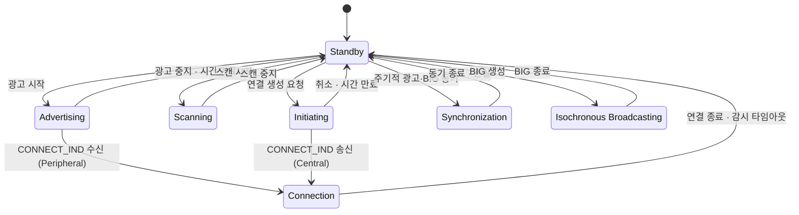

# 링크 계층 상태 기계

!!! spec "규격 · 버전"
    Core v6.0 Vol 6 Part B §1.1 (링크 계층 상태) · Vol 4 Part E (HCI: `HCI_LE_Read_Supported_States`)
    Core 4.0 다섯 상태 → 4.1 상태 동시 수행(다중 역할) → 5.0 Synchronization 상태 → 5.2 Isochronous Broadcasting 상태 → 5.3 용어 변경(master/slave → Central/Peripheral)

!!! basic "한눈에 보기"
    LE 링크 계층은 "지금 무엇을 하고 있는가"를 몇 가지 **상태**로 나눠 관리합니다.

    1. **Standby** — 아무것도 보내거나 받지 않는 대기
    2. **Advertising** — "나 여기 있어요"를 광고 채널에 외침
    3. **Scanning** — 광고를 엿들음
    4. **Initiating** — 특정 광고자를 기다렸다가 연결 요청을 보냄
    5. **Connection** — 연결된 상대와 정해진 시각마다 데이터를 주고받음
    6. **Synchronization** — 주기적 광고나 BIG에 시각을 맞춰 따라 들음
    7. **Isochronous Broadcasting** — BIG로 등시성 데이터를 방송함

    Classic이 "마스터/슬레이브" 두 역할 위주라면, LE는 이 상태들을 조합해 한 칩이 비컨·센트럴·페리페럴을 동시에 해낼 수 있습니다.

## 상태와 전이 { .l2 }

| 상태 | 하는 일 | 대표 HCI 명령 (진입) | 도입 |
|---|---|---|---|
| Standby | 무선 동작 없음 | (기본 상태) | 4.0 |
| Advertising | 광고 PDU 송신, `SCAN_REQ`·`CONNECT_IND`에 응답 | `HCI_LE_Set_Advertising_Enable`, `HCI_LE_Set_Extended_Advertising_Enable` | 4.0 |
| Scanning | 광고 PDU 수신, 능동 스캔이면 `SCAN_REQ` 송신 | `HCI_LE_Set_Scan_Enable`, `HCI_LE_Set_Extended_Scan_Enable` | 4.0 |
| Initiating | 연결 가능한 광고를 기다렸다가 `CONNECT_IND`(`AUX_CONNECT_REQ`) 송신 | `HCI_LE_Create_Connection`, `HCI_LE_Extended_Create_Connection` | 4.0 |
| Connection | 연결 이벤트마다 데이터 교환 (Central 또는 Peripheral 역할) | (Advertising/Initiating에서 전이) | 4.0 |
| Synchronization | 주기적 광고(`AUX_SYNC_IND`)나 BIG에 동기해 수신 | `HCI_LE_Periodic_Advertising_Create_Sync`, `HCI_LE_BIG_Create_Sync` | 5.0 / 5.2 |
| Isochronous Broadcasting | BIS 패킷 송신 | `HCI_LE_Create_BIG` | 5.2 |

5.0 이후 확장 광고에서는 `AUX_CONNECT_REQ`/`AUX_CONNECT_RSP` 교환이 끝나야 Connection 상태로 들어갑니다. 연결 이후의 역할 이름은 5.3에서 **Central**(연결을 시작한 쪽)과 **Peripheral**(광고하던 쪽)로 바뀌었습니다. 옛 문서와 스택 API의 master/slave와 같은 뜻입니다.

## Connection 상태 안의 역할 { .l2 }

| 항목 | Central | Peripheral |
|---|---|---|
| 들어오는 경로 | Initiating → Connection | Advertising → Connection |
| 연결 이벤트 시작 | 매 이벤트 첫 패킷을 송신 (시각의 기준) | Central 패킷을 듣고 T_IFS 뒤 응답 |
| 파라미터 결정 | 연결 간격·채널 맵을 결정, 갱신 절차 시작 | 선호값 요청 가능 (`LL_CONNECTION_PARAM_REQ`) |
| 슬립 | 자기 일정대로 | Peripheral latency만큼 이벤트를 건너뛸 수 있음 |
| 클럭 요구 | 자신의 SCA를 `CONNECT_IND`로 알림 | 창 넓힘(window widening)으로 상대 오차 흡수 |

세부 타이밍은 [연결 수립](connection.md)과 [연결 이벤트와 파라미터](connection-events.md)에서 다룹니다.

## 다중 상태 조합 { .l2 }

링크 계층은 여러 **상태 기계 인스턴스**를 동시에 돌릴 수 있습니다. 예를 들어 스마트워치는 휴대폰과 연결(Peripheral)을 유지하면서 광고를 계속하고, 동시에 심박 센서와 연결(Central)할 수 있습니다. 4.0에서는 연결 중 다른 상태 조합이 크게 제한되었고, 4.1부터 Central과 Peripheral 역할 동시 수행 같은 조합이 허용되었습니다.

| 조합 예 | 쓰임 | 비고 |
|---|---|---|
| Connection(Peripheral) + Advertising | 연결 중에도 다른 기기에 발견됨 | 가장 흔한 조합 |
| Connection(Central) + Scanning | 휴대폰이 연결 유지하며 주변 기기 탐색 | 스캔 듀티가 연결 이벤트와 시간 경쟁 |
| Connection(Central) + Connection(Peripheral) | 중계기, 게이트웨이 | 4.1부터 |
| Scanning + Synchronization | Auracast 수신기가 방송 찾기 + 동기 유지 | 5.0 / 5.2 |
| Advertising(여러 세트) + Isochronous Broadcasting | Auracast 송신기 | 확장·주기적 광고 + BIG |

컨트롤러가 어떤 조합을 지원하는지는 `HCI_LE_Read_Supported_States`가 돌려주는 64비트 비트맵으로 확인합니다. 비트마다 "Scannable Advertising + Central" 같은 조합 하나가 대응합니다.

??? expert "전문가 노트 — 스케줄러, 상태 비트맵의 한계, 6.0 이후"
    **상태 조합은 시간 나누기입니다.** 무선은 하나뿐이므로 여러 상태를 동시에 한다는 것은 컨트롤러 스케줄러가 시간을 쪼갠다는 뜻입니다. 연결 이벤트, 광고 이벤트, 스캔 윈도, BIG 이벤트가 겹치면 우선순위에 따라 일부를 건너뜁니다. 연결 수가 늘면 스캔 윈도가 잘게 끊겨 발견이 느려지고, 광고 간격도 실제로는 설정값보다 들쑥날쑥해집니다. 규격은 우선순위 규칙을 정하지 않으므로 칩마다 다릅니다.

    **비트맵만 믿지 말 것.** `HCI_LE_Read_Supported_States`는 두 상태의 조합만 표현합니다. "연결 4개 + 확장 광고 2세트 + 스캔"처럼 셋 이상의 조합 가능 여부는 알 수 없고, 실제 한도는 메모리와 스케줄러 설계(예: 최대 연결 수, 광고 세트 수 `HCI_LE_Read_Number_of_Supported_Advertising_Sets`)가 정합니다.

    **Standby를 거치지 않는 경우.** Advertising에서 연결 요청을 받거나 Initiating에서 연결을 만들면 Standby를 거치지 않고 바로 Connection으로 갑니다. 반면 연결이 끊긴 뒤 자동으로 다시 광고하는 동작은 링크 계층이 아니라 호스트가 다시 광고를 켜는 것입니다(일부 컨트롤러는 설정 옵션으로 제공).

    **Channel Sounding은 상태가 아닙니다.** 6.0의 Channel Sounding은 Connection 상태 안에서 동작하는 절차이며 별도 링크 계층 상태를 추가하지 않습니다. → [Channel Sounding](channel-sounding.md)

## Classic ↔ LE 비교

| 항목 | Classic (BR/EDR) | LE |
|---|---|---|
| 발견 | Inquiry / Inquiry Scan | Advertising / Scanning |
| 연결 시작 | Page / Page Scan | Initiating / Advertising |
| 연결 중 저전력 | Sniff, Hold, Sniff Subrating | 연결 간격·Peripheral latency·서브레이팅 |
| 역할 | 피코넷 Central(최대 7 활성 Peripheral) | 연결마다 Central/Peripheral, 수는 구현 한도 |
| 연결 없는 방송 | CSB (Connectionless Slave Broadcast, 4.1) | 광고, 주기적 광고, BIS |

## 관련 페이지
- [레거시 광고](legacy-advertising.md) — Advertising 상태의 4.0 방식
- [스캔과 필터](scanning.md) — Scanning 상태
- [연결 수립](connection.md) — Initiating → Connection
- [주기적 광고와 PAwR](periodic-advertising.md) — Synchronization 상태
- [등시성 채널 (CIS·BIS)](iso.md) — Isochronous Broadcasting 상태
