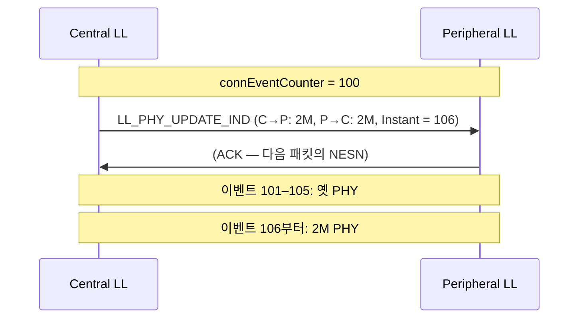

# LL 제어 절차

!!! spec "규격 · 버전"
    Core v6.0 Vol 6 Part B (Link Layer) — LL Control PDU 형식과 Link Layer 제어 절차 · Vol 4 Part E (HCI) 오류 코드
    Core 4.0 기본 절차(갱신·채널 맵·암호화·기능·버전·종료) → 4.1 파라미터 요청·Ping → 4.2 데이터 길이 → 5.0 PHY 갱신 → 5.1 CTE·PAST → 5.2 CIS·전력 제어 → 5.3 서브레이팅·채널 분류 → 6.0 LL 확장 기능 집합·Channel Sounding·프레임 간격 → 6.2 연결 속도

!!! basic "한눈에 보기"
    연결된 두 링크 계층은 사용자 데이터 외에 **"관리용 쪽지"**를 주고받습니다. 이것이 LL 제어 PDU입니다.

    - 데이터 PDU 헤더의 `LLID` = 0b11이면 제어 PDU, 첫 바이트가 **opcode**
    - "너 뭐 할 수 있어?"(기능 교환), "패킷 크게 쓰자"(DLE), "2M로 바꾸자"(PHY), "암호화 시작"(ENC), "그만 끊자"(TERMINATE) 같은 대화가 모두 여기에 속함
    - 타이밍을 양쪽이 동시에 바꿔야 하는 절차는 **instant**(미래의 이벤트 번호)를 정해 그 순간 함께 바꿈
    - 상대가 40초 안에 답하지 않으면 링크를 끊음

## 주요 LL 제어 PDU { .l2 }

| Opcode | PDU | 방향 | 도입 | 용도 |
|---|---|---|---|---|
| 0x00 | `LL_CONNECTION_UPDATE_IND` | C→P | 4.0 | 연결 파라미터 변경 (instant) |
| 0x01 | `LL_CHANNEL_MAP_IND` | C→P | 4.0 | 채널 맵 변경 (instant) |
| 0x02 | `LL_TERMINATE_IND` | 양쪽 | 4.0 | 연결 종료 + 오류 코드 |
| 0x03 / 0x04 | `LL_ENC_REQ` / `LL_ENC_RSP` | C→P / P→C | 4.0 | 세션 키 재료(SKD, IV) 교환 |
| 0x05 / 0x06 | `LL_START_ENC_REQ` / `LL_START_ENC_RSP` | P→C / 양쪽 | 4.0 | 암호화 시작 3-way 확인 |
| 0x07 | `LL_UNKNOWN_RSP` | 양쪽 | 4.0 | 모르는 opcode에 대한 응답 |
| 0x08 / 0x09 | `LL_FEATURE_REQ` / `LL_FEATURE_RSP` | C→P / P→C | 4.0 | 64비트 기능 집합 교환 |
| 0x0A / 0x0B | `LL_PAUSE_ENC_REQ` / `RSP` | | 4.0 | 키 교체 전 암호화 일시 중지 |
| 0x0C | `LL_VERSION_IND` | 양쪽 | 4.0 | Core 버전·제조사·서브버전 |
| 0x0D / 0x11 | `LL_REJECT_IND` / `LL_REJECT_EXT_IND` | 양쪽 | 4.0 / 4.1 | 거절 (EXT는 거절할 opcode 포함) |
| 0x0E | `LL_PERIPHERAL_FEATURE_REQ` | P→C | 4.1 | Peripheral이 먼저 기능 교환 |
| 0x0F / 0x10 | `LL_CONNECTION_PARAM_REQ` / `RSP` | 양쪽 | 4.1 | 연결 파라미터 범위 협상 |
| 0x12 / 0x13 | `LL_PING_REQ` / `RSP` | 양쪽 | 4.1 | 인증된 페이로드 타임아웃 확인 |
| 0x14 / 0x15 | `LL_LENGTH_REQ` / `RSP` | 양쪽 | 4.2 | 최대 페이로드 길이·시간 |
| 0x16 / 0x17 / 0x18 | `LL_PHY_REQ` / `LL_PHY_RSP` / `LL_PHY_UPDATE_IND` | 양쪽 / 양쪽 / C→P | 5.0 | PHY 변경 (instant) |
| 0x19 | `LL_MIN_USED_CHANNELS_IND` | P→C | 5.0 | 최소 사용 채널 수 요구 |
| 0x1A / 0x1B | `LL_CTE_REQ` / `RSP` | 양쪽 | 5.1 | 방향 탐지용 CTE 요청 |
| 0x1C | `LL_PERIODIC_SYNC_IND` | 양쪽 | 5.1 | 주기적 광고 동기 정보 전달(PAST) |
| 0x1D / 0x1E | `LL_CLOCK_ACCURACY_REQ` / `RSP` | 양쪽 | 5.1 | SCA 갱신 |
| 0x1F–0x22 | `LL_CIS_REQ` / `RSP` / `IND`, `LL_CIS_TERMINATE_IND` | | 5.2 | CIS 생성·종료 |
| 0x23–0x25 | `LL_POWER_CONTROL_REQ` / `RSP`, `LL_POWER_CHANGE_IND` | 양쪽 | 5.2 | 전력 제어 |
| 0x26 / 0x27 | `LL_SUBRATE_REQ` / `LL_SUBRATE_IND` | P→C / C→P | 5.3 | 연결 서브레이팅 |
| 0x28 / 0x29 | `LL_CHANNEL_REPORTING_IND` / `LL_CHANNEL_STATUS_IND` | C→P / P→C | 5.3 | 채널 분류 보고 |
| — | `LL_FEATURE_EXT_REQ` / `RSP` | 양쪽 | 6.0 | 확장 기능 집합 페이지 교환 |
| — | `LL_FRAME_SPACE_REQ` / `RSP` | 양쪽 | 6.0 | 프레임 간격(T_IFS 등) 협상 |
| — | `LL_CS_SEC_REQ`/`RSP`, `LL_CS_CAPABILITIES_REQ`/`RSP`, `LL_CS_CONFIG_REQ`/`RSP`, `LL_CS_FAE_REQ`/`RSP`, `LL_CS_REQ`/`RSP`/`IND`, `LL_CS_TERMINATE_REQ`/`RSP`, `LL_CS_CHANNEL_MAP_IND` | 양쪽 | 6.0 | Channel Sounding 준비·시작·종료 |
| — | `LL_CONNECTION_RATE_REQ` / `IND` | P→C / C→P | 6.2 | 짧은 연결 간격 |

6.0 이후 PDU의 opcode 값은 규격 원문을 확인하십시오.

## 절차 규칙 { .l2 }

| 규칙 | 내용 |
|---|---|
| 응답 타임아웃 | 절차를 시작한 쪽은 응답을 **40 s** 안에 받지 못하면 연결 종료 (`0x22` LL Response Timeout) |
| 동시 진행 | 한 방향으로 진행 중인 절차는 하나. 상대가 시작한 절차에는 응답하면서 자기 절차를 시작할 수는 있음 |
| instant 절차 충돌 | instant를 쓰는 절차(연결 갱신·채널 맵·PHY·…)는 동시에 둘 이상 진행 불가 → 나중 쪽 거절 `0x2A` (Different Transaction Collision) |
| 같은 절차 충돌 | 양쪽이 동시에 같은 절차를 시작하면 **Central 우선**, Peripheral 절차는 `0x23` (LL Procedure Collision)으로 거절 |
| 모르는 PDU | `LL_UNKNOWN_RSP`, 지원 안 하는 파라미터는 `LL_REJECT_EXT_IND` + `0x1A` (Unsupported Remote Feature) 등 |
| 암호화 중 | 암호화 시작·일시 중지 절차 동안에는 허용되는 PDU가 제한됨 |

## instant { .l2 }

**instant**는 16비트 연결 이벤트 카운터 값입니다. Central이 "이벤트 N부터 새 설정"을 PDU에 담아 보내면, 양쪽은 각자 카운터가 N이 되는 이벤트에서 동시에 전환합니다.

| 상황 | 결과 |
|---|---|
| instant 전에 PDU 수신 | 정상: instant에 전환 |
| instant가 지난 뒤 수신 (카운터 차이가 32767 이하로 "과거") | 링크 종료 `0x28` (Instant Passed) |
| Peripheral이 Latency로 잠든 사이 | Central은 Latency를 감안해 충분히 먼 instant를 고름 |

??? expert "전문가 노트 — 연결 직후 순서, 6.0 확장 기능 집합, 종료 코드"
    **연결 직후 흔한 순서.** `LL_VERSION_IND` 교환 → `LL_FEATURE_REQ`/`RSP` → `LL_LENGTH_REQ`/`RSP` → `LL_PHY_REQ`/`RSP`/`LL_PHY_UPDATE_IND` → (본딩되어 있으면) `LL_ENC_REQ` … 순서는 규정이 아니고 스택마다 다릅니다. 기능 교환 결과는 Controller가 캐시하므로 Host가 `HCI_LE_Read_Remote_Features`를 다시 불러도 무선으로 다시 묻지 않을 수 있습니다.

    **암호화 시작.** C→P `LL_ENC_REQ`(Rand, EDIV, SKDm, IVm) → P→C `LL_ENC_RSP`(SKDs, IVs) → Peripheral Host가 LTK 제공 → P→C `LL_START_ENC_REQ`(평문) → C→P `LL_START_ENC_RSP`(암호문) → P→C `LL_START_ENC_RSP`(암호문). 세션 키 SK = AES(LTK, SKD) → [LE 페어링과 본딩](../security/le-pairing.md).

    **LL Extended Feature Set (6.0).** 기존 64비트 FeatureSet이 바닥나자, 페이지 단위로 확장했습니다. 페이지 0은 기존 64비트, 페이지 1–10은 각 24옥텟(192비트)으로 최대 1984비트를 표현합니다. 지원 여부는 FeatureSet의 비트 63으로 알리고, `LL_FEATURE_EXT_REQ`/`RSP`가 MaxPage·PageNumber·FeaturePage를 나릅니다. HCI는 `HCI_LE_Read_All_Local_Supported_Features`, `HCI_LE_Read_All_Remote_Features`, 이벤트 LE Read All Remote Features Complete입니다.

    **종료 코드.** `LL_TERMINATE_IND`의 오류 코드는 HCI Disconnection Complete로 그대로 올라옵니다. 자주 보는 값: `0x13` Remote User Terminated, `0x08` Connection Timeout, `0x22` LL Response Timeout, `0x3D` Connection Terminated due to MIC Failure, `0x3E` Connection Failed to be Established. 로그 분석은 [로그 분석](../practice/logs.md) 참조.

## Classic ↔ LE 비교

| 항목 | Classic (BR/EDR) | LE |
|---|---|---|
| 관리 프로토콜 | LMP (별도 계층, [링크 관리자](../classic/lmp.md)) | LL 제어 PDU (링크 계층 안) |
| 응답 타임아웃 | LMP 응답 30 s | 40 s |
| 동시 변경 시점 | 슬롯 번호 기준 instant | 연결 이벤트 카운터 instant |
| 기능 집합 | LMP feature 페이지 0–2 | 64비트 → 6.0 확장 페이지 |

## 관련 페이지
- [연결 수립](connection.md) — 제어 절차가 시작되기 전 단계
- [연결 이벤트와 파라미터](connection-events.md) — 갱신·서브레이팅 절차
- [데이터 길이 확장 (DLE)](data-length.md) — `LL_LENGTH_REQ`
- [LE PHY (1M·2M·Coded)](phy.md) — PHY 갱신 대상
- [HCI 명령과 이벤트](../practice/hci.md) — 절차를 일으키는 HCI 명령
